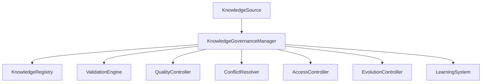
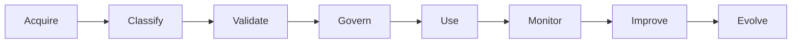

# RFC-0050

**Title:** Knowledge Governance System

**Document ID:** RFC-0050

**Version:** 1.0

**Status:** Accepted

**Category:** Platform

**Layer:** Knowledge / Governance / Intelligence

**Target:**

```text
knowledge/governance_manager/
```

---

# Abstract

This RFC defines the SH-3 Knowledge Governance System.

The Knowledge Governance System provides the unified control framework responsible for managing the lifecycle, quality, authority, consistency, accessibility, and evolution of knowledge within SH-3.

The system governs:

- semantic knowledge
- procedural knowledge
- episodic knowledge
- operational knowledge
- architectural knowledge
- learning knowledge
- evolutionary knowledge

The system enables:

- knowledge ownership
- knowledge validation
- knowledge quality control
- knowledge conflict resolution
- knowledge lifecycle management
- knowledge evolution governance

The Knowledge Governance System integrates with:

- Knowledge System
- Memory System
- Documentation Management System
- Learning System
- Self Evolution System
- Quality Management System
- Security System
- Policy Management System
- Audit Management System
- Compliance Management System

This document is normative.

---

# Motivation

An autonomous intelligence system continuously acquires, modifies, and generates knowledge.

Without knowledge governance:

- incorrect knowledge may spread
- outdated information may remain active
- conflicting knowledge may confuse reasoning
- learning results may reduce reliability
- autonomous evolution may lose consistency

The Knowledge Governance System ensures that SH-3 knowledge remains reliable and controlled.

---

# Goals

The Knowledge Governance System SHALL provide:

- knowledge authority management
- knowledge quality assurance
- knowledge lifecycle control
- conflict resolution
- controlled knowledge evolution
- explainable knowledge usage

---

# Non-Goals

The Knowledge Governance System SHALL NOT:

- replace Knowledge System storage
- replace Memory System retrieval
- generate all knowledge itself
- define learning algorithms
- replace Security System

Knowledge Governance controls knowledge usage.

---

# Architecture



The Knowledge Governance System transforms raw knowledge into trusted intelligence resources.

---

# Design Principles

The Knowledge Governance System follows these principles.

---

## Trust Before Usage

Knowledge SHOULD be validated before high-impact usage.

---

## Provenance Tracking

Knowledge origin SHALL be recorded.

---

## Quality Preservation

Knowledge quality SHALL be measurable.

---

## Conflict Resolution

Contradictory knowledge SHALL be managed.

---

## Controlled Evolution

Knowledge updates SHALL be traceable.

---

## Explainable Knowledge

Knowledge decisions SHALL be understandable.

---

# Knowledge Governance Components

The system consists of:

| Component | Responsibility |
|-----------|----------------|
| KnowledgeGovernanceManager | Coordination |
| KnowledgeRegistry | Knowledge metadata |
| ValidationEngine | Verification |
| QualityController | Quality management |
| ConflictResolver | Contradiction handling |
| AccessController | Permission control |
| LifecycleManager | Knowledge lifecycle |
| EvolutionController | Knowledge updates |
| LearningAdapter | Improvement |

---

# KnowledgeGovernanceManager

KnowledgeGovernanceManager coordinates knowledge control.

Responsibilities:

- knowledge registration
- validation management
- quality monitoring
- conflict handling
- evolution coordination

The manager does not replace knowledge storage.

---

# Knowledge Context

Every governance operation receives an immutable KnowledgeContext.

A KnowledgeContext contains:

| Field | Description |
|--------|-------------|
| knowledge_id | Knowledge identifier |
| source | Origin |
| authority | Trust level |
| timestamp | Creation time |
| version | Knowledge version |

---

# Knowledge Model

A Knowledge object contains:

| Field | Description |
|------|-------------|
| knowledge_id | Identifier |
| content | Information |
| category | Type |
| source | Origin |
| confidence | Reliability |
| status | Lifecycle state |

---

# Knowledge Categories

Supported categories:

| Type | Purpose |
|------|---------|
| Semantic | Concepts |
| Procedural | Methods |
| Episodic | Experiences |
| Operational | Runtime knowledge |
| Architectural | System design |
| Learning | Improvement knowledge |
| Evolution | Self-change knowledge |

---

# Knowledge Lifecycle

Every knowledge item follows:

```text
Created

↓

Evaluated

↓

Validated

↓

Active

↓

Updated

↓

Deprecated

↓

Archived
```

---

# Knowledge States

Supported states:

| State | Meaning |
|------|---------|
| Candidate | New knowledge |
| Reviewing | Validation |
| Trusted | Approved |
| Active | Usable |
| Deprecated | Old |
| Archived | Stored |

---

# Knowledge Registry

KnowledgeRegistry stores:

- knowledge metadata
- provenance
- confidence
- validation history
- relationships

---

# Knowledge Provenance

Every knowledge item SHALL record:

- source
- creation time
- transformation history
- validation history
- usage history

---

# Knowledge Validation

ValidationEngine verifies:

- correctness
- consistency
- source reliability
- contextual relevance

---

# Validation Model

```text
Knowledge

+

Evidence

+

Context

↓

Trust Evaluation
```

---

# Knowledge Quality Control

QualityController evaluates:

- accuracy
- freshness
- usefulness
- consistency

---

# Quality Score

Example:

```text
Knowledge Quality

=

Accuracy

+

Reliability

+

Freshness

+

Usage Success
```

---

# Knowledge Conflict Resolution

ConflictResolver manages:

- contradictions
- duplicate information
- outdated knowledge
- competing hypotheses

---

# Conflict Resolution Flow

```text
Conflict Detection

↓

Compare Evidence

↓

Evaluate Confidence

↓

Select Resolution

↓

Update Knowledge State
```

---

# Memory Integration

Memory System provides:

- episodic knowledge
- historical context
- usage patterns

---

# Documentation Integration

Documentation Management provides:

- architecture knowledge
- operational knowledge
- design history

---

# Learning Integration

Learning System provides:

- discovered patterns
- improved knowledge
- causal relationships

---

# Self Evolution Integration

Self Evolution provides:

- generated knowledge
- capability changes
- adaptation results

---

# Security Integration

Security System controls:

- access
- protection
- sensitive knowledge handling

---

# Knowledge Governance Execution Model

The Knowledge Governance System transforms acquired information into controlled, trusted, and continuously improving intelligence resources.

The knowledge governance lifecycle follows:



Each stage maintains a clear architectural responsibility.

---

# Knowledge Governance Control Loop

The Knowledge Governance System operates through continuous knowledge assurance.

```text
Knowledge Acquisition

↓

Validation

↓

Quality Evaluation

↓

Authorization

↓

Knowledge Usage

↓

Feedback Collection

↓

Knowledge Improvement
```

---

# Knowledge Access Governance

Knowledge usage SHALL be controlled according to:

- authority level
- confidence score
- context
- risk level
- access policy

---

# Access Decision Model

```text
Request

↓

Knowledge Evaluation

↓

Permission Check

↓

Risk Assessment

↓

Access Decision
```

---

# Knowledge Authority Levels

| Level | Description |
|------|-------------|
| L0 | Unverified knowledge |
| L1 | Candidate knowledge |
| L2 | Reviewed knowledge |
| L3 | Trusted knowledge |
| L4 | Core system knowledge |

---

# Knowledge Ranking

Knowledge ranking determines preferred information during reasoning.

Ranking factors:

- confidence
- freshness
- source reliability
- validation history
- usage success

---

# Ranking Model

```text
Knowledge Score

=

Confidence

+

Reliability

+

Freshness

+

Historical Success
```

---

# Knowledge Update Control

Knowledge updates require controlled transitions.

Update flow:

```text
New Information

↓

Difference Analysis

↓

Impact Evaluation

↓

Validation

↓

Knowledge Revision

↓

Activation
```

---

# Update Types

| Type | Description |
|------|-------------|
| Addition | New knowledge |
| Correction | Error fixing |
| Expansion | Detail increase |
| Merge | Knowledge integration |
| Deprecation | Removal of obsolete data |

---

# Knowledge Conflict Resolution Advanced

ConflictResolver evaluates:

- evidence quality
- temporal relevance
- source authority
- consistency with world model

---

# Conflict Resolution Strategy

```text
Conflict

↓

Collect Evidence

↓

Compare Reliability

↓

Generate Resolution

↓

Record Decision
```

---

# Knowledge Evolution Process

Knowledge evolves through:

```text
Observation

↓

Experience

↓

Learning

↓

Validation

↓

Knowledge Update

↓

Future Reasoning
```

---

# Knowledge Evolution Rules

Knowledge evolution SHALL:

- preserve history
- maintain provenance
- support rollback
- record reasoning

---

# Knowledge Learning Loop

Learning System improves governance through feedback.

Learning targets:

- validation accuracy
- ranking quality
- conflict handling
- update timing

---

# Learning Pipeline

```text
Knowledge Usage

↓

Outcome Analysis

↓

Quality Feedback

↓

Governance Improvement

↓

Better Knowledge Control
```

---

# Autonomous Knowledge Management

SH-3 MAY manage knowledge autonomously.

Capabilities:

- automatic classification
- validation suggestion
- duplicate detection
- knowledge consolidation
- obsolete knowledge detection

---

# Autonomous Knowledge Requirements

Required:

- confidence estimation
- validation mechanism
- provenance tracking
- rollback capability

---

# Knowledge Safety Boundary

High-impact knowledge changes require:

```text
Knowledge Proposal

↓

Validation

↓

Risk Evaluation

↓

Governance Approval

↓

Activation
```

---

# Knowledge Impact Levels

| Level | Handling |
|------|----------|
| Low | Automatic update |
| Medium | Validation required |
| High | Governance approval required |
| Critical | Multi-layer verification |

---

# World Model Integration

World Model uses governed knowledge for:

- prediction
- simulation
- causal reasoning

---

# Planning Integration

PlanningCore uses governed knowledge for:

- goal evaluation
- strategy selection
- future prediction

---

# Reasoning Integration

Reasoning systems use governed knowledge for:

- inference
- explanation
- decision support

---

# Memory Integration

Memory systems use governance results for:

- retention priority
- retrieval ranking
- forgetting strategy

---

# Quality Integration

Quality Management evaluates:

- knowledge reliability
- governance effectiveness
- update accuracy

---

# Documentation Integration

Documentation Management receives:

- knowledge changes
- validation results
- governance history

---

# Audit Integration

Audit Management records:

- knowledge access
- updates
- approvals
- conflicts

---

# Compliance Integration

Compliance Management verifies:

- knowledge policies
- governance rules
- traceability requirements

---

# Message Bus Integration

Knowledge governance events include:

- KnowledgeRegistered
- KnowledgeValidated
- KnowledgeUpdated
- KnowledgeConflictDetected
- KnowledgeApproved
- KnowledgeDeprecated

---

# Persistence Integration

Persistence stores:

- knowledge metadata
- authority levels
- validation records
- governance history

---

# Observability Integration

Knowledge telemetry includes:

- knowledge quality
- validation rate
- conflict frequency
- update frequency

---

# Tracing

Knowledge traces preserve:

- trace_id
- knowledge_id
- validation_id
- update_id
- access_id

---

# Thread Model

The Knowledge Governance System supports concurrent:

- validation
- ranking
- access evaluation
- update processing

Knowledge state transitions SHALL be synchronized.

The reference implementation shall be thread-safe.

---

# Metrics

The Knowledge Governance System exposes:

- total knowledge items
- trusted knowledge ratio
- validation success rate
- conflict resolution rate
- knowledge freshness
- update accuracy
- governance latency

---

# Performance Objectives

The Knowledge Governance System should optimize for:

- reliable knowledge usage
- fast validation
- accurate ranking
- safe evolution
- transparent knowledge management

---

# Future Work

Potential future enhancements include:

- autonomous knowledge councils
- AI-based knowledge verification
- predictive knowledge maintenance
- self-organizing knowledge networks
- fully autonomous knowledge governance

These enhancements extend SH-3 toward a self-maintaining intelligence architecture while preserving reliability and traceability.

---

# References

- SH-3 Architecture Specification v2.1
- RFC-0022 Knowledge System
- RFC-0023 World Model System
- RFC-0024 Cognitive Architecture System
- RFC-0026 Self Evolution System
- RFC-0027 Autonomous Learning System
- RFC-0029 Self-Healing System
- RFC-0047 Quality Management System
- RFC-0048 Testing Management System
- RFC-0049 Documentation Management System

---

# End of RFC-0050
