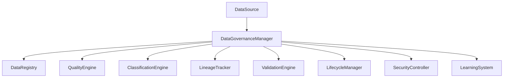
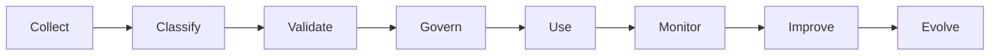

# RFC-0051

**Title:** Data Governance System

**Document ID:** RFC-0051

**Version:** 1.0

**Status:** Accepted

**Category:** Platform

**Layer:** Data / Governance / Intelligence

**Target:**

```text
data/governance_manager/
```

---

# Abstract

This RFC defines the SH-3 Data Governance System.

The Data Governance System provides the unified control framework responsible for managing the lifecycle, quality, security, provenance, and evolution of all data processed by SH-3.

The system governs:

- operational data
- memory data
- learning data
- model data
- knowledge data
- telemetry data
- audit data
- experimental data

The system enables:

- data ownership
- data classification
- data quality management
- data validation
- data lineage tracking
- data lifecycle control
- data evolution governance

The Data Governance System integrates with:

- Memory System
- Knowledge System
- Knowledge Governance System
- Documentation Management System
- Learning System
- Model Management System
- Security System
- Privacy System
- Quality Management System
- Audit Management System
- Compliance Management System

This document is normative.

---

# Motivation

An autonomous intelligence system continuously generates, consumes, transforms, and stores data.

SH-3 data includes:

- experiences
- observations
- reasoning traces
- training information
- model states
- operational events

Without data governance:

- corrupted data may propagate
- outdated data may influence decisions
- learning quality may degrade
- data origin may become unknown
- autonomous evolution may become unstable

The Data Governance System ensures that SH-3 data remains reliable, traceable, and usable.

---

# Goals

The Data Governance System SHALL provide:

- centralized data control
- data quality assurance
- lineage tracking
- lifecycle management
- secure data handling
- autonomous data improvement

---

# Non-Goals

The Data Governance System SHALL NOT:

- replace databases
- replace Memory System
- replace Knowledge System
- perform all data processing
- define model architectures

Data Governance controls data reliability.

---

# Architecture



The Data Governance System transforms raw data into trusted data assets.

---

# Design Principles

The Data Governance System follows these principles.

---

## Data Trust

Data SHALL have measurable reliability.

---

## Data Traceability

Data origin and transformation SHALL be recorded.

---

## Data Quality

Low-quality data SHALL be detected and controlled.

---

## Data Security

Data access SHALL follow security policies.

---

## Data Lifecycle Control

Data SHALL have controlled states.

---

## Evolution Compatibility

Data governance SHALL adapt with SH-3 evolution.

---

# Data Governance Components

The system consists of:

| Component | Responsibility |
|-----------|----------------|
| DataGovernanceManager | Coordination |
| DataRegistry | Data metadata |
| QualityEngine | Quality evaluation |
| ClassificationEngine | Data classification |
| LineageTracker | Origin tracking |
| ValidationEngine | Verification |
| LifecycleManager | Data lifecycle |
| RetentionManager | Storage policy |
| SecurityController | Protection |
| LearningAdapter | Improvement |

---

# DataGovernanceManager

DataGovernanceManager coordinates data governance operations.

Responsibilities:

- data registration
- quality control
- lifecycle management
- lineage tracking
- governance decisions

The manager does not replace data storage systems.

---

# Data Context

Every governance operation receives an immutable DataContext.

A DataContext contains:

| Field | Description |
|------|-------------|
| data_id | Data identifier |
| source | Origin |
| category | Data type |
| timestamp | Creation time |
| version | Data version |

---

# Data Asset Model

A DataAsset contains:

| Field | Description |
|------|-------------|
| data_id | Identifier |
| type | Data category |
| source | Origin |
| quality | Quality score |
| status | Lifecycle state |
| owner | Responsible system |

---

# Data Categories

Supported categories:

| Type | Purpose |
|------|---------|
| Memory | Experience storage |
| Knowledge | Structured knowledge |
| Learning | Training information |
| Model | Parameters and states |
| Runtime | Operational information |
| Telemetry | Observation data |
| Audit | Governance records |
| Experimental | Research data |

---

# Data Lifecycle

Every data asset follows:

```text
Created

↓

Classified

↓

Validated

↓

Active

↓

Processed

↓

Archived

↓

Deleted
```

---

# Data States

Supported states:

| State | Meaning |
|------|---------|
| Incoming | Newly received |
| Validating | Quality check |
| Approved | Trusted |
| Active | Available |
| Archived | Historical |
| Retained | Protected |
| Deleted | Removed |

---

# Data Registry

DataRegistry stores:

- data metadata
- ownership
- quality information
- lineage
- lifecycle state

---

# Data Classification

ClassificationEngine determines:

- data type
- sensitivity
- importance
- retention requirement

---

# Classification Model

```text
Data Input

↓

Analysis

↓

Category Assignment

↓

Policy Application
```

---

# Data Quality Management

QualityEngine evaluates:

- accuracy
- completeness
- consistency
- freshness
- usability

---

# Data Quality Score

Example:

```text
Data Quality

=

Accuracy

+

Completeness

+

Consistency

+

Freshness
```

---

# Data Validation

ValidationEngine verifies:

- schema correctness
- value consistency
- source reliability
- processing integrity

---

# Data Lineage

LineageTracker records:

- origin
- transformations
- consumers
- derived data

---

# Lineage Model

```text
Source Data

↓

Transformation

↓

Derived Data

↓

Usage

↓

Result
```

---

# Memory Integration

Memory System provides:

- episodic data
- working data
- retrieval history

---

# Knowledge Integration

Knowledge System provides:

- semantic relationships
- structured information

---

# Learning Integration

Learning System provides:

- training datasets
- feedback data
- improvement results

---

# Model Integration

Model Management provides:

- model versions
- parameter data
- evaluation information

---

# Security Integration

Security System controls:

- access
- encryption
- protection policies

---

# Data Governance Execution Model

The Data Governance System transforms raw system data into reliable, secure, traceable, and continuously improving data assets.

The data governance lifecycle follows:



Each stage maintains a clear architectural responsibility.

---

# Data Governance Control Loop

The Data Governance System operates through continuous data assurance.

```text
Data Creation

↓

Classification

↓

Quality Evaluation

↓

Validation

↓

Authorized Usage

↓

Monitoring

↓

Improvement

↓

Future Data Reliability
```

---

# Data Quality Automation

QualityEngine provides automated quality evaluation.

Quality checks include:

- schema validation
- anomaly detection
- consistency analysis
- duplication detection
- freshness evaluation

---

# Data Quality Pipeline

```text
Incoming Data

↓

Validation Rules

↓

Quality Analysis

↓

Quality Score

↓

Acceptance Decision
```

---

# Data Quality Rules

Rules may evaluate:

| Rule | Purpose |
|------|---------|
| Accuracy | Correctness |
| Completeness | Missing information |
| Consistency | Agreement |
| Freshness | Timeliness |
| Integrity | Preservation |

---

# Data Lineage Advanced

LineageTracker maintains complete data history.

Tracked information:

- original source
- transformations
- derived assets
- consuming systems
- final results

---

# Lineage Graph

```text
Input

↓

Processing

↓

Knowledge

↓

Decision

↓

Outcome
```

---

# Data Impact Analysis

Lineage enables:

- change impact analysis
- error tracing
- data dependency analysis
- recovery planning

---

# Data Retention Strategy

RetentionManager controls data lifetime.

Retention factors:

- importance
- usage frequency
- regulatory requirements
- storage cost
- learning value

---

# Retention Lifecycle

```text
Active Data

↓

Low Usage

↓

Archive Candidate

↓

Archive

↓

Deletion Evaluation
```

---

# Data Retention Policies

| Priority | Handling |
|---------|----------|
| Critical | Permanent retention |
| Important | Long-term storage |
| Normal | Managed retention |
| Temporary | Short retention |

---

# Data Security Governance

SecurityController manages:

- access control
- encryption requirements
- isolation
- protection level

---

# Data Protection Flow

```text
Access Request

↓

Identity Verification

↓

Policy Evaluation

↓

Permission Decision

↓

Data Access
```

---

# Data Privacy Control

Privacy management handles:

- sensitive information
- anonymization
- minimization
- controlled access

---

# Privacy Model

```text
Data Collection

↓

Classification

↓

Protection Policy

↓

Controlled Usage
```

---

# Data Evolution Process

Data evolves through:

```text
Observation

↓

Collection

↓

Transformation

↓

Validation

↓

Integration

↓

Improvement
```

---

# Data Evolution Rules

Data evolution SHALL:

- preserve lineage
- maintain versions
- support rollback
- record transformations

---

# Autonomous Data Management

SH-3 MAY manage data autonomously.

Capabilities:

- automatic classification
- quality monitoring
- duplicate removal
- retention optimization
- data relationship discovery

---

# Autonomous Data Requirements

Required:

- quality evaluation
- lineage tracking
- rollback support
- security validation

---

# Data Learning Loop

Learning System improves data governance.

Learning targets:

- quality prediction
- retention optimization
- anomaly detection
- data importance estimation

---

# Learning Pipeline

```text
Data History

↓

Usage Analysis

↓

Quality Feedback

↓

Governance Improvement

↓

Better Data Management
```

---

# Memory Integration

Memory uses governance results for:

- importance calculation
- retention decisions
- forgetting strategy
- retrieval ranking

---

# Knowledge Integration

Knowledge System uses governed data for:

- reliable knowledge construction
- semantic relationships
- reasoning support

---

# World Model Integration

World Model uses validated data for:

- simulation
- prediction
- causal analysis

---

# Learning System Integration

Learning System uses governed data for:

- training
- evaluation
- improvement loops

---

# Quality Integration

Quality Management evaluates:

- data reliability
- governance effectiveness
- quality trends

---

# Testing Integration

Testing Management validates:

- data pipelines
- validation rules
- transformation processes

---

# Audit Integration

Audit Management records:

- data access
- transformations
- policy decisions
- lifecycle events

---

# Compliance Integration

Compliance Management verifies:

- retention rules
- protection requirements
- governance policies

---

# Message Bus Integration

Data governance events include:

- DataRegistered
- DataClassified
- DataValidated
- DataQualityChanged
- DataArchived
- DataDeleted
- DataGovernanceImproved

---

# Persistence Integration

Persistence stores:

- metadata
- lineage records
- quality history
- lifecycle history

---

# Observability Integration

Data telemetry includes:

- quality score
- data volume
- validation failures
- lineage depth
- retention status

---

# Tracing

Data traces preserve:

- trace_id
- data_id
- transformation_id
- validation_id
- access_id

---

# Thread Model

The Data Governance System supports concurrent:

- validation
- classification
- lineage tracking
- quality analysis

Data state transitions SHALL be synchronized.

The reference implementation shall be thread-safe.

---

# Metrics

The Data Governance System exposes:

- total data assets
- validated data ratio
- quality score
- lineage coverage
- retention efficiency
- anomaly detection rate
- governance latency

---

# Performance Objectives

The Data Governance System should optimize for:

- reliable data usage
- efficient validation
- complete traceability
- secure operation
- autonomous data improvement

---

# Future Work

Potential future enhancements include:

- AI-based data quality prediction
- autonomous data repair
- self-optimizing storage policies
- predictive data lifecycle management
- fully autonomous data governance

These enhancements extend SH-3 toward a self-managing intelligence platform while maintaining reliability, security, and traceability.

---

# References

- SH-3 Architecture Specification v2.1
- RFC-0022 Knowledge System
- RFC-0023 World Model System
- RFC-0026 Self Evolution System
- RFC-0027 Autonomous Learning System
- RFC-0029 Self-Healing System
- RFC-0047 Quality Management System
- RFC-0048 Testing Management System
- RFC-0049 Documentation Management System
- RFC-0050 Knowledge Governance System

---

# End of RFC-0051
