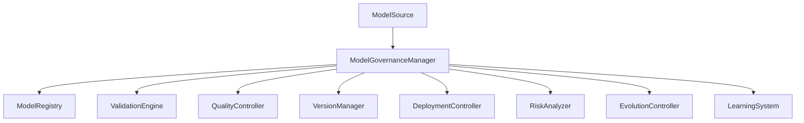
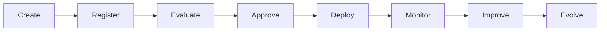

# RFC-0052

**Title:** Model Governance System

**Document ID:** RFC-0052

**Version:** 1.0

**Status:** Accepted

**Category:** Platform

**Layer:** Model / Governance / Intelligence

**Target:**

```text
model/governance_manager/
```

---

# Abstract

This RFC defines the SH-3 Model Governance System.

The Model Governance System provides the unified control framework responsible for managing the lifecycle, quality, security, validation, deployment, and evolution of all AI models used within SH-3.

The system governs:

- language models
- reasoning models
- planning models
- prediction models
- evaluation models
- reward models
- embedding models
- optimization models

The system enables:

- model ownership
- model registration
- model validation
- model quality management
- model version control
- model deployment governance
- model evolution control

The Model Governance System integrates with:

- Learning System
- Self Evolution System
- Optimization System
- Deployment System
- Testing Management System
- Quality Management System
- Data Governance System
- Security System
- Risk Management System
- Audit Management System
- Compliance Management System

This document is normative.

---

# Motivation

SH-3 continuously improves through model updates and learning.

Models influence:

- reasoning
- planning
- prediction
- decision making
- autonomous behavior

Without model governance:

- degraded models may be deployed
- model lineage may be lost
- unsafe updates may occur
- evaluation becomes inconsistent
- evolution becomes uncontrollable

The Model Governance System ensures reliable model evolution.

---

# Goals

The Model Governance System SHALL provide:

- centralized model control
- lifecycle management
- validation framework
- quality assurance
- deployment safety
- evolutionary model management

---

# Non-Goals

The Model Governance System SHALL NOT:

- train all models
- replace Learning System
- replace Deployment System
- define model architectures
- directly modify model parameters

Model Governance controls model reliability.

---

# Architecture



The Model Governance System transforms models into controlled intelligence assets.

---

# Design Principles

The Model Governance System follows these principles.

---

## Model Reliability

Models SHALL be measurable and validated.

---

## Version Control

All model states SHALL be recoverable.

---

## Evaluation Before Deployment

Models SHALL be evaluated before use.

---

## Traceable Evolution

Model changes SHALL preserve history.

---

## Risk Awareness

High-impact models SHALL receive additional validation.

---

## Continuous Improvement

Governance quality SHALL improve through feedback.

---

# Model Governance Components

The system consists of:

| Component | Responsibility |
|-----------|----------------|
| ModelGovernanceManager | Coordination |
| ModelRegistry | Model metadata |
| ValidationEngine | Verification |
| QualityController | Quality evaluation |
| VersionManager | History |
| DeploymentController | Release control |
| RiskAnalyzer | Risk evaluation |
| EvolutionController | Model updates |
| LearningAdapter | Improvement |

---

# ModelGovernanceManager

ModelGovernanceManager coordinates model governance.

Responsibilities:

- model registration
- lifecycle control
- validation scheduling
- deployment approval
- evolution monitoring

The manager does not train models.

---

# Model Context

Every governance operation receives an immutable ModelContext.

A ModelContext contains:

| Field | Description |
|------|-------------|
| model_id | Model identifier |
| version | Model version |
| type | Model category |
| source | Origin |
| timestamp | Creation time |

---

# Model Asset Model

A ModelAsset contains:

| Field | Description |
|------|-------------|
| model_id | Identifier |
| type | Model category |
| version | Current version |
| quality | Quality score |
| status | Lifecycle state |
| owner | Responsible system |

---

# Model Categories

Supported categories:

| Type | Purpose |
|------|---------|
| Language | Text generation |
| Reasoning | Inference |
| Planning | Strategy generation |
| Prediction | Future estimation |
| Evaluation | Quality assessment |
| Reward | Learning feedback |
| Embedding | Representation |
| Optimization | Parameter improvement |

---

# Model Lifecycle

Every model follows:

```text
Created

↓

Registered

↓

Validated

↓

Approved

↓

Deployed

↓

Monitored

↓

Updated

↓

Retired
```

---

# Model States

Supported states:

| State | Meaning |
|------|---------|
| Candidate | New model |
| Testing | Evaluation |
| Approved | Ready |
| Production | Active |
| Deprecated | Old |
| Retired | Removed |

---

# Model Registry

ModelRegistry stores:

- model metadata
- versions
- evaluation results
- deployment history
- lineage information

---

# Model Lineage

Model lineage records:

- training data
- training process
- parent model
- modifications
- evaluation results

---

# Model Validation

ValidationEngine verifies:

- accuracy
- robustness
- safety
- consistency
- resource requirements

---

# Validation Model

```text
Model

+

Dataset

+

Evaluation Rules

↓

Validation Result
```

---

# Model Quality Control

QualityController evaluates:

- capability
- reliability
- stability
- efficiency

---

# Model Quality Score

Example:

```text
Model Quality

=

Accuracy

+

Reliability

+

Safety

+

Efficiency
```

---

# Model Version Management

VersionManager controls:

- version creation
- comparison
- rollback
- historical preservation

---

# Deployment Governance

DeploymentController controls:

- deployment approval
- rollout strategy
- rollback capability

---

# Data Integration

Data Governance provides:

- training data quality
- dataset lineage
- validation information

---

# Learning Integration

Learning System provides:

- training results
- improvement candidates
- evaluation feedback

---

# Evolution Integration

Self Evolution provides:

- model improvement proposals
- adaptation results
- capability changes

---

# Security Integration

Security System controls:

- model access
- integrity protection
- execution permissions

---

# Model Governance Execution Model

The Model Governance System transforms AI models into controlled, validated, traceable, and continuously improving intelligence assets.

The model governance lifecycle follows:



Each stage maintains a clear architectural responsibility.

---

# Model Governance Control Loop

The Model Governance System operates through continuous model assurance.

```text
Model Creation

↓

Registration

↓

Validation

↓

Quality Evaluation

↓

Deployment Decision

↓

Runtime Monitoring

↓

Feedback Collection

↓

Model Improvement
```

---

# Model Evaluation Pipeline

ValidationEngine provides standardized model evaluation.

Evaluation stages:

- functional evaluation
- capability evaluation
- safety evaluation
- performance evaluation
- regression evaluation

---

# Evaluation Flow

```text
Model Candidate

↓

Evaluation Dataset

↓

Execution

↓

Measurement

↓

Quality Report

↓

Governance Decision
```

---

# Model Evaluation Types

| Type | Purpose |
|------|---------|
| Accuracy | Capability measurement |
| Robustness | Stability verification |
| Safety | Risk prevention |
| Performance | Resource evaluation |
| Regression | Previous capability protection |

---

# Model Risk Management

RiskAnalyzer evaluates model impact.

Risk factors:

- decision influence
- autonomy level
- failure probability
- deployment scope
- resource requirements

---

# Risk Assessment Model

```text
Model Change

↓

Impact Analysis

↓

Risk Evaluation

↓

Risk Level

↓

Governance Action
```

---

# Model Risk Levels

| Level | Handling |
|------|----------|
| Low | Automatic approval |
| Medium | Additional testing |
| High | Manual review |
| Critical | Restricted deployment |

---

# Model Deployment Safety

DeploymentController ensures safe model activation.

Deployment strategies:

- staged rollout
- shadow execution
- A/B evaluation
- rollback deployment

---

# Deployment Flow

```text
Approved Model

↓

Deployment Preparation

↓

Safety Check

↓

Limited Activation

↓

Monitoring

↓

Full Deployment
```

---

# Rollback Capability

Every deployed model SHALL support:

- previous version restoration
- state recovery
- failure isolation
- deployment cancellation

---

# Model Monitoring

Runtime monitoring observes:

- output quality
- latency
- resource usage
- behavioral changes
- failure patterns

---

# Monitoring Flow

```text
Production Model

↓

Observation

↓

Analysis

↓

Deviation Detection

↓

Correction
```

---

# Model Drift Detection

Model drift detection identifies:

- performance degradation
- data distribution changes
- behavior changes
- capability loss

---

# Drift Detection Model

```text
Current Behavior

vs

Expected Behavior

↓

Difference Analysis

↓

Drift Score
```

---

# Drift Response

When drift occurs:

```text
Drift Detected

↓

Analyze Cause

↓

Retrain

or

Rollback

or

Restrict Usage
```

---

# Model Evolution Control

EvolutionController manages model improvements.

Evolution process:

```text
Improvement Proposal

↓

Simulation

↓

Evaluation

↓

Risk Analysis

↓

Validation

↓

Activation
```

---

# Model Evolution Rules

Model evolution SHALL:

- preserve previous versions
- maintain lineage
- pass validation
- support rollback
- record decisions

---

# Autonomous Model Management

SH-3 MAY manage models autonomously.

Capabilities:

- model selection
- evaluation scheduling
- performance optimization
- version management
- retirement decisions

---

# Autonomous Model Requirements

Required:

- evaluation reliability
- risk assessment
- rollback support
- governance traceability

---

# Model Learning Loop

Learning System improves governance.

Learning targets:

- evaluation efficiency
- deployment safety
- drift detection
- model selection

---

# Learning Pipeline

```text
Model History

↓

Performance Analysis

↓

Governance Feedback

↓

Process Improvement

↓

Better Model Management
```

---

# Memory Integration

Memory stores:

- model history
- evaluation results
- deployment experiences
- failure patterns

---

# Knowledge Integration

Knowledge System stores:

- model behavior knowledge
- evaluation knowledge
- improvement strategies

---

# World Model Integration

World Model evaluates:

- predicted model impact
- future capability changes
- behavior consequences

---

# Planning Integration

PlanningCore uses model governance information for:

- strategy selection
- capability assessment
- resource planning

---

# Quality Integration

Quality Management evaluates:

- model reliability
- validation effectiveness
- governance quality

---

# Testing Integration

Testing Management validates:

- model interfaces
- model behavior
- regression conditions

---

# Risk Integration

Risk Management receives:

- model impact information
- failure probability
- deployment risk

---

# Audit Integration

Audit Management records:

- model versions
- evaluation decisions
- deployment actions
- evolution history

---

# Compliance Integration

Compliance Management verifies:

- model policies
- governance requirements
- traceability rules

---

# Message Bus Integration

Model governance events include:

- ModelRegistered
- ModelValidated
- ModelApproved
- ModelDeployed
- ModelDriftDetected
- ModelUpdated
- ModelRetired

---

# Persistence Integration

Persistence stores:

- model metadata
- versions
- evaluation reports
- deployment records

---

# Observability Integration

Model telemetry includes:

- quality score
- latency
- resource usage
- drift score
- failure rate

---

# Tracing

Model traces preserve:

- trace_id
- model_id
- version_id
- evaluation_id
- deployment_id

---

# Thread Model

The Model Governance System supports concurrent:

- evaluation
- monitoring
- deployment checks
- version management

Model state transitions SHALL be synchronized.

The reference implementation shall be thread-safe.

---

# Metrics

The Model Governance System exposes:

- registered models
- active models
- validation success rate
- deployment success rate
- rollback frequency
- drift detection rate
- model improvement rate

---

# Performance Objectives

The Model Governance System should optimize for:

- safe model evolution
- reliable deployment
- fast evaluation
- accurate monitoring
- continuous improvement

---

# Future Work

Potential future enhancements include:

- autonomous model review committees
- predictive model degradation detection
- self-optimizing model governance
- formal model verification
- fully autonomous model lifecycle management

These enhancements extend SH-3 toward a self-managing intelligence platform while maintaining safety, transparency, and controllability.

---

# References

- SH-3 Architecture Specification v2.1
- RFC-0026 Self Evolution System
- RFC-0027 Autonomous Learning System
- RFC-0028 Optimizer System
- RFC-0031 Deployment System
- RFC-0043 Risk Management System
- RFC-0047 Quality Management System
- RFC-0048 Testing Management System
- RFC-0051 Data Governance System

---

# End of RFC-0052
