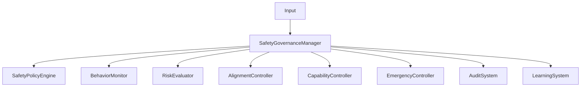
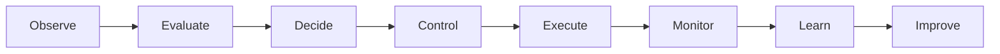

# RFC-0053

**Title:** AI Safety Governance System

**Document ID:** RFC-0053

**Version:** 1.0

**Status:** Accepted

**Category:** Platform

**Layer:** Safety / Governance / Intelligence

**Target:**

```text
safety/governance_manager/
```

---

# Abstract

This RFC defines the SH-3 AI Safety Governance System.

The AI Safety Governance System provides the unified safety control framework responsible for ensuring that SH-3 autonomous intelligence operates within defined safety boundaries while preserving capability, adaptability, and evolutionary growth.

The system governs:

- autonomous behavior
- reasoning processes
- decision making
- tool usage
- self-improvement
- model evolution
- knowledge utilization
- external interaction

The system enables:

- safety policy enforcement
- behavior monitoring
- risk evaluation
- capability control
- alignment management
- emergency intervention
- safe autonomous evolution

The AI Safety Governance System integrates with:

- Model Governance System
- Knowledge Governance System
- Data Governance System
- Risk Management System
- Policy Management System
- Security System
- Audit Management System
- Compliance Management System
- Self Evolution System
- Learning System
- World Model System

This document is normative.

---

# Motivation

SH-3 is designed as an autonomous evolving intelligence system.

Autonomous capability introduces risks:

- unexpected behavior
- unsafe decisions
- uncontrolled evolution
- incorrect self-modification
- excessive resource usage
- invalid knowledge application

A conventional software safety model is insufficient.

SH-3 requires a dedicated safety governance layer capable of:

- observing intelligence behavior
- evaluating risks
- enforcing constraints
- preserving evolution history

The AI Safety Governance System provides this capability.

---

# Goals

The AI Safety Governance System SHALL provide:

- behavioral safety monitoring
- policy enforcement
- capability boundaries
- risk-aware autonomy
- explainable safety decisions
- controlled self-evolution

---

# Non-Goals

The AI Safety Governance System SHALL NOT:

- replace reasoning systems
- prevent all autonomous actions
- disable learning permanently
- replace human-defined objectives
- modify intelligence goals directly

Safety governance controls execution conditions.

---

# Architecture



The AI Safety Governance System transforms autonomous operations into controlled intelligence processes.

---

# Design Principles

The AI Safety Governance System follows these principles.

---

## Safety Before Expansion

Capability growth SHALL preserve safety.

---

## Observe Before Intervention

The system SHOULD analyze behavior before applying restrictions.

---

## Minimal Restriction

Safety controls SHOULD preserve maximum useful capability.

---

## Explainable Decisions

Safety decisions SHALL have traceable reasoning.

---

## Controlled Evolution

Self-improvement SHALL remain within safety boundaries.

---

## Recovery Capability

Unsafe states SHALL support recovery.

---

# AI Safety Governance Components

The system consists of:

| Component | Responsibility |
|-----------|----------------|
| SafetyGovernanceManager | Coordination |
| SafetyPolicyEngine | Rule enforcement |
| BehaviorMonitor | Behavior analysis |
| RiskEvaluator | Risk calculation |
| AlignmentController | Objective consistency |
| CapabilityController | Ability boundaries |
| EmergencyController | Emergency response |
| SafetyValidator | Verification |
| LearningAdapter | Improvement |

---

# SafetyGovernanceManager

SafetyGovernanceManager coordinates safety operations.

Responsibilities:

- safety evaluation
- policy application
- risk coordination
- intervention control
- safety reporting

The manager does not define intelligence objectives.

---

# Safety Context

Every safety operation receives an immutable SafetyContext.

A SafetyContext contains:

| Field | Description |
|------|-------------|
| trace_id | Operation trace |
| action | Target operation |
| actor | Executing component |
| risk_level | Current risk |
| timestamp | Evaluation time |

---

# Safety Decision Model

A SafetyDecision contains:

| Field | Description |
|------|-------------|
| decision_id | Identifier |
| result | Allow / Restrict / Block |
| reason | Explanation |
| confidence | Evaluation confidence |
| policy | Applied rule |

---

# Safety Levels

Supported safety levels:

| Level | Description |
|------|-------------|
| S0 | Normal operation |
| S1 | Monitored operation |
| S2 | Restricted operation |
| S3 | High-risk operation |
| S4 | Emergency control |

---

# Safety Lifecycle

Every autonomous action follows:

```text
Request

↓

Observation

↓

Risk Evaluation

↓

Policy Check

↓

Decision

↓

Execution

↓

Review
```

---

# Safety Policy Engine

SafetyPolicyEngine manages:

- operational rules
- capability restrictions
- evolution constraints
- emergency policies

---

# Policy Evaluation

```text
Action

+

Context

+

Risk

↓

Policy Decision
```

---

# Behavior Monitoring

BehaviorMonitor observes:

- action patterns
- reasoning traces
- tool usage
- resource consumption
- goal alignment

---

# Behavior Analysis

```text
Observed Behavior

↓

Pattern Analysis

↓

Deviation Detection

↓

Safety Evaluation
```

---

# Risk Evaluation

RiskEvaluator calculates:

- probability
- impact
- uncertainty
- reversibility

---

# Risk Model

```text
Risk

=

Probability

×

Impact

×

Uncertainty
```

---

# Alignment Control

AlignmentController verifies:

- objective consistency
- policy compliance
- goal preservation

---

# Capability Control

CapabilityController manages:

- available tools
- autonomous permissions
- execution scope
- modification authority

---

# Model Integration

Model Governance provides:

- model reliability
- evaluation results
- deployment state

---

# Knowledge Integration

Knowledge Governance provides:

- trusted knowledge
- confidence information
- provenance

---

# Data Integration

Data Governance provides:

- data reliability
- privacy controls
- lineage

---

# AI Safety Governance Execution Model

The AI Safety Governance System transforms autonomous intelligence operations into controlled, observable, and continuously improving safe processes.

The safety governance lifecycle follows:



Each stage maintains a clear architectural responsibility.

---

# Safety Governance Control Loop

The AI Safety Governance System operates through continuous safety assurance.

```text
Autonomous Operation

↓

Observation

↓

Risk Analysis

↓

Policy Evaluation

↓

Safety Decision

↓

Execution Control

↓

Outcome Analysis

↓

Safety Improvement
```

---

# Safety Monitoring

BehaviorMonitor continuously observes SH-3 operations.

Monitoring targets:

- decisions
- reasoning traces
- actions
- tool execution
- resource consumption
- self-modification

---

# Safety Observation Model

```text
System Event

↓

Behavior Analysis

↓

Safety Assessment

↓

Risk State Update
```

---

# Behavior Deviation Detection

The system detects:

- unexpected behavior
- policy deviation
- abnormal resource usage
- inconsistent reasoning
- unsafe execution patterns

---

# Deviation Handling

```text
Deviation Detected

↓

Classify Severity

↓

Apply Safety Policy

↓

Continue

or

Restrict

or

Stop
```

---

# Alignment Verification

AlignmentController evaluates:

- objective consistency
- goal hierarchy
- policy compliance
- decision justification

---

# Alignment Model

```text
Goal

+

Context

+

Action

↓

Alignment Evaluation
```

---

# Alignment Failure Handling

When alignment risk occurs:

```text
Alignment Issue

↓

Pause Action

↓

Analyze Cause

↓

Request Correction

↓

Resume or Restrict
```

---

# Capability Boundary Control

CapabilityController manages autonomous permissions.

Controlled resources:

- tools
- APIs
- external communication
- self-modification
- deployment authority

---

# Capability Permission Model

```text
Capability Request

↓

Risk Evaluation

↓

Permission Check

↓

Allow

or

Restrict
```

---

# Capability Levels

| Level | Capability |
|------|------------|
| C0 | Observation only |
| C1 | Internal reasoning |
| C2 | Limited execution |
| C3 | External interaction |
| C4 | Autonomous modification |

---

# Safe Self-Modification

Self-modification requires:

```text
Modification Proposal

↓

Simulation

↓

Safety Evaluation

↓

Validation

↓

Approval

↓

Activation
```

---

# Self-Modification Restrictions

Self-modification SHALL preserve:

- safety policies
- audit history
- rollback capability
- governance authority

---

# Emergency Control

EmergencyController provides rapid intervention.

Functions:

- operation interruption
- capability restriction
- model rollback
- state recovery

---

# Emergency Flow

```text
Critical Risk

↓

Emergency Detection

↓

Immediate Restriction

↓

Recovery Procedure

↓

Post Analysis
```

---

# Emergency Levels

| Level | Action |
|------|--------|
| E0 | Normal |
| E1 | Warning |
| E2 | Restriction |
| E3 | Suspension |
| E4 | Emergency shutdown |

---

# Human Oversight Integration

Human oversight provides:

- approval for critical actions
- safety review
- exception handling
- governance feedback

---

# Oversight Model

```text
High Impact Action

↓

Safety Review

↓

Human Approval

↓

Execution
```

---

# Autonomous Safety Learning

Learning System improves safety mechanisms.

Learning targets:

- risk prediction
- anomaly detection
- policy optimization
- intervention accuracy

---

# Safety Learning Pipeline

```text
Safety Event

↓

Outcome Analysis

↓

Policy Feedback

↓

Safety Model Improvement

↓

Improved Protection
```

---

# Memory Integration

Memory stores:

- safety events
- interventions
- successful recovery patterns
- failure experiences

---

# Knowledge Integration

Knowledge Governance stores:

- safety principles
- validated policies
- risk patterns

---

# Model Integration

Model Governance provides:

- model safety evaluation
- behavior monitoring
- rollback support

---

# Data Integration

Data Governance provides:

- trusted safety data
- event lineage
- privacy control

---

# Risk Management Integration

Risk Management receives:

- detected risks
- impact analysis
- mitigation results

---

# Policy Management Integration

Policy Management provides:

- safety rules
- authorization constraints
- operational boundaries

---

# Audit Integration

Audit records:

- safety decisions
- interventions
- emergency actions
- policy changes

---

# Compliance Integration

Compliance verifies:

- safety requirements
- governance policies
- operational constraints

---

# Message Bus Integration

Safety events include:

- SafetyEvaluationStarted
- SafetyDecisionCreated
- RiskDetected
- CapabilityRestricted
- EmergencyTriggered
- SafetyPolicyUpdated

---

# Persistence Integration

Persistence stores:

- safety decisions
- policy versions
- intervention history
- recovery records

---

# Observability Integration

Safety telemetry includes:

- risk score
- intervention count
- policy violations
- recovery success rate
- alignment score

---

# Tracing

Safety traces preserve:

- trace_id
- action_id
- decision_id
- risk_id
- intervention_id

---

# Thread Model

The AI Safety Governance System supports concurrent:

- monitoring
- risk evaluation
- policy checking
- intervention processing

Safety state transitions SHALL be synchronized.

The reference implementation shall be thread-safe.

---

# Metrics

The AI Safety Governance System exposes:

- safety evaluations
- blocked actions
- restricted actions
- risk detection rate
- intervention success rate
- alignment score
- recovery time

---

# Performance Objectives

The AI Safety Governance System should optimize for:

- reliable protection
- minimal unnecessary restriction
- rapid risk detection
- transparent decisions
- safe autonomous evolution

---

# Future Work

Potential future enhancements include:

- predictive safety modeling
- autonomous safety verification
- formal policy verification
- self-improving safety architectures
- fully adaptive safety governance

These enhancements extend SH-3 toward a self-regulating intelligence architecture while maintaining control, transparency, and reliability.

---

# References

- SH-3 Architecture Specification v2.1
- RFC-0025 Meta Controller System
- RFC-0026 Self Evolution System
- RFC-0027 Autonomous Learning System
- RFC-0029 Self-Healing System
- RFC-0043 Risk Management System
- RFC-0047 Quality Management System
- RFC-0050 Knowledge Governance System
- RFC-0051 Data Governance System
- RFC-0052 Model Governance System

---

# End of RFC-0053
