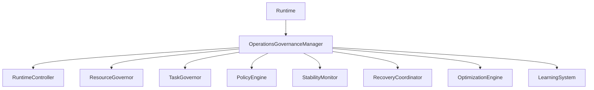

# RFC-0054

**Title:** Autonomous Operations Governance System

**Document ID:** RFC-0054

**Version:** 1.0

**Status:** Accepted

**Category:** Platform

**Layer:** Operations / Governance / Autonomy

**Target:**

```text
operations/governance_manager/
```

---

# Abstract

This RFC defines the SH-3 Autonomous Operations Governance System.

The Autonomous Operations Governance System provides the unified operational control framework responsible for maintaining stable, reliable, and continuously optimized autonomous operation of SH-3.

The system governs:

- runtime operations
- autonomous task execution
- resource utilization
- scheduling decisions
- operational policies
- service availability
- recovery operations
- long-term stability

The system enables:

- autonomous operation control
- runtime governance
- resource governance
- operational decision management
- stability monitoring
- autonomous recovery coordination

The Autonomous Operations Governance System integrates with:

- Scheduler System
- Runtime System
- Resource Management System
- Self-Healing System
- Observability System
- Security System
- Policy Management System
- Risk Management System
- Deployment System
- Learning System
- Self Evolution System

This document is normative.

---

# Motivation

SH-3 is designed to operate autonomously over long periods.

Long-term autonomous operation requires:

- stable execution
- controlled resource usage
- operational awareness
- failure recovery
- continuous optimization

Without operational governance:

- resources may be exhausted
- tasks may conflict
- recovery may fail
- autonomous behavior may degrade
- system stability may decline

The Autonomous Operations Governance System provides operational intelligence control.

---

# Goals

The Autonomous Operations Governance System SHALL provide:

- runtime stability
- operational policy enforcement
- resource optimization
- autonomous recovery coordination
- operational transparency
- continuous improvement

---

# Non-Goals

The Autonomous Operations Governance System SHALL NOT:

- replace Runtime System
- replace Scheduler System
- replace Self-Healing System
- make application-level decisions
- define intelligence objectives

Operational governance controls execution stability.

---

# Architecture



The Autonomous Operations Governance System transforms runtime activity into controlled autonomous operations.

---

# Design Principles

The Autonomous Operations Governance System follows these principles.

---

## Stability First

Operations SHALL prioritize system stability.

---

## Controlled Autonomy

Autonomous decisions SHALL follow operational policies.

---

## Resource Awareness

Resources SHALL be managed dynamically.

---

## Continuous Observation

Operational state SHALL remain observable.

---

## Recovery Readiness

Failures SHALL have recovery paths.

---

## Evolution Compatibility

Operations SHALL improve through learning.

---

# Autonomous Operations Governance Components

The system consists of:

| Component | Responsibility |
|-----------|----------------|
| OperationsGovernanceManager | Coordination |
| RuntimeController | Runtime control |
| ResourceGovernor | Resource management |
| TaskGovernor | Execution governance |
| PolicyEngine | Rule enforcement |
| StabilityMonitor | Health monitoring |
| RecoveryCoordinator | Recovery control |
| OptimizationEngine | Improvement |
| LearningAdapter | Adaptation |

---

# OperationsGovernanceManager

OperationsGovernanceManager coordinates autonomous operation control.

Responsibilities:

- operational evaluation
- policy enforcement
- resource coordination
- stability management
- optimization scheduling

The manager does not execute application tasks.

---

# Operation Context

Every operational decision receives an immutable OperationContext.

An OperationContext contains:

| Field | Description |
|------|-------------|
| operation_id | Operation identifier |
| component | Target component |
| priority | Execution priority |
| resource_state | Resource status |
| timestamp | Evaluation time |

---

# Operational Decision Model

An OperationalDecision contains:

| Field | Description |
|------|-------------|
| decision_id | Identifier |
| action | Selected action |
| reason | Explanation |
| priority | Decision priority |
| confidence | Decision confidence |

---

# Operational Lifecycle

Every autonomous operation follows:

```text
Request

↓

Evaluation

↓

Scheduling

↓

Execution

↓

Monitoring

↓

Optimization

↓

Learning
```

---

# Runtime Governance

RuntimeController manages:

- execution state
- service lifecycle
- runtime policies
- operational transitions

---

# Runtime State Model

Supported states:

| State | Meaning |
|------|---------|
| Initializing | Startup |
| Running | Active |
| Degraded | Reduced capability |
| Recovering | Restoration |
| Maintenance | Controlled state |
| Shutdown | Stopped |

---

# Resource Governance

ResourceGovernor manages:

- CPU
- memory
- storage
- network
- accelerator resources

---

# Resource Decision Model

```text
Resource State

↓

Demand Analysis

↓

Priority Evaluation

↓

Allocation Decision
```

---

# Task Governance

TaskGovernor manages:

- task priority
- execution limits
- dependency control
- conflict prevention

---

# Task Priority Model

Priority factors:

- importance
- urgency
- resource cost
- safety impact

---

# Policy Integration

PolicyEngine provides:

- operational rules
- resource limits
- execution constraints

---

# Observability Integration

Observability System provides:

- runtime metrics
- events
- health information

---

# Self-Healing Integration

Self-Healing System provides:

- failure detection
- repair actions
- recovery results

---

# Learning Integration

Learning System provides:

- optimization patterns
- operational improvements
- historical outcomes

---

# Autonomous Operations Governance Execution Model

The Autonomous Operations Governance System transforms SH-3 runtime activity into stable, optimized, observable, and continuously improving autonomous operations.

The operational governance lifecycle follows:


Each stage maintains a clear operational responsibility.

---

# Autonomous Operations Control Loop

The Autonomous Operations Governance System operates through continuous runtime assurance.

```text
Runtime State

↓

Operational Observation

↓

Policy Evaluation

↓

Resource Decision

↓

Task Execution

↓

Health Monitoring

↓

Optimization

↓

Operational Improvement
```

---

# Runtime Stability Control

StabilityMonitor continuously evaluates system health.

Monitoring targets:

- service availability
- execution latency
- error frequency
- resource pressure
- component health
- dependency status

---

# Stability Evaluation Model

```text
Runtime Condition

+

Historical Behavior

+

Operational Policy

↓

Stability Score
```

---

# Stability Levels

| Level | Meaning |
|------|---------|
| Stable | Normal operation |
| Warning | Deviation detected |
| Degraded | Reduced capability |
| Critical | Recovery required |

---

# Autonomous Resource Optimization

ResourceGovernor dynamically optimizes resource allocation.

Optimization targets:

- CPU utilization
- memory usage
- storage efficiency
- network utilization
- accelerator allocation

---

# Resource Optimization Flow

```text
Resource Observation

↓

Demand Prediction

↓

Priority Analysis

↓

Allocation Adjustment

↓

Performance Evaluation
```

---

# Resource Policies

Resource decisions consider:

- task importance
- safety level
- operational priority
- future demand prediction

---

# Autonomous Scheduling Optimization

TaskGovernor cooperates with Scheduler System.

Optimization targets:

- execution order
- parallelism
- resource efficiency
- dependency resolution

---

# Scheduling Improvement Loop

```text
Task History

↓

Execution Analysis

↓

Scheduling Pattern Discovery

↓

Scheduler Improvement
```

---

# Operational Policy Evolution

PolicyEngine improves operational rules through controlled evolution.

Policy lifecycle:

```text
Policy Proposal

↓

Simulation

↓

Validation

↓

Approval

↓

Activation

↓

Monitoring
```

---

# Policy Evolution Requirements

Operational policy changes SHALL:

- preserve previous versions
- support rollback
- maintain audit records
- pass safety validation

---

# Long-Term Runtime Monitoring

Observability integration provides:

- historical analysis
- trend detection
- anomaly detection
- capacity prediction

---

# Runtime Trend Analysis

```text
Historical Metrics

↓

Pattern Analysis

↓

Future Prediction

↓

Preventive Action
```

---

# Self-Healing Coordination

RecoveryCoordinator integrates with Self-Healing System.

Recovery flow:

```text
Failure Detection

↓

Impact Evaluation

↓

Recovery Selection

↓

Repair Execution

↓

Recovery Verification
```

---

# Recovery Priority

Recovery decisions consider:

| Factor | Purpose |
|------|---------|
| Severity | Impact |
| Availability | Service continuity |
| Cost | Resource usage |
| Safety | Risk control |

---

# Autonomous Maintenance

The system supports controlled maintenance.

Capabilities:

- component restart
- resource cleanup
- cache optimization
- temporary restriction
- health restoration

---

# Maintenance Lifecycle

```text
Detect Need

↓

Plan Maintenance

↓

Execute Safely

↓

Verify Result

↓

Resume Operation
```

---

# Operational Learning Loop

Learning System improves autonomous operations.

Learning targets:

- resource prediction
- scheduling efficiency
- recovery accuracy
- policy optimization

---

# Learning Pipeline

```text
Operational History

↓

Outcome Analysis

↓

Pattern Extraction

↓

Governance Improvement

↓

Better Operations
```

---

# Memory Integration

Memory stores:

- operational experiences
- recovery patterns
- optimization history
- failure knowledge

---

# Knowledge Integration

Knowledge Governance stores:

- operational rules
- system behavior knowledge
- optimization strategies

---

# World Model Integration

World Model predicts:

- resource demand
- operational impact
- future stability

---

# Planning Integration

PlanningCore uses operational governance information for:

- execution planning
- resource-aware decisions
- long-term strategies

---

# Safety Integration

AI Safety Governance verifies:

- operational boundaries
- autonomous actions
- high-impact changes

---

# Security Integration

Security System protects:

- operational control
- resource permissions
- administrative actions

---

# Audit Integration

Audit Management records:

- operational decisions
- resource changes
- recovery actions
- policy updates

---

# Compliance Integration

Compliance Management verifies:

- operational requirements
- governance rules
- control procedures

---

# Message Bus Integration

Operational governance events include:

- OperationStarted
- OperationEvaluated
- ResourceAdjusted
- TaskPrioritized
- StabilityChanged
- RecoveryStarted
- RecoveryCompleted
- OperationOptimized

---

# Persistence Integration

Persistence stores:

- operational history
- decisions
- optimization results
- recovery records

---

# Observability Integration

Operational telemetry includes:

- stability score
- resource utilization
- task throughput
- recovery success rate
- optimization gain

---

# Tracing

Operational traces preserve:

- trace_id
- operation_id
- task_id
- resource_action_id
- recovery_id

---

# Thread Model

The Autonomous Operations Governance System supports concurrent:

- monitoring
- resource optimization
- task evaluation
- recovery coordination

Operational state transitions SHALL be synchronized.

The reference implementation shall be thread-safe.

---

# Metrics

The Autonomous Operations Governance System exposes:

- uptime
- stability score
- resource efficiency
- task success rate
- recovery success rate
- optimization improvement
- operational latency

---

# Performance Objectives

The Autonomous Operations Governance System should optimize for:

- long-term stability
- efficient resource usage
- autonomous recovery
- predictable operation
- continuous optimization

---

# Future Work

Potential future enhancements include:

- predictive operational control
- autonomous capacity planning
- self-optimizing infrastructure
- fully autonomous operations management
- adaptive runtime governance

These enhancements extend SH-3 toward a self-managing autonomous intelligence platform capable of long-term stable operation.

---

# References

- SH-3 Architecture Specification v2.1
- RFC-0015 Scheduler System
- RFC-0019 Observability System
- RFC-0028 Optimizer System
- RFC-0029 Self-Healing System
- RFC-0037 Resource Management System
- RFC-0038 Policy Management System
- RFC-0053 AI Safety Governance System

---

# End of RFC-0054
