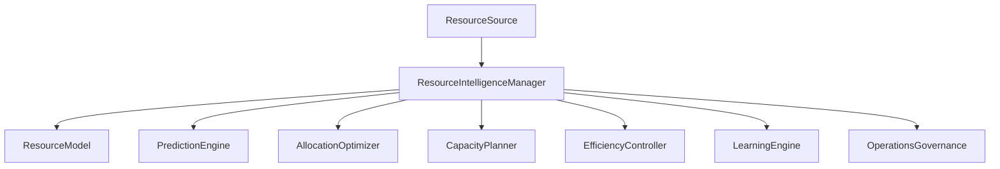

# RFC-0055

**Title:** Autonomous Resource Intelligence System

**Document ID:** RFC-0055

**Version:** 1.0

**Status:** Accepted

**Category:** Platform

**Layer:** Resource / Intelligence / Autonomy

**Target:**

```text
resource/intelligence_manager/
```

---

# Abstract

This RFC defines the SH-3 Autonomous Resource Intelligence System.

The Autonomous Resource Intelligence System provides the intelligence layer responsible for understanding, predicting, optimizing, and autonomously managing all computational resources required by SH-3.

The system governs:

- CPU resources
- memory resources
- storage resources
- network resources
- accelerator resources
- execution environments
- energy consumption

The system enables:

- resource awareness
- resource modeling
- demand prediction
- dynamic allocation
- autonomous optimization
- capacity planning
- infrastructure adaptation

The Autonomous Resource Intelligence System integrates with:

- Autonomous Operations Governance System
- Resource Management System
- Scheduler System
- Runtime System
- Optimization System
- Self Evolution System
- Learning System
- Observability System
- Data Governance System
- Security System

This document is normative.

---

# Motivation

SH-3 operates as an autonomous evolving intelligence system.

As intelligence capabilities expand, resource requirements dynamically change.

Resource requirements are influenced by:

- model execution
- memory operations
- learning processes
- planning complexity
- tool usage
- self-improvement

Without resource intelligence:

- performance may degrade
- resources may be wasted
- bottlenecks may occur
- scaling decisions may be inefficient

The Autonomous Resource Intelligence System provides predictive and adaptive resource management.

---

# Goals

The Autonomous Resource Intelligence System SHALL provide:

- complete resource awareness
- predictive resource management
- intelligent allocation
- autonomous optimization
- resource efficiency improvement
- long-term capacity planning

---

# Non-Goals

The Autonomous Resource Intelligence System SHALL NOT:

- replace operating systems
- directly control hardware drivers
- replace Resource Management System
- define application behavior
- override safety constraints

Resource Intelligence provides optimization decisions.

---

# Architecture



The Autonomous Resource Intelligence System transforms resource data into intelligent resource decisions.

---

# Design Principles

The Autonomous Resource Intelligence System follows these principles.

---

## Resource Awareness

The system SHALL maintain a complete resource state model.

---

## Predictive Management

Future resource demand SHOULD be predicted.

---

## Adaptive Allocation

Resources SHALL adapt to changing workloads.

---

## Efficiency First

Resource usage SHALL be optimized.

---

## Safety Preservation

Resource optimization SHALL respect safety boundaries.

---

## Continuous Improvement

Resource strategies SHALL improve through learning.

---

# Resource Intelligence Components

The system consists of:

| Component | Responsibility |
|-----------|----------------|
| ResourceIntelligenceManager | Coordination |
| ResourceModel | Resource representation |
| PredictionEngine | Demand prediction |
| AllocationOptimizer | Resource optimization |
| CapacityPlanner | Future planning |
| EfficiencyController | Usage optimization |
| LearningEngine | Improvement |
| MonitoringAdapter | Observation |

---

# ResourceIntelligenceManager

ResourceIntelligenceManager coordinates resource intelligence operations.

Responsibilities:

- resource analysis
- prediction management
- optimization coordination
- allocation recommendation
- capacity planning

The manager does not directly manage hardware.

---

# Resource Context

Every resource decision receives an immutable ResourceContext.

A ResourceContext contains:

| Field | Description |
|------|-------------|
| resource_id | Resource identifier |
| type | Resource category |
| availability | Current state |
| demand | Required amount |
| timestamp | Observation time |

---

# Resource Model

A ResourceAsset contains:

| Field | Description |
|------|-------------|
| resource_id | Identifier |
| type | Category |
| capacity | Maximum capacity |
| utilization | Current usage |
| status | Current state |

---

# Resource Categories

Supported categories:

| Type | Purpose |
|------|---------|
| Compute | Processing power |
| Memory | Temporary storage |
| Storage | Persistent storage |
| Network | Communication |
| Accelerator | Specialized computation |
| Energy | Power consumption |

---

# Resource Lifecycle

Every resource follows:

```text
Detected

↓

Modeled

↓

Monitored

↓

Optimized

↓

Rebalanced

↓

Improved
```

---

# Resource State Model

Supported states:

| State | Meaning |
|------|---------|
| Available | Ready |
| Allocated | Assigned |
| Saturated | High usage |
| Restricted | Limited |
| Optimizing | Adjustment |
| Released | Returned |

---

# Resource Modeling

ResourceModel represents:

- capacity
- usage patterns
- dependencies
- performance characteristics

---

# Resource Dependency Graph

```text
Compute

↓

Memory

↓

Storage

↓

Network

↓

Execution Capability
```

---

# Resource Prediction

PredictionEngine estimates:

- future demand
- workload growth
- resource bottlenecks
- optimization opportunities

---

# Prediction Model

```text
Historical Usage

+

Current State

+

Workload Pattern

↓

Future Resource Demand
```

---

# Allocation Optimization

AllocationOptimizer determines:

- resource distribution
- execution priority
- workload placement
- efficiency improvements

---

# Optimization Model

```text
Resource Demand

+

Resource State

↓

Optimal Allocation
```

---

# Operations Integration

Autonomous Operations Governance provides:

- runtime status
- operational priorities
- stability constraints

---

# Scheduler Integration

Scheduler System provides:

- task requirements
- execution timing
- dependency information

---

# Learning Integration

Learning System provides:

- usage patterns
- optimization feedback
- prediction improvement

---

# Observability Integration

Observability System provides:

- metrics
- telemetry
- historical trends

---

# Autonomous Resource Intelligence Execution Model

The Autonomous Resource Intelligence System transforms resource states into predictive, optimized, adaptive, and continuously improving resource decisions.

The resource intelligence lifecycle follows:


Each stage maintains a clear resource intelligence responsibility.

---

# Resource Intelligence Control Loop

The Autonomous Resource Intelligence System operates through continuous resource optimization.

```text
Resource State

↓

Resource Observation

↓

Demand Prediction

↓

Optimization Decision

↓

Allocation Adjustment

↓

Performance Evaluation

↓

Learning

↓

Improved Resource Strategy
```

---

# Dynamic Resource Allocation

AllocationOptimizer dynamically adjusts resources according to system conditions.

Allocation targets:

- compute capacity
- memory availability
- storage usage
- network bandwidth
- accelerator utilization

---

# Allocation Decision Model

```text
Current Resources

+

Future Demand

+

Operational Priority

↓

Optimal Allocation
```

---

# Allocation Policies

Resource allocation considers:

- task importance
- safety level
- latency requirement
- energy cost
- future demand

---

# Autonomous Scaling

The system supports autonomous scaling decisions.

Scaling operations:

- increase resources
- reduce resources
- redistribute workloads
- migrate execution

---

# Scaling Flow

```text
Demand Increase

↓

Capacity Evaluation

↓

Scaling Decision

↓

Resource Adjustment

↓

Validation
```

---

# Scaling Constraints

Scaling SHALL respect:

- safety boundaries
- operational policies
- budget constraints
- hardware limitations

---

# Capacity Planning

CapacityPlanner predicts long-term resource requirements.

Planning factors:

- workload growth
- model expansion
- memory growth
- learning activity
- operational trends

---

# Capacity Planning Model

```text
Historical Resource Usage

+

Future Capability Growth

+

Evolution Prediction

↓

Future Capacity Requirement
```

---

# Predictive Resource Management

PredictionEngine provides proactive management.

Prediction targets:

- bottlenecks
- resource exhaustion
- performance degradation
- future demand peaks

---

# Predictive Flow

```text
Historical Data

↓

Pattern Analysis

↓

Demand Prediction

↓

Preventive Optimization
```

---

# Resource Efficiency Optimization

EfficiencyController optimizes resource utilization.

Optimization targets:

- unused capacity
- execution efficiency
- energy consumption
- workload distribution

---

# Efficiency Model

```text
Resource Output

/

Resource Cost

=

Efficiency Score
```

---

# Energy Optimization

The system manages energy-aware operation.

Energy optimization includes:

- workload scheduling
- idle resource reduction
- efficient execution selection

---

# Energy Decision Model

```text
Task Requirement

+

Energy Cost

+

Priority

↓

Energy Efficient Execution
```

---

# Resource Learning Loop

LearningEngine improves resource intelligence.

Learning targets:

- demand prediction accuracy
- allocation quality
- scaling decisions
- efficiency strategies

---

# Learning Pipeline

```text
Resource History

↓

Outcome Analysis

↓

Optimization Feedback

↓

Model Improvement

↓

Better Resource Intelligence
```

---

# Memory Integration

Memory stores:

- resource usage history
- optimization experiences
- successful allocation patterns
- failure cases

---

# Knowledge Integration

Knowledge Governance stores:

- resource management rules
- optimization knowledge
- infrastructure behavior patterns

---

# World Model Integration

World Model predicts:

- future workload
- resource impact
- scaling consequences

---

# Planning Integration

PlanningCore uses resource intelligence for:

- feasible planning
- cost estimation
- execution strategy selection

---

# Model Governance Integration

Model Governance provides:

- model resource requirements
- inference cost information
- optimization constraints

---

# Operations Governance Integration

Autonomous Operations Governance provides:

- runtime priority
- stability requirements
- operational limits

---

# Security Integration

Security System protects:

- resource permissions
- allocation authority
- infrastructure controls

---

# Audit Integration

Audit Management records:

- resource decisions
- scaling events
- optimization actions
- policy changes

---

# Compliance Integration

Compliance Management verifies:

- resource usage policies
- operational constraints
- governance requirements

---

# Message Bus Integration

Resource intelligence events include:

- ResourceDetected
- ResourceModeled
- DemandPredicted
- AllocationChanged
- ScalingTriggered
- EfficiencyImproved
- ResourceStrategyUpdated

---

# Persistence Integration

Persistence stores:

- resource models
- prediction history
- allocation decisions
- optimization results

---

# Observability Integration

Resource telemetry includes:

- utilization rate
- capacity margin
- prediction accuracy
- efficiency score
- scaling frequency

---

# Tracing

Resource traces preserve:

- trace_id
- resource_id
- prediction_id
- allocation_id
- optimization_id

---

# Thread Model

The Autonomous Resource Intelligence System supports concurrent:

- monitoring
- prediction
- optimization
- allocation decisions

Resource state transitions SHALL be synchronized.

The reference implementation shall be thread-safe.

---

# Metrics

The Autonomous Resource Intelligence System exposes:

- resource utilization
- prediction accuracy
- allocation efficiency
- scaling success rate
- energy efficiency
- optimization improvement

---

# Performance Objectives

The Autonomous Resource Intelligence System should optimize for:

- efficient resource usage
- proactive capacity management
- reduced waste
- stable autonomous operation
- continuous infrastructure improvement

---

# Future Work

Potential future enhancements include:

- fully autonomous infrastructure optimization
- predictive hardware adaptation
- self-configuring execution environments
- energy-aware intelligence scheduling
- self-evolving resource architectures

These enhancements extend SH-3 toward a self-optimizing autonomous intelligence infrastructure capable of adapting its own computational environment.

---

# References

- SH-3 Architecture Specification v2.1
- RFC-0028 Optimizer System
- RFC-0029 Self-Healing System
- RFC-0037 Resource Management System
- RFC-0054 Autonomous Operations Governance System
- RFC-0053 AI Safety Governance System

---

# End of RFC-0055
