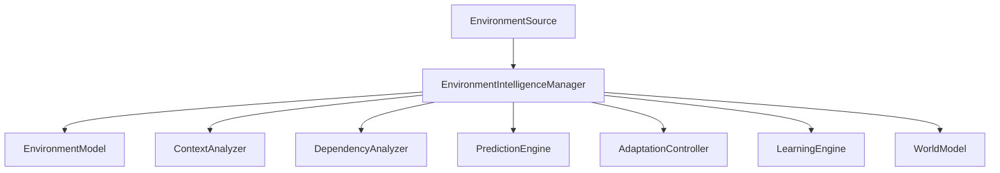

# RFC-0056

**Title:** Autonomous Environment Intelligence System

**Document ID:** RFC-0056

**Version:** 1.0

**Status:** Accepted

**Category:** Platform

**Layer:** Environment / Intelligence / Adaptation

**Target:**

```text
environment/intelligence_manager/
```

---

# Abstract

This RFC defines the SH-3 Autonomous Environment Intelligence System.

The Autonomous Environment Intelligence System provides the intelligence layer responsible for perceiving, modeling, predicting, and adapting to the internal and external environments surrounding SH-3.

The system governs:

- execution environment
- infrastructure state
- dependency services
- external conditions
- operational context
- system topology
- environmental changes

The system enables:

- environment awareness
- context understanding
- environment modeling
- dependency intelligence
- adaptive behavior
- predictive adaptation

The Autonomous Environment Intelligence System integrates with:

- Autonomous Resource Intelligence System
- Autonomous Operations Governance System
- World Model System
- Planning System
- Learning System
- Self Evolution System
- Observability System
- Security System
- Data Governance System
- Knowledge Governance System

This document is normative.

---

# Motivation

SH-3 operates in dynamic environments.

The environment may change due to:

- resource availability
- hardware conditions
- network state
- external services
- user interaction
- operational requirements
- system evolution

A static configuration model is insufficient.

SH-3 requires the ability to:

- understand its environment
- predict changes
- adapt operation strategies
- preserve stability

The Autonomous Environment Intelligence System provides environmental awareness and adaptation capabilities.

---

# Goals

The Autonomous Environment Intelligence System SHALL provide:

- environmental perception
- context modeling
- dependency awareness
- environmental prediction
- adaptive operation support
- continuous environment learning

---

# Non-Goals

The Autonomous Environment Intelligence System SHALL NOT:

- replace World Model System
- directly control all external systems
- override safety policies
- replace Security System
- define business objectives

Environment Intelligence provides understanding and adaptation.

---

# Architecture



The Autonomous Environment Intelligence System transforms environmental information into adaptive intelligence.

---

# Design Principles

The Autonomous Environment Intelligence System follows these principles.

---

## Environment Awareness

The system SHALL maintain a current environment model.

---

## Context Understanding

Environmental information SHALL be interpreted according to operational context.

---

## Predictive Adaptation

Future environmental changes SHOULD be predicted.

---

## Minimal Disruption

Adaptation SHOULD preserve stable operation.

---

## Continuous Learning

Environmental knowledge SHALL improve over time.

---

## Safety Preservation

Environmental adaptation SHALL follow safety constraints.

---

# Environment Intelligence Components

The system consists of:

| Component | Responsibility |
|-----------|----------------|
| EnvironmentIntelligenceManager | Coordination |
| EnvironmentModel | Environment representation |
| ContextAnalyzer | Context understanding |
| DependencyAnalyzer | Dependency analysis |
| PredictionEngine | Future prediction |
| AdaptationController | Adaptive decisions |
| LearningEngine | Improvement |
| MonitoringAdapter | Observation |

---

# EnvironmentIntelligenceManager

EnvironmentIntelligenceManager coordinates environment intelligence operations.

Responsibilities:

- environment analysis
- context evaluation
- adaptation coordination
- prediction management
- environmental learning

The manager does not directly modify external environments.

---

# Environment Context

Every environment evaluation receives an immutable EnvironmentContext.

An EnvironmentContext contains:

| Field | Description |
|------|-------------|
| environment_id | Environment identifier |
| context_type | Environment category |
| state | Current condition |
| dependencies | Related systems |
| timestamp | Observation time |

---

# Environment Model

An EnvironmentAsset contains:

| Field | Description |
|------|-------------|
| environment_id | Identifier |
| type | Category |
| state | Current condition |
| stability | Reliability score |
| version | Environment version |

---

# Environment Categories

Supported categories:

| Type | Purpose |
|------|---------|
| Runtime | Execution environment |
| Infrastructure | Hardware/software platform |
| Network | Communication environment |
| Service | External dependencies |
| User | Interaction context |
| Operational | Runtime conditions |

---

# Environment Lifecycle

Every environment follows:

```text
Detected

↓

Modeled

↓

Observed

↓

Predicted

↓

Adapted

↓

Learned
```

---

# Environment State Model

Supported states:

| State | Meaning |
|------|---------|
| Normal | Expected condition |
| Changing | Transition |
| Unstable | Deviation |
| Unknown | Insufficient information |
| Restricted | Limited operation |
| Adapted | Adjusted |

---

# Environment Modeling

EnvironmentModel represents:

- structure
- dependencies
- conditions
- historical changes
- behavior patterns

---

# Environment Dependency Graph

```text
SH-3 Core

↓

Runtime

↓

Resources

↓

Services

↓

External Environment
```

---

# Context Awareness

ContextAnalyzer determines:

- current situation
- operational meaning
- priority
- adaptation requirements

---

# Context Evaluation Model

```text
Environment State

+

System State

+

Current Objective

↓

Operational Context
```

---

# Dependency Intelligence

DependencyAnalyzer evaluates:

- service availability
- dependency reliability
- failure impact
- alternative resources

---

# Dependency Model

```text
Dependency

↓

Health Evaluation

↓

Impact Analysis

↓

Adaptation Strategy
```

---

# Prediction Engine

PredictionEngine estimates:

- environment changes
- dependency failures
- operational impact
- future conditions

---

# Prediction Model

```text
Historical Environment Data

+

Current State

+

External Signals

↓

Future Environment Prediction
```

---

# Resource Integration

Autonomous Resource Intelligence provides:

- infrastructure conditions
- capacity information
- resource trends

---

# Operations Integration

Autonomous Operations Governance provides:

- runtime priorities
- stability requirements
- operational constraints

---

# World Model Integration

World Model provides:

- environmental simulation
- causal relationships
- future prediction support

---

# Autonomous Environment Intelligence Execution Model

The Autonomous Environment Intelligence System transforms environmental observations into predictive, adaptive, and continuously improving environmental strategies.

The environment intelligence lifecycle follows:


Each stage maintains a clear environmental intelligence responsibility.

---

# Environment Intelligence Control Loop

The Autonomous Environment Intelligence System operates through continuous environmental adaptation.

```text
Environment State

↓

Environmental Observation

↓

Context Analysis

↓

Future Prediction

↓

Adaptation Decision

↓

Execution Adjustment

↓

Outcome Evaluation

↓

Environment Learning
```

---

# External Condition Monitoring

Environment Intelligence continuously monitors external conditions.

Monitoring targets:

- service availability
- network conditions
- infrastructure changes
- dependency status
- operational constraints

---

# External Condition Model

```text
External Signal

+

Internal State

+

Historical Pattern

↓

Environment Condition Assessment
```

---

# Environment Change Detection

The system detects:

- topology changes
- service degradation
- resource changes
- dependency failures
- configuration changes

---

# Change Detection Flow

```text
Environment Change

↓

Impact Analysis

↓

Adaptation Evaluation

↓

Response Selection
```

---

# Adaptive Environment Control

AdaptationController manages environment-aware adjustments.

Adaptation targets:

- execution strategy
- resource usage
- service selection
- operational mode
- scheduling behavior

---

# Adaptation Decision Model

```text
Environment Condition

+

System Capability

+

Safety Policy

↓

Adaptive Strategy
```

---

# Adaptation Levels

| Level | Action |
|------|--------|
| A0 | No change |
| A1 | Parameter adjustment |
| A2 | Strategy adjustment |
| A3 | Component adaptation |
| A4 | Environment migration |

---

# Dependency Recovery Intelligence

DependencyAnalyzer supports autonomous dependency handling.

Capabilities:

- failure prediction
- alternative selection
- dependency isolation
- recovery recommendation

---

# Dependency Recovery Flow

```text
Dependency Failure

↓

Impact Evaluation

↓

Alternative Analysis

↓

Recovery Strategy

↓

Verification
```

---

# Environment Prediction Loop

PredictionEngine continuously improves environmental forecasting.

Prediction targets:

- future availability
- workload changes
- dependency risks
- operational conditions

---

# Prediction Pipeline

```text
Environment History

↓

Pattern Learning

↓

Prediction Model

↓

Future Condition

↓

Preventive Adaptation
```

---

# Autonomous Adaptation

SH-3 MAY adapt to environmental changes autonomously.

Capabilities:

- runtime adjustment
- resource strategy change
- dependency switching
- execution optimization

---

# Autonomous Adaptation Requirements

Required:

- safety validation
- rollback capability
- impact evaluation
- audit recording

---

# Environment Learning Loop

LearningEngine improves environment intelligence.

Learning targets:

- prediction accuracy
- adaptation effectiveness
- dependency understanding
- context interpretation

---

# Learning Pipeline

```text
Environment Experience

↓

Outcome Analysis

↓

Pattern Extraction

↓

Model Improvement

↓

Better Adaptation
```

---

# Memory Integration

Memory stores:

- environmental experiences
- successful adaptations
- failure patterns
- dependency history

---

# Knowledge Integration

Knowledge Governance stores:

- environment rules
- dependency knowledge
- adaptation strategies

---

# World Model Integration

World Model provides:

- environmental simulation
- causal prediction
- future scenario analysis

---

# Planning Integration

PlanningCore uses environment intelligence for:

- context-aware planning
- feasibility evaluation
- adaptive strategies

---

# Resource Intelligence Integration

Autonomous Resource Intelligence provides:

- resource conditions
- capacity predictions
- infrastructure information

---

# Operations Governance Integration

Autonomous Operations Governance provides:

- operational priorities
- stability constraints
- execution policies

---

# Safety Governance Integration

AI Safety Governance verifies:

- adaptation boundaries
- external interaction safety
- autonomous changes

---

# Security Integration

Security System protects:

- environmental access
- dependency communication
- adaptation authority

---

# Audit Integration

Audit Management records:

- environment changes
- adaptation decisions
- dependency events
- recovery actions

---

# Compliance Integration

Compliance Management verifies:

- environment policies
- operational requirements
- governance constraints

---

# Message Bus Integration

Environment intelligence events include:

- EnvironmentDetected
- EnvironmentChanged
- DependencyAnalyzed
- PredictionGenerated
- AdaptationTriggered
- EnvironmentRecovered
- EnvironmentStrategyUpdated

---

# Persistence Integration

Persistence stores:

- environment models
- prediction history
- adaptation records
- dependency relationships

---

# Observability Integration

Environment telemetry includes:

- environment stability
- prediction accuracy
- adaptation frequency
- dependency health
- recovery success

---

# Tracing

Environment traces preserve:

- trace_id
- environment_id
- dependency_id
- prediction_id
- adaptation_id

---

# Thread Model

The Autonomous Environment Intelligence System supports concurrent:

- monitoring
- prediction
- dependency analysis
- adaptation decisions

Environment state transitions SHALL be synchronized.

The reference implementation shall be thread-safe.

---

# Metrics

The Autonomous Environment Intelligence System exposes:

- environment stability score
- prediction accuracy
- adaptation success rate
- dependency reliability
- recovery efficiency
- learning improvement rate

---

# Performance Objectives

The Autonomous Environment Intelligence System should optimize for:

- accurate environmental understanding
- proactive adaptation
- reduced operational disruption
- stable autonomous operation
- continuous environmental learning

---

# Future Work

Potential future enhancements include:

- fully autonomous environmental reasoning
- predictive infrastructure adaptation
- self-organizing dependency networks
- autonomous external environment negotiation
- self-evolving adaptive environments

These enhancements extend SH-3 toward a fully adaptive autonomous intelligence platform capable of understanding and responding to complex dynamic environments.

---

# References

- SH-3 Architecture Specification v2.1
- RFC-0023 World Model System
- RFC-0026 Self Evolution System
- RFC-0027 Autonomous Learning System
- RFC-0053 AI Safety Governance System
- RFC-0054 Autonomous Operations Governance System
- RFC-0055 Autonomous Resource Intelligence System

---

# End of RFC-0056
