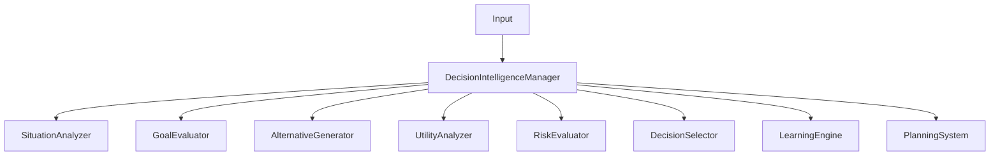
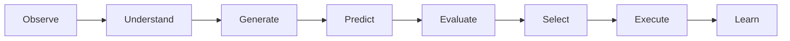

# RFC-0057

**Title:** Autonomous Decision Intelligence System

**Document ID:** RFC-0057

**Version:** 1.0

**Status:** Accepted

**Category:** Intelligence

**Layer:** Decision / Reasoning / Autonomy

**Target:**

```text
decision/intelligence_manager/
```

---

# Abstract

This RFC defines the SH-3 Autonomous Decision Intelligence System.

The Autonomous Decision Intelligence System provides the intelligence layer responsible for generating, evaluating, selecting, and improving autonomous decisions within SH-3.

The system governs:

- decision generation
- goal evaluation
- alternative analysis
- utility estimation
- risk-aware selection
- strategic decision making
- decision improvement

The system enables:

- autonomous decision formation
- multi-factor evaluation
- causal decision support
- uncertainty-aware reasoning
- strategy optimization
- decision learning

The Autonomous Decision Intelligence System integrates with:

- Planning System
- World Model System
- Cognitive Architecture System
- AI Safety Governance System
- Risk Management System
- Knowledge System
- Memory System
- Learning System
- Self Evolution System
- Autonomous Environment Intelligence System

This document is normative.

---

# Motivation

SH-3 performs autonomous operation through continuous decision making.

Decisions influence:

- actions
- planning
- resource usage
- learning direction
- self-improvement

As autonomy increases, decisions become more complex.

A simple rule-based system is insufficient.

SH-3 requires the ability to:

- understand situations
- generate alternatives
- predict consequences
- evaluate risks
- select optimal strategies

The Autonomous Decision Intelligence System provides this capability.

---

# Goals

The Autonomous Decision Intelligence System SHALL provide:

- autonomous decision generation
- decision evaluation
- alternative exploration
- risk-aware selection
- explainable decisions
- continuous decision improvement

---

# Non-Goals

The Autonomous Decision Intelligence System SHALL NOT:

- replace Planning System
- replace World Model System
- define final objectives
- bypass safety policies
- directly execute actions

Decision Intelligence selects strategies.

---

# Architecture



The Autonomous Decision Intelligence System transforms information into optimized decisions.

---

# Design Principles

The Autonomous Decision Intelligence System follows these principles.

---

## Rational Selection

Decisions SHALL be based on evaluated information.

---

## Multi-Objective Optimization

Multiple goals SHALL be considered.

---

## Risk Awareness

Uncertainty and consequences SHALL be evaluated.

---

## Explainability

Decision processes SHALL be traceable.

---

## Adaptability

Decision strategies SHALL improve through learning.

---

## Safety Preservation

Decisions SHALL respect governance constraints.

---

# Decision Intelligence Components

The system consists of:

| Component | Responsibility |
|-----------|----------------|
| DecisionIntelligenceManager | Coordination |
| SituationAnalyzer | State understanding |
| GoalEvaluator | Goal analysis |
| AlternativeGenerator | Option creation |
| UtilityAnalyzer | Value estimation |
| RiskEvaluator | Risk analysis |
| DecisionSelector | Final selection |
| LearningEngine | Improvement |

---

# DecisionIntelligenceManager

DecisionIntelligenceManager coordinates decision processes.

Responsibilities:

- decision request handling
- situation evaluation
- alternative coordination
- decision selection
- learning feedback

The manager does not execute actions.

---

# Decision Context

Every decision receives an immutable DecisionContext.

A DecisionContext contains:

| Field | Description |
|------|-------------|
| decision_id | Decision identifier |
| situation | Current state |
| goals | Target objectives |
| constraints | Limitations |
| timestamp | Evaluation time |

---

# Decision Model

A DecisionObject contains:

| Field | Description |
|------|-------------|
| decision_id | Identifier |
| selected_action | Selected strategy |
| alternatives | Available options |
| confidence | Confidence score |
| reasoning | Explanation |

---

# Decision Lifecycle

Every decision follows:

```text
Request

↓

Situation Analysis

↓

Goal Evaluation

↓

Alternative Generation

↓

Consequence Prediction

↓

Risk Evaluation

↓

Selection

↓

Execution Request

↓

Feedback
```

---

# Situation Analysis

SituationAnalyzer evaluates:

- current environment
- system state
- available resources
- active goals

---

# Situation Model

```text
Current State

+

Environment

+

History

↓

Situation Understanding
```

---

# Goal Evaluation

GoalEvaluator analyzes:

- priority
- importance
- conflicts
- expected value

---

# Goal Hierarchy

```text
Primary Goal

↓

Secondary Goals

↓

Operational Goals

↓

Immediate Tasks
```

---

# Alternative Generation

AlternativeGenerator creates possible strategies.

Sources:

- Planning System
- Memory
- Knowledge
- World Model

---

# Alternative Model

```text
Current Situation

↓

Possible Actions

↓

Future Outcomes
```

---

# Utility Analysis

UtilityAnalyzer estimates decision value.

Evaluation factors:

- benefit
- cost
- time
- resources
- risk

---

# Utility Model

```text
Utility

=

Expected Benefit

-

Cost

-

Risk
```

---

# Risk Evaluation

RiskEvaluator analyzes:

- uncertainty
- failure probability
- impact
- reversibility

---

# Planning Integration

Planning System provides:

- execution plans
- strategic options
- task decomposition

---

# World Model Integration

World Model provides:

- consequence prediction
- simulation
- causal relationships

---

# Memory Integration

Memory provides:

- previous decisions
- successful strategies
- failure experiences

---

# Learning Integration

Learning System provides:

- decision feedback
- improvement signals
- optimization patterns

---

# Autonomous Decision Intelligence Execution Model

The Autonomous Decision Intelligence System transforms situation understanding into optimized, explainable, risk-aware, and continuously improving autonomous decisions.

The decision intelligence lifecycle follows:



Each stage maintains a clear decision intelligence responsibility.

---

# Decision Intelligence Control Loop

The Autonomous Decision Intelligence System operates through continuous decision optimization.

```text
Situation

↓

Context Understanding

↓

Goal Evaluation

↓

Alternative Generation

↓

Outcome Prediction

↓

Utility Analysis

↓

Risk Evaluation

↓

Decision Selection

↓

Feedback Learning
```

---

# Multi-Objective Decision Optimization

DecisionSelector evaluates multiple objectives simultaneously.

Optimization targets:

- goal achievement
- resource efficiency
- safety
- reliability
- future value

---

# Multi-Objective Model

```text
Decision Score

=

Goal Value

+

Future Benefit

-

Cost

-

Risk

-
Uncertainty
```

---

# Objective Conflict Resolution

When objectives conflict:

```text
Multiple Goals

↓

Priority Analysis

↓

Trade-off Evaluation

↓

Balanced Decision
```

---

# Causal Decision Support

World Model and Knowledge System provide causal analysis.

Causal factors:

- action effects
- dependency relationships
- historical outcomes
- environmental impact

---

# Causal Decision Model

```text
Possible Action

↓

Cause Analysis

↓

Effect Prediction

↓

Decision Value
```

---

# Decision Simulation

The system evaluates decisions before execution.

Simulation process:

```text
Candidate Decision

↓

World Model Simulation

↓

Outcome Prediction

↓

Risk Assessment

↓

Decision Revision
```

---

# Strategy Selection

DecisionSelector chooses the optimal strategy.

Selection factors:

- expected utility
- confidence
- risk level
- reversibility
- resource requirement

---

# Strategy Ranking Model

```text
Strategy A

↓

Evaluation Score

↓

Strategy Ranking

↓

Selected Strategy
```

---

# Decision Confidence Management

The system maintains decision confidence.

Confidence factors:

- information completeness
- prediction accuracy
- historical success
- uncertainty level

---

# Confidence Model

```text
Confidence

=

Information Quality

+

Prediction Reliability

+

Experience
```

---

# Low Confidence Handling

When confidence is insufficient:

```text
Low Confidence

↓

Request More Information

↓

Generate Additional Alternatives

↓

Delay Decision

or

↓

Human Review
```

---

# Autonomous Decision Learning

LearningEngine improves decision quality.

Learning targets:

- decision accuracy
- strategy selection
- risk estimation
- utility prediction

---

# Decision Learning Pipeline

```text
Decision History

↓

Outcome Observation

↓

Success Analysis

↓

Pattern Extraction

↓

Decision Model Improvement
```

---

# Reinforcement Integration

Learning feedback includes:

- successful outcomes
- failed decisions
- unexpected results
- environmental changes

---

# Memory Integration

Memory stores:

- decision traces
- selected strategies
- outcomes
- lessons learned

---

# Knowledge Integration

Knowledge Governance stores:

- decision rules
- reasoning patterns
- validated strategies

---

# Planning Integration

PlanningCore receives:

- selected strategies
- decision constraints
- execution priorities

---

# World Model Integration

World Model provides:

- future simulation
- causal prediction
- consequence analysis

---

# AI Safety Governance Integration

AI Safety Governance validates:

- decision boundaries
- prohibited actions
- high-impact decisions

---

# Risk Management Integration

Risk Management provides:

- risk scores
- mitigation strategies
- impact evaluation

---

# Environment Intelligence Integration

Environment Intelligence provides:

- context information
- environmental predictions
- adaptation requirements

---

# Resource Intelligence Integration

Resource Intelligence provides:

- resource availability
- execution cost
- capacity predictions

---

# Message Bus Integration

Decision intelligence events include:

- DecisionRequested
- SituationAnalyzed
- AlternativesGenerated
- DecisionSimulated
- RiskEvaluated
- DecisionSelected
- DecisionLearned

---

# Persistence Integration

Persistence stores:

- decision objects
- evaluation results
- simulations
- learning outcomes

---

# Observability Integration

Decision telemetry includes:

- decision latency
- confidence score
- risk score
- success rate
- learning improvement

---

# Tracing

Decision traces preserve:

- trace_id
- decision_id
- simulation_id
- evaluation_id
- learning_id

---

# Thread Model

The Autonomous Decision Intelligence System supports concurrent:

- situation analysis
- simulation
- evaluation
- learning

Decision state transitions SHALL be synchronized.

The reference implementation shall be thread-safe.

---

# Metrics

The Autonomous Decision Intelligence System exposes:

- decision accuracy
- decision confidence
- average decision time
- risk reduction
- strategy success rate
- learning improvement rate

---

# Performance Objectives

The Autonomous Decision Intelligence System should optimize for:

- high-quality decisions
- explainable reasoning
- low-risk autonomy
- adaptive strategy selection
- continuous improvement

---

# Future Work

Potential future enhancements include:

- fully autonomous strategic reasoning
- hierarchical decision intelligence
- predictive goal optimization
- self-improving decision architectures
- autonomous value alignment systems

These enhancements extend SH-3 toward an advanced autonomous intelligence capable of reasoning, evaluating, and improving its own decision processes.

---

# References

- SH-3 Architecture Specification v2.1
- RFC-0023 World Model System
- RFC-0024 Cognitive Architecture System
- RFC-0025 Meta Controller System
- RFC-0027 Autonomous Learning System
- RFC-0043 Risk Management System
- RFC-0053 AI Safety Governance System
- RFC-0056 Autonomous Environment Intelligence System

---

# End of RFC-0057
