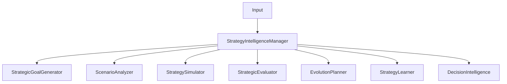
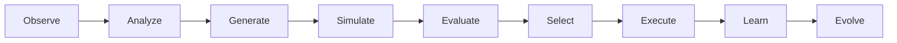

# RFC-0058

**Title:** Autonomous Strategy Intelligence System

**Document ID:** RFC-0058

**Version:** 1.0

**Status:** Accepted

**Category:** Intelligence

**Layer:** Strategy / Planning / Evolution

**Target:**

```text
strategy/intelligence_manager/
```

---

# Abstract

This RFC defines the SH-3 Autonomous Strategy Intelligence System.

The Autonomous Strategy Intelligence System provides the intelligence layer responsible for generating, evaluating, simulating, and improving long-term strategies for SH-3.

The system governs:

- strategic goal generation
- long-term planning
- scenario analysis
- strategic simulation
- resource strategy
- evolution strategy
- adaptation planning

The system enables:

- autonomous strategy creation
- long-term optimization
- future scenario evaluation
- strategic learning
- self-improving strategy formation

The Autonomous Strategy Intelligence System integrates with:

- Autonomous Decision Intelligence System
- Planning System
- World Model System
- Self Evolution System
- Learning System
- Resource Intelligence System
- Environment Intelligence System
- Knowledge Governance System
- AI Safety Governance System
- Risk Management System

This document is normative.

---

# Motivation

SH-3 requires more than immediate decision making.

Autonomous intelligence must determine:

- where to improve
- which capabilities to develop
- how to allocate resources
- how to adapt to future environments

Short-term optimization alone cannot achieve continuous evolution.

SH-3 requires strategic intelligence capable of:

- understanding future possibilities
- selecting long-term objectives
- planning evolutionary paths

The Autonomous Strategy Intelligence System provides this capability.

---

# Goals

The Autonomous Strategy Intelligence System SHALL provide:

- autonomous strategy generation
- long-term objective planning
- scenario simulation
- strategic evaluation
- evolutionary path selection
- strategy improvement

---

# Non-Goals

The Autonomous Strategy Intelligence System SHALL NOT:

- replace Decision Intelligence System
- directly execute operations
- bypass safety governance
- define unrestricted self-modification
- override system objectives

Strategy Intelligence determines long-term direction.

---

# Architecture



The Autonomous Strategy Intelligence System transforms future possibilities into strategic directions.

---

# Design Principles

The Autonomous Strategy Intelligence System follows these principles.

---

## Long-Term Optimization

Strategies SHALL consider future outcomes.

---

## Scenario Awareness

Multiple possible futures SHALL be evaluated.

---

## Adaptive Direction

Strategies SHALL change according to conditions.

---

## Resource Consciousness

Strategies SHALL consider available capabilities.

---

## Evolution Compatibility

Strategies SHALL support continuous improvement.

---

## Safety Alignment

Strategies SHALL follow governance constraints.

---

# Strategy Intelligence Components

The system consists of:

| Component | Responsibility |
|-----------|----------------|
| StrategyIntelligenceManager | Coordination |
| StrategicGoalGenerator | Goal creation |
| ScenarioAnalyzer | Future analysis |
| StrategySimulator | Strategy simulation |
| StrategicEvaluator | Value evaluation |
| EvolutionPlanner | Improvement planning |
| StrategyLearner | Learning |

---

# StrategyIntelligenceManager

StrategyIntelligenceManager coordinates strategic intelligence operations.

Responsibilities:

- strategy generation
- scenario management
- evaluation coordination
- evolution planning
- strategic learning

The manager does not execute strategies.

---

# Strategy Context

Every strategy evaluation receives an immutable StrategyContext.

A StrategyContext contains:

| Field | Description |
|------|-------------|
| strategy_id | Identifier |
| current_state | Current capability |
| objectives | Long-term goals |
| constraints | Restrictions |
| timestamp | Evaluation time |

---

# Strategy Model

A StrategyObject contains:

| Field | Description |
|------|-------------|
| strategy_id | Identifier |
| objective | Target |
| actions | Strategic steps |
| expected_result | Outcome |
| confidence | Confidence level |

---

# Strategy Lifecycle

Every strategy follows:

```text
Observation

↓

Goal Discovery

↓

Strategy Generation

↓

Scenario Simulation

↓

Evaluation

↓

Selection

↓

Execution Planning

↓

Outcome Learning
```

---

# Strategic Goal Generation

StrategicGoalGenerator creates long-term objectives.

Goal sources:

- system capability analysis
- environment prediction
- learning results
- evolution requirements

---

# Strategic Goal Model

```text
Current Capability

+

Future Requirement

+

Improvement Opportunity

↓

Strategic Goal
```

---

# Long-Term Planning

The system evaluates:

- future capabilities
- development priorities
- resource requirements
- expected benefits

---

# Planning Horizon

Supported horizons:

| Horizon | Purpose |
|------|---------|
| Short | Immediate improvement |
| Medium | Capability expansion |
| Long | Evolution direction |

---

# Scenario Analysis

ScenarioAnalyzer evaluates possible futures.

Analysis targets:

- environment changes
- resource conditions
- capability growth
- external factors

---

# Scenario Model

```text
Current State

↓

Possible Future

↓

Strategic Impact
```

---

# Strategy Simulation

StrategySimulator evaluates strategies before adoption.

Simulation includes:

- expected outcomes
- resource requirements
- risks
- dependencies

---

# Strategy Evaluation

StrategicEvaluator analyzes:

- benefit
- cost
- feasibility
- risk
- alignment

---

# Decision Intelligence Integration

Decision Intelligence provides:

- strategic selection support
- utility analysis
- risk evaluation

---

# World Model Integration

World Model provides:

- future simulation
- causal prediction
- scenario modeling

---

# Learning Integration

Learning System provides:

- strategy outcomes
- improvement signals
- historical knowledge

---

# Autonomous Strategy Intelligence Execution Model

The Autonomous Strategy Intelligence System transforms long-term objectives into adaptive, optimized, and continuously improving strategic directions.

The strategy intelligence lifecycle follows:



Each stage maintains a clear strategic intelligence responsibility.

---

# Strategy Intelligence Control Loop

The Autonomous Strategy Intelligence System operates through continuous strategic improvement.

```text
Current Capability

↓

Future Analysis

↓

Strategic Goal Generation

↓

Strategy Creation

↓

Scenario Simulation

↓

Risk Evaluation

↓

Strategy Selection

↓

Execution Planning

↓

Outcome Analysis

↓

Strategic Learning
```

---

# Strategic Simulation Engine

StrategySimulator evaluates possible strategies before adoption.

Simulation targets:

- capability growth
- environmental change
- resource impact
- operational consequences
- long-term outcomes

---

# Strategic Simulation Model

```text
Strategy Candidate

+

World Model

+

Environment Model

+

Resource Model

↓

Future Scenario
```

---

# Scenario Optimization

ScenarioAnalyzer compares multiple future possibilities.

Evaluation factors:

- probability
- expected value
- risk
- resource requirement
- strategic alignment

---

# Scenario Ranking

```text
Scenario A

↓

Impact Analysis

↓

Strategic Score

↓

Scenario Priority
```

---

# Evolution Strategy Planning

EvolutionPlanner determines SH-3 improvement directions.

Planning targets:

- capability expansion
- architecture improvement
- learning improvement
- efficiency improvement

---

# Evolution Planning Model

```text
Current System

+

Detected Limitation

+

Future Requirement

↓

Evolution Strategy
```

---

# Long-Term Resource Strategy

Strategy Intelligence cooperates with Resource Intelligence.

Resource strategy considers:

- future computation needs
- memory expansion
- storage growth
- infrastructure requirements

---

# Resource Strategy Flow

```text
Strategic Objective

↓

Capability Requirement

↓

Resource Prediction

↓

Resource Strategy
```

---

# Strategic Adaptation

The system adapts strategies according to changing conditions.

Adaptation triggers:

- environment change
- capability improvement
- resource limitation
- new knowledge acquisition

---

# Strategic Adaptation Flow

```text
Strategy Evaluation

↓

Condition Change Detection

↓

Strategy Update

↓

Validation

↓

Activation
```

---

# Strategic Learning Loop

StrategyLearner improves strategic intelligence.

Learning targets:

- prediction accuracy
- strategy effectiveness
- goal selection
- long-term optimization

---

# Learning Pipeline

```text
Strategy History

↓

Outcome Evaluation

↓

Success Pattern Extraction

↓

Strategy Model Update

↓

Improved Strategic Reasoning
```

---

# Memory Integration

Memory stores:

- strategic decisions
- successful evolution paths
- failed strategies
- long-term experiences

---

# Knowledge Integration

Knowledge Governance stores:

- strategic principles
- optimization patterns
- validated strategies

---

# Decision Intelligence Integration

Decision Intelligence receives:

- strategic priorities
- recommended directions
- scenario evaluations

---

# Planning Integration

PlanningCore receives:

- strategic objectives
- long-term constraints
- capability priorities

---

# World Model Integration

World Model provides:

- future simulation
- causal relationships
- strategic consequences

---

# Environment Intelligence Integration

Environment Intelligence provides:

- external trends
- environmental changes
- adaptation requirements

---

# Resource Intelligence Integration

Resource Intelligence provides:

- capacity predictions
- resource feasibility
- optimization opportunities

---

# Self Evolution Integration

Self Evolution System receives:

- evolution strategies
- improvement priorities
- capability roadmaps

---

# AI Safety Governance Integration

AI Safety Governance validates:

- strategic boundaries
- self-improvement constraints
- high-impact strategies

---

# Risk Management Integration

Risk Management evaluates:

- strategic uncertainty
- failure impact
- mitigation plans

---

# Message Bus Integration

Strategy intelligence events include:

- StrategyRequested
- GoalGenerated
- ScenarioCreated
- StrategySimulated
- StrategyEvaluated
- StrategySelected
- StrategyUpdated
- StrategyLearned

---

# Persistence Integration

Persistence stores:

- strategy models
- scenario simulations
- evaluation results
- evolution plans

---

# Observability Integration

Strategy telemetry includes:

- strategy quality
- prediction accuracy
- simulation reliability
- goal achievement
- learning improvement

---

# Tracing

Strategy traces preserve:

- trace_id
- strategy_id
- scenario_id
- simulation_id
- evolution_id

---

# Thread Model

The Autonomous Strategy Intelligence System supports concurrent:

- scenario analysis
- simulation
- evaluation
- learning

Strategy state transitions SHALL be synchronized.

The reference implementation shall be thread-safe.

---

# Metrics

The Autonomous Strategy Intelligence System exposes:

- strategy success rate
- goal achievement rate
- simulation accuracy
- evolution efficiency
- resource planning accuracy
- strategic improvement rate

---

# Performance Objectives

The Autonomous Strategy Intelligence System should optimize for:

- long-term intelligence growth
- adaptive strategic planning
- efficient evolution
- stable autonomous improvement
- future-oriented decision making

---

# Future Work

Potential future enhancements include:

- autonomous scientific strategy generation
- civilization-scale planning models
- recursive strategic improvement
- self-optimizing evolutionary architecture
- fully autonomous strategic intelligence

These enhancements extend SH-3 toward an advanced autonomous intelligence capable of planning its own future development and continuously improving its strategic capabilities.

---

# References

- SH-3 Architecture Specification v2.1
- RFC-0023 World Model System
- RFC-0026 Self Evolution System
- RFC-0027 Autonomous Learning System
- RFC-0055 Autonomous Resource Intelligence System
- RFC-0056 Autonomous Environment Intelligence System
- RFC-0057 Autonomous Decision Intelligence System

---

# End of RFC-0058
