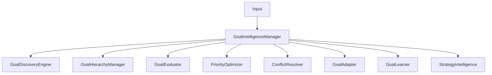
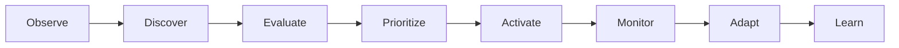

# RFC-0059

**Title:** Autonomous Goal Intelligence System

**Document ID:** RFC-0059

**Version:** 1.0

**Status:** Accepted

**Category:** Intelligence

**Layer:** Goal / Motivation / Autonomy

**Target:**

```text
goal/intelligence_manager/
```

---

# Abstract

This RFC defines the SH-3 Autonomous Goal Intelligence System.

The Autonomous Goal Intelligence System provides the intelligence layer responsible for generating, evaluating, prioritizing, adapting, and improving goals within SH-3.

The system governs:

- autonomous goal generation
- goal hierarchy management
- goal evaluation
- goal prioritization
- goal conflict resolution
- goal adaptation
- goal learning

The system enables:

- self-generated objectives
- dynamic goal management
- value-aware prioritization
- long-term objective alignment
- continuous goal improvement

The Autonomous Goal Intelligence System integrates with:

- Autonomous Strategy Intelligence System
- Autonomous Decision Intelligence System
- Planning System
- World Model System
- Learning System
- Memory System
- Self Evolution System
- AI Safety Governance System
- Risk Management System
- Environment Intelligence System

This document is normative.

---

# Motivation

Autonomous intelligence requires the ability to determine what should be achieved.

Traditional systems operate through externally defined goals.

However, SH-3 requires:

- identifying improvement opportunities
- discovering required capabilities
- adjusting priorities
- balancing competing objectives

Without Goal Intelligence:

- strategies lack direction
- learning lacks purpose
- evolution becomes inefficient

The Autonomous Goal Intelligence System provides goal formation and management capabilities.

---

# Goals

The Autonomous Goal Intelligence System SHALL provide:

- autonomous goal discovery
- hierarchical goal organization
- goal evaluation
- priority optimization
- conflict resolution
- adaptive goal evolution

---

# Non-Goals

The Autonomous Goal Intelligence System SHALL NOT:

- define unrestricted objectives
- bypass safety constraints
- replace Strategy Intelligence
- replace Decision Intelligence
- directly execute actions

Goal Intelligence determines desired outcomes.

---

# Architecture



The Autonomous Goal Intelligence System transforms system state into meaningful objectives.

---

# Design Principles

The Autonomous Goal Intelligence System follows these principles.

---

## Purpose Awareness

Goals SHALL represent meaningful improvement directions.

---

## Hierarchical Organization

Goals SHALL be structured from abstract to concrete.

---

## Value Alignment

Goals SHALL follow system values and constraints.

---

## Adaptive Adjustment

Goals SHALL change according to conditions.

---

## Conflict Management

Competing goals SHALL be evaluated.

---

## Continuous Learning

Goal generation SHALL improve through experience.

---

# Goal Intelligence Components

The system consists of:

| Component | Responsibility |
|-----------|----------------|
| GoalIntelligenceManager | Coordination |
| GoalDiscoveryEngine | Goal creation |
| GoalHierarchyManager | Structure management |
| GoalEvaluator | Value evaluation |
| PriorityOptimizer | Priority calculation |
| ConflictResolver | Conflict handling |
| GoalAdapter | Dynamic adjustment |
| GoalLearner | Improvement |

---

# GoalIntelligenceManager

GoalIntelligenceManager coordinates goal operations.

Responsibilities:

- goal generation
- evaluation coordination
- priority management
- adaptation control
- learning feedback

The manager does not execute goals.

---

# Goal Context

Every goal evaluation receives an immutable GoalContext.

A GoalContext contains:

| Field | Description |
|------|-------------|
| goal_id | Goal identifier |
| current_state | Current condition |
| requirements | Requirements |
| constraints | Restrictions |
| timestamp | Evaluation time |

---

# Goal Model

A GoalObject contains:

| Field | Description |
|------|-------------|
| goal_id | Identifier |
| description | Objective |
| parent_goal | Higher goal |
| priority | Importance |
| status | Current state |
| confidence | Confidence |

---

# Goal Lifecycle

Every goal follows:

```text
Observation

↓

Opportunity Detection

↓

Goal Generation

↓

Evaluation

↓

Prioritization

↓

Activation

↓

Monitoring

↓

Adaptation

↓

Learning
```

---

# Autonomous Goal Generation

GoalDiscoveryEngine creates candidate goals.

Goal sources:

- system limitations
- environment changes
- learning results
- strategic requirements
- user objectives

---

# Goal Generation Model

```text
Current State

+

Gap Analysis

+

Future Requirement

↓

Candidate Goal
```

---

# Goal Hierarchy Management

GoalHierarchyManager organizes goals.

Hierarchy example:

```text
Mission Goal

↓

Strategic Goal

↓

Capability Goal

↓

Operational Goal

↓

Task Goal
```

---

# Goal Evaluation

GoalEvaluator determines:

- importance
- expected benefit
- feasibility
- alignment
- urgency

---

# Goal Evaluation Model

```text
Goal Value

=

Expected Benefit

+

Strategic Importance

-

Cost

-

Risk
```

---

# Priority Optimization

PriorityOptimizer determines execution order.

Priority factors:

- impact
- urgency
- dependency
- resource availability
- strategic value

---

# Conflict Resolution

ConflictResolver handles:

- incompatible goals
- resource competition
- priority conflicts
- value conflicts

---

# Conflict Resolution Model

```text
Goal A

vs

Goal B

↓

Impact Analysis

↓

Priority Decision

↓

Balanced Goal Set
```

---

# Strategy Intelligence Integration

Strategy Intelligence provides:

- long-term objectives
- strategic direction
- evolution requirements

---

# Decision Intelligence Integration

Decision Intelligence provides:

- goal selection support
- utility analysis
- risk evaluation

---

# World Model Integration

World Model provides:

- future impact prediction
- causal relationships
- goal feasibility analysis

---

# Autonomous Goal Intelligence Execution Model

The Autonomous Goal Intelligence System transforms system state, strategic direction, and learned experience into adaptive, prioritized, and continuously improving objectives.

The goal intelligence lifecycle follows:



Each stage maintains a clear goal intelligence responsibility.

---

# Goal Intelligence Control Loop

The Autonomous Goal Intelligence System operates through continuous objective optimization.

```text
System State

↓

Gap Analysis

↓

Goal Discovery

↓

Goal Evaluation

↓

Priority Calculation

↓

Goal Activation

↓

Progress Monitoring

↓

Goal Adaptation

↓

Goal Learning
```

---

# Goal Value Alignment

GoalEvaluator validates goals against SH-3 values and constraints.

Evaluation dimensions:

- mission relevance
- safety alignment
- strategic contribution
- resource feasibility
- expected benefit

---

# Value Alignment Model

```text
Candidate Goal

+

System Values

+

Safety Constraints

+

Strategic Direction

↓

Validated Goal
```

---

# Goal Adaptation Engine

GoalAdapter dynamically modifies goals.

Adaptation triggers:

- environment changes
- capability improvements
- resource limitations
- new knowledge discovery
- strategic changes

---

# Goal Adaptation Flow

```text
Active Goal

↓

Condition Monitoring

↓

Goal Reassessment

↓

Priority Update

↓

Goal Modification
```

---

# Dynamic Goal Reprioritization

PriorityOptimizer continuously recalculates goal importance.

Priority factors:

- urgency
- impact
- dependency
- strategic value
- opportunity cost

---

# Priority Model

```text
Goal Priority

=

Impact

+

Urgency

+

Strategic Value

-

Cost

-

Risk
```

---

# Goal Dependency Management

GoalHierarchyManager maintains relationships.

Dependency types:

- prerequisite
- enhancement
- conflict
- alternative
- parallel

---

# Dependency Graph

```text
Mission Goal

↓

Strategic Goal

↓

Capability Goal

↓

Operational Goal

↓

Task Goal
```

---

# Goal Progress Evaluation

The system monitors:

- completion rate
- expected outcome
- resource usage
- deviation from plan

---

# Progress Model

```text
Expected Progress

vs

Actual Progress

↓

Goal Adjustment
```

---

# Goal Failure Handling

When goals fail:

```text
Failure Detection

↓

Cause Analysis

↓

Goal Review

↓

Strategy Update

↓

New Goal Decision
```

---

# Autonomous Goal Learning

GoalLearner improves goal generation.

Learning targets:

- goal quality
- priority accuracy
- value prediction
- adaptation timing

---

# Learning Pipeline

```text
Goal History

↓

Outcome Analysis

↓

Pattern Extraction

↓

Goal Model Update

↓

Improved Goal Generation
```

---

# Memory Integration

Memory stores:

- generated goals
- completed goals
- failed objectives
- priority decisions
- improvement lessons

---

# Knowledge Integration

Knowledge Governance stores:

- goal generation rules
- prioritization patterns
- validated objectives

---

# Strategy Intelligence Integration

Strategy Intelligence receives:

- high-level goals
- evolution objectives
- capability priorities

---

# Decision Intelligence Integration

Decision Intelligence receives:

- active objectives
- goal priorities
- evaluation constraints

---

# Planning Integration

PlanningCore receives:

- selected goals
- goal hierarchy
- execution requirements

---

# World Model Integration

World Model provides:

- goal consequence prediction
- feasibility analysis
- future impact estimation

---

# Environment Intelligence Integration

Environment Intelligence provides:

- environmental changes
- context information
- adaptation signals

---

# Resource Intelligence Integration

Resource Intelligence provides:

- capability availability
- resource constraints
- cost estimation

---

# Self Evolution Integration

Self Evolution System receives:

- improvement goals
- capability expansion targets
- evolutionary objectives

---

# AI Safety Governance Integration

AI Safety Governance validates:

- acceptable objectives
- prohibited goal formation
- autonomy boundaries

---

# Risk Management Integration

Risk Management evaluates:

- goal uncertainty
- potential impact
- mitigation requirements

---

# Message Bus Integration

Goal intelligence events include:

- GoalDiscovered
- GoalEvaluated
- GoalPrioritized
- GoalActivated
- GoalAdjusted
- GoalCompleted
- GoalLearned

---

# Persistence Integration

Persistence stores:

- goal models
- hierarchy states
- evaluation results
- adaptation history

---

# Observability Integration

Goal telemetry includes:

- goal generation rate
- completion rate
- priority accuracy
- adaptation frequency
- learning improvement

---

# Tracing

Goal traces preserve:

- trace_id
- goal_id
- parent_goal_id
- evaluation_id
- learning_id

---

# Thread Model

The Autonomous Goal Intelligence System supports concurrent:

- goal discovery
- evaluation
- prioritization
- adaptation
- learning

Goal state transitions SHALL be synchronized.

The reference implementation shall be thread-safe.

---

# Metrics

The Autonomous Goal Intelligence System exposes:

- goal quality score
- goal completion rate
- priority accuracy
- adaptation success rate
- alignment score
- learning improvement rate

---

# Performance Objectives

The Autonomous Goal Intelligence System should optimize for:

- meaningful objective generation
- adaptive prioritization
- strategic alignment
- safe autonomy
- continuous goal improvement

---

# Future Work

Potential future enhancements include:

- autonomous scientific objective discovery
- self-directed research planning
- hierarchical motivation modeling
- recursive goal improvement
- fully autonomous objective evolution

These enhancements extend SH-3 toward an advanced autonomous intelligence capable of determining, refining, and improving its own objectives while maintaining safety and alignment.

---

# References

- SH-3 Architecture Specification v2.1
- RFC-0023 World Model System
- RFC-0026 Self Evolution System
- RFC-0027 Autonomous Learning System
- RFC-0053 AI Safety Governance System
- RFC-0057 Autonomous Decision Intelligence System
- RFC-0058 Autonomous Strategy Intelligence System

---

# End of RFC-0059
