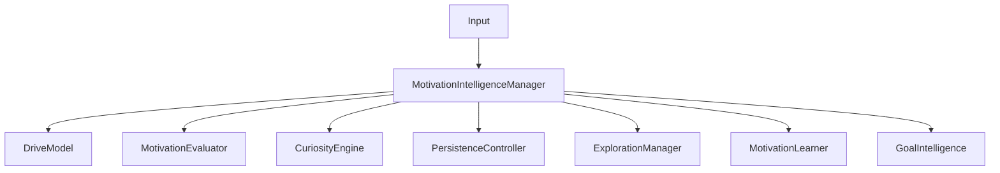
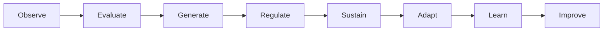

# RFC-0060

**Title:** Autonomous Motivation Intelligence System

**Document ID:** RFC-0060

**Version:** 1.0

**Status:** Accepted

**Category:** Intelligence

**Layer:** Motivation / Drive / Autonomy

**Target:**

```text
motivation/intelligence_manager/
```

---

# Abstract

This RFC defines the SH-3 Autonomous Motivation Intelligence System.

The Autonomous Motivation Intelligence System provides the intelligence layer responsible for generating, regulating, sustaining, and adapting internal motivational states that influence autonomous behavior.

The system governs:

- drive modeling
- motivation generation
- intrinsic motivation
- goal persistence
- curiosity management
- exploration versus exploitation
- motivational learning

The system enables:

- sustained autonomous activity
- adaptive behavioral regulation
- internally generated exploration
- long-term objective persistence
- continuous motivational optimization

The Autonomous Motivation Intelligence System integrates with:

- Autonomous Goal Intelligence System
- Autonomous Strategy Intelligence System
- Autonomous Decision Intelligence System
- Learning System
- World Model System
- Environment Intelligence System
- Resource Intelligence System
- Self Evolution System
- AI Safety Governance System
- Risk Management System

This document is normative.

---

# Motivation

Autonomous intelligence requires more than goals.

A system must determine:

- why an objective should remain active
- when exploration is beneficial
- when persistence should be maintained
- when motivation should change

Without motivation:

- goals become static
- learning stagnates
- exploration disappears
- adaptation weakens

The Autonomous Motivation Intelligence System provides sustained autonomous behavioral regulation.

---

# Goals

The Autonomous Motivation Intelligence System SHALL provide:

- intrinsic motivation
- adaptive drive regulation
- goal persistence
- curiosity mechanisms
- exploration management
- motivational learning

---

# Non-Goals

The Autonomous Motivation Intelligence System SHALL NOT:

- replace Goal Intelligence
- replace Decision Intelligence
- bypass AI Safety Governance
- directly execute actions
- define unrestricted motivations

Motivation Intelligence regulates behavioral energy and persistence.

---

# Architecture



The Autonomous Motivation Intelligence System transforms internal state into sustained autonomous behavior.

---

# Design Principles

The Autonomous Motivation Intelligence System follows these principles.

---

## Intrinsic Regulation

Motivations SHALL be internally evaluated.

---

## Adaptive Persistence

Persistence SHALL adapt to changing conditions.

---

## Curiosity Balance

Exploration SHALL remain beneficial and bounded.

---

## Goal Support

Motivations SHALL reinforce meaningful objectives.

---

## Continuous Adaptation

Motivational dynamics SHALL evolve through learning.

---

## Safety Alignment

Motivational processes SHALL remain within governance constraints.

---

# Motivation Intelligence Components

The system consists of:

| Component | Responsibility |
|-----------|----------------|
| MotivationIntelligenceManager | Coordination |
| DriveModel | Internal drive representation |
| MotivationEvaluator | Motivation assessment |
| CuriosityEngine | Intrinsic exploration |
| PersistenceController | Goal persistence |
| ExplorationManager | Exploration policy |
| MotivationLearner | Continuous improvement |

---

# MotivationIntelligenceManager

MotivationIntelligenceManager coordinates motivational intelligence.

Responsibilities:

- motivation generation
- drive regulation
- persistence management
- curiosity coordination
- learning feedback

The manager does not directly execute actions.

---

# Motivation Context

Every motivation evaluation receives an immutable MotivationContext.

A MotivationContext contains:

| Field | Description |
|------|-------------|
| motivation_id | Motivation identifier |
| active_goals | Current objectives |
| internal_state | Internal status |
| environment | External context |
| timestamp | Evaluation time |

---

# Motivation Model

A MotivationObject contains:

| Field | Description |
|------|-------------|
| motivation_id | Identifier |
| drive_type | Motivation category |
| intensity | Activation level |
| persistence | Expected duration |
| confidence | Stability estimate |

---

# Motivation Lifecycle

Every motivation follows:

```text
Observation

↓

Drive Assessment

↓

Motivation Generation

↓

Priority Evaluation

↓

Behavioral Support

↓

Monitoring

↓

Adaptation

↓

Learning
```

---

# Drive Modeling

DriveModel represents internal behavioral drivers.

Supported drives include:

- achievement
- exploration
- efficiency
- robustness
- learning
- maintenance

---

# Drive Model

```text
Internal State

+

Goal State

+

Environment

↓

Drive Activation
```

---

# Intrinsic Motivation

MotivationEvaluator estimates internally generated motivation.

Evaluation considers:

- expected knowledge gain
- capability growth
- uncertainty reduction
- strategic contribution

---

# Intrinsic Motivation Model

```text
Knowledge Gain

+

Capability Improvement

+

Strategic Value

↓

Intrinsic Motivation
```

---

# Goal Persistence

PersistenceController determines how long goals remain active.

Persistence depends upon:

- strategic value
- observed progress
- motivation intensity
- environmental stability

---

# Persistence Model

```text
Goal Importance

+

Motivation

+

Observed Progress

↓

Persistence Level
```

---

# Curiosity Mechanism

CuriosityEngine promotes bounded exploration.

Curiosity sources include:

- novelty
- uncertainty
- unexplored knowledge
- prediction error

---

# Curiosity Model

```text
Novelty

+

Prediction Error

+

Knowledge Gap

↓

Exploration Motivation
```

---

# Exploration Management

ExplorationManager balances:

- exploration
- exploitation
- stability
- efficiency

---

# Exploration Policy

```text
Current Knowledge

↓

Uncertainty Evaluation

↓

Exploration Decision
```

---

# Goal Intelligence Integration

Goal Intelligence provides:

- active objectives
- goal hierarchy
- priority information

---

# Strategy Intelligence Integration

Strategy Intelligence provides:

- long-term direction
- capability priorities
- evolution plans

---

# Autonomous Motivation Intelligence Execution Model

The Autonomous Motivation Intelligence System transforms internal state, environmental feedback, and accumulated experience into adaptive, sustainable, and continuously improving motivational dynamics.

The motivation intelligence lifecycle follows:



Each stage maintains a clear motivational intelligence responsibility.

---

# Motivation Intelligence Control Loop

The Autonomous Motivation Intelligence System operates through continuous motivational optimization.

```text
Internal State

↓

Drive Assessment

↓

Motivation Generation

↓

Priority Regulation

↓

Behavior Selection Support

↓

Outcome Observation

↓

Motivation Adaptation

↓

Motivational Learning
```

---

# Internal State Evaluation

MotivationEvaluator continuously evaluates the internal operational state.

Evaluation dimensions:

- active goals
- learning progress
- capability growth
- resource availability
- environmental stability
- strategic alignment

---

# Internal State Model

```text
Goal State

+

Capability State

+

Environment State

+

Resource State

↓

Motivational State
```

---

# Motivation Regulation Engine

The MotivationRegulator adjusts motivational intensity over time.

Regulation factors include:

- progress acceleration
- repeated failure
- environmental uncertainty
- strategic importance
- opportunity discovery

---

# Regulation Model

```text
Current Motivation

+

Observed Outcome

+

Context

↓

Updated Motivation
```

---

# Priority Dynamics

Motivations continuously influence goal priorities.

Priority adjustments consider:

- urgency
- expected value
- novelty
- exploration benefit
- execution cost

---

# Dynamic Priority Model

```text
Motivation

+

Goal Value

+

Expected Benefit

↓

Behavior Priority
```

---

# Exploration vs Exploitation

ExplorationManager balances learning and execution.

Exploration is preferred when:

- uncertainty is high
- knowledge gaps exist
- prediction error increases
- long-term benefit exceeds short-term cost

Exploitation is preferred when:

- confidence is high
- goals are time-critical
- resources are constrained
- strategy stability is required

---

# Exploration Policy Model

```text
Prediction Confidence

+

Knowledge Coverage

+

Expected Gain

↓

Exploration Ratio
```

---

# Curiosity Adaptation

CuriosityEngine dynamically regulates curiosity.

Curiosity increases when:

- novel environments appear
- unexplained observations accumulate
- prediction failures increase

Curiosity decreases when:

- knowledge becomes sufficient
- exploration cost exceeds benefit
- operational risk rises

---

# Curiosity Learning Loop

```text
Novel Experience

↓

Knowledge Acquisition

↓

Prediction Improvement

↓

Reduced Uncertainty

↓

Curiosity Update
```

---

# Motivation Decay

Inactive motivations gradually decay.

Decay depends upon:

- elapsed time
- goal completion
- environmental relevance
- strategic importance

Decay prevents obsolete motivations from consuming resources indefinitely.

---

# Motivation Reinforcement

Motivations strengthen through positive outcomes.

Reinforcement sources:

- successful learning
- capability improvement
- strategic achievement
- prediction accuracy

---

# Reinforcement Model

```text
Successful Outcome

↓

Positive Reinforcement

↓

Motivation Strengthening
```

---

# Autonomous Motivation Learning

MotivationLearner improves motivational regulation.

Learning targets:

- persistence accuracy
- curiosity effectiveness
- exploration policy
- reinforcement timing
- intrinsic reward estimation

---

# Learning Pipeline

```text
Motivation History

↓

Behavior Outcome

↓

Pattern Extraction

↓

Motivation Model Update

↓

Improved Motivation
```

---

# Memory Integration

Memory stores:

- motivational history
- drive activation patterns
- persistence records
- exploration outcomes
- reinforcement events

---

# Knowledge Integration

Knowledge Governance stores:

- motivational policies
- exploration heuristics
- reinforcement models
- validated behavioral patterns

---

# Goal Intelligence Integration

Goal Intelligence receives:

- motivation strength
- persistence recommendations
- reprioritization signals

---

# Strategy Intelligence Integration

Strategy Intelligence receives:

- long-term motivational trends
- exploration opportunities
- intrinsic capability interests

---

# Decision Intelligence Integration

Decision Intelligence receives:

- behavioral priorities
- exploration weighting
- motivation-adjusted utilities

---

# World Model Integration

World Model provides:

- predicted learning benefit
- exploration outcomes
- long-term motivational impact

---

# Environment Intelligence Integration

Environment Intelligence provides:

- novelty indicators
- environmental uncertainty
- adaptation signals

---

# Resource Intelligence Integration

Resource Intelligence provides:

- available computational budget
- exploration cost
- operational constraints

---

# Self Evolution Integration

Self Evolution System receives:

- persistent improvement drives
- intrinsic capability interests
- long-term developmental tendencies

---

# AI Safety Governance Integration

AI Safety Governance validates:

- motivational boundaries
- exploration limits
- autonomous behavioral constraints

---

# Risk Management Integration

Risk Management evaluates:

- exploration risk
- persistence risk
- motivational instability
- behavioral uncertainty

---

# Message Bus Integration

Motivation intelligence events include:

- MotivationGenerated
- MotivationUpdated
- CuriosityTriggered
- ExplorationStarted
- PersistenceAdjusted
- MotivationReinforced
- MotivationLearned

---

# Persistence Integration

Persistence stores:

- motivation models
- reinforcement history
- curiosity profiles
- exploration statistics

---

# Observability Integration

Motivation telemetry includes:

- motivation intensity
- curiosity index
- persistence duration
- exploration ratio
- intrinsic reward estimate
- learning improvement

---

# Tracing

Motivation traces preserve:

- trace_id
- motivation_id
- drive_id
- curiosity_id
- reinforcement_id
- learning_id

---

# Thread Model

The Autonomous Motivation Intelligence System supports concurrent:

- drive evaluation
- curiosity assessment
- reinforcement processing
- persistence management
- motivational learning

Motivational state transitions SHALL be synchronized.

The reference implementation shall be thread-safe.

---

# Metrics

The Autonomous Motivation Intelligence System exposes:

- motivation stability
- persistence effectiveness
- curiosity efficiency
- exploration effectiveness
- reinforcement quality
- motivational learning rate

---

# Performance Objectives

The Autonomous Motivation Intelligence System should optimize for:

- sustained autonomous behavior
- adaptive exploration
- efficient exploitation
- meaningful intrinsic motivation
- continuous behavioral improvement

---

# Future Work

Potential future enhancements include:

- hierarchical intrinsic motivation models
- autonomous scientific curiosity
- adaptive motivational ecosystems
- recursive drive optimization
- self-organizing motivational architectures

These enhancements extend SH-3 toward an advanced autonomous intelligence capable of sustaining purposeful long-term behavior through adaptive internal motivational regulation.

---

# References

- SH-3 Architecture Specification v2.1
- RFC-0026 Self Evolution System
- RFC-0027 Autonomous Learning System
- RFC-0023 World Model System
- RFC-0053 AI Safety Governance System
- RFC-0057 Autonomous Decision Intelligence System
- RFC-0058 Autonomous Strategy Intelligence System
- RFC-0059 Autonomous Goal Intelligence System

---

# End of RFC-0060
