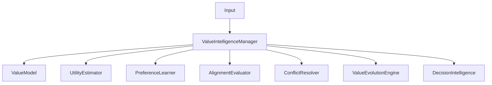
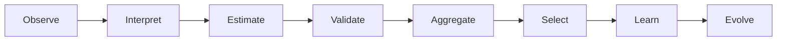

# RFC-0061

**Title:** Autonomous Value Intelligence System

**Document ID:** RFC-0061

**Version:** 1.0

**Status:** Accepted

**Category:** Intelligence

**Layer:** Value / Utility / Alignment

**Target:**

```text
value/intelligence_manager/
```

---

# Abstract

This RFC defines the SH-3 Autonomous Value Intelligence System.

The Autonomous Value Intelligence System provides the intelligence layer responsible for constructing, evaluating, maintaining, and improving the internal value model used by SH-3.

The system governs:

- value modeling
- utility estimation
- preference learning
- value alignment
- value conflict resolution
- value adaptation
- value evolution

The system enables:

- internally consistent evaluation
- adaptive utility estimation
- preference optimization
- long-term value preservation
- explainable value reasoning

The Autonomous Value Intelligence System integrates with:

- Autonomous Motivation Intelligence System
- Autonomous Goal Intelligence System
- Autonomous Strategy Intelligence System
- Autonomous Decision Intelligence System
- World Model System
- Learning System
- AI Safety Governance System
- Knowledge Governance System
- Risk Management System
- Self Evolution System

This document is normative.

---

# Motivation

Autonomous intelligence requires a stable mechanism for determining what is valuable.

Goals define **what** should be achieved.

Strategies define **how** objectives should be achieved.

Motivation determines **why** activity continues.

Value Intelligence determines **how outcomes are evaluated**.

Without a consistent value model:

- decision quality becomes unstable
- priorities drift
- learning becomes inconsistent
- optimization lacks direction

The Autonomous Value Intelligence System provides this evaluation foundation.

---

# Goals

The Autonomous Value Intelligence System SHALL provide:

- adaptive value modeling
- utility estimation
- preference learning
- value alignment
- conflict resolution
- continuous value improvement

---

# Non-Goals

The Autonomous Value Intelligence System SHALL NOT:

- replace Goal Intelligence
- replace Decision Intelligence
- override AI Safety Governance
- define unrestricted preferences
- directly execute behaviors

Value Intelligence evaluates alternatives rather than performing them.

---

# Architecture



The Autonomous Value Intelligence System transforms observations and experience into stable utility representations.

---

# Design Principles

The Autonomous Value Intelligence System follows these principles.

---

## Consistency

Equivalent situations SHOULD produce equivalent value assessments.

---

## Adaptability

Value estimation SHALL improve through experience.

---

## Explainability

Every value evaluation SHALL be traceable.

---

## Alignment

Values SHALL remain compatible with governance policies.

---

## Long-Term Optimization

Immediate rewards SHALL NOT dominate long-term utility.

---

## Stability

Value evolution SHALL occur gradually and safely.

---

# Value Intelligence Components

The system consists of:

| Component | Responsibility |
|-----------|----------------|
| ValueIntelligenceManager | Coordination |
| ValueModel | Internal representation |
| UtilityEstimator | Utility calculation |
| PreferenceLearner | Preference optimization |
| AlignmentEvaluator | Policy compatibility |
| ConflictResolver | Value conflict handling |
| ValueEvolutionEngine | Continuous improvement |

---

# ValueIntelligenceManager

ValueIntelligenceManager coordinates all value-related operations.

Responsibilities:

- value evaluation
- utility estimation
- preference updates
- conflict resolution
- evolutionary refinement

The manager does not directly execute actions.

---

# Value Context

Every evaluation receives an immutable ValueContext.

A ValueContext contains:

| Field | Description |
|------|-------------|
| value_id | Evaluation identifier |
| goals | Active objectives |
| motivation | Current motivational state |
| strategy | Active strategy |
| constraints | Governance constraints |
| timestamp | Evaluation time |

---

# Value Model

A ValueObject contains:

| Field | Description |
|------|-------------|
| value_id | Identifier |
| utility | Estimated utility |
| confidence | Confidence level |
| alignment | Alignment score |
| explanation | Evaluation rationale |

---

# Value Lifecycle

Every value assessment follows:

```text
Observation

↓

Context Construction

↓

Utility Estimation

↓

Alignment Validation

↓

Conflict Resolution

↓

Value Assignment

↓

Outcome Evaluation

↓

Learning
```

---

# Value Modeling

ValueModel represents internal utility relationships.

Model inputs include:

- goals
- motivations
- strategies
- predicted outcomes
- historical experience

---

# Value Model Representation

```text
Context

+

Expected Outcome

+

Historical Utility

↓

Estimated Value
```

---

# Utility Estimation

UtilityEstimator predicts expected utility.

Evaluation factors:

- expected benefit
- strategic contribution
- resource efficiency
- uncertainty
- long-term impact

---

# Utility Model

```text
Expected Utility

=

Benefit

+

Strategic Contribution

-

Cost

-

Risk
```

---

# Preference Learning

PreferenceLearner improves evaluation preferences.

Learning signals include:

- successful outcomes
- failures
- user feedback
- long-term optimization

---

# Preference Model

```text
Experience

↓

Preference Update

↓

Improved Utility Estimation
```

---

# Value Alignment

AlignmentEvaluator validates consistency with:

- AI Safety Governance
- operational policy
- strategic objectives
- ethical constraints
- resource policies

---

# Alignment Model

```text
Candidate Value

+

Governance Rules

+

Safety Constraints

↓

Aligned Value
```

---

# Autonomous Value Intelligence Execution Model

The Autonomous Value Intelligence System transforms observations, experience, strategic objectives, and governance constraints into stable, adaptive, and continuously improving value representations.

The value intelligence lifecycle follows:



Each stage maintains a clear value intelligence responsibility.

---

# Value Intelligence Control Loop

The Autonomous Value Intelligence System operates through continuous value optimization.

```text
Observation

↓

Context Construction

↓

Utility Estimation

↓

Alignment Validation

↓

Conflict Resolution

↓

Value Aggregation

↓

Decision Support

↓

Outcome Evaluation

↓

Value Learning
```

---

# Multi-Objective Value Aggregation

ValueIntelligence combines multiple utility sources.

Aggregation dimensions include:

- strategic utility
- operational utility
- learning utility
- safety utility
- resource utility
- long-term utility

---

# Aggregation Model

```text
Strategic Utility

+

Learning Utility

+

Operational Utility

+

Safety Utility

+

Long-Term Utility

↓

Global Utility
```

---

# Value Conflict Resolution

ConflictResolver resolves competing value estimates.

Conflict sources:

- conflicting goals
- limited resources
- competing strategies
- uncertain predictions
- policy restrictions

---

# Conflict Resolution Flow

```text
Conflicting Utilities

↓

Priority Analysis

↓

Trade-off Evaluation

↓

Resolved Utility
```

---

# Long-Term Utility Optimization

The system prevents excessive short-term optimization.

Optimization considers:

- cumulative benefit
- future capability growth
- sustainability
- strategic consistency
- system stability

---

# Long-Term Utility Model

```text
Immediate Utility

+

Future Utility

+

Learning Benefit

↓

Long-Term Utility
```

---

# Value Drift Detection

ValueEvolutionEngine detects undesirable changes.

Drift indicators:

- unstable preferences
- inconsistent evaluations
- repeated reversals
- governance deviation
- reward instability

---

# Drift Detection Pipeline

```text
Historical Values

↓

Trend Analysis

↓

Deviation Detection

↓

Correction Recommendation
```

---

# Adaptive Value Evolution

The value model evolves cautiously.

Evolution triggers:

- accumulated experience
- verified learning
- persistent environmental change
- improved predictive accuracy

---

# Value Evolution Model

```text
Validated Experience

↓

Model Update

↓

Consistency Verification

↓

Updated Value Model
```

---

# Preference Stabilization

PreferenceLearner prevents oscillation.

Stabilization mechanisms:

- historical smoothing
- confidence weighting
- governance constraints
- minimum adaptation intervals

---

# Preference Stability Model

```text
Historical Preference

+

Current Evidence

+

Confidence

↓

Stable Preference
```

---

# Value Learning Loop

Learning continuously improves utility estimation.

Learning targets:

- estimation accuracy
- preference consistency
- alignment quality
- long-term optimization

---

# Learning Pipeline

```text
Value History

↓

Outcome Analysis

↓

Prediction Error

↓

Utility Model Update

↓

Improved Evaluation
```

---

# Memory Integration

Memory stores:

- historical utilities
- preference evolution
- conflict resolutions
- alignment decisions
- value explanations

---

# Knowledge Integration

Knowledge Governance stores:

- value policies
- evaluation heuristics
- utility models
- validated preferences

---

# Goal Intelligence Integration

Goal Intelligence receives:

- value-weighted priorities
- objective evaluations
- preference signals

---

# Motivation Intelligence Integration

Motivation Intelligence receives:

- intrinsic utility estimates
- reinforcement values
- persistence recommendations

---

# Strategy Intelligence Integration

Strategy Intelligence receives:

- strategic utility
- long-term value trends
- capability valuations

---

# Decision Intelligence Integration

Decision Intelligence receives:

- aggregated utilities
- confidence scores
- value explanations

---

# World Model Integration

World Model provides:

- predicted consequences
- expected utility forecasts
- causal evaluation support

---

# AI Safety Governance Integration

AI Safety Governance validates:

- acceptable value evolution
- alignment preservation
- prohibited utility shifts

---

# Risk Management Integration

Risk Management evaluates:

- uncertainty in utility
- value instability
- alignment degradation
- long-term optimization risk

---

# Self Evolution Integration

Self Evolution System receives:

- capability valuations
- improvement priorities
- evolutionary utility signals

---

# Message Bus Integration

Value intelligence events include:

- ValueEstimated
- UtilityCalculated
- PreferenceUpdated
- AlignmentValidated
- ConflictResolved
- ValueModelUpdated
- ValueLearned

---

# Persistence Integration

Persistence stores:

- value models
- preference history
- utility estimates
- alignment records
- evolution history

---

# Observability Integration

Value telemetry includes:

- utility estimation accuracy
- alignment score
- preference stability
- conflict frequency
- drift rate
- learning improvement

---

# Tracing

Value traces preserve:

- trace_id
- value_id
- utility_id
- preference_id
- alignment_id
- learning_id

---

# Thread Model

The Autonomous Value Intelligence System supports concurrent:

- utility estimation
- preference learning
- alignment validation
- conflict resolution
- value evolution

Value state transitions SHALL be synchronized.

The reference implementation shall be thread-safe.

---

# Metrics

The Autonomous Value Intelligence System exposes:

- utility prediction accuracy
- preference stability
- alignment consistency
- value drift rate
- conflict resolution efficiency
- long-term utility improvement

---

# Performance Objectives

The Autonomous Value Intelligence System should optimize for:

- stable value estimation
- adaptive preference learning
- governance alignment
- explainable utility reasoning
- sustainable long-term optimization

---

# Future Work

Potential future enhancements include:

- hierarchical value systems
- context-sensitive utility functions
- multi-agent value negotiation
- recursive value refinement
- autonomous value discovery
- constitutional value reasoning

These enhancements extend SH-3 toward an advanced autonomous intelligence capable of maintaining stable internal values while continuously improving utility estimation and long-term alignment.

---

# References

- SH-3 Architecture Specification v2.1
- RFC-0023 World Model System
- RFC-0026 Self Evolution System
- RFC-0027 Autonomous Learning System
- RFC-0053 AI Safety Governance System
- RFC-0057 Autonomous Decision Intelligence System
- RFC-0058 Autonomous Strategy Intelligence System
- RFC-0059 Autonomous Goal Intelligence System
- RFC-0060 Autonomous Motivation Intelligence System

---

# End of RFC-0061
