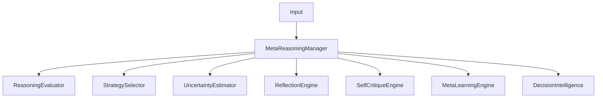

# RFC-0062

**Title:** Autonomous Meta-Reasoning Intelligence System

**Document ID:** RFC-0062

**Version:** 1.0

**Status:** Accepted

**Category:** Intelligence

**Layer:** Meta-Reasoning / Reflection / Cognitive Control

**Target:**

```text
meta_reasoning/intelligence_manager/
```

---

# Abstract

This RFC defines the SH-3 Autonomous Meta-Reasoning Intelligence System.

The Autonomous Meta-Reasoning Intelligence System provides the intelligence layer responsible for monitoring, evaluating, regulating, and improving SH-3's own reasoning processes.

The system governs:

- reasoning evaluation
- reasoning strategy selection
- uncertainty estimation
- reflection
- self-critique
- reasoning optimization
- meta-learning

The system enables:

- reasoning quality assessment
- adaptive reasoning selection
- confidence-aware cognition
- continuous cognitive improvement
- explainable reflective reasoning

The Autonomous Meta-Reasoning Intelligence System integrates with:

- Autonomous Value Intelligence System
- Autonomous Motivation Intelligence System
- Autonomous Goal Intelligence System
- Autonomous Strategy Intelligence System
- Autonomous Decision Intelligence System
- World Model System
- Learning System
- Knowledge Governance System
- AI Safety Governance System
- Self Evolution System

This document is normative.

---

# Motivation

Reasoning quality directly determines autonomous intelligence.

Selecting an action is insufficient.

SH-3 must also determine:

- whether reasoning is reliable
- whether assumptions are valid
- whether uncertainty is acceptable
- whether another reasoning strategy would be superior

Without meta-reasoning:

- systematic reasoning errors accumulate
- confidence becomes unreliable
- cognitive improvement slows
- learning becomes inefficient

The Autonomous Meta-Reasoning Intelligence System provides continuous reasoning supervision and optimization.

---

# Goals

The Autonomous Meta-Reasoning Intelligence System SHALL provide:

- reasoning evaluation
- reasoning strategy selection
- uncertainty management
- reflective reasoning
- self-critique
- continuous reasoning improvement

---

# Non-Goals

The Autonomous Meta-Reasoning Intelligence System SHALL NOT:

- replace Decision Intelligence
- replace Planning
- bypass AI Safety Governance
- directly execute actions
- alter historical traces

Meta-Reasoning evaluates reasoning rather than replacing operational cognition.

---

# Architecture



The Autonomous Meta-Reasoning Intelligence System transforms reasoning activity into improved cognitive performance.

---

# Design Principles

The Autonomous Meta-Reasoning Intelligence System follows these principles.

---

## Reflection

Reasoning SHALL be continuously examined.

---

## Explainability

Meta-level decisions SHALL be traceable.

---

## Uncertainty Awareness

Confidence SHALL influence reasoning behavior.

---

## Adaptive Strategy Selection

Reasoning approaches SHALL adapt to context.

---

## Continuous Improvement

Meta-learning SHALL improve future reasoning.

---

## Safety Preservation

Meta-reasoning SHALL remain within governance constraints.

---

# Meta-Reasoning Components

The system consists of:

| Component | Responsibility |
|-----------|----------------|
| MetaReasoningManager | Coordination |
| ReasoningEvaluator | Reasoning quality assessment |
| StrategySelector | Reasoning strategy selection |
| UncertaintyEstimator | Confidence estimation |
| ReflectionEngine | Reflective analysis |
| SelfCritiqueEngine | Error detection |
| MetaLearningEngine | Improvement |

---

# MetaReasoningManager

MetaReasoningManager coordinates reflective cognition.

Responsibilities:

- reasoning evaluation
- confidence monitoring
- reflection scheduling
- strategy optimization
- learning coordination

The manager does not directly produce operational decisions.

---

# MetaReasoning Context

Every reasoning assessment receives an immutable MetaReasoningContext.

A MetaReasoningContext contains:

| Field | Description |
|------|-------------|
| reasoning_id | Reasoning identifier |
| decision_context | Current decision context |
| reasoning_trace | Recorded reasoning |
| confidence | Confidence estimate |
| timestamp | Evaluation time |

---

# MetaReasoning Model

A MetaReasoningObject contains:

| Field | Description |
|------|-------------|
| reasoning_id | Identifier |
| quality_score | Estimated reasoning quality |
| confidence | Confidence estimate |
| uncertainty | Estimated uncertainty |
| recommendation | Suggested improvement |

---

# MetaReasoning Lifecycle

Every reasoning evaluation follows:

```text
Reasoning

↓

Observation

↓

Quality Evaluation

↓

Reflection

↓

Self Critique

↓

Optimization

↓

Learning
```

---

# Reasoning Evaluation

ReasoningEvaluator measures reasoning quality.

Evaluation criteria include:

- logical consistency
- evidence quality
- causal validity
- prediction reliability
- explanation completeness

---

# Reasoning Evaluation Model

```text
Reasoning Trace

+

Evidence

+

Prediction

↓

Reasoning Quality
```

---

# Reasoning Strategy Selection

StrategySelector selects reasoning approaches.

Available strategies include:

- deductive reasoning
- inductive reasoning
- abductive reasoning
- probabilistic reasoning
- causal reasoning

Selection depends upon:

- uncertainty
- available knowledge
- time constraints
- prediction quality

---

# Strategy Selection Model

```text
Problem Context

+

Knowledge

+

Confidence

↓

Reasoning Strategy
```

---

# Uncertainty Estimation

UncertaintyEstimator evaluates confidence.

Uncertainty sources include:

- incomplete knowledge
- conflicting evidence
- prediction variance
- environmental instability

---

# Confidence Model

```text
Evidence Quality

+

Prediction Stability

+

Historical Accuracy

↓

Confidence Estimate
```

---

# Reflection Engine

ReflectionEngine performs post-reasoning analysis.

Reflection evaluates:

- reasoning assumptions
- hidden dependencies
- alternative explanations
- missed information

---

# Reflection Model

```text
Reasoning Result

↓

Critical Review

↓

Improved Understanding
```

---

# Self-Critique

SelfCritiqueEngine identifies weaknesses.

Detected issues include:

- unsupported assumptions
- logical inconsistency
- excessive uncertainty
- contradictory evidence

---

# Autonomous Meta-Reasoning Intelligence Execution Model

The Autonomous Meta-Reasoning Intelligence System transforms reasoning traces, decision outcomes, and accumulated experience into adaptive, explainable, and continuously improving cognitive processes.

The meta-reasoning lifecycle follows:


Each stage maintains a distinct meta-cognitive responsibility.

---

# Meta-Reasoning Control Loop

The Autonomous Meta-Reasoning Intelligence System operates through continuous cognitive optimization.

```text
Reasoning Execution

↓

Reasoning Trace Collection

↓

Quality Evaluation

↓

Reflection

↓

Self-Critique

↓

Optimization

↓

Outcome Validation

↓

Meta-Learning
```

---

# Reflection Control Loop

ReflectionEngine continuously reviews completed reasoning.

Reflection dimensions include:

- assumption validity
- evidence completeness
- logical consistency
- causal correctness
- alternative explanations

---

# Reflection Model

```text
Reasoning Trace

+

Observed Outcome

↓

Reflective Analysis

↓

Improvement Recommendation
```

---

# Self-Critique Pipeline

SelfCritiqueEngine performs structured error analysis.

Evaluation targets include:

- unsupported assumptions
- reasoning gaps
- contradictory conclusions
- missing evidence
- confidence mismatch

---

# Self-Critique Flow

```text
Reasoning Result

↓

Weakness Detection

↓

Improvement Suggestions

↓

Corrective Feedback
```

---

# Reasoning Optimization Engine

The system improves future reasoning.

Optimization targets:

- inference quality
- evidence usage
- prediction accuracy
- computational efficiency
- explanation quality

---

# Optimization Model

```text
Observed Error

+

Historical Success

↓

Reasoning Update
```

---

# Adaptive Reasoning Strategy

StrategySelector dynamically switches reasoning strategies.

Possible transitions include:

- deductive → probabilistic
- inductive → causal
- abductive → hybrid
- symbolic → statistical

Selection depends upon:

- uncertainty
- available evidence
- computational budget
- expected utility

---

# Hybrid Reasoning Model

```text
Problem Type

+

Knowledge Availability

+

Confidence

↓

Hybrid Strategy
```

---

# Reasoning Drift Detection

MetaLearningEngine detects degradation.

Drift indicators:

- declining prediction accuracy
- repeated reasoning failures
- unstable confidence
- inconsistent explanations
- recurring logical errors

---

# Drift Detection Pipeline

```text
Historical Reasoning

↓

Trend Analysis

↓

Deviation Detection

↓

Optimization Trigger
```

---

# Recursive Reflection

Reflection may recursively evaluate previous reflections.

Recursive reflection SHALL:

- terminate deterministically
- respect recursion limits
- preserve traceability
- avoid infinite self-analysis

---

# Recursive Reflection Model

```text
Reasoning

↓

Reflection

↓

Meta-Reflection

↓

Validated Improvement
```

---

# Meta-Learning Loop

MetaLearningEngine continuously improves cognitive processes.

Learning targets:

- reasoning strategy selection
- uncertainty estimation
- reflection quality
- critique accuracy
- optimization effectiveness

---

# Meta-Learning Pipeline

```text
Reasoning History

↓

Performance Analysis

↓

Pattern Extraction

↓

Meta Model Update

↓

Improved Reasoning
```

---

# Memory Integration

Memory stores:

- reasoning traces
- reflection history
- critique reports
- optimization results
- confidence history

---

# Knowledge Integration

Knowledge Governance stores:

- reasoning heuristics
- optimization policies
- validated inference patterns
- reflection templates

---

# Decision Intelligence Integration

Decision Intelligence receives:

- reasoning confidence
- optimization recommendations
- uncertainty estimates

---

# Strategy Intelligence Integration

Strategy Intelligence receives:

- reasoning effectiveness metrics
- strategic inference quality
- reflective recommendations

---

# Goal Intelligence Integration

Goal Intelligence receives:

- reasoning-based goal refinements
- confidence-weighted priorities

---

# Value Intelligence Integration

Value Intelligence receives:

- utility estimation feedback
- reasoning consistency metrics

---

# World Model Integration

World Model provides:

- predicted outcomes
- causal validation
- simulation-based verification

---

# AI Safety Governance Integration

AI Safety Governance validates:

- reflective boundaries
- reasoning constraints
- acceptable optimization scope

---

# Risk Management Integration

Risk Management evaluates:

- reasoning uncertainty
- optimization risk
- recursive instability
- confidence degradation

---

# Self Evolution Integration

Self Evolution System receives:

- reasoning improvement opportunities
- cognitive capability assessments
- long-term optimization recommendations

---

# Message Bus Integration

Meta-reasoning events include:

- ReasoningEvaluated
- ReflectionCompleted
- SelfCritiqueCompleted
- StrategyOptimized
- DriftDetected
- MetaLearningUpdated
- CognitiveImproved

---

# Persistence Integration

Persistence stores:

- reasoning models
- reflection logs
- critique history
- optimization history
- meta-learning models

---

# Observability Integration

Meta-reasoning telemetry includes:

- reasoning quality score
- confidence calibration error
- reflection effectiveness
- critique precision
- optimization gain
- cognitive drift rate

---

# Tracing

Meta-reasoning traces preserve:

- trace_id
- reasoning_id
- reflection_id
- critique_id
- optimization_id
- meta_learning_id

---

# Thread Model

The Autonomous Meta-Reasoning Intelligence System supports concurrent:

- reasoning evaluation
- reflection
- critique
- optimization
- meta-learning

Meta-cognitive state transitions SHALL be synchronized.

The reference implementation shall be thread-safe.

---

# Metrics

The Autonomous Meta-Reasoning Intelligence System exposes:

- reasoning accuracy
- confidence calibration
- reflection quality
- critique effectiveness
- optimization improvement
- cognitive stability

---

# Performance Objectives

The Autonomous Meta-Reasoning Intelligence System should optimize for:

- reliable reasoning
- explainable cognition
- adaptive inference
- efficient reflection
- continuous cognitive improvement

---

# Future Work

Potential future enhancements include:

- recursive theorem-guided reflection
- adaptive reasoning portfolios
- distributed meta-cognition
- self-verifying inference systems
- autonomous cognitive architecture redesign
- lifelong reflective intelligence

These enhancements extend SH-3 toward an advanced autonomous intelligence capable of supervising, validating, and continuously improving its own reasoning processes while maintaining alignment, transparency, and cognitive stability.

---

# References

- SH-3 Architecture Specification v2.1
- RFC-0023 World Model System
- RFC-0026 Self Evolution System
- RFC-0027 Autonomous Learning System
- RFC-0053 AI Safety Governance System
- RFC-0057 Autonomous Decision Intelligence System
- RFC-0058 Autonomous Strategy Intelligence System
- RFC-0059 Autonomous Goal Intelligence System
- RFC-0060 Autonomous Motivation Intelligence System
- RFC-0061 Autonomous Value Intelligence System

---

# End of RFC-0062
