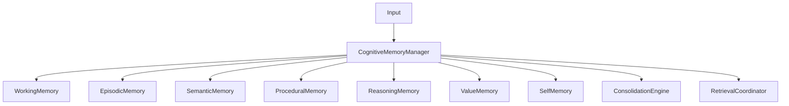

# RFC-0064

**Title:** Autonomous Cognitive Memory Architecture

**Document ID:** RFC-0064

**Version:** 1.0

**Status:** Accepted

**Category:** Cognitive Architecture

**Layer:** Unified Memory / Knowledge / Experience

**Target:**

```text
memory/cognitive_memory/
```

---

# Abstract

This RFC defines the SH-3 Autonomous Cognitive Memory Architecture.

The Autonomous Cognitive Memory Architecture provides the unified memory substrate supporting every cognitive subsystem within SH-3.

Rather than treating memory as a passive storage mechanism, SH-3 models memory as an active cognitive process responsible for encoding, organizing, retrieving, consolidating, and evolving knowledge throughout the lifetime of the system.

The architecture governs:

- working memory
- episodic memory
- semantic memory
- procedural memory
- reasoning memory
- value memory
- self memory
- memory consolidation
- retrieval coordination
- forgetting
- lifelong knowledge evolution

The system enables:

- unified cognitive context
- efficient retrieval
- lifelong learning
- explainable knowledge usage
- adaptive memory organization

The Autonomous Cognitive Memory Architecture integrates with:

- Consciousness Coordination System
- Meta-Reasoning Intelligence System
- Value Intelligence System
- Motivation Intelligence System
- Goal Intelligence System
- Strategy Intelligence System
- Decision Intelligence System
- World Model System
- Learning System
- Self Evolution System
- Knowledge Governance System

This document is normative.

---

# Motivation

Every intelligent process depends upon memory.

Without an integrated memory architecture:

- knowledge fragments
- learning becomes inconsistent
- reasoning loses context
- planning becomes unstable
- self-improvement is inefficient

The SH-3 memory architecture therefore serves as the persistent cognitive substrate for all autonomous intelligence.

---

# Goals

The Autonomous Cognitive Memory Architecture SHALL provide:

- unified memory abstraction
- multiple specialized memory systems
- adaptive retrieval
- lifelong consolidation
- knowledge evolution
- explainable memory access

---

# Non-Goals

The Autonomous Cognitive Memory Architecture SHALL NOT:

- replace reasoning
- replace planning
- replace world modeling
- bypass governance
- expose internal storage implementation

Memory provides knowledge and experience rather than cognitive decisions.

---

# Architecture



The architecture transforms experiences into structured lifelong knowledge.

---

# Design Principles

The Autonomous Cognitive Memory Architecture follows these principles.

---

## Unified Representation

All memory systems SHALL expose a common interface.

---

## Specialized Storage

Different knowledge types SHALL use dedicated memory structures.

---

## Lifelong Learning

Memory SHALL continuously evolve.

---

## Efficient Retrieval

Relevant knowledge SHALL be prioritized.

---

## Explainability

Retrieved knowledge SHALL remain traceable.

---

## Governance Compatibility

Memory SHALL respect governance policies.

---

# Cognitive Memory Components

The system consists of:

| Component | Responsibility |
|-----------|----------------|
| CognitiveMemoryManager | Global coordination |
| WorkingMemory | Active context |
| EpisodicMemory | Experiences |
| SemanticMemory | Concepts and facts |
| ProceduralMemory | Skills and procedures |
| ReasoningMemory | Inference history |
| ValueMemory | Utility history |
| SelfMemory | Identity representation |
| ConsolidationEngine | Long-term organization |
| RetrievalCoordinator | Query coordination |

---

# CognitiveMemoryManager

CognitiveMemoryManager coordinates all memory operations.

Responsibilities:

- encoding
- retrieval
- consolidation
- synchronization
- lifecycle management

The manager does not perform reasoning.

---

# Memory Context

Every memory operation receives an immutable MemoryContext.

A MemoryContext contains:

| Field | Description |
|------|-------------|
| request_id | Retrieval identifier |
| active_goal | Current objective |
| reasoning_context | Active reasoning |
| workspace_state | Working state |
| timestamp | Operation time |

---

# Unified Memory Object

Every memory record SHALL expose:

| Field | Description |
|------|-------------|
| memory_id | Identifier |
| memory_type | Memory category |
| importance | Importance score |
| confidence | Reliability |
| timestamp | Creation time |
| provenance | Source |
| embedding | Semantic representation |

---

# Memory Lifecycle

Every memory follows:

```text
Observation

↓

Encoding

↓

Indexing

↓

Retrieval

↓

Reuse

↓

Consolidation

↓

Evolution

↓

Archival / Forgetting
```

---

# Working Memory

WorkingMemory stores currently active cognition.

Contents include:

- active observations
- current goals
- reasoning state
- execution state
- temporary variables

Working Memory SHALL remain capacity-limited.

---

# Working Memory Model

```text
Current Context

+

Executive Focus

↓

Working Memory
```

---

# Episodic Memory

EpisodicMemory stores temporally ordered experiences.

Examples include:

- completed tasks
- interaction history
- failures
- successful plans
- learning events

Episodes SHALL preserve temporal ordering.

---

# Episodic Representation

```text
Experience

+

Time

+

Context

↓

Episode
```

---

# Semantic Memory

SemanticMemory stores structured knowledge.

Knowledge includes:

- concepts
- definitions
- facts
- relationships
- ontologies

Semantic memory SHALL remain independent of individual experiences.

---

# Semantic Model

```text
Knowledge

+

Relationships

↓

Semantic Graph
```

---

# Procedural Memory

ProceduralMemory stores reusable procedures.

Examples include:

- planning templates
- reasoning strategies
- execution workflows
- optimization methods

Procedural knowledge SHALL support continuous refinement.

---

# Autonomous Cognitive Memory Execution Model

The Autonomous Cognitive Memory Architecture transforms observations, reasoning, experience, and learned knowledge into a unified lifelong cognitive memory that continuously supports autonomous intelligence.

The cognitive memory lifecycle follows:


Each stage maintains a distinct memory management responsibility.

---

# Cognitive Memory Control Loop

The Autonomous Cognitive Memory Architecture operates through continuous memory optimization.

```text
Observation

↓

Memory Encoding

↓

Semantic Indexing

↓

Contextual Retrieval

↓

Reasoning Support

↓

Memory Consolidation

↓

Knowledge Evolution

↓

Lifecycle Management
```

---

# Reasoning Memory

ReasoningMemory stores historical inference processes.

Stored information includes:

- reasoning traces
- intermediate hypotheses
- evidence chains
- confidence estimates
- reflection summaries
- optimization history

ReasoningMemory SHALL support explainability and meta-reasoning.

---

# Reasoning Memory Model

```text
Reasoning Trace

+

Evidence

+

Outcome

↓

Reasoning Record
```

---

# Value Memory

ValueMemory stores historical value evaluations.

Stored information includes:

- utility estimates
- preference evolution
- reward history
- alignment decisions
- optimization feedback

ValueMemory SHALL support long-term utility learning.

---

# Value Memory Model

```text
Evaluation

+

Utility

+

Outcome

↓

Value Record
```

---

# Self Memory

SelfMemory stores the evolving representation of SH-3 itself.

The self representation includes:

- capability profile
- operational history
- learned competencies
- limitations
- long-term objectives
- architectural evolution

SelfMemory SHALL preserve identity continuity across the system lifetime.

---

# Self Representation Model

```text
Capability

+

History

+

Objectives

↓

Self Model
```

---

# Memory Consolidation Engine

The ConsolidationEngine transfers valuable knowledge into long-term memory.

Consolidation inputs include:

- repeated experiences
- successful procedures
- validated reasoning
- stable concepts
- persistent preferences

---

# Consolidation Pipeline

```text
Working Memory

↓

Importance Analysis

↓

Knowledge Integration

↓

Long-Term Memory
```

---

# Retrieval Coordination

RetrievalCoordinator performs context-aware retrieval.

Retrieval sources include:

- semantic memory
- episodic memory
- procedural memory
- reasoning memory
- value memory
- self memory

The coordinator SHALL aggregate results into a unified retrieval response.

---

# Retrieval Pipeline

```text
Query

↓

Context Expansion

↓

Candidate Retrieval

↓

Ranking

↓

Aggregation

↓

Unified Memory Response
```

---

# Memory Ranking

Retrieved memories SHALL be ranked according to:

- semantic similarity
- contextual relevance
- importance
- confidence
- recency
- retrieval history

---

# Ranking Model

```text
Similarity

+

Importance

+

Confidence

+

Recency

↓

Memory Score
```

---

# Forgetting Policy

The architecture supports controlled forgetting.

Candidate memories include:

- obsolete information
- redundant knowledge
- low-confidence records
- superseded procedures

Critical knowledge SHALL NOT be forgotten.

---

# Forgetting Model

```text
Low Utility

+

Low Importance

+

High Redundancy

↓

Archival / Removal
```

---

# Memory Evolution

Memory continuously reorganizes itself.

Evolution activities include:

- graph refinement
- embedding updates
- relationship discovery
- procedural optimization
- concept abstraction

---

# Evolution Pipeline

```text
Stored Knowledge

↓

Relationship Analysis

↓

Structural Improvement

↓

Updated Memory Graph
```

---

# Lifelong Learning Support

Memory enables lifelong learning through:

- continuous encoding
- incremental consolidation
- adaptive retrieval
- knowledge refinement
- long-term preservation

---

# Memory Consistency

The architecture SHALL maintain:

- referential integrity
- temporal consistency
- semantic consistency
- provenance tracking

Conflicting memories SHALL be resolved through Learning and Knowledge Governance.

---

# Consciousness Integration

Consciousness Coordination receives:

- active memory context
- working memory state
- retrieval summaries

---

# Meta-Reasoning Integration

Meta-Reasoning receives:

- reasoning history
- reflection records
- optimization history

---

# Value Intelligence Integration

Value Intelligence receives:

- historical utility records
- preference evolution
- reinforcement history

---

# Goal Intelligence Integration

Goal Intelligence receives:

- historical objectives
- goal completion history
- strategy outcomes

---

# World Model Integration

World Model receives:

- validated knowledge
- causal observations
- environment history

---

# Learning Integration

Learning System receives:

- replay memories
- training experiences
- optimization datasets

---

# Self Evolution Integration

Self Evolution System receives:

- capability history
- architectural changes
- competency evolution

---

# AI Safety Governance Integration

AI Safety Governance validates:

- protected memories
- retention policies
- deletion authorization
- governance compliance

---

# Message Bus Integration

Memory events include:

- MemoryEncoded
- MemoryRetrieved
- MemoryRanked
- MemoryConsolidated
- MemoryArchived
- MemoryForgotten
- MemoryEvolved

---

# Persistence Integration

Persistence stores:

- all long-term memories
- embedding indexes
- semantic graphs
- replay datasets
- provenance metadata

---

# Observability Integration

Memory telemetry includes:

- encoding throughput
- retrieval latency
- retrieval accuracy
- consolidation rate
- forgetting rate
- memory growth
- graph density

---

# Tracing

Memory traces preserve:

- trace_id
- memory_id
- retrieval_id
- consolidation_id
- evolution_id
- provenance_id

---

# Thread Model

The Autonomous Cognitive Memory Architecture supports concurrent:

- encoding
- retrieval
- consolidation
- indexing
- ranking
- evolution

Concurrent modifications SHALL preserve consistency through synchronized commit semantics.

The reference implementation SHALL be deterministic and thread-safe.

---

# Metrics

The Autonomous Cognitive Memory Architecture exposes:

- retrieval precision
- retrieval recall
- consolidation efficiency
- semantic consistency
- memory utilization
- embedding quality
- lifelong retention score

---

# Performance Objectives

The Autonomous Cognitive Memory Architecture should optimize for:

- low-latency retrieval
- scalable knowledge storage
- accurate contextual recall
- efficient consolidation
- continuous knowledge evolution

---

# Future Work

Potential future enhancements include:

- hierarchical episodic abstraction
- adaptive semantic graph compression
- distributed memory federation
- autonomous ontology generation
- memory-guided simulation
- self-organizing cognitive knowledge graphs
- neurosymbolic memory integration

These enhancements extend SH-3 toward a lifelong autonomous cognitive architecture capable of continuously acquiring, organizing, refining, and utilizing knowledge while maintaining consistency, explainability, and long-term adaptability.

---

# References

- SH-3 Architecture Specification v2.1
- RFC-0022 Knowledge System
- RFC-0023 World Model System
- RFC-0026 Self Evolution System
- RFC-0027 Autonomous Learning System
- RFC-0050 Knowledge Governance System
- RFC-0053 AI Safety Governance System
- RFC-0059 Autonomous Goal Intelligence System
- RFC-0060 Autonomous Motivation Intelligence System
- RFC-0061 Autonomous Value Intelligence System
- RFC-0062 Autonomous Meta-Reasoning Intelligence System
- RFC-0063 Autonomous Consciousness Coordination System

---

# End of RFC-0064
