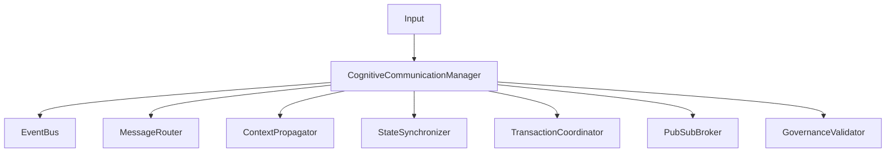
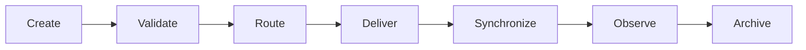

# RFC-0065

**Title:** Autonomous Cognitive Communication Architecture

**Document ID:** RFC-0065

**Version:** 1.0

**Status:** Accepted

**Category:** Cognitive Architecture

**Layer:** Communication / Coordination / Event System

**Target:**

```text
communication/cognitive_bus/
```

---

# Abstract

This RFC defines the SH-3 Autonomous Cognitive Communication Architecture.

The Autonomous Cognitive Communication Architecture provides the unified communication substrate connecting every cognitive subsystem within SH-3.

Rather than treating communication as simple message passing, SH-3 models communication as a first-class cognitive process responsible for propagating context, synchronizing state, coordinating distributed reasoning, and maintaining deterministic interaction among autonomous intelligence modules.

The architecture governs:

- cognitive messaging
- event propagation
- request-response coordination
- publish-subscribe communication
- context propagation
- state synchronization
- distributed cognitive transactions
- communication governance

The system enables:

- deterministic module interaction
- coherent distributed cognition
- scalable subsystem integration
- explainable communication flow
- reliable coordination across all intelligence layers

The Autonomous Cognitive Communication Architecture integrates with:

- Consciousness Coordination System
- Meta-Reasoning Intelligence System
- Value Intelligence System
- Motivation Intelligence System
- Goal Intelligence System
- Strategy Intelligence System
- Decision Intelligence System
- World Model System
- Unified Cognitive Memory
- Learning System
- Self Evolution System
- AI Safety Governance System

This document is normative.

---

# Motivation

An autonomous cognitive architecture consists of many specialized intelligence systems.

Without a unified communication model:

- context becomes fragmented
- synchronization becomes inconsistent
- event ordering becomes ambiguous
- coordination becomes unreliable
- scalability deteriorates

The Autonomous Cognitive Communication Architecture provides deterministic, observable, and governance-aware communication for the entire SH-3 architecture.

---

# Goals

The Autonomous Cognitive Communication Architecture SHALL provide:

- unified communication abstraction
- deterministic event ordering
- context propagation
- distributed coordination
- state synchronization
- communication observability
- governance enforcement

---

# Non-Goals

The Autonomous Cognitive Communication Architecture SHALL NOT:

- replace business logic
- perform reasoning
- perform planning
- replace persistence
- bypass governance validation

Communication coordinates cognition rather than implementing cognitive behavior.

---

# Architecture



The architecture transforms isolated module execution into coordinated distributed cognition.

---

# Design Principles

The Autonomous Cognitive Communication Architecture follows these principles.

---

## Unified Communication

Every cognitive subsystem SHALL communicate through a common communication model.

---

## Deterministic Ordering

Communication SHALL preserve deterministic processing whenever ordering affects cognition.

---

## Context Preservation

Communication SHALL propagate relevant cognitive context.

---

## Observability

Communication SHALL remain fully traceable.

---

## Scalability

Communication SHALL support increasing numbers of cognitive modules.

---

## Governance Compliance

Communication SHALL satisfy governance and safety policies.

---

# Communication Components

The architecture consists of:

| Component | Responsibility |
|-----------|----------------|
| CognitiveCommunicationManager | Global communication coordination |
| EventBus | Event distribution |
| MessageRouter | Directed messaging |
| ContextPropagator | Context transmission |
| StateSynchronizer | State consistency |
| TransactionCoordinator | Distributed transaction control |
| PubSubBroker | Publish-subscribe coordination |
| GovernanceValidator | Communication policy validation |

---

# CognitiveCommunicationManager

The CognitiveCommunicationManager coordinates every communication operation.

Responsibilities include:

- message orchestration
- event coordination
- communication lifecycle management
- routing supervision
- synchronization control

The manager SHALL remain independent of domain-specific reasoning.

---

# Communication Context

Every communication operation receives an immutable CommunicationContext.

A CommunicationContext contains:

| Field | Description |
|------|-------------|
| message_id | Unique identifier |
| trace_id | End-to-end trace identifier |
| source | Sending module |
| destination | Receiving module(s) |
| cognitive_cycle | Active executive cycle |
| timestamp | Creation time |

---

# Unified Cognitive Message

Every cognitive message SHALL expose:

| Field | Description |
|------|-------------|
| message_id | Identifier |
| message_type | Message category |
| payload | Structured data |
| priority | Delivery priority |
| context | Communication context |
| provenance | Origin metadata |

Messages SHALL remain immutable after publication.

---

# Communication Lifecycle

Every communication follows:

```text
Message Creation

↓

Validation

↓

Routing

↓

Delivery

↓

Acknowledgement

↓

Synchronization

↓

Archival
```

---

# Event Bus

The EventBus distributes asynchronous cognitive events.

Supported event categories include:

- perception events
- reasoning events
- planning events
- learning events
- memory events
- executive events
- governance events

The EventBus SHALL guarantee deterministic delivery semantics for ordered event streams.

---

# Event Flow

```text
Publisher

↓

EventBus

↓

Subscriber Filtering

↓

Subscriber Delivery
```

---

# Message Routing

MessageRouter performs directed communication.

Routing supports:

- point-to-point delivery
- multicast delivery
- broadcast delivery
- policy-driven routing

Routing SHALL remain transparent to communicating modules.

---

# Routing Model

```text
Outgoing Message

↓

Routing Policy

↓

Destination Resolution

↓

Delivery Queue
```

---

# Context Propagation

ContextPropagator maintains cognitive continuity across module boundaries.

Propagated context includes:

- active goals
- reasoning context
- executive directives
- workspace references
- trace identifiers

Context propagation SHALL avoid unnecessary duplication while preserving explainability.

---

# Autonomous Cognitive Communication Execution Model

The Autonomous Cognitive Communication Architecture transforms distributed cognitive interactions into deterministic, observable, synchronized, and governance-compliant communication.

The communication lifecycle follows:



Each stage maintains a clearly defined communication responsibility.

---

# Cognitive Communication Control Loop

The Autonomous Cognitive Communication Architecture continuously coordinates communication across all cognitive subsystems.

```text
Message Creation

↓

Policy Validation

↓

Routing

↓

Context Propagation

↓

Delivery

↓

Acknowledgement

↓

State Synchronization

↓

Communication Analysis
```

---

# State Synchronization

StateSynchronizer maintains globally consistent cognitive state.

Synchronization includes:

- workspace state
- executive state
- goal state
- motivation state
- value state
- reasoning state
- memory references

Synchronization SHALL guarantee deterministic commit ordering.

---

# State Synchronization Model

```text
Module State Updates

↓

Conflict Detection

↓

Synchronization Policy

↓

Global State Commit
```

---

# Distributed Cognitive Transactions

TransactionCoordinator manages atomic multi-module operations.

Each distributed transaction SHALL support:

- begin
- validation
- prepare
- commit
- rollback

Transactions SHALL preserve cognitive consistency across participating modules.

---

# Transaction Lifecycle

```text
Begin

↓

Validate

↓

Prepare

↓

Commit

↓

Complete
```

Rollback SHALL occur whenever deterministic completion cannot be guaranteed.

---

# Publish–Subscribe Coordination

PubSubBroker provides asynchronous communication.

Supported delivery modes include:

- broadcast
- multicast
- filtered subscription
- priority subscription
- persistent subscription

Subscriptions SHALL remain dynamically configurable.

---

# Pub/Sub Model

```text
Publisher

↓

Topic

↓

Subscriber Matching

↓

Delivery
```

---

# Communication Governance

GovernanceValidator validates every communication operation.

Validation policies include:

- authorization
- safety constraints
- routing permissions
- information boundaries
- communication quotas

Messages violating governance SHALL be rejected before routing.

---

# Governance Pipeline

```text
Outgoing Message

↓

Policy Validation

↓

Authorization

↓

Approved Communication
```

---

# Delivery Guarantees

The communication architecture supports:

- at-most-once delivery
- at-least-once delivery
- exactly-once delivery
- ordered delivery
- priority delivery

Delivery guarantees SHALL be configurable according to communication policy.

---

# Communication Reliability

Reliable communication includes:

- retry management
- duplicate detection
- acknowledgement tracking
- timeout handling
- dead-letter routing

Failures SHALL be observable and recoverable.

---

# Reliability Model

```text
Delivery Attempt

↓

Acknowledgement

↓

Success

or

Retry

↓

Recovery
```

---

# Fault Tolerance

Communication SHALL tolerate:

- module failure
- transient network errors
- delayed delivery
- subscriber restart
- partial transaction failure

Recovery SHALL preserve deterministic behavior whenever possible.

---

# Context Continuity

ContextPropagator preserves:

- trace identifiers
- executive context
- workspace references
- causal relationships
- provenance metadata

Every communication SHALL remain traceable throughout the cognitive lifecycle.

---

# Communication Prioritization

Messages SHALL be prioritized according to:

- executive priority
- safety priority
- strategic importance
- urgency
- dependency ordering

Priority SHALL influence routing and scheduling.

---

# Priority Model

```text
Message

+

Priority

+

Governance

↓

Scheduling Queue
```

---

# Communication Analysis

CommunicationManager continuously evaluates:

- throughput
- latency
- congestion
- delivery success
- synchronization efficiency

Communication policies SHALL adapt through validated learning.

---

# Memory Integration

Unified Cognitive Memory stores:

- communication history
- transaction records
- routing metadata
- synchronization events

---

# Consciousness Integration

Consciousness Coordination receives:

- communication summaries
- synchronization state
- executive notifications

---

# Meta-Reasoning Integration

Meta-Reasoning receives:

- communication traces
- routing effectiveness
- coordination failures

---

# Learning Integration

Learning receives:

- communication metrics
- optimization opportunities
- routing performance

---

# AI Safety Governance Integration

AI Safety Governance validates:

- communication authorization
- protected information
- policy compliance
- inter-module isolation

---

# Risk Management Integration

Risk Management evaluates:

- communication congestion
- synchronization failure
- transaction rollback frequency
- routing instability

---

# Self Evolution Integration

Self Evolution System receives:

- communication optimization opportunities
- architecture bottlenecks
- scalability recommendations

---

# Message Bus Integration

Communication events include:

- MessageCreated
- MessageValidated
- MessageRouted
- MessageDelivered
- MessageAcknowledged
- TransactionCommitted
- SynchronizationCompleted
- CommunicationOptimized

---

# Persistence Integration

Persistence stores:

- message logs
- event history
- routing tables
- transaction journals
- synchronization checkpoints

---

# Observability Integration

Communication telemetry includes:

- message throughput
- delivery latency
- routing accuracy
- synchronization latency
- transaction success rate
- retry frequency
- dead-letter count

---

# Tracing

Communication traces preserve:

- trace_id
- message_id
- transaction_id
- routing_id
- synchronization_id
- acknowledgement_id

Every communication SHALL participate in distributed tracing.

---

# Thread Model

The Autonomous Cognitive Communication Architecture supports concurrent:

- message publication
- routing
- event delivery
- synchronization
- transaction management
- acknowledgement processing

Concurrent communication SHALL preserve deterministic ordering for ordered channels.

The reference implementation SHALL be thread-safe and lock-efficient.

---

# Metrics

The Autonomous Cognitive Communication Architecture exposes:

- end-to-end latency
- throughput
- delivery success rate
- routing efficiency
- synchronization consistency
- transaction completion rate
- communication availability

---

# Performance Objectives

The Autonomous Cognitive Communication Architecture should optimize for:

- deterministic communication
- low-latency messaging
- scalable coordination
- reliable synchronization
- efficient resource utilization
- continuous communication optimization

---

# Future Work

Potential future enhancements include:

- distributed cognitive federation
- adaptive communication topology
- self-optimizing routing
- semantic message compression
- cross-agent cognitive networking
- autonomous communication policy evolution
- neurosymbolic communication protocols

These enhancements extend SH-3 toward a fully distributed cognitive architecture capable of deterministic, scalable, explainable, and self-optimizing communication across all autonomous intelligence systems.

---

# References

- SH-3 Architecture Specification v2.1
- RFC-0016 Pipeline System
- RFC-0034 Message Bus System
- RFC-0050 Knowledge Governance System
- RFC-0053 AI Safety Governance System
- RFC-0062 Autonomous Meta-Reasoning Intelligence System
- RFC-0063 Autonomous Consciousness Coordination System
- RFC-0064 Autonomous Cognitive Memory Architecture

---

# End of RFC-0065
