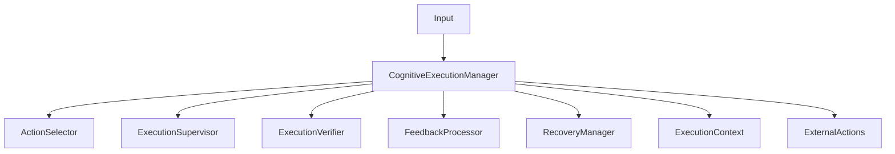

# RFC-0066

**Title:** Autonomous Cognitive Execution Architecture

**Document ID:** RFC-0066

**Version:** 1.0

**Status:** Accepted

**Category:** Cognitive Architecture

**Layer:** Execution / Action / Closed-Loop Control

**Target:**

```text
execution/cognitive_execution/
```

---

# Abstract

This RFC defines the SH-3 Autonomous Cognitive Execution Architecture.

The Autonomous Cognitive Execution Architecture provides the execution substrate that transforms cognitive decisions into verified, adaptive, and observable actions.

Unlike traditional execution engines, SH-3 executes actions as part of a closed cognitive control loop in which execution continuously interacts with perception, memory, reasoning, learning, and executive control.

The architecture governs:

- action execution
- execution context
- execution supervision
- adaptive execution
- execution verification
- execution recovery
- feedback processing
- execution lifecycle

The system enables:

- deterministic execution
- adaptive behavior
- continuous verification
- closed-loop cognition
- safe autonomous action

The Autonomous Cognitive Execution Architecture integrates with:

- Consciousness Coordination System
- Cognitive Communication Architecture
- Unified Cognitive Memory
- Decision Intelligence System
- Strategy Intelligence System
- Goal Intelligence System
- Motivation Intelligence System
- Value Intelligence System
- Meta-Reasoning Intelligence System
- World Model System
- AI Safety Governance System
- Risk Management System
- Self Evolution System

This document is normative.

---

# Motivation

Reasoning without execution produces no external effect.

Execution without cognition produces unsafe behavior.

An autonomous intelligence therefore requires an execution architecture that continuously coordinates cognition and action.

The execution architecture transforms:

- intentions
- plans
- strategies
- constraints
- observations

into verified actions.

---

# Goals

The Autonomous Cognitive Execution Architecture SHALL provide:

- deterministic execution
- adaptive action control
- execution supervision
- verification
- recovery
- continuous feedback
- governance-compliant execution

---

# Non-Goals

The Autonomous Cognitive Execution Architecture SHALL NOT:

- replace planning
- replace reasoning
- replace decision making
- bypass governance
- directly modify cognitive state outside approved interfaces

Execution performs approved actions only.

---

# Architecture



The architecture transforms cognitive intent into safe autonomous behavior.

---

# Design Principles

The Autonomous Cognitive Execution Architecture follows these principles.

---

## Deterministic Execution

Equivalent execution requests SHALL produce equivalent execution behavior.

---

## Continuous Verification

Execution SHALL remain continuously observable.

---

## Adaptive Recovery

Recoverable failures SHALL initiate adaptive recovery.

---

## Closed-Loop Operation

Execution SHALL continuously interact with perception and cognition.

---

## Explainability

Execution SHALL remain traceable.

---

## Governance Compliance

Every action SHALL satisfy governance validation before execution.

---

# Execution Components

The architecture consists of:

| Component | Responsibility |
|-----------|----------------|
| CognitiveExecutionManager | Global execution coordination |
| ActionSelector | Action selection |
| ExecutionSupervisor | Execution supervision |
| ExecutionVerifier | Outcome verification |
| FeedbackProcessor | Feedback processing |
| RecoveryManager | Failure recovery |
| ExecutionContext | Execution state |

---

# CognitiveExecutionManager

The CognitiveExecutionManager coordinates the complete execution lifecycle.

Responsibilities include:

- execution orchestration
- action scheduling
- supervision
- verification
- recovery coordination

The manager SHALL remain independent of planning logic.

---

# Execution Context

Every execution SHALL receive an immutable ExecutionContext.

An ExecutionContext contains:

| Field | Description |
|------|-------------|
| execution_id | Execution identifier |
| plan_id | Originating plan |
| goal_id | Associated goal |
| strategy_id | Active strategy |
| constraints | Execution constraints |
| timestamp | Execution time |

---

# Unified Execution Object

Every execution SHALL expose:

| Field | Description |
|------|-------------|
| execution_id | Identifier |
| action_type | Action category |
| execution_state | Current state |
| confidence | Estimated success |
| priority | Execution priority |
| provenance | Origin metadata |

---

# Execution Lifecycle

Every execution follows:

```text
Action Selection

↓

Validation

↓

Scheduling

↓

Execution

↓

Verification

↓

Feedback

↓

Completion
```

---

# Action Selection

ActionSelector chooses executable actions from approved plans.

Selection criteria include:

- strategic value
- expected utility
- execution cost
- operational risk
- resource availability

Only governance-approved actions SHALL be selected.

---

# Action Selection Model

```text
Approved Plan

+

Current Context

+

Resource State

↓

Selected Action
```

---

# Execution Supervision

ExecutionSupervisor continuously monitors action execution.

Supervision includes:

- execution progress
- deadline monitoring
- resource consumption
- policy compliance
- anomaly detection

Execution SHALL remain observable until completion.

---

# Supervision Model

```text
Execution State

+

Telemetry

↓

Supervision Decision
```

---

# Execution Verification

ExecutionVerifier determines whether execution produced the expected outcome.

Verification considers:

- expected effects
- observed effects
- policy compliance
- confidence
- safety

Verification SHALL precede completion.

---

# Verification Model

```text
Expected Outcome

+

Observed Outcome

↓

Execution Validity
```

---

# Autonomous Cognitive Execution Execution Model

The Autonomous Cognitive Execution Architecture transforms approved cognitive intent into deterministic, adaptive, verifiable, and continuously improving autonomous behavior.

The execution lifecycle follows:


Each stage maintains a distinct execution responsibility.

---

# Closed-Loop Cognitive Execution

The CognitiveExecutionManager operates through a continuous execution control loop.

```text
Approved Plan

↓

Action Selection

↓

Execution Validation

↓

Execution Scheduling

↓

Action Execution

↓

Telemetry Collection

↓

Outcome Verification

↓

Feedback Processing

↓

Learning

↓

Execution Optimization
```

Every execution SHALL complete with either:

- Success
- Partial Success
- Failure
- Cancelled
- Rolled Back

---

# Feedback Processing

FeedbackProcessor evaluates execution outcomes.

Feedback sources include:

- environment observations
- execution telemetry
- user interaction
- policy evaluation
- world model prediction error

Feedback SHALL be normalized before downstream processing.

---

# Feedback Model

```text
Observed Outcome

+

Execution Telemetry

↓

Normalized Feedback
```

---

# Adaptive Execution

Execution behavior SHALL adapt during runtime when permitted by governance.

Adaptive adjustments include:

- parameter tuning
- scheduling adjustment
- retry timing
- execution pacing
- resource allocation

Adaptation SHALL preserve execution intent.

---

# Adaptive Execution Model

```text
Execution State

+

Runtime Feedback

↓

Adaptive Adjustment
```

---

# Execution Recovery

RecoveryManager handles recoverable execution failures.

Recovery strategies include:

- retry
- rollback
- alternative action selection
- degraded execution
- graceful termination

Recovery SHALL preserve global cognitive consistency.

---

# Recovery Pipeline

```text
Execution Failure

↓

Failure Classification

↓

Recovery Strategy

↓

Recovery Execution

↓

Verification
```

---

# Failure Classification

Recoverable failures include:

- transient resource exhaustion
- temporary communication failure
- dependency timeout
- recoverable policy conflict

Non-recoverable failures SHALL terminate execution safely.

---

# Execution Verification Pipeline

Verification SHALL evaluate:

- action completion
- expected outcome
- side effects
- governance compliance
- safety invariants

Verification SHALL produce an immutable ExecutionResult.

---

# ExecutionResult

ExecutionResult SHALL contain:

| Field | Description |
|------|-------------|
| execution_id | Execution identifier |
| status | Final state |
| verification | Verification outcome |
| confidence | Confidence score |
| telemetry | Execution metrics |
| explanation | Outcome summary |

ExecutionResult SHALL be immutable after publication.

---

# Execution Optimization

The execution architecture continuously improves.

Optimization targets include:

- execution latency
- completion rate
- recovery efficiency
- resource utilization
- scheduling quality

Optimization SHALL use validated historical evidence.

---

# Optimization Pipeline

```text
Execution History

↓

Performance Analysis

↓

Pattern Extraction

↓

Policy Improvement

↓

Improved Execution
```

---

# Execution Consistency

Equivalent execution contexts SHALL produce equivalent execution behavior unless adaptive execution is explicitly authorized.

Deterministic execution SHALL remain the default execution policy.

---

# Consciousness Integration

Consciousness Coordination receives:

- execution summaries
- active execution state
- completion notifications

---

# Decision Intelligence Integration

Decision Intelligence receives:

- execution outcome
- verification status
- recovery recommendations

---

# Strategy Intelligence Integration

Strategy Intelligence receives:

- execution effectiveness
- strategy realization metrics
- execution constraints

---

# World Model Integration

World Model receives:

- observed outcomes
- prediction errors
- causal execution evidence

---

# Unified Cognitive Memory Integration

Unified Cognitive Memory stores:

- execution history
- execution traces
- recovery history
- feedback records

---

# Meta-Reasoning Integration

Meta-Reasoning receives:

- execution quality
- verification reports
- adaptive execution history

---

# Learning Integration

Learning receives:

- execution replay
- optimization datasets
- failure analysis
- successful execution patterns

---

# Self Evolution Integration

Self Evolution System receives:

- execution capability metrics
- optimization opportunities
- architectural recommendations

---

# AI Safety Governance Integration

AI Safety Governance validates:

- execution authorization
- action constraints
- recovery boundaries
- termination conditions

No execution SHALL bypass governance validation.

---

# Risk Management Integration

Risk Management evaluates:

- execution risk
- recovery probability
- cascading failure
- operational uncertainty

---

# Message Bus Integration

Execution events include:

- ExecutionStarted
- ActionSelected
- ExecutionValidated
- ExecutionCompleted
- ExecutionVerified
- FeedbackProcessed
- RecoveryInitiated
- RecoveryCompleted
- ExecutionOptimized

---

# Persistence Integration

Persistence stores:

- execution logs
- verification reports
- recovery history
- optimization history
- telemetry archives

---

# Observability Integration

Execution telemetry includes:

- execution latency
- completion rate
- verification accuracy
- recovery frequency
- retry count
- resource utilization
- execution confidence

---

# Tracing

Execution traces preserve:

- trace_id
- execution_id
- action_id
- verification_id
- recovery_id
- feedback_id

Every execution SHALL participate in distributed cognitive tracing.

---

# Thread Model

The Autonomous Cognitive Execution Architecture supports concurrent:

- action scheduling
- execution supervision
- telemetry collection
- verification
- recovery
- optimization

Concurrent execution SHALL preserve deterministic ordering whenever action dependencies exist.

The reference implementation SHALL be thread-safe and lock-efficient.

---

# Metrics

The Autonomous Cognitive Execution Architecture exposes:

- execution success rate
- verification accuracy
- execution latency
- recovery success rate
- retry frequency
- adaptive execution effectiveness
- resource efficiency

---

# Performance Objectives

The Autonomous Cognitive Execution Architecture should optimize for:

- reliable execution
- deterministic behavior
- rapid recovery
- adaptive performance
- low execution latency
- continuous execution improvement

---

# Future Work

Potential future enhancements include:

- hierarchical execution planners
- distributed execution orchestration
- autonomous skill composition
- predictive execution scheduling
- self-generating execution policies
- multi-agent execution coordination
- neurosymbolic execution optimization

These enhancements extend SH-3 toward a fully autonomous execution architecture capable of safely transforming cognitive intent into reliable real-world behavior while continuously improving execution quality through lifelong learning.

---

# References

- SH-3 Architecture Specification v2.1
- RFC-0016 Pipeline System
- RFC-0023 World Model System
- RFC-0027 Autonomous Learning System
- RFC-0034 Message Bus System
- RFC-0053 AI Safety Governance System
- RFC-0062 Autonomous Meta-Reasoning Intelligence System
- RFC-0063 Autonomous Consciousness Coordination System
- RFC-0064 Autonomous Cognitive Memory Architecture
- RFC-0065 Autonomous Cognitive Communication Architecture

---

# End of RFC-0066
