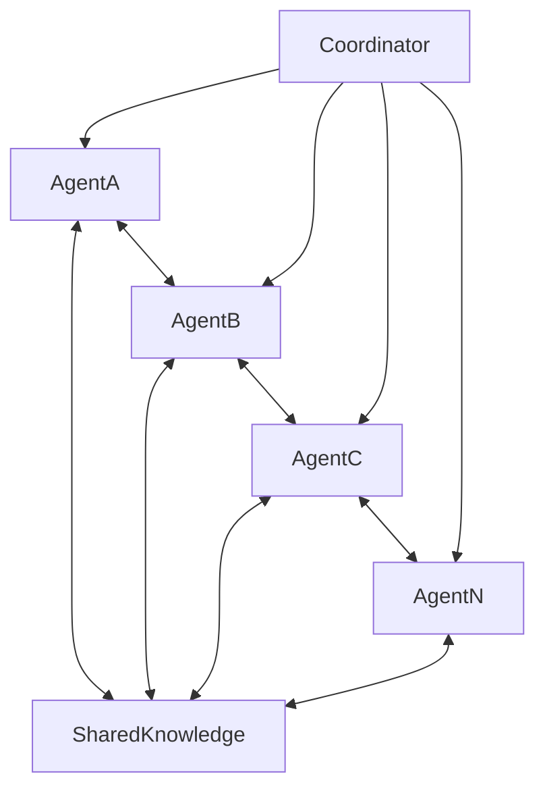

# RFC-0068

**Title:** Autonomous Multi-Agent Cognitive Architecture

**Document ID:** RFC-0068

**Version:** 1.0

**Status:** Accepted

**Category:** Distributed Cognitive Architecture

**Layer:** Multi-Agent / Distributed Cognition / Collective Intelligence

**Target:**

```text
multi_agent/
```

---

# Abstract

This RFC defines the SH-3 Autonomous Multi-Agent Cognitive Architecture (AMCA).

AMCA extends the SH-3 Autonomous Cognitive Operating System (ACOS) from a single autonomous cognitive agent to a distributed federation of cooperating SH-3 agents.

Each SH-3 instance remains independently autonomous while participating in a coordinated collective intelligence.

The architecture provides:

- distributed cognition
- cooperative reasoning
- shared knowledge
- distributed planning
- coordinated execution
- collective learning
- distributed governance

The architecture enables:

- scalable intelligence
- resilient cognition
- collaborative decision making
- distributed specialization
- fault-tolerant operation

This document is normative.

---

# Motivation

A single autonomous intelligence has bounded:

- computational resources
- memory
- expertise
- perception
- execution capacity

Many complex problems require multiple autonomous cognitive systems operating cooperatively.

Rather than constructing a monolithic intelligence, SH-3 adopts a federation of autonomous cognitive agents.

Each agent remains independently executable while contributing to collective cognition.

---

# Goals

AMCA SHALL provide:

- distributed cognition
- autonomous cooperation
- distributed planning
- distributed execution
- distributed learning
- shared knowledge
- collective optimization

---

# Non-Goals

AMCA SHALL NOT:

- eliminate agent autonomy
- require centralized reasoning
- expose private internal state
- bypass AI Safety Governance
- require identical agent capabilities

Agents remain autonomous participants within the federation.

---

# Architecture



---

# Design Principles

## Agent Autonomy

Every SH-3 instance SHALL remain operational independently.

---

## Cooperative Intelligence

Agents SHALL cooperate without sacrificing autonomy.

---

## Distributed Knowledge

Knowledge sharing SHALL be selective.

---

## Deterministic Coordination

Coordination SHALL remain reproducible whenever possible.

---

## Explainability

Inter-agent reasoning SHALL remain observable.

---

## Governance

Every agent SHALL independently enforce governance.

---

# Components

| Component | Responsibility |
|------------|----------------|
| FederationManager | Federation lifecycle |
| AgentRegistry | Agent discovery |
| CollaborationManager | Cooperation |
| SharedKnowledgeManager | Shared knowledge |
| DistributedPlanner | Distributed planning |
| ConsensusEngine | Agreement |
| CollectiveLearning | Federated learning |

---

# FederationManager

Responsibilities:

- federation startup
- federation shutdown
- membership
- federation policies
- federation health

---

# Agent

Each SH-3 instance SHALL expose:

- ACOS
- Consciousness
- Memory
- Planning
- Execution
- Communication
- Learning

Every agent SHALL remain independently executable.

---

# Agent Identity

Each agent SHALL expose:

| Field | Description |
|------|-------------|
| agent_id | Unique identifier |
| version | SH-3 version |
| capabilities | Capability list |
| specialization | Domain expertise |
| trust_score | Dynamic trust |
| status | Runtime state |

---

# Agent Lifecycle

```text
Discovery

↓

Authentication

↓

Registration

↓

Capability Exchange

↓

Collaboration

↓

Optimization

↓

Retirement
```

---

# Agent Discovery

AgentRegistry SHALL support:

- static discovery
- dynamic discovery
- federation broadcast
- capability lookup

---

# Capability Advertisement

Every agent SHALL publish:

- reasoning capability
- planning capability
- execution capability
- memory capability
- learning capability
- specialized skills

---

# Distributed Communication

Agents communicate through:

- request-response
- publish-subscribe
- broadcast
- negotiation
- consensus messages

Communication SHALL use RFC-0065 Cognitive Communication.

---

# Shared Knowledge

SharedKnowledgeManager SHALL manage:

- validated facts
- reusable procedures
- global ontologies
- distributed embeddings
- capability descriptions

Private memory SHALL remain private unless explicitly shared.

---

# Knowledge Synchronization

```text
Local Memory

↓

Share Candidate

↓

Governance Validation

↓

Shared Knowledge

↓

Federation Synchronization
```

---

# Distributed Planning

DistributedPlanner decomposes large objectives.

Planning stages:

- goal decomposition
- task allocation
- dependency graph
- execution ordering
- completion aggregation

---

# Task Allocation

Allocation SHALL consider:

- capability
- availability
- latency
- trust
- workload
- historical performance

---

# Consensus Engine

Consensus SHALL support:

- majority voting
- weighted voting
- confidence aggregation
- leader coordination
- quorum approval

Consensus SHALL be configurable.

---

# Collective Reasoning

Multiple agents may reason independently.

Outputs SHALL be merged using:

- confidence
- evidence quality
- historical accuracy
- specialization

---

# Collective Learning

CollectiveLearning SHALL support:

- federated learning
- experience sharing
- policy synchronization
- model aggregation
- distributed replay

Raw private experiences need not be shared.

---

# Trust Model

Each agent maintains dynamic trust.

Trust SHALL consider:

- reliability
- correctness
- consistency
- governance compliance
- availability

Trust SHALL continuously evolve.

---

# Fault Tolerance

The federation SHALL tolerate:

- agent failure
- delayed communication
- network partition
- inconsistent knowledge
- temporary isolation

Remaining agents SHALL continue operating.

---

# Security

Every agent SHALL authenticate:

- identity
- capabilities
- message integrity
- federation membership

---

# Governance

Every distributed decision SHALL satisfy:

- local governance
- federation governance
- safety policies
- authorization policies

No distributed consensus SHALL override local safety policies.

---

# Observability

Federation telemetry includes:

- active agents
- collaboration latency
- consensus duration
- synchronization rate
- federation health
- task completion rate

---

# Tracing

Distributed traces preserve:

- federation_id
- trace_id
- agent_id
- task_id
- consensus_id
- message_id

Distributed tracing SHALL span all participating agents.

---

# Thread Model

The federation supports concurrent:

- reasoning
- planning
- communication
- synchronization
- execution
- learning

Every participating SH-3 instance SHALL remain internally thread-safe.

---

# Metrics

AMCA exposes:

- federation throughput
- collaboration efficiency
- consensus latency
- task success rate
- knowledge synchronization rate
- trust stability
- agent utilization

---

# Performance Objectives

AMCA should optimize for:

- scalable cognition
- resilient execution
- efficient collaboration
- adaptive specialization
- deterministic coordination
- continuous federation learning

---

# Future Work

Potential future enhancements include:

- hierarchical federations
- autonomous coalition formation
- dynamic role evolution
- distributed world models
- cognitive swarm intelligence
- inter-federation cooperation
- planetary-scale cognitive networks

These enhancements extend SH-3 beyond a single autonomous cognitive system toward a scalable federation of cooperating autonomous intelligences capable of solving problems beyond the capacity of any individual agent.

---

# References

- SH-3 Architecture Specification v2.1
- RFC-0063 Autonomous Consciousness Coordination System
- RFC-0064 Autonomous Cognitive Memory Architecture
- RFC-0065 Autonomous Cognitive Communication Architecture
- RFC-0066 Autonomous Cognitive Execution Architecture
- RFC-0067 Autonomous Cognitive Operating System

---

# End of RFC-0068
