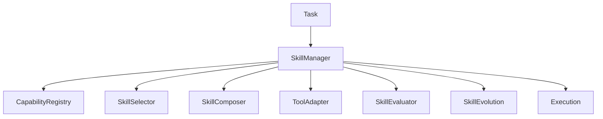

# RFC-0069

**Title:** Autonomous Cognitive Skill Architecture

**Document ID:** RFC-0069

**Version:** 1.0

**Status:** Accepted

**Category:** Cognitive Capability Architecture

**Layer:** Skills / Capabilities / Tool Intelligence

**Target:**

```text
skills/
```

---

# Abstract

This RFC defines the SH-3 Autonomous Cognitive Skill Architecture (ACSA).

The Autonomous Cognitive Skill Architecture provides the unified capability framework through which SH-3 acquires, manages, executes, evaluates, composes, and evolves cognitive and operational skills.

Unlike conventional plugin systems, ACSA treats every skill as a first-class cognitive capability that participates in reasoning, planning, execution, learning, governance, and self-evolution.

The architecture governs:

- skill lifecycle
- capability management
- skill composition
- tool orchestration
- capability discovery
- adaptive skill selection
- skill evolution
- skill governance

The system enables:

- reusable cognitive capabilities
- autonomous tool selection
- dynamic capability composition
- lifelong capability growth
- explainable capability utilization

This document is normative.

---

# Motivation

Autonomous intelligence continuously encounters new tasks.

Embedding every possible behavior directly into the architecture is neither scalable nor maintainable.

Instead, SH-3 models functionality as reusable cognitive skills.

Skills become modular building blocks that can be:

- discovered
- composed
- optimized
- replaced
- evolved
- retired

---

# Goals

The Autonomous Cognitive Skill Architecture SHALL provide:

- unified capability abstraction
- dynamic skill registration
- adaptive skill selection
- skill composition
- capability governance
- continuous skill evolution
- explainable capability execution

---

# Non-Goals

The architecture SHALL NOT:

- replace planning
- replace execution
- replace reasoning
- bypass governance
- tightly couple skills to runtime implementation

Skills provide capabilities rather than executive control.

---

# Architecture



---

# Design Principles

## Capability Abstraction

Every executable ability SHALL be represented as a skill.

---

## Composability

Skills SHALL be composable into higher-order capabilities.

---

## Discoverability

Capabilities SHALL be dynamically discoverable.

---

## Explainability

Skill selection SHALL remain traceable.

---

## Governance

Every skill SHALL satisfy governance validation.

---

## Lifelong Evolution

Capabilities SHALL continuously improve.

---

# Components

| Component | Responsibility |
|------------|----------------|
| SkillManager | Global coordination |
| CapabilityRegistry | Capability catalog |
| SkillSelector | Skill selection |
| SkillComposer | Skill composition |
| ToolAdapter | External tool interface |
| SkillEvaluator | Capability evaluation |
| SkillEvolution | Capability improvement |

---

# Skill

A Skill represents an executable cognitive capability.

Every Skill SHALL expose:

| Field | Description |
|------|-------------|
| skill_id | Unique identifier |
| name | Capability name |
| version | Version |
| category | Capability type |
| inputs | Input schema |
| outputs | Output schema |
| constraints | Operational constraints |
| confidence | Capability confidence |

---

# Skill Lifecycle

Every Skill follows:

```text
Creation

↓

Registration

↓

Validation

↓

Execution

↓

Evaluation

↓

Optimization

↓

Version Update

↓

Retirement
```

---

# Capability Registry

CapabilityRegistry stores:

- available skills
- metadata
- versions
- dependencies
- compatibility
- governance approval

Capabilities SHALL be queryable.

---

# Capability Discovery

Discovery SHALL support:

- semantic search
- capability tags
- ontology lookup
- embedding similarity
- dependency analysis

---

# Skill Selection

SkillSelector chooses skills using:

- task requirements
- confidence
- historical success
- execution cost
- capability compatibility
- governance approval

Selection SHALL be deterministic unless stochastic exploration is explicitly enabled.

---

# Selection Model

```text
Task

+

Context

+

Capabilities

↓

Selected Skill
```

---

# Skill Composition

SkillComposer combines multiple skills into a composite capability.

Composition patterns include:

- sequential
- parallel
- conditional
- hierarchical
- recursive

Composite skills SHALL expose the same interface as atomic skills.

---

# Composition Model

```text
Skill A

+

Skill B

+

Skill C

↓

Composite Skill
```

---

# Tool Adapter

ToolAdapter connects cognitive skills to external systems.

Supported integrations include:

- APIs
- filesystems
- databases
- web services
- robotics
- operating systems
- external models

External interfaces SHALL remain isolated from cognitive logic.

---

# Skill Context

Every skill execution receives an immutable SkillContext.

SkillContext SHALL contain:

| Field | Description |
|------|-------------|
| skill_execution_id | Execution identifier |
| task_id | Associated task |
| execution_context | Runtime context |
| safety_constraints | Governance constraints |
| timestamp | Execution time |

---

# Autonomous Cognitive Skill Execution Model

The Autonomous Cognitive Skill Architecture (ACSA) transforms reusable capabilities into adaptive, explainable, governable, and continuously evolving cognitive functions.

Every skill participates in the complete cognitive lifecycle of SH-3, including reasoning, planning, execution, learning, governance, and self-evolution.

The capability lifecycle follows:


Each stage maintains a distinct capability management responsibility.

---

# Cognitive Skill Control Loop

The SkillManager continuously supervises the capability ecosystem.

```text
Capability Discovery

↓

Capability Selection

↓

Governance Validation

↓

Execution

↓

Result Evaluation

↓

Capability Learning

↓

Optimization

↓

Capability Evolution
```

The capability ecosystem SHALL remain continuously adaptive.

---

# Skill Evaluation

SkillEvaluator determines the effectiveness of every execution.

Evaluation considers:

- execution success
- output quality
- execution latency
- resource utilization
- policy compliance
- user satisfaction
- confidence calibration

Evaluation SHALL generate an immutable SkillEvaluation record.

---

# Skill Evaluation Model

```text
Execution Result

+

Telemetry

+

Expected Outcome

↓

Capability Score
```

---

# Capability Governance

Every skill SHALL satisfy governance before execution.

Governance validation includes:

- authorization
- capability approval
- execution constraints
- resource limits
- safety policies
- trust requirements

Capabilities violating governance SHALL NOT execute.

---

# Governance Pipeline

```text
Selected Skill

↓

Policy Validation

↓

Authorization

↓

Approved Capability
```

---

# Skill Versioning

Every capability SHALL maintain semantic versioning.

Version metadata includes:

| Field | Description |
|------|-------------|
| major | Breaking changes |
| minor | Compatible enhancements |
| patch | Bug fixes |
| compatibility | Supported runtime versions |
| deprecation | Retirement status |

Multiple compatible versions MAY coexist.

---

# Capability Compatibility

Compatibility SHALL consider:

- runtime version
- dependency versions
- governance policy version
- API compatibility
- execution environment

Incompatible capabilities SHALL NOT be activated.

---

# Adaptive Skill Learning

Learning continuously improves capabilities using:

- execution history
- feedback
- failure analysis
- optimization history
- successful execution patterns

Learning SHALL preserve deterministic behavior unless exploratory learning is explicitly enabled.

---

# Learning Pipeline

```text
Execution History

↓

Pattern Analysis

↓

Capability Update

↓

Improved Skill
```

---

# Skill Optimization

Optimization targets include:

- execution latency
- success rate
- resource efficiency
- reliability
- composability
- maintainability

Optimization SHALL remain evidence-driven.

---

# Composite Capability Optimization

Composite capabilities SHALL optimize:

- execution ordering
- dependency resolution
- redundant execution elimination
- shared context reuse
- parallel execution opportunities

---

# Capability Marketplace

The architecture MAY support capability exchange.

Exchangeable artifacts include:

- reusable skills
- composite skills
- execution templates
- capability metadata
- governance manifests

Imported capabilities SHALL pass governance validation before registration.

---

# Federated Capability Sharing

Multiple SH-3 instances MAY share:

- approved capabilities
- optimization policies
- execution statistics
- capability metadata

Private implementation details need not be shared.

---

# Skill Retirement

Capabilities MAY be retired because of:

- obsolescence
- policy changes
- superior replacements
- security concerns
- persistent failures

Retirement SHALL preserve execution history.

---

# Capability Evolution

SkillEvolution continuously improves the capability ecosystem.

Evolution activities include:

- specialization
- generalization
- decomposition
- composition
- replacement
- automatic optimization

Evolution SHALL remain explainable.

---

# Evolution Pipeline

```text
Capability History

↓

Performance Analysis

↓

Evolution Strategy

↓

Capability Update
```

---

# Unified Cognitive Memory Integration

Unified Cognitive Memory stores:

- capability history
- execution history
- evaluation reports
- optimization records
- version history

---

# Consciousness Integration

Consciousness Coordination receives:

- capability summaries
- execution recommendations
- capability availability

---

# Decision Intelligence Integration

Decision Intelligence receives:

- capability confidence
- execution feasibility
- capability constraints

---

# Cognitive Execution Integration

Cognitive Execution receives:

- approved capabilities
- execution parameters
- composed workflows

---

# Meta-Reasoning Integration

Meta-Reasoning receives:

- capability effectiveness
- optimization opportunities
- evolution recommendations

---

# Learning Integration

Learning receives:

- replay datasets
- execution feedback
- capability metrics
- optimization opportunities

---

# Self Evolution Integration

Self Evolution System receives:

- capability evolution history
- architectural recommendations
- specialization opportunities

---

# AI Safety Governance Integration

AI Safety Governance validates:

- capability approval
- imported capabilities
- execution authorization
- evolution boundaries

No capability SHALL bypass governance validation.

---

# Risk Management Integration

Risk Management evaluates:

- capability reliability
- execution risk
- dependency instability
- capability degradation

---

# Message Bus Integration

Capability events include:

- SkillRegistered
- SkillValidated
- SkillSelected
- SkillExecuted
- SkillEvaluated
- SkillOptimized
- SkillVersionUpdated
- SkillRetired
- SkillEvolved

---

# Persistence Integration

Persistence stores:

- capability registry
- execution history
- evaluation history
- version history
- optimization history
- governance manifests

---

# Observability Integration

Capability telemetry includes:

- execution frequency
- success rate
- execution latency
- capability utilization
- composition frequency
- optimization gain
- evolution rate

---

# Tracing

Capability traces preserve:

- trace_id
- skill_id
- execution_id
- evaluation_id
- optimization_id
- version_id
- evolution_id

Every capability execution SHALL participate in distributed cognitive tracing.

---

# Thread Model

The Autonomous Cognitive Skill Architecture supports concurrent:

- capability discovery
- registration
- execution
- evaluation
- optimization
- evolution

Concurrent capability operations SHALL preserve registry consistency.

The reference implementation SHALL be deterministic, thread-safe, and lock-efficient.

---

# Metrics

The Autonomous Cognitive Skill Architecture exposes:

- capability utilization
- execution success rate
- average execution latency
- capability reliability
- composition efficiency
- optimization effectiveness
- capability evolution rate

---

# Performance Objectives

The Autonomous Cognitive Skill Architecture should optimize for:

- reusable capabilities
- rapid capability discovery
- efficient execution
- adaptive capability evolution
- scalable composition
- continuous capability improvement

---

# Future Work

Potential future enhancements include:

- autonomous capability synthesis
- neurosymbolic skill generation
- capability graph optimization
- distributed capability federation
- self-generating composite skills
- market-based capability allocation
- autonomous capability certification

These enhancements extend SH-3 toward a self-expanding cognitive capability ecosystem in which reusable skills can be autonomously acquired, evaluated, composed, optimized, governed, and evolved throughout the system's lifetime.

---

# References

- SH-3 Architecture Specification v2.1
- RFC-0027 Autonomous Learning System
- RFC-0053 AI Safety Governance System
- RFC-0063 Autonomous Consciousness Coordination System
- RFC-0064 Autonomous Cognitive Memory Architecture
- RFC-0065 Autonomous Cognitive Communication Architecture
- RFC-0066 Autonomous Cognitive Execution Architecture
- RFC-0067 Autonomous Cognitive Operating System
- RFC-0068 Autonomous Multi-Agent Cognitive Architecture

---

# End of RFC-0069
