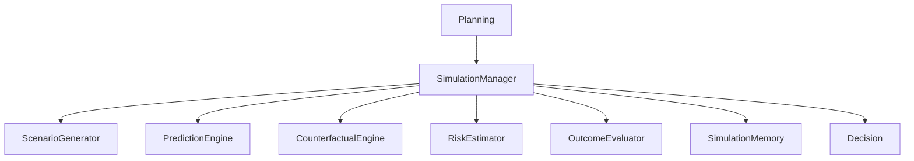

# RFC-0070

**Title:** Autonomous Cognitive Simulation Architecture

**Document ID:** RFC-0070

**Version:** 1.0

**Status:** Accepted

**Category:** Cognitive Architecture

**Layer:** Simulation / Prediction / Counterfactual Reasoning

**Target:**

```text
simulation/
```

---

# Abstract

This RFC defines the SH-3 Autonomous Cognitive Simulation Architecture (ACSA-S).

The Autonomous Cognitive Simulation Architecture provides SH-3 with the ability to internally simulate possible futures before committing to real-world execution.

Rather than immediately executing selected actions, SH-3 evaluates multiple hypothetical scenarios using internal models, predicts outcomes, estimates uncertainty, analyzes risks, and recommends execution strategies based on expected utility.

The architecture governs:

- predictive simulation
- future state estimation
- counterfactual reasoning
- scenario generation
- uncertainty estimation
- risk forecasting
- execution forecasting
- simulation learning

The system enables:

- safer decision making
- improved planning quality
- reduced execution risk
- explainable predictions
- adaptive strategic reasoning

This document is normative.

---

# Motivation

Real-world execution is expensive.

Some actions:

- cannot be reversed
- consume resources
- create irreversible consequences
- affect safety
- change long-term system state

A cognitive architecture therefore benefits from evaluating candidate actions before execution.

Simulation transforms reasoning into predictive intelligence.

---

# Goals

The Autonomous Cognitive Simulation Architecture SHALL provide:

- future prediction
- internal simulation
- scenario comparison
- uncertainty estimation
- counterfactual analysis
- simulation-based planning
- explainable prediction

---

# Non-Goals

The architecture SHALL NOT:

- replace execution
- replace planning
- replace decision making
- guarantee perfect prediction
- bypass governance

Simulation informs decisions rather than making them.

---

# Architecture



---

# Design Principles

## Predict Before Acting

Actions SHOULD be simulated before execution whenever practical.

---

## Multiple Futures

Multiple plausible futures SHALL be considered.

---

## Explainability

Predictions SHALL remain explainable.

---

## Probabilistic Reasoning

Simulation SHALL represent uncertainty explicitly.

---

## Continuous Learning

Simulation accuracy SHALL continuously improve.

---

## Governance

Simulation SHALL respect governance constraints.

---

# Components

| Component | Responsibility |
|------------|----------------|
| SimulationManager | Global coordination |
| ScenarioGenerator | Candidate scenarios |
| PredictionEngine | Future prediction |
| CounterfactualEngine | Alternative histories |
| RiskEstimator | Risk prediction |
| OutcomeEvaluator | Utility estimation |
| SimulationMemory | Simulation history |

---

# Simulation Context

Every simulation receives an immutable SimulationContext.

SimulationContext SHALL contain:

| Field | Description |
|------|-------------|
| simulation_id | Identifier |
| goal_id | Active goal |
| strategy_id | Current strategy |
| world_state | Current world model |
| assumptions | Simulation assumptions |
| timestamp | Simulation time |

---

# Simulation Lifecycle

Every simulation follows:

```text
Scenario Generation

↓

Prediction

↓

Evaluation

↓

Risk Analysis

↓

Comparison

↓

Recommendation

↓

Learning
```

---

# Scenario Generation

ScenarioGenerator creates candidate futures.

Scenario generation includes:

- optimistic paths
- pessimistic paths
- expected paths
- exploratory paths
- stochastic variants

Generated scenarios SHALL remain bounded by governance constraints.

---

# Scenario Representation

Every scenario SHALL expose:

| Field | Description |
|------|-------------|
| scenario_id | Identifier |
| assumptions | Initial assumptions |
| predicted_actions | Candidate actions |
| predicted_state | Expected future |
| probability | Estimated likelihood |
| confidence | Prediction confidence |

---

# Prediction Engine

PredictionEngine estimates future world states.

Predictions consider:

- current observations
- world model
- historical experience
- causal relationships
- environmental uncertainty

Predictions SHALL produce probabilistic outputs.

---

# Prediction Model

```text
Current State

+

Candidate Action

+

World Model

↓

Predicted Future
```

---

# Counterfactual Reasoning

CounterfactualEngine evaluates:

"What would happen if..."

Counterfactual analysis supports:

- rejected actions
- alternative strategies
- hypothetical observations
- causal analysis
- failure diagnosis

Counterfactual reasoning SHALL preserve causal consistency.

---

# Counterfactual Model

```text
Observed Reality

+

Alternative Decision

↓

Alternative Future
```

---

# Autonomous Cognitive Simulation Execution Model

The Autonomous Cognitive Simulation Architecture transforms candidate actions into predictive evaluations before real-world execution.

Rather than committing immediately to execution, SH-3 evaluates multiple plausible futures, estimates uncertainty, analyzes risk, compares expected outcomes, and continuously improves prediction quality through lifelong learning.

The simulation lifecycle follows:


Each stage maintains a distinct simulation responsibility.

---

# Cognitive Simulation Control Loop

The SimulationManager continuously supervises predictive cognition.

```text
World State

↓

Scenario Generation

↓

Future Prediction

↓

Counterfactual Analysis

↓

Risk Estimation

↓

Outcome Evaluation

↓

Decision Recommendation

↓

Simulation Learning
```

Simulation SHALL precede execution whenever simulation cost is justified by expected decision improvement.

---

# Risk Estimation

RiskEstimator predicts execution risk.

Risk dimensions include:

- operational risk
- safety risk
- resource risk
- uncertainty
- cascading failure
- governance risk

Risk SHALL be represented probabilistically.

---

# Risk Model

```text
Predicted Future

+

World State

+

Uncertainty

↓

Risk Profile
```

---

# Outcome Evaluation

OutcomeEvaluator estimates expected utility.

Evaluation includes:

- goal completion
- expected reward
- execution cost
- resource utilization
- strategic value
- long-term impact

Evaluation SHALL produce an immutable OutcomeEstimate.

---

# OutcomeEstimate

OutcomeEstimate SHALL contain:

| Field | Description |
|------|-------------|
| scenario_id | Scenario identifier |
| expected_utility | Estimated utility |
| expected_cost | Estimated cost |
| confidence | Confidence |
| predicted_risk | Risk score |
| recommendation | Execution recommendation |

---

# Multi-Scenario Comparison

Multiple scenarios SHALL be compared simultaneously.

Comparison criteria include:

- utility
- probability
- confidence
- execution complexity
- governance compliance
- strategic alignment

The comparison process SHALL generate a ranked scenario list.

---

# Comparison Pipeline

```text
Scenario A

Scenario B

Scenario C

↓

Multi-Criteria Evaluation

↓

Ranked Scenarios
```

---

# Monte Carlo Simulation

The architecture MAY perform Monte Carlo simulation.

Simulation parameters include:

- iteration count
- stochastic variables
- uncertainty distribution
- convergence threshold

Monte Carlo execution SHALL remain bounded by runtime constraints.

---

# Scenario Pruning

ScenarioGenerator MAY eliminate scenarios that are:

- impossible
- governance prohibited
- strategically dominated
- below confidence threshold
- computationally redundant

Pruning SHALL preserve representative diversity.

---

# Simulation Memory

SimulationMemory stores:

- generated scenarios
- prediction history
- evaluation history
- simulation traces
- recommendation history

Historical simulations SHALL support future prediction improvement.

---

# Simulation Verification

Simulation predictions SHALL be verified after execution.

Verification compares:

- predicted outcome
- observed outcome
- prediction error
- uncertainty estimate
- causal assumptions

Prediction quality SHALL be continuously measured.

---

# Verification Pipeline

```text
Prediction

↓

Execution

↓

Observed Outcome

↓

Prediction Error

↓

Model Update
```

---

# Simulation Learning

Learning continuously improves prediction quality.

Learning inputs include:

- prediction errors
- execution history
- environment changes
- counterfactual validation
- world model updates

Learning SHALL improve future simulations without invalidating historical provenance.

---

# Prediction Calibration

PredictionEngine SHALL continuously calibrate:

- confidence
- uncertainty
- causal weights
- probability estimation

Calibration SHALL reduce systematic prediction bias.

---

# Distributed Simulation

Multiple SH-3 agents MAY execute simulations collaboratively.

Distributed simulation SHALL support:

- parallel scenario evaluation
- federated prediction
- distributed risk estimation
- shared simulation knowledge

Federated simulation SHALL preserve local governance policies.

---

# Consciousness Integration

Consciousness Coordination receives:

- simulation summaries
- ranked scenarios
- prediction confidence
- uncertainty reports

---

# World Model Integration

World Model provides:

- environmental dynamics
- causal relationships
- environmental constraints

Simulation SHALL continuously synchronize with the World Model.

---

# Decision Intelligence Integration

Decision Intelligence receives:

- ranked alternatives
- expected utility
- predicted consequences
- uncertainty estimates

Decision SHALL remain responsible for final action selection.

---

# Strategy Intelligence Integration

Strategy Intelligence receives:

- scenario effectiveness
- long-term projections
- strategic risk

---

# Unified Cognitive Memory Integration

Unified Cognitive Memory stores:

- simulation history
- prediction history
- verification results
- counterfactual analyses

---

# Meta-Reasoning Integration

Meta-Reasoning receives:

- prediction quality
- simulation limitations
- uncertainty analysis
- calibration history

---

# Learning Integration

Learning receives:

- replay datasets
- prediction errors
- calibration history
- optimization opportunities

---

# Self Evolution Integration

Self Evolution System receives:

- simulation capability metrics
- prediction improvement opportunities
- architectural recommendations

---

# AI Safety Governance Integration

AI Safety Governance validates:

- simulation assumptions
- prohibited scenarios
- execution recommendations
- simulation resource limits

Simulation SHALL NOT recommend governance-prohibited actions.

---

# Risk Management Integration

Risk Management evaluates:

- prediction uncertainty
- scenario robustness
- catastrophic risk
- model limitations

---

# Message Bus Integration

Simulation events include:

- SimulationStarted
- ScenarioGenerated
- PredictionCompleted
- RiskEstimated
- OutcomeEvaluated
- ScenarioRanked
- SimulationVerified
- SimulationLearned

---

# Persistence Integration

Persistence stores:

- simulation history
- prediction datasets
- verification reports
- calibration records
- scenario archives

---

# Observability Integration

Simulation telemetry includes:

- simulation latency
- prediction accuracy
- calibration quality
- scenario count
- uncertainty distribution
- verification accuracy
- simulation throughput

---

# Tracing

Simulation traces preserve:

- trace_id
- simulation_id
- scenario_id
- prediction_id
- verification_id
- calibration_id

Every simulation SHALL participate in distributed cognitive tracing.

---

# Thread Model

The Autonomous Cognitive Simulation Architecture supports concurrent:

- scenario generation
- prediction
- risk estimation
- evaluation
- verification
- learning

Concurrent simulation SHALL preserve deterministic behavior when identical seeds, inputs, and world states are supplied.

The reference implementation SHALL be thread-safe, scalable, and lock-efficient.

---

# Metrics

The Autonomous Cognitive Simulation Architecture exposes:

- prediction accuracy
- calibration error
- expected utility accuracy
- simulation latency
- scenario diversity
- verification rate
- simulation throughput

---

# Performance Objectives

The Autonomous Cognitive Simulation Architecture should optimize for:

- accurate prediction
- robust uncertainty estimation
- efficient simulation
- explainable recommendations
- adaptive calibration
- continuous predictive improvement

---

# Future Work

Potential future enhancements include:

- hierarchical simulation planning
- differentiable world simulation
- self-generated scenario synthesis
- neurosymbolic predictive reasoning
- digital twin integration
- real-time distributed simulation
- autonomous hypothesis generation

These enhancements extend SH-3 toward a predictive cognitive architecture capable of evaluating, comparing, and continuously improving its understanding of possible futures before committing to real-world execution.

---

# References

- SH-3 Architecture Specification v2.1
- RFC-0023 World Model System
- RFC-0027 Autonomous Learning System
- RFC-0053 AI Safety Governance System
- RFC-0062 Autonomous Meta-Reasoning Intelligence System
- RFC-0063 Autonomous Consciousness Coordination System
- RFC-0064 Autonomous Cognitive Memory Architecture
- RFC-0065 Autonomous Cognitive Communication Architecture
- RFC-0066 Autonomous Cognitive Execution Architecture
- RFC-0067 Autonomous Cognitive Operating System
- RFC-0068 Autonomous Multi-Agent Cognitive Architecture
- RFC-0069 Autonomous Cognitive Skill Architecture

---

# End of RFC-0070
