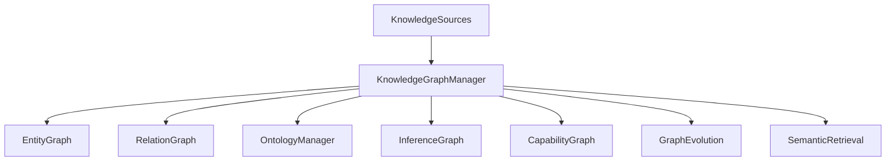
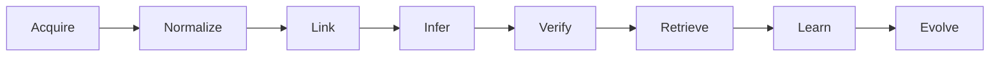

# RFC-0071

**Title:** Autonomous Cognitive Knowledge Graph Architecture

**Document ID:** RFC-0071

**Version:** 1.0

**Status:** Accepted

**Category:** Cognitive Knowledge Architecture

**Layer:** Knowledge Representation / Semantic Graph / Cognitive Graph

**Target:**

```text
knowledge_graph/
```

---

# Abstract

This RFC defines the SH-3 Autonomous Cognitive Knowledge Graph Architecture (ACKGA).

The Autonomous Cognitive Knowledge Graph Architecture provides the unified semantic representation layer that connects every cognitive subsystem within SH-3.

Rather than storing isolated facts, SH-3 represents knowledge as an evolving semantic graph composed of entities, concepts, events, procedures, causal relationships, temporal relationships, capabilities, goals, and experiences.

The Knowledge Graph serves as the common representational substrate for reasoning, planning, memory, simulation, learning, explanation, and autonomous self-evolution.

The architecture governs:

- semantic knowledge representation
- entity relationships
- causal graphs
- temporal knowledge
- procedural knowledge
- capability graphs
- ontology management
- graph evolution

The system enables:

- unified knowledge representation
- explainable reasoning
- graph-based inference
- semantic retrieval
- lifelong knowledge evolution

This document is normative.

---

# Motivation

Modern autonomous cognition requires more than document storage.

Knowledge must preserve:

- relationships
- causality
- temporal order
- abstraction
- hierarchy
- provenance

Representing cognition as a semantic graph enables reasoning across interconnected knowledge rather than isolated records.

---

# Goals

The Autonomous Cognitive Knowledge Graph Architecture SHALL provide:

- unified graph representation
- semantic consistency
- graph evolution
- ontology support
- explainable inference
- efficient retrieval
- distributed graph compatibility

---

# Non-Goals

The architecture SHALL NOT:

- replace memory
- replace world modeling
- replace reasoning
- replace planning
- bypass governance

The Knowledge Graph represents knowledge rather than executing cognition.

---

# Architecture



---

# Design Principles

## Unified Representation

All cognitive knowledge SHALL be representable as graph structures.

---

## Semantic Consistency

Equivalent concepts SHALL preserve semantic identity.

---

## Explainability

Relationships SHALL remain observable.

---

## Incremental Evolution

The graph SHALL evolve continuously.

---

## Governance

Graph modifications SHALL satisfy governance validation.

---

## Lifelong Knowledge

Knowledge SHALL accumulate without losing provenance.

---

# Components

| Component | Responsibility |
|------------|----------------|
| KnowledgeGraphManager | Global coordination |
| EntityGraph | Entity representation |
| RelationGraph | Relationship management |
| OntologyManager | Concept hierarchy |
| InferenceGraph | Derived knowledge |
| CapabilityGraph | Capability relationships |
| GraphEvolution | Continuous refinement |

---

# Graph Context

Every graph operation receives an immutable GraphContext.

GraphContext SHALL contain:

| Field | Description |
|------|-------------|
| graph_id | Graph identifier |
| operation_id | Graph operation |
| provenance | Origin |
| confidence | Confidence |
| timestamp | Operation time |

---

# Knowledge Node

Every graph node SHALL expose:

| Field | Description |
|------|-------------|
| node_id | Unique identifier |
| node_type | Entity type |
| label | Semantic label |
| confidence | Confidence |
| provenance | Origin |
| embedding | Semantic embedding |

Nodes SHALL remain globally identifiable.

---

# Graph Edge

Every edge SHALL expose:

| Field | Description |
|------|-------------|
| edge_id | Unique identifier |
| relation_type | Semantic relation |
| source | Source node |
| target | Target node |
| confidence | Confidence |
| provenance | Origin |

Edges SHALL preserve semantic directionality.

---

# Graph Lifecycle

Every graph update follows:

```text
Observation

↓

Normalization

↓

Entity Resolution

↓

Relationship Extraction

↓

Graph Update

↓

Verification

↓

Evolution
```

---

# Entity Graph

EntityGraph stores:

- objects
- people
- systems
- organizations
- places
- concepts
- events

Entities SHALL possess stable identities.

---

# Entity Resolution

Entity resolution SHALL perform:

- duplicate detection
- alias resolution
- canonical mapping
- identity merging

Entity identity SHALL remain deterministic.

---

# Relation Graph

RelationGraph represents:

- causality
- dependency
- hierarchy
- ownership
- similarity
- sequence
- interaction

Relationships SHALL be typed.

---

# Relationship Model

```text
Entity

↓

Semantic Relation

↓

Entity
```

---

# Ontology Manager

OntologyManager maintains:

- concept taxonomy
- inheritance
- abstraction
- specialization
- semantic constraints

Ontologies SHALL remain versioned.

---

# Ontology Model

```text
Concept

↓

Superclass

↓

Subclass
```

---

# Inference Graph

InferenceGraph stores derived knowledge.

Derived knowledge includes:

- inferred relationships
- logical conclusions
- causal implications
- predicted connections

Derived nodes SHALL preserve inference provenance.

---

# Autonomous Cognitive Knowledge Graph Execution Model

The Autonomous Cognitive Knowledge Graph Architecture (ACKGA) transforms observations, experiences, reasoning results, simulations, and learned knowledge into a unified semantic knowledge graph.

The graph continuously evolves while preserving semantic consistency, provenance, explainability, and governance compliance.

The knowledge graph lifecycle follows:



Each stage maintains a distinct semantic knowledge responsibility.

---

# Cognitive Knowledge Graph Control Loop

The KnowledgeGraphManager continuously supervises semantic knowledge evolution.

```text
Knowledge Acquisition

↓

Entity Resolution

↓

Relationship Extraction

↓

Ontology Alignment

↓

Inference

↓

Graph Verification

↓

Semantic Retrieval

↓

Graph Evolution
```

The graph SHALL remain continuously consistent and incrementally extensible.

---

# Capability Graph

CapabilityGraph represents relationships among cognitive capabilities.

Relationships include:

- dependency
- composition
- specialization
- replacement
- compatibility
- prerequisite

Capability relationships SHALL support autonomous capability discovery and composition.

---

# Capability Graph Model

```text
Capability

↓

Semantic Relationship

↓

Capability
```

---

# Semantic Retrieval

SemanticRetrieval performs graph-aware knowledge retrieval.

Retrieval methods include:

- neighborhood expansion
- semantic similarity
- ontology traversal
- causal traversal
- temporal traversal
- capability traversal

Retrieval SHALL preserve provenance.

---

# Semantic Retrieval Pipeline

```text
Query

↓

Embedding Search

↓

Graph Traversal

↓

Ranking

↓

Knowledge Response
```

---

# Graph Evolution

GraphEvolution continuously improves semantic quality.

Evolution activities include:

- entity merging
- edge refinement
- ontology refinement
- graph compression
- abstraction generation
- relationship discovery

Evolution SHALL preserve graph integrity.

---

# Evolution Pipeline

```text
Graph History

↓

Structural Analysis

↓

Evolution Policy

↓

Updated Graph
```

---

# Knowledge Verification

Knowledge SHALL be verified before becoming authoritative.

Verification sources include:

- observation
- execution outcome
- simulation
- trusted external knowledge
- consensus

Verification SHALL assign confidence scores.

---

# Verification Model

```text
Candidate Knowledge

↓

Evidence Collection

↓

Confidence Analysis

↓

Verified Knowledge
```

---

# Graph Consistency

The Knowledge Graph SHALL preserve:

- entity uniqueness
- semantic consistency
- referential integrity
- ontology consistency
- causal consistency
- temporal consistency

Consistency SHALL be maintained after every graph update.

---

# Provenance Tracking

Every node and edge SHALL maintain provenance.

Provenance metadata includes:

| Field | Description |
|------|-------------|
| source | Knowledge origin |
| acquisition_time | Acquisition timestamp |
| confidence | Confidence |
| verification_state | Validation status |
| creator | Originating subsystem |

Provenance SHALL never be discarded.

---

# Distributed Knowledge Graph

Multiple SH-3 instances MAY participate in a federated graph.

Federated operations include:

- graph synchronization
- ontology synchronization
- distributed inference
- entity federation
- shared semantic retrieval

Local governance SHALL remain authoritative.

---

# Knowledge Conflict Resolution

Conflicting knowledge SHALL be resolved using:

- confidence
- provenance
- recency
- consensus
- governance policy

Conflicts SHALL remain explainable.

---

# Graph Optimization

Optimization targets include:

- graph density
- retrieval latency
- traversal efficiency
- embedding quality
- redundancy reduction

Optimization SHALL preserve semantic meaning.

---

# Consciousness Integration

Consciousness Coordination receives:

- graph summaries
- active semantic context
- concept activation
- relationship explanations

---

# World Model Integration

World Model synchronizes:

- entities
- causal relationships
- environmental dynamics
- temporal evolution

The World Model SHALL remain graph-compatible.

---

# Unified Cognitive Memory Integration

Unified Cognitive Memory stores:

- graph history
- graph snapshots
- ontology versions
- semantic retrieval history

---

# Cognitive Simulation Integration

Simulation receives:

- causal graphs
- entity relationships
- temporal dependencies
- capability relationships

Simulation SHALL use graph semantics for future prediction.

---

# Meta-Reasoning Integration

Meta-Reasoning receives:

- graph quality
- inference confidence
- ontology consistency
- semantic uncertainty

---

# Learning Integration

Learning receives:

- graph evolution history
- semantic corrections
- inference quality
- ontology improvements

---

# Self Evolution Integration

Self Evolution System receives:

- graph optimization opportunities
- ontology evolution
- capability relationship improvements

---

# AI Safety Governance Integration

AI Safety Governance validates:

- graph modifications
- ontology updates
- imported knowledge
- distributed synchronization

No graph modification SHALL bypass governance.

---

# Risk Management Integration

Risk Management evaluates:

- inconsistent knowledge
- ontology conflicts
- low-confidence inference
- graph fragmentation

---

# Message Bus Integration

Knowledge Graph events include:

- EntityCreated
- EntityMerged
- RelationshipAdded
- RelationshipUpdated
- OntologyUpdated
- KnowledgeVerified
- GraphOptimized
- GraphEvolved

---

# Persistence Integration

Persistence stores:

- graph database
- ontology versions
- graph snapshots
- provenance metadata
- embedding indexes
- inference history

---

# Observability Integration

Knowledge Graph telemetry includes:

- node count
- edge count
- ontology depth
- retrieval latency
- inference accuracy
- graph density
- graph evolution rate

---

# Tracing

Knowledge Graph traces preserve:

- trace_id
- graph_id
- node_id
- edge_id
- ontology_id
- inference_id
- provenance_id

Every graph operation SHALL participate in distributed cognitive tracing.

---

# Thread Model

The Autonomous Cognitive Knowledge Graph Architecture supports concurrent:

- entity insertion
- relationship updates
- graph traversal
- semantic retrieval
- inference
- graph evolution

Concurrent graph operations SHALL preserve semantic consistency through deterministic commit semantics.

The reference implementation SHALL be thread-safe, scalable, and lock-efficient.

---

# Metrics

The Autonomous Cognitive Knowledge Graph Architecture exposes:

- graph completeness
- semantic consistency
- inference precision
- retrieval recall
- ontology stability
- graph evolution rate
- provenance coverage

---

# Performance Objectives

The Autonomous Cognitive Knowledge Graph Architecture should optimize for:

- scalable graph growth
- efficient semantic retrieval
- high-quality inference
- explainable knowledge representation
- continuous semantic refinement
- long-term graph integrity

---

# Future Work

Potential future enhancements include:

- autonomous ontology induction
- neurosymbolic graph reasoning
- differentiable knowledge graphs
- planetary-scale distributed knowledge graphs
- self-organizing semantic networks
- graph-native cognitive execution
- autonomous conceptual discovery

These enhancements extend SH-3 toward a unified semantic cognition architecture in which every observation, experience, capability, and reasoning result becomes part of an evolving, explainable, and governance-aware knowledge graph supporting lifelong autonomous intelligence.

---

# References

- SH-3 Architecture Specification v2.1
- RFC-0022 Knowledge System
- RFC-0023 World Model System
- RFC-0027 Autonomous Learning System
- RFC-0050 Knowledge Governance System
- RFC-0053 AI Safety Governance System
- RFC-0063 Autonomous Consciousness Coordination System
- RFC-0064 Autonomous Cognitive Memory Architecture
- RFC-0065 Autonomous Cognitive Communication Architecture
- RFC-0067 Autonomous Cognitive Operating System
- RFC-0068 Autonomous Multi-Agent Cognitive Architecture
- RFC-0069 Autonomous Cognitive Skill Architecture
- RFC-0070 Autonomous Cognitive Simulation Architecture

---

# End of RFC-0071
