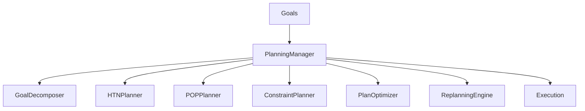

# RFC-0072

**Title:** Autonomous Cognitive Planning Architecture

**Document ID:** RFC-0072

**Version:** 1.0

**Status:** Accepted

**Category:** Cognitive Architecture

**Layer:** Planning / Goal Decomposition / Strategy Realization

**Target:**

```text
planning/
```

---

# Abstract

This RFC defines the SH-3 Autonomous Cognitive Planning Architecture (ACPA).

The Autonomous Cognitive Planning Architecture provides the planning substrate that transforms goals, intentions, and strategic objectives into executable plans through hierarchical decomposition, constraint reasoning, simulation, and adaptive optimization.

Unlike conventional task planners, ACPA integrates cognitive memory, the world model, knowledge graphs, simulation, execution feedback, and multi-agent coordination into a unified planning framework.

The architecture governs:

- goal decomposition
- hierarchical planning
- partial-order planning
- constraint planning
- adaptive replanning
- execution-aware planning
- multi-agent planning
- plan optimization

The system enables:

- explainable planning
- adaptive plan generation
- resilient execution
- long-term strategic coordination
- continuous planning improvement

This document is normative.

---

# Motivation

Autonomous intelligence requires more than isolated decision making.

Complex objectives demand:

- hierarchical decomposition
- dependency management
- uncertainty handling
- resource allocation
- continuous replanning
- execution monitoring

Planning connects strategic reasoning with executable behavior.

---

# Goals

The Autonomous Cognitive Planning Architecture SHALL provide:

- unified planning
- adaptive replanning
- constraint satisfaction
- execution awareness
- explainable plans
- distributed planning
- lifelong planning optimization

---

# Non-Goals

The architecture SHALL NOT:

- replace execution
- replace simulation
- replace reasoning
- bypass governance
- directly manipulate runtime state

Planning generates executable intent rather than performing execution.

---

# Architecture



---

# Design Principles

## Goal-Oriented Planning

Every plan SHALL originate from explicit goals.

---

## Hierarchical Decomposition

Complex objectives SHALL be decomposed into manageable subtasks.

---

## Execution Awareness

Planning SHALL incorporate execution feedback.

---

## Explainability

Every planning decision SHALL remain traceable.

---

## Adaptability

Plans SHALL evolve with changing environments.

---

## Governance

Generated plans SHALL satisfy governance validation.

---

# Components

| Component | Responsibility |
|------------|----------------|
| PlanningManager | Global coordination |
| GoalDecomposer | Goal hierarchy |
| HTNPlanner | Hierarchical task planning |
| POPPlanner | Partial-order planning |
| ConstraintPlanner | Constraint solving |
| PlanOptimizer | Plan optimization |
| ReplanningEngine | Dynamic replanning |

---

# Planning Context

Every planning operation receives an immutable PlanningContext.

PlanningContext SHALL contain:

| Field | Description |
|------|-------------|
| planning_id | Planning identifier |
| goal_id | Goal identifier |
| strategy_id | Strategy identifier |
| world_state | Current world model |
| constraints | Active constraints |
| timestamp | Planning time |

---

# Plan

Every Plan SHALL expose:

| Field | Description |
|------|-------------|
| plan_id | Unique identifier |
| goal | Associated goal |
| actions | Planned actions |
| dependencies | Action dependencies |
| constraints | Planning constraints |
| confidence | Estimated success |
| status | Planning state |

Plans SHALL remain immutable after approval.

---

# Planning Lifecycle

Every planning process follows:

```text
Goal Analysis

↓

Decomposition

↓

Plan Generation

↓

Simulation

↓

Optimization

↓

Validation

↓

Execution
```

---

# Goal Decomposer

GoalDecomposer transforms high-level objectives into subgoals.

Decomposition SHALL consider:

- semantic hierarchy
- capability availability
- dependency structure
- resource requirements
- temporal ordering

Every subgoal SHALL maintain traceability to its parent goal.

---

# Hierarchical Task Planning

HTNPlanner constructs hierarchical task networks.

Supported constructs include:

- compound tasks
- primitive tasks
- recursive decomposition
- method selection
- task inheritance

Hierarchical plans SHALL preserve causal correctness.

---

# HTN Planning Model

```text
Goal

↓

Compound Tasks

↓

Primitive Tasks

↓

Executable Plan
```

---

# Partial-Order Planning

POPPlanner generates partially ordered plans.

The planner SHALL identify:

- causal links
- ordering constraints
- independent actions
- concurrency opportunities

Independent actions MAY execute in parallel.

---

# Partial-Order Model

```text
Action Set

↓

Dependency Analysis

↓

Partial Ordering
```

---

# Constraint Planning

ConstraintPlanner resolves planning constraints.

Constraint categories include:

- temporal
- resource
- safety
- governance
- capability
- dependency

Constraint violations SHALL invalidate candidate plans.

---

# Autonomous Cognitive Planning Execution Model

The Autonomous Cognitive Planning Architecture transforms goals, intentions, strategic objectives, and environmental constraints into deterministic, adaptive, explainable, and executable plans.

Planning operates as a continuous cognitive process rather than a one-time computation. Plans are continuously refined using execution feedback, simulation results, environmental observations, and learned experience.

The planning lifecycle follows:


Each stage maintains a distinct planning responsibility.

---

# Cognitive Planning Control Loop

The PlanningManager continuously supervises planning throughout the execution lifecycle.

```text
Goal Analysis

↓

Goal Decomposition

↓

Candidate Plan Generation

↓

Simulation

↓

Constraint Verification

↓

Plan Optimization

↓

Execution

↓

Execution Feedback

↓

Adaptive Replanning
```

Planning SHALL remain active until the associated goal is completed, cancelled, or superseded.

---

# Plan Optimization

PlanOptimizer improves candidate plans before approval.

Optimization targets include:

- execution latency
- resource utilization
- expected utility
- execution reliability
- robustness
- plan simplicity

Optimization SHALL preserve goal correctness.

---

# Optimization Model

```text
Candidate Plans

↓

Multi-Objective Optimization

↓

Optimized Plan
```

---

# Dynamic Replanning

ReplanningEngine continuously evaluates whether replanning is required.

Replanning triggers include:

- environmental change
- execution failure
- resource loss
- new knowledge
- updated goals
- governance changes

Replanning SHALL preserve completed work whenever feasible.

---

# Replanning Pipeline

```text
Execution Feedback

↓

Change Detection

↓

Impact Analysis

↓

Partial Replanning

↓

Updated Plan
```

---

# Multi-Agent Planning

Multiple SH-3 agents MAY cooperate during planning.

Distributed planning supports:

- task decomposition
- capability allocation
- dependency negotiation
- schedule coordination
- joint execution planning

Each participating agent SHALL retain local autonomy.

---

# Multi-Agent Planning Model

```text
Global Goal

↓

Task Decomposition

↓

Agent Allocation

↓

Local Plans

↓

Integrated Plan
```

---

# Plan Verification

Every plan SHALL be verified before execution.

Verification evaluates:

- goal completeness
- dependency correctness
- constraint satisfaction
- governance compliance
- simulation consistency

Only verified plans SHALL become executable.

---

# Plan Verification Pipeline

```text
Candidate Plan

↓

Verification Rules

↓

Simulation Review

↓

Approved Plan
```

---

# Plan Consistency

Planning SHALL preserve:

- causal consistency
- dependency consistency
- temporal consistency
- capability consistency
- governance consistency

Consistency SHALL be maintained after every plan modification.

---

# Planning Learning

Learning continuously improves planning quality.

Learning sources include:

- successful plans
- failed plans
- execution history
- replanning history
- simulation accuracy

Planning knowledge SHALL accumulate throughout the system lifetime.

---

# Planning Knowledge Base

Planning knowledge includes:

- reusable plan templates
- decomposition strategies
- optimization heuristics
- constraint patterns
- execution statistics

Knowledge SHALL be reusable across future planning tasks.

---

# Hierarchical Planning Memory

Hierarchical planning SHALL preserve:

- parent-child goal relationships
- decomposition history
- reusable subplans
- planning rationale

Planning provenance SHALL remain available for explanation.

---

# Consciousness Integration

Consciousness Coordination receives:

- active planning state
- planning priorities
- goal progress
- replanning events

---

# World Model Integration

World Model provides:

- current environment
- predicted environment
- causal constraints
- environmental dynamics

Planning SHALL remain synchronized with the World Model.

---

# Knowledge Graph Integration

Knowledge Graph provides:

- semantic relationships
- capability dependencies
- procedural knowledge
- causal structures

Planning SHALL leverage graph-based semantic reasoning.

---

# Cognitive Simulation Integration

Simulation evaluates:

- candidate plans
- execution forecasts
- expected outcomes
- uncertainty

Simulation SHALL precede approval for high-impact plans whenever practical.

---

# Unified Cognitive Memory Integration

Unified Cognitive Memory stores:

- planning history
- decomposition history
- optimization history
- replanning history
- execution outcomes

---

# Meta-Reasoning Integration

Meta-Reasoning evaluates:

- planning quality
- optimization effectiveness
- decomposition efficiency
- planning uncertainty

---

# Learning Integration

Learning receives:

- plan execution results
- optimization metrics
- planning failures
- successful planning patterns

---

# Self Evolution Integration

Self Evolution System receives:

- planner performance
- optimization opportunities
- architectural recommendations

---

# AI Safety Governance Integration

AI Safety Governance validates:

- generated plans
- replanning actions
- capability allocation
- execution authorization

Planning SHALL never generate governance-prohibited execution paths.

---

# Risk Management Integration

Risk Management evaluates:

- execution uncertainty
- plan fragility
- resource contention
- cascading failures

Risk SHALL influence optimization and replanning decisions.

---

# Message Bus Integration

Planning events include:

- PlanningStarted
- GoalDecomposed
- PlanGenerated
- PlanOptimized
- PlanVerified
- PlanApproved
- ReplanningStarted
- PlanCompleted

---

# Persistence Integration

Persistence stores:

- planning history
- reusable templates
- optimization records
- decomposition graphs
- planning metrics

---

# Observability Integration

Planning telemetry includes:

- planning latency
- optimization time
- plan complexity
- decomposition depth
- replanning frequency
- planning success rate
- execution alignment

---

# Tracing

Planning traces preserve:

- trace_id
- planning_id
- goal_id
- plan_id
- optimization_id
- verification_id
- replanning_id

Every planning operation SHALL participate in distributed cognitive tracing.

---

# Thread Model

The Autonomous Cognitive Planning Architecture supports concurrent:

- goal decomposition
- candidate plan generation
- simulation
- optimization
- verification
- replanning

Concurrent planning SHALL preserve deterministic behavior when supplied with identical goals, constraints, and world states.

The reference implementation SHALL be thread-safe, scalable, and lock-efficient.

---

# Metrics

The Autonomous Cognitive Planning Architecture exposes:

- planning success rate
- average planning latency
- optimization gain
- replanning frequency
- execution alignment
- constraint satisfaction rate
- plan reuse rate

---

# Performance Objectives

The Autonomous Cognitive Planning Architecture should optimize for:

- high-quality plans
- rapid planning
- adaptive replanning
- robust execution alignment
- reusable planning knowledge
- continuous planning improvement

---

# Future Work

Potential future enhancements include:

- probabilistic hierarchical planning
- autonomous plan synthesis
- neurosymbolic planning
- distributed global planning
- self-generated planning heuristics
- predictive resource scheduling
- lifelong planning intelligence

These enhancements extend SH-3 toward a planning architecture capable of continuously generating, validating, optimizing, adapting, and explaining executable plans across dynamic environments while coordinating with every major cognitive subsystem.

---

# References

- SH-3 Architecture Specification v2.1
- RFC-0023 World Model System
- RFC-0027 Autonomous Learning System
- RFC-0050 Knowledge Governance System
- RFC-0053 AI Safety Governance System
- RFC-0062 Autonomous Meta-Reasoning Intelligence System
- RFC-0063 Autonomous Consciousness Coordination System
- RFC-0064 Autonomous Cognitive Memory Architecture
- RFC-0065 Autonomous Cognitive Communication Architecture
- RFC-0066 Autonomous Cognitive Execution Architecture
- RFC-0067 Autonomous Cognitive Operating System
- RFC-0068 Autonomous Multi-Agent Cognitive Architecture
- RFC-0069 Autonomous Cognitive Skill Architecture
- RFC-0070 Autonomous Cognitive Simulation Architecture
- RFC-0071 Autonomous Cognitive Knowledge Graph Architecture

---

# End of RFC-0072
