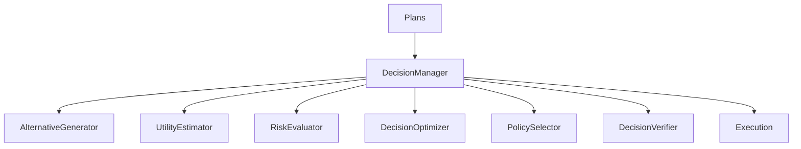
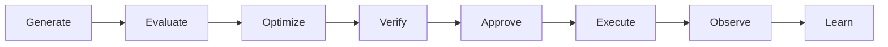

# RFC-0073

**Title:** Autonomous Cognitive Decision Architecture

**Document ID:** RFC-0073

**Version:** 1.0

**Status:** Accepted

**Category:** Cognitive Architecture

**Layer:** Decision Making / Utility Optimization / Action Selection

**Target:**

```text
decision/
```

---

# Abstract

This RFC defines the SH-3 Autonomous Cognitive Decision Architecture (ACDA).

The Autonomous Cognitive Decision Architecture is responsible for selecting the most appropriate action among competing alternatives by integrating planning, simulation, world knowledge, memory, values, goals, uncertainty, risk, governance, and execution constraints.

Unlike traditional rule-based decision engines, ACDA performs multi-objective cognitive decision making using explainable utility estimation, probabilistic reasoning, counterfactual analysis, and adaptive optimization.

The architecture governs:

- decision formulation
- alternative evaluation
- utility estimation
- uncertainty reasoning
- risk-aware decision making
- action selection
- adaptive decision optimization
- decision provenance

The system enables:

- explainable decision making
- adaptive action selection
- robust uncertainty handling
- governance-aware autonomy
- lifelong decision improvement

This document is normative.

---

# Motivation

Autonomous cognition continuously encounters situations with multiple valid actions.

Selecting an action requires balancing:

- expected utility
- uncertainty
- execution cost
- strategic value
- safety
- governance
- long-term consequences

Decision making therefore becomes a dedicated cognitive function rather than a simple planning step.

---

# Goals

The Autonomous Cognitive Decision Architecture SHALL provide:

- explainable decisions
- multi-objective optimization
- uncertainty-aware evaluation
- governance-compliant action selection
- adaptive decision policies
- continuous decision learning

---

# Non-Goals

The architecture SHALL NOT:

- replace planning
- replace execution
- replace simulation
- replace governance
- directly modify world state

The architecture selects actions rather than executing them.

---

# Architecture



---

# Design Principles

## Rational Action Selection

Every decision SHALL maximize expected utility subject to active constraints.

---

## Explainability

Every selected action SHALL include a traceable rationale.

---

## Uncertainty Awareness

Decision quality SHALL explicitly account for uncertainty.

---

## Adaptability

Decision policies SHALL evolve using accumulated experience.

---

## Governance

No decision SHALL violate governance policies.

---

## Continuous Improvement

Decision quality SHALL improve over the lifetime of the system.

---

# Components

| Component | Responsibility |
|------------|----------------|
| DecisionManager | Global coordination |
| AlternativeGenerator | Candidate actions |
| UtilityEstimator | Utility prediction |
| RiskEvaluator | Risk assessment |
| DecisionOptimizer | Multi-objective optimization |
| PolicySelector | Policy application |
| DecisionVerifier | Decision validation |

---

# Decision Context

Every decision operation receives an immutable DecisionContext.

DecisionContext SHALL contain:

| Field | Description |
|------|-------------|
| decision_id | Decision identifier |
| goal_id | Active goal |
| plan_id | Candidate plan |
| world_state | Current world model |
| constraints | Active constraints |
| timestamp | Decision time |

---

# Decision Object

Every Decision SHALL expose:

| Field | Description |
|------|-------------|
| decision_id | Unique identifier |
| selected_action | Approved action |
| alternatives | Evaluated candidates |
| utility | Expected utility |
| confidence | Decision confidence |
| rationale | Explainable justification |
| status | Decision lifecycle state |

Decision objects SHALL remain immutable after approval.

---

# Decision Lifecycle

Every decision process follows:

```text
Alternative Generation

↓

Utility Estimation

↓

Risk Analysis

↓

Optimization

↓

Verification

↓

Approval

↓

Execution
```

---

# Alternative Generation

AlternativeGenerator constructs feasible candidate actions.

Generation sources include:

- planning results
- simulation outcomes
- historical experience
- reusable policies
- capability graph
- multi-agent recommendations

Every generated alternative SHALL satisfy structural planning constraints.

---

# Alternative Model

```text
Goal

+

Current State

+

Capabilities

↓

Candidate Alternatives
```

---

# Utility Estimation

UtilityEstimator predicts expected utility.

Utility SHALL consider:

- goal achievement
- execution cost
- resource efficiency
- strategic alignment
- long-term value
- expected reward

Utility estimation SHALL remain probabilistic.

---

# Utility Model

```text
Alternative

+

Context

+

World Model

↓

Expected Utility
```

---

# Risk Evaluation

RiskEvaluator estimates execution risk.

Risk dimensions include:

- operational risk
- uncertainty
- cascading effects
- resource contention
- governance risk
- safety impact

Risk SHALL be represented independently from utility.

---

# Autonomous Cognitive Decision Execution Model

The Autonomous Cognitive Decision Architecture (ACDA) transforms candidate plans, predicted outcomes, knowledge, values, goals, and environmental context into explainable, governance-compliant decisions.

Decision making is a continuous cognitive process rather than a single optimization step. Every decision remains observable, verifiable, and continuously improvable through execution feedback and lifelong learning.

The decision lifecycle follows:



Each stage maintains a distinct decision responsibility.

---

# Cognitive Decision Control Loop

The DecisionManager continuously supervises cognitive decision making.

```text
Alternative Generation

↓

Utility Estimation

↓

Risk Evaluation

↓

Multi-Objective Optimization

↓

Governance Verification

↓

Decision Approval

↓

Execution Feedback

↓

Decision Learning
```

Decision SHALL remain active until execution is completed, cancelled, or superseded.

---

# Multi-Objective Optimization

DecisionOptimizer ranks candidate alternatives according to multiple competing objectives.

Optimization objectives include:

- expected utility
- execution reliability
- strategic value
- resource efficiency
- execution latency
- safety
- long-term benefit

Optimization SHALL preserve governance constraints.

---

# Optimization Model

```text
Alternatives

↓

Utility

+

Risk

+

Constraints

↓

Optimal Decision
```

---

# Policy Selection

PolicySelector applies organizational and cognitive policies.

Policy categories include:

- execution policy
- governance policy
- ethical policy
- resource policy
- collaboration policy
- optimization policy

Policies SHALL remain versioned and explainable.

---

# Decision Verification

Every approved decision SHALL be verified before execution.

Verification evaluates:

- policy compliance
- governance compliance
- capability availability
- execution feasibility
- simulation consistency

Unverified decisions SHALL NOT be executed.

---

# Verification Pipeline

```text
Selected Decision

↓

Policy Validation

↓

Simulation Consistency

↓

Execution Approval
```

---

# Decision Consistency

Decision making SHALL preserve:

- policy consistency
- causal consistency
- strategic consistency
- capability consistency
- governance consistency

Consistency SHALL be maintained after every decision update.

---

# Decision Provenance

Every decision SHALL preserve complete provenance.

Decision provenance includes:

| Field | Description |
|------|-------------|
| decision_source | Originating subsystem |
| evaluated_alternatives | Candidate list |
| selected_policy | Applied policies |
| supporting_evidence | Evidence references |
| simulation_reference | Related simulations |
| planner_reference | Related plans |

Decision provenance SHALL remain immutable.

---

# Adaptive Decision Learning

Learning continuously improves decision quality.

Learning inputs include:

- execution outcomes
- simulation accuracy
- decision failures
- utility prediction errors
- policy effectiveness

Decision policies SHALL improve throughout the lifetime of the system.

---

# Decision Knowledge Base

The architecture maintains reusable decision knowledge including:

- decision templates
- optimization heuristics
- policy preferences
- historical decisions
- reusable evaluation patterns

Knowledge SHALL remain explainable.

---

# Distributed Decision Making

Multiple SH-3 agents MAY participate in collaborative decisions.

Distributed decision making supports:

- alternative sharing
- distributed utility estimation
- federated risk analysis
- consensus-based approval
- collaborative optimization

Each participating agent SHALL preserve local governance authority.

---

# Consciousness Integration

Consciousness Coordination receives:

- active decisions
- confidence levels
- unresolved conflicts
- decision priorities

---

# World Model Integration

World Model provides:

- environmental context
- causal predictions
- state transitions
- uncertainty estimates

Decision making SHALL remain synchronized with the World Model.

---

# Knowledge Graph Integration

Knowledge Graph provides:

- semantic relationships
- historical evidence
- capability dependencies
- causal knowledge

Decision reasoning SHALL leverage semantic graph traversal where appropriate.

---

# Cognitive Planning Integration

Planning provides:

- executable plans
- decomposition graphs
- scheduling information
- constraint models

Decision making SHALL evaluate planning alternatives without modifying planning semantics.

---

# Cognitive Simulation Integration

Simulation provides:

- predicted outcomes
- uncertainty estimates
- risk forecasts
- counterfactual analyses

Simulation SHALL inform high-impact decisions whenever practical.

---

# Unified Cognitive Memory Integration

Unified Cognitive Memory stores:

- decision history
- policy history
- optimization history
- execution outcomes
- decision rationale

---

# Meta-Reasoning Integration

Meta-Reasoning evaluates:

- decision quality
- confidence calibration
- optimization effectiveness
- policy suitability

---

# Learning Integration

Learning receives:

- decision datasets
- policy outcomes
- utility prediction errors
- optimization opportunities

---

# Self Evolution Integration

Self Evolution System receives:

- decision architecture metrics
- optimization opportunities
- policy evolution recommendations

---

# AI Safety Governance Integration

AI Safety Governance validates:

- approved actions
- policy compliance
- capability authorization
- execution boundaries

Decision making SHALL never authorize governance-prohibited behavior.

---

# Risk Management Integration

Risk Management evaluates:

- operational uncertainty
- catastrophic outcomes
- policy conflicts
- cascading effects

Risk SHALL directly influence alternative ranking.

---

# Message Bus Integration

Decision events include:

- DecisionStarted
- AlternativesGenerated
- UtilityEstimated
- RiskEvaluated
- DecisionOptimized
- DecisionVerified
- DecisionApproved
- DecisionExecuted
- DecisionLearned

---

# Persistence Integration

Persistence stores:

- decision history
- optimization history
- policy versions
- rationale records
- provenance metadata

---

# Observability Integration

Decision telemetry includes:

- decision latency
- confidence distribution
- policy utilization
- utility prediction accuracy
- decision success rate
- optimization effectiveness
- governance rejection rate

---

# Tracing

Decision traces preserve:

- trace_id
- decision_id
- policy_id
- optimization_id
- simulation_id
- planning_id
- execution_id

Every decision SHALL participate in distributed cognitive tracing.

---

# Thread Model

The Autonomous Cognitive Decision Architecture supports concurrent:

- alternative evaluation
- utility estimation
- risk analysis
- optimization
- verification
- policy evaluation

Concurrent decision operations SHALL preserve deterministic behavior when supplied with identical goals, constraints, policies, and world states.

The reference implementation SHALL be thread-safe, scalable, and lock-efficient.

---

# Metrics

The Autonomous Cognitive Decision Architecture exposes:

- decision success rate
- average decision latency
- utility prediction accuracy
- policy compliance rate
- governance approval rate
- optimization gain
- decision confidence calibration

---

# Performance Objectives

The Autonomous Cognitive Decision Architecture should optimize for:

- high-quality decisions
- low decision latency
- accurate utility estimation
- effective uncertainty handling
- explainable reasoning
- continuous decision improvement

---

# Future Work

Potential future enhancements include:

- game-theoretic decision models
- causal decision optimization
- neurosymbolic decision reasoning
- distributed collective decision intelligence
- self-generated decision policies
- preference learning
- autonomous value alignment refinement

These enhancements extend SH-3 toward a continuously improving decision architecture capable of selecting optimal actions under uncertainty while remaining explainable, governance-aware, and tightly integrated with planning, simulation, memory, execution, and lifelong learning.

---

# References

- SH-3 Architecture Specification v2.1
- RFC-0023 World Model System
- RFC-0027 Autonomous Learning System
- RFC-0050 Knowledge Governance System
- RFC-0053 AI Safety Governance System
- RFC-0062 Autonomous Meta-Reasoning Intelligence System
- RFC-0063 Autonomous Consciousness Coordination System
- RFC-0064 Autonomous Cognitive Memory Architecture
- RFC-0065 Autonomous Cognitive Communication Architecture
- RFC-0066 Autonomous Cognitive Execution Architecture
- RFC-0067 Autonomous Cognitive Operating System
- RFC-0068 Autonomous Multi-Agent Cognitive Architecture
- RFC-0069 Autonomous Cognitive Skill Architecture
- RFC-0070 Autonomous Cognitive Simulation Architecture
- RFC-0071 Autonomous Cognitive Knowledge Graph Architecture
- RFC-0072 Autonomous Cognitive Planning Architecture

---

# End of RFC-0073
