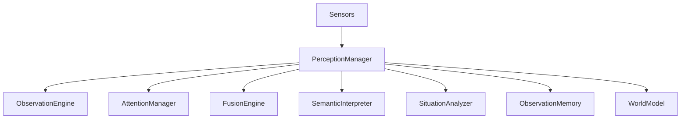
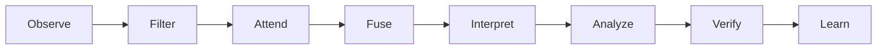

# RFC-0074

**Title:** Autonomous Cognitive Perception Architecture

**Document ID:** RFC-0074

**Version:** 1.0

**Status:** Accepted

**Category:** Cognitive Architecture

**Layer:** Perception / Observation / Situation Awareness

**Target:**

```text
perception/
```

---

# Abstract

This RFC defines the SH-3 Autonomous Cognitive Perception Architecture (ACPA-P).

The Autonomous Cognitive Perception Architecture provides the unified perception layer responsible for transforming raw internal and external signals into structured cognitive observations suitable for reasoning, planning, simulation, learning, and execution.

Rather than treating perception as simple input processing, SH-3 models perception as an active cognitive process involving observation, attention, semantic interpretation, uncertainty estimation, temporal integration, and situation awareness.

The architecture governs:

- multi-modal perception
- event perception
- semantic interpretation
- attention management
- context integration
- uncertainty estimation
- observation fusion
- situation awareness

The system enables:

- unified perception
- explainable observations
- adaptive attention
- robust environmental awareness
- continuous perception improvement

This document is normative.

---

# Motivation

Autonomous cognition depends on reliable perception.

Raw data alone is insufficient.

Effective perception requires:

- interpretation
- contextualization
- temporal continuity
- uncertainty estimation
- semantic understanding
- relevance filtering

Perception transforms signals into meaningful cognitive knowledge.

---

# Goals

The Autonomous Cognitive Perception Architecture SHALL provide:

- unified observation
- semantic perception
- multi-modal fusion
- adaptive attention
- explainable perception
- continuous perception learning
- situation awareness

---

# Non-Goals

The architecture SHALL NOT:

- replace reasoning
- replace memory
- replace planning
- replace world modeling
- bypass governance

Perception supplies observations rather than cognitive conclusions.

---

# Architecture



---

# Design Principles

## Observation Before Reasoning

Every cognitive process SHALL originate from observations.

---

## Multi-Modal Integration

Information from heterogeneous sources SHALL be fused whenever appropriate.

---

## Context Awareness

Observations SHALL be interpreted within context.

---

## Explainability

Perceptual conclusions SHALL remain traceable to source observations.

---

## Adaptability

Attention and perception SHALL continuously adapt.

---

## Governance

Perception SHALL comply with governance policies.

---

# Components

| Component | Responsibility |
|------------|----------------|
| PerceptionManager | Global coordination |
| ObservationEngine | Observation acquisition |
| AttentionManager | Relevance allocation |
| FusionEngine | Multi-modal fusion |
| SemanticInterpreter | Semantic interpretation |
| SituationAnalyzer | Situation awareness |
| ObservationMemory | Observation history |

---

# Perception Context

Every perception operation receives an immutable PerceptionContext.

PerceptionContext SHALL contain:

| Field | Description |
|------|-------------|
| perception_id | Perception identifier |
| observation_window | Observation interval |
| sensor_set | Active observation sources |
| environment_state | Current environment |
| timestamp | Observation time |

---

# Observation

Every Observation SHALL expose:

| Field | Description |
|------|-------------|
| observation_id | Unique identifier |
| modality | Observation modality |
| source | Origin |
| confidence | Confidence |
| timestamp | Observation time |
| semantic_label | Interpreted meaning |

Observations SHALL preserve provenance.

---

# Perception Lifecycle

Every perception process follows:

```text
Observation

↓

Filtering

↓

Attention

↓

Fusion

↓

Interpretation

↓

Situation Analysis

↓

World Model Update
```

---

# Observation Engine

ObservationEngine acquires information from:

- internal state
- external sensors
- event streams
- communication
- memory queries
- agent collaboration

Observation SHALL preserve acquisition metadata.

---

# Observation Modalities

Supported modalities include:

- text
- image
- audio
- video
- structured data
- events
- telemetry
- symbolic knowledge

Additional modalities MAY be introduced without modifying the architecture.

---

# Attention Manager

AttentionManager allocates computational focus.

Attention SHALL consider:

- goal relevance
- novelty
- urgency
- uncertainty
- expected utility
- historical importance

Attention SHALL remain adaptive.

---

# Attention Model

```text
Observations

↓

Relevance Estimation

↓

Priority Ranking

↓

Focused Observation Set
```

---

# Fusion Engine

FusionEngine combines heterogeneous observations.

Fusion SHALL support:

- temporal fusion
- spatial fusion
- semantic fusion
- probabilistic fusion
- cross-modal fusion

Fusion SHALL preserve uncertainty estimates.

---

# Semantic Interpreter

SemanticInterpreter transforms observations into cognitive meaning.

Interpretation includes:

- entity recognition
- relationship extraction
- event detection
- intent estimation
- semantic normalization

Semantic interpretation SHALL be ontology-aware.

---

# Autonomous Cognitive Perception Execution Model

The Autonomous Cognitive Perception Architecture (ACPA-P) transforms heterogeneous internal and external signals into structured cognitive observations that drive reasoning, planning, simulation, decision making, learning, and execution.

Perception is modeled as a continuous cognitive process rather than a passive data acquisition mechanism.

The perception lifecycle follows:



Each stage maintains a distinct perception responsibility.

---

# Cognitive Perception Control Loop

The PerceptionManager continuously supervises environmental awareness.

```text
Signal Acquisition

↓

Observation Filtering

↓

Attention Allocation

↓

Multi-Modal Fusion

↓

Semantic Interpretation

↓

Situation Awareness

↓

World Model Update

↓

Perception Learning
```

Perception SHALL operate continuously while the cognitive runtime remains active.

---

# Situation Awareness

SituationAnalyzer constructs a coherent understanding of the current operational environment.

Situation analysis includes:

- environmental state
- active entities
- ongoing events
- temporal evolution
- causal relationships
- operational context

Situation awareness SHALL remain continuously synchronized with the World Model.

---

# Situation Model

```text
Observations

+

Historical Context

+

World Model

↓

Situation Representation
```

---

# Observation Memory

ObservationMemory maintains short-term perceptual history.

ObservationMemory stores:

- raw observations
- filtered observations
- attention history
- fusion history
- semantic interpretations

Observation history SHALL preserve temporal ordering.

---

# Observation Verification

Perceptual observations SHALL be verified whenever practical.

Verification sources include:

- repeated observations
- cross-modal confirmation
- trusted external sources
- simulation consistency
- multi-agent agreement

Verified observations SHALL receive increased confidence.

---

# Verification Pipeline

```text
Observation

↓

Evidence Collection

↓

Consistency Analysis

↓

Verified Observation
```

---

# Uncertainty Estimation

Every observation SHALL include uncertainty estimation.

Uncertainty SHALL consider:

- sensor quality
- observation completeness
- environmental ambiguity
- conflicting evidence
- historical reliability

Uncertainty SHALL propagate through downstream cognitive systems.

---

# Adaptive Attention

AttentionManager continuously adjusts attention allocation.

Adaptation considers:

- goal changes
- environmental changes
- novelty
- uncertainty
- execution demands
- cognitive workload

Attention SHALL remain explainable.

---

# Attention Optimization

Attention optimization targets include:

- observation relevance
- computational efficiency
- response latency
- situational coverage
- uncertainty reduction

Optimization SHALL preserve critical observations.

---

# Perception Learning

Learning continuously improves perception quality.

Learning sources include:

- perception errors
- execution feedback
- simulation verification
- user feedback
- environmental changes

Perception SHALL continuously improve throughout system operation.

---

# Distributed Perception

Multiple SH-3 agents MAY cooperate during perception.

Distributed perception supports:

- observation sharing
- cross-agent confirmation
- federated attention
- distributed sensor fusion
- collaborative situation awareness

Local governance SHALL remain authoritative.

---

# Perception Consistency

Perception SHALL preserve:

- temporal consistency
- semantic consistency
- causal consistency
- provenance consistency
- observation integrity

Consistency SHALL be maintained after every perception update.

---

# Consciousness Integration

Consciousness Coordination receives:

- active observations
- attention priorities
- situational summaries
- perception confidence

---

# World Model Integration

World Model receives:

- verified observations
- semantic entities
- causal events
- environmental updates

The World Model SHALL remain the authoritative representation of perceived reality.

---

# Knowledge Graph Integration

Knowledge Graph receives:

- entities
- relationships
- events
- semantic annotations

Perception SHALL contribute directly to graph evolution.

---

# Cognitive Planning Integration

Planning receives:

- environmental updates
- resource availability
- execution context
- situational constraints

---

# Cognitive Simulation Integration

Simulation receives:

- current observations
- uncertainty estimates
- environmental dynamics

Simulation SHALL remain synchronized with perceptual updates.

---

# Cognitive Decision Integration

Decision making receives:

- verified observations
- confidence estimates
- situational awareness
- uncertainty metrics

---

# Unified Cognitive Memory Integration

Unified Cognitive Memory stores:

- observation history
- perception history
- attention history
- verification history

---

# Meta-Reasoning Integration

Meta-Reasoning evaluates:

- perception quality
- uncertainty calibration
- attention effectiveness
- fusion quality

---

# Learning Integration

Learning receives:

- perception datasets
- verification outcomes
- uncertainty calibration
- optimization opportunities

---

# Self Evolution Integration

Self Evolution System receives:

- perception performance metrics
- sensor utilization
- architecture improvement opportunities

---

# AI Safety Governance Integration

AI Safety Governance validates:

- observation sources
- perception policies
- imported sensor data
- federated perception

Perception SHALL reject observations that violate governance policies.

---

# Risk Management Integration

Risk Management evaluates:

- observation uncertainty
- missing information
- conflicting evidence
- degraded perception quality

---

# Message Bus Integration

Perception events include:

- ObservationReceived
- ObservationFiltered
- AttentionUpdated
- FusionCompleted
- SemanticInterpreted
- SituationUpdated
- ObservationVerified
- PerceptionLearned

---

# Persistence Integration

Persistence stores:

- observation history
- attention history
- fusion history
- semantic interpretations
- verification records

---

# Observability Integration

Perception telemetry includes:

- observation throughput
- fusion latency
- attention utilization
- uncertainty distribution
- perception accuracy
- verification rate
- perception coverage

---

# Tracing

Perception traces preserve:

- trace_id
- perception_id
- observation_id
- fusion_id
- interpretation_id
- verification_id
- attention_id

Every perception operation SHALL participate in distributed cognitive tracing.

---

# Thread Model

The Autonomous Cognitive Perception Architecture supports concurrent:

- observation acquisition
- filtering
- fusion
- semantic interpretation
- verification
- attention optimization

Concurrent perception SHALL preserve deterministic behavior when supplied with identical observation streams and runtime conditions.

The reference implementation SHALL be thread-safe, scalable, and lock-efficient.

---

# Metrics

The Autonomous Cognitive Perception Architecture exposes:

- perception accuracy
- observation latency
- fusion effectiveness
- semantic precision
- uncertainty calibration
- attention efficiency
- verification success rate

---

# Performance Objectives

The Autonomous Cognitive Perception Architecture should optimize for:

- accurate observations
- low-latency perception
- robust multi-modal fusion
- adaptive attention
- explainable interpretation
- continuous perception improvement

---

# Future Work

Potential future enhancements include:

- predictive attention allocation
- active perception strategies
- neurosymbolic perception
- autonomous sensor orchestration
- distributed planetary-scale perception
- self-calibrating perception pipelines
- adaptive modality generation

These enhancements extend SH-3 toward a continuously learning perception architecture capable of transforming heterogeneous sensory information into reliable, explainable, and governance-aware cognitive observations that serve as the foundation for higher-level intelligence.

---

# References

- SH-3 Architecture Specification v2.1
- RFC-0022 Knowledge System
- RFC-0023 World Model System
- RFC-0027 Autonomous Learning System
- RFC-0050 Knowledge Governance System
- RFC-0053 AI Safety Governance System
- RFC-0063 Autonomous Consciousness Coordination System
- RFC-0064 Autonomous Cognitive Memory Architecture
- RFC-0065 Autonomous Cognitive Communication Architecture
- RFC-0067 Autonomous Cognitive Operating System
- RFC-0068 Autonomous Multi-Agent Cognitive Architecture
- RFC-0069 Autonomous Cognitive Skill Architecture
- RFC-0070 Autonomous Cognitive Simulation Architecture
- RFC-0071 Autonomous Cognitive Knowledge Graph Architecture
- RFC-0072 Autonomous Cognitive Planning Architecture
- RFC-0073 Autonomous Cognitive Decision Architecture

---

# End of RFC-0074
