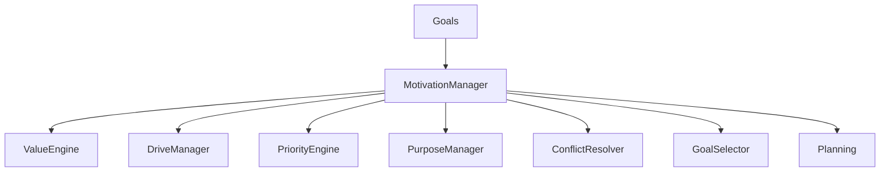

# RFC-0075

**Title:** Autonomous Cognitive Value & Motivation Architecture

**Document ID:** RFC-0075

**Version:** 1.0

**Status:** Accepted

**Category:** Cognitive Architecture

**Layer:** Values / Motivation / Goal Prioritization / Purpose

**Target:**

```text
motivation/
```

---

# Abstract

This RFC defines the SH-3 Autonomous Cognitive Value & Motivation Architecture (ACVMA).

The Autonomous Cognitive Value & Motivation Architecture provides the intrinsic evaluation layer that governs why SH-3 chooses objectives, how competing goals are prioritized, and how long-term purpose influences autonomous behavior.

Rather than relying solely on externally supplied goals, SH-3 continuously evaluates internal values, motivations, operational drives, environmental demands, and strategic objectives to determine what should receive cognitive attention and execution priority.

The architecture governs:

- value representation
- motivational reasoning
- intrinsic drives
- priority management
- goal valuation
- purpose alignment
- adaptive motivation
- value evolution

The system enables:

- value-aware cognition
- autonomous goal prioritization
- adaptive motivation
- explainable objective selection
- long-term behavioral consistency

This document is normative.

---

# Motivation

Planning determines **how** to act.

Decision making determines **which** action to execute.

A cognitive architecture additionally requires mechanisms to determine **why** particular goals deserve attention.

Without explicit values and motivations:

- priorities become inconsistent
- long-term objectives degrade
- goal conflicts become difficult to resolve
- adaptive autonomy becomes limited

Values and motivations provide the persistent foundation for autonomous behavior.

---

# Goals

The Autonomous Cognitive Value & Motivation Architecture SHALL provide:

- explicit value representation
- intrinsic motivation
- dynamic priority management
- explainable goal valuation
- adaptive motivational learning
- long-term purpose alignment
- governance-aware value evaluation

---

# Non-Goals

The architecture SHALL NOT:

- replace planning
- replace decision making
- replace governance
- replace execution
- independently execute actions

The architecture evaluates objectives rather than performing execution.

---

# Architecture



---

# Design Principles

## Purpose-Driven Cognition

Every autonomous objective SHALL be traceable to one or more values or operational purposes.

---

## Explainability

Every prioritization decision SHALL include a human-readable rationale.

---

## Dynamic Adaptation

Motivational priorities SHALL adapt to changing circumstances while preserving long-term stability.

---

## Consistency

Value evaluation SHALL remain internally consistent across equivalent situations.

---

## Governance

Values and motivations SHALL never override governance constraints.

---

## Continuous Evolution

Value models SHALL improve using accumulated experience.

---

# Components

| Component | Responsibility |
|------------|----------------|
| MotivationManager | Global coordination |
| ValueEngine | Value evaluation |
| DriveManager | Intrinsic drives |
| PriorityEngine | Goal prioritization |
| PurposeManager | Long-term purpose |
| ConflictResolver | Goal conflict resolution |
| GoalSelector | Goal recommendation |

---

# Motivation Context

Every motivational evaluation receives an immutable MotivationContext.

MotivationContext SHALL contain:

| Field | Description |
|------|-------------|
| motivation_id | Evaluation identifier |
| active_goals | Candidate goals |
| world_state | Current world model |
| internal_state | Cognitive state |
| active_constraints | Active policies |
| timestamp | Evaluation time |

---

# Value

Every Value SHALL expose:

| Field | Description |
|------|-------------|
| value_id | Unique identifier |
| name | Value name |
| weight | Relative importance |
| category | Value category |
| stability | Expected persistence |
| confidence | Evaluation confidence |

Values SHALL be versioned and traceable.

---

# Motivation Lifecycle

Every motivational evaluation follows:

```text
Context Analysis

↓

Drive Activation

↓

Value Evaluation

↓

Priority Estimation

↓

Conflict Resolution

↓

Goal Recommendation

↓

Learning
```

---

# Value Engine

ValueEngine evaluates candidate objectives.

Evaluation dimensions include:

- strategic value
- operational value
- knowledge value
- efficiency value
- resilience value
- collaborative value
- long-term impact

Value evaluation SHALL remain explainable.

---

# Value Model

```text
Goal

+

Context

+

Value Set

↓

Goal Value
```

---

# Intrinsic Drives

DriveManager maintains persistent operational drives.

Example drive categories include:

- knowledge acquisition
- reliability improvement
- efficiency optimization
- collaboration
- exploration
- self-improvement
- goal completion

Drive intensity MAY vary according to operational context.

---

# Priority Engine

PriorityEngine ranks competing objectives.

Priority estimation SHALL consider:

- value score
- motivational strength
- urgency
- expected utility
- execution feasibility
- resource availability
- governance constraints

Priority rankings SHALL be deterministic for identical inputs.

---

# Autonomous Cognitive Value & Motivation Execution Model

The Autonomous Cognitive Value & Motivation Architecture (ACVMA) transforms organizational objectives, operational context, intrinsic drives, learned preferences, and long-term purpose into explainable motivational priorities that guide autonomous cognition.

Motivation is modeled as a continuous cognitive process rather than a static configuration. Values, drives, and priorities are continuously re-evaluated as the environment, knowledge, goals, and system state evolve.

The motivational lifecycle follows:


Each stage maintains a distinct motivational responsibility.

---

# Cognitive Motivation Control Loop

The MotivationManager continuously supervises motivational reasoning.

```text
Context Observation

↓

Drive Activation

↓

Value Evaluation

↓

Priority Estimation

↓

Conflict Resolution

↓

Goal Recommendation

↓

Execution Feedback

↓

Motivation Learning
```

Motivational evaluation SHALL remain active while the cognitive runtime is operational.

---

# Purpose Management

PurposeManager maintains persistent long-term objectives.

Purpose SHALL provide stable guidance across multiple planning and execution cycles.

Purpose dimensions include:

- mission continuity
- long-term optimization
- knowledge growth
- resilience
- collaboration
- sustainability

Purpose SHALL remain independent of transient execution goals.

---

# Purpose Model

```text
Mission

+

Values

+

Operational Context

↓

Purpose Alignment
```

---

# Goal Conflict Resolution

ConflictResolver resolves competing objectives.

Resolution SHALL consider:

- value alignment
- strategic importance
- urgency
- expected utility
- execution feasibility
- governance constraints
- resource availability

Resolved conflicts SHALL preserve complete reasoning history.

---

# Conflict Resolution Pipeline

```text
Competing Goals

↓

Conflict Analysis

↓

Priority Optimization

↓

Recommended Goal
```

---

# Motivation Consistency

Motivational evaluation SHALL preserve:

- value consistency
- priority consistency
- purpose consistency
- governance consistency
- strategic consistency

Consistency SHALL be maintained after every motivational update.

---

# Motivation Learning

Learning continuously improves motivational quality.

Learning inputs include:

- execution outcomes
- planning success
- decision effectiveness
- user feedback
- environmental adaptation
- policy evolution

Learning SHALL improve future prioritization while preserving long-term behavioral stability.

---

# Value Evolution

Values MAY evolve gradually.

Evolution SHALL be driven by:

- accumulated experience
- verified knowledge
- organizational objectives
- long-term performance
- governance-approved adaptation

Value evolution SHALL remain explainable and auditable.

---

# Motivation Knowledge Base

The architecture maintains reusable motivational knowledge including:

- value profiles
- priority heuristics
- conflict resolution patterns
- purpose models
- motivational history

Knowledge SHALL support continual improvement.

---

# Multi-Agent Motivation Coordination

Multiple SH-3 agents MAY coordinate motivational reasoning.

Coordination supports:

- shared objectives
- distributed priorities
- collaborative purpose alignment
- negotiated resource allocation
- collective mission planning

Each agent SHALL preserve locally governed values.

---

# Consciousness Integration

Consciousness Coordination receives:

- active motivations
- purpose alignment
- priority rankings
- unresolved conflicts

---

# World Model Integration

World Model provides:

- environmental context
- operational opportunities
- resource conditions
- environmental constraints

Motivational evaluation SHALL remain synchronized with current world state.

---

# Knowledge Graph Integration

Knowledge Graph provides:

- value relationships
- organizational knowledge
- historical goal outcomes
- semantic dependencies

Motivation SHALL leverage graph-based semantic reasoning.

---

# Cognitive Planning Integration

Planning receives:

- prioritized goals
- strategic objectives
- motivational constraints
- execution priorities

Planning SHALL not modify intrinsic values directly.

---

# Cognitive Decision Integration

Decision making receives:

- goal priorities
- value scores
- motivational confidence
- purpose alignment

Motivational evaluation SHALL inform—but not replace—decision optimization.

---

# Unified Cognitive Memory Integration

Unified Cognitive Memory stores:

- motivation history
- value evolution history
- conflict resolution history
- purpose history
- priority history

---

# Meta-Reasoning Integration

Meta-Reasoning evaluates:

- motivational coherence
- priority stability
- value calibration
- purpose consistency

---

# Learning Integration

Learning receives:

- motivation datasets
- prioritization outcomes
- value adjustments
- optimization opportunities

---

# Self Evolution Integration

Self Evolution System receives:

- value evolution metrics
- motivational optimization opportunities
- long-term purpose adaptation proposals

---

# AI Safety Governance Integration

AI Safety Governance validates:

- value modifications
- motivational policies
- purpose updates
- autonomous goal generation

No motivational process SHALL authorize behavior that violates governance policy.

---

# Risk Management Integration

Risk Management evaluates:

- value conflicts
- unstable priorities
- purpose drift
- resource-driven motivational bias

Risk SHALL influence motivational recommendations.

---

# Message Bus Integration

Motivation events include:

- MotivationStarted
- DriveActivated
- ValueEvaluated
- PrioritiesRanked
- ConflictResolved
- GoalRecommended
- PurposeUpdated
- MotivationLearned

---

# Persistence Integration

Persistence stores:

- value definitions
- motivation history
- purpose models
- priority rankings
- conflict records
- evolution history

---

# Observability Integration

Motivation telemetry includes:

- evaluation latency
- priority stability
- value utilization
- conflict frequency
- purpose alignment score
- motivational adaptation rate
- goal recommendation accuracy

---

# Tracing

Motivation traces preserve:

- trace_id
- motivation_id
- value_id
- priority_id
- purpose_id
- conflict_id
- recommendation_id

Every motivational evaluation SHALL participate in distributed cognitive tracing.

---

# Thread Model

The Autonomous Cognitive Value & Motivation Architecture supports concurrent:

- value evaluation
- drive activation
- priority estimation
- conflict resolution
- motivational learning
- value evolution

Concurrent motivational operations SHALL preserve deterministic behavior when supplied with identical context, values, constraints, and world states.

The reference implementation SHALL be thread-safe, scalable, and lock-efficient.

---

# Metrics

The Autonomous Cognitive Value & Motivation Architecture exposes:

- purpose alignment score
- priority consistency
- value stability
- conflict resolution effectiveness
- motivational adaptation rate
- recommendation accuracy
- long-term objective fulfillment

---

# Performance Objectives

The Autonomous Cognitive Value & Motivation Architecture should optimize for:

- stable long-term purpose
- adaptive motivation
- consistent prioritization
- explainable value reasoning
- effective conflict resolution
- continuous motivational improvement

---

# Future Work

Potential future enhancements include:

- hierarchical value systems
- constitutional value reasoning
- preference learning
- collective motivation synthesis
- adaptive organizational objectives
- value negotiation across federated agents
- autonomous mission generation

These enhancements extend SH-3 toward a value-driven cognitive architecture capable of continuously aligning goals, motivations, and long-term purpose while remaining explainable, governance-aware, and tightly integrated with planning, decision making, learning, and self-evolution.

---

# References

- SH-3 Architecture Specification v2.1
- RFC-0027 Autonomous Learning System
- RFC-0050 Knowledge Governance System
- RFC-0053 AI Safety Governance System
- RFC-0062 Autonomous Meta-Reasoning Intelligence System
- RFC-0063 Autonomous Consciousness Coordination System
- RFC-0064 Autonomous Cognitive Memory Architecture
- RFC-0067 Autonomous Cognitive Operating System
- RFC-0068 Autonomous Multi-Agent Cognitive Architecture
- RFC-0069 Autonomous Cognitive Skill Architecture
- RFC-0070 Autonomous Cognitive Simulation Architecture
- RFC-0071 Autonomous Cognitive Knowledge Graph Architecture
- RFC-0072 Autonomous Cognitive Planning Architecture
- RFC-0073 Autonomous Cognitive Decision Architecture
- RFC-0074 Autonomous Cognitive Perception Architecture

---

# End of RFC-0075
