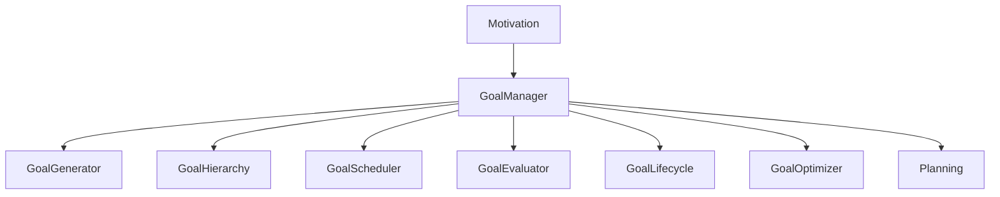

# RFC-0076

**Title:** Autonomous Cognitive Goal Architecture

**Document ID:** RFC-0076

**Version:** 1.0

**Status:** Accepted

**Category:** Cognitive Architecture

**Layer:** Goal Management / Goal Lifecycle / Objective Coordination

**Target:**

```text
goals/
```

---

# Abstract

This RFC defines the SH-3 Autonomous Cognitive Goal Architecture (ACGA).

The Autonomous Cognitive Goal Architecture provides the unified goal management layer responsible for generating, organizing, maintaining, prioritizing, evaluating, and retiring cognitive objectives throughout the lifetime of the system.

Goals are treated as first-class cognitive entities with explicit semantics, lifecycle states, dependencies, ownership, priorities, constraints, provenance, and measurable success criteria.

The architecture governs:

- autonomous goal generation
- goal decomposition
- goal prioritization
- dependency management
- lifecycle management
- progress evaluation
- goal retirement
- goal evolution

The system enables:

- explainable goal management
- adaptive objective selection
- long-term mission continuity
- coordinated cognitive behavior
- continuous goal optimization

This document is normative.

---

# Motivation

Values determine **why** objectives matter.

Planning determines **how** objectives are achieved.

A dedicated goal architecture determines **what** the system should actively pursue.

Without explicit goal management:

- objectives become fragmented
- priorities drift over time
- execution lacks continuity
- planning becomes unstable
- long-term autonomy degrades

Goal management provides persistent coordination across every cognitive subsystem.

---

# Goals

The Autonomous Cognitive Goal Architecture SHALL provide:

- explicit goal representation
- autonomous goal generation
- hierarchical goal management
- lifecycle supervision
- explainable prioritization
- adaptive goal evolution
- governance-aware objective control

---

# Non-Goals

The architecture SHALL NOT:

- replace planning
- replace decision making
- replace motivation
- replace execution
- bypass governance

The architecture manages objectives rather than executing them.

---

# Architecture



---

# Design Principles

## Goal-Centric Cognition

Every autonomous activity SHALL be associated with one or more explicit goals.

---

## Hierarchical Organization

Goals SHALL support hierarchical decomposition.

---

## Explainability

Goal creation and prioritization SHALL remain explainable.

---

## Adaptability

Goals SHALL evolve with changing environments and knowledge.

---

## Persistence

Long-term objectives SHALL survive individual execution cycles.

---

## Governance

Goal generation and modification SHALL satisfy governance policies.

---

# Components

| Component | Responsibility |
|------------|----------------|
| GoalManager | Global coordination |
| GoalGenerator | Goal creation |
| GoalHierarchy | Goal decomposition |
| GoalScheduler | Goal scheduling |
| GoalEvaluator | Goal assessment |
| GoalLifecycle | Lifecycle supervision |
| GoalOptimizer | Goal refinement |

---

# Goal Context

Every goal operation receives an immutable GoalContext.

GoalContext SHALL contain:

| Field | Description |
|------|-------------|
| goal_context_id | Context identifier |
| mission_id | Associated mission |
| motivation_id | Motivation source |
| world_state | Current world model |
| active_constraints | Active constraints |
| timestamp | Evaluation time |

---

# Goal

Every Goal SHALL expose:

| Field | Description |
|------|-------------|
| goal_id | Unique identifier |
| title | Human-readable description |
| category | Goal category |
| priority | Current priority |
| status | Lifecycle state |
| success_criteria | Completion metrics |
| provenance | Origin |

Goals SHALL remain uniquely identifiable throughout their lifecycle.

---

# Goal Lifecycle

Every goal follows:

```text
Generation

↓

Validation

↓

Prioritization

↓

Planning

↓

Execution

↓

Evaluation

↓

Completion

↓

Retirement
```

Lifecycle transitions SHALL remain auditable.

---

# Goal Generation

GoalGenerator creates goals from:

- motivational reasoning
- user requests
- organizational missions
- execution feedback
- simulation outcomes
- environmental observations
- multi-agent collaboration

Generated goals SHALL include measurable success criteria.

---

# Goal Categories

The architecture supports:

- strategic goals
- operational goals
- maintenance goals
- learning goals
- optimization goals
- collaborative goals
- exploratory goals

Additional categories MAY be introduced through extension mechanisms.

---

# Goal Hierarchy

GoalHierarchy organizes goals into directed acyclic structures.

Hierarchy relationships include:

- parent
- child
- prerequisite
- dependency
- successor

Hierarchical relationships SHALL remain acyclic.

---

# Goal Decomposition

Goal decomposition SHALL produce:

- smaller objectives
- measurable milestones
- executable planning units
- dependency graphs

Every derived goal SHALL preserve traceability to its originating objective.

---

# Goal Scheduling

GoalScheduler determines execution order.

Scheduling SHALL consider:

- priority
- dependencies
- resource availability
- deadlines
- estimated utility
- governance constraints

Scheduling SHALL remain deterministic for equivalent inputs.

---

# Autonomous Cognitive Goal Execution Model

The Autonomous Cognitive Goal Architecture (ACGA) transforms motivations, missions, environmental observations, execution feedback, and strategic intent into measurable, explainable, and continuously managed cognitive objectives.

Goal management is modeled as a continuous lifecycle rather than a one-time creation process. Goals are generated, validated, prioritized, monitored, adapted, completed, archived, and reused throughout the lifetime of the system.

The goal lifecycle follows:


Each stage maintains a distinct goal management responsibility.

---

# Cognitive Goal Control Loop

The GoalManager continuously supervises objective management.

```text
Goal Generation

↓

Goal Validation

↓

Priority Assignment

↓

Scheduling

↓

Execution Monitoring

↓

Progress Evaluation

↓

Goal Optimization

↓

Goal Retirement
```

Goal management SHALL remain active while the associated mission exists.

---

# Goal Evaluation

GoalEvaluator continuously measures progress toward completion.

Evaluation dimensions include:

- completion percentage
- milestone completion
- expected utility
- strategic alignment
- execution efficiency
- resource utilization
- governance compliance

Evaluation SHALL produce immutable GoalEvaluation records.

---

# Goal Evaluation Model

```text
Goal

+

Execution State

+

World Model

↓

Goal Evaluation
```

---

# Goal Lifecycle Management

GoalLifecycle supervises state transitions.

Supported lifecycle states include:

- Proposed
- Validated
- Scheduled
- Active
- Suspended
- Completed
- Failed
- Cancelled
- Archived

Lifecycle transitions SHALL preserve complete provenance.

---

# Lifecycle Transition Rules

A transition SHALL occur only when:

- preconditions are satisfied
- governance validation succeeds
- dependencies remain consistent
- required capabilities are available

Invalid transitions SHALL be rejected.

---

# Goal Optimization

GoalOptimizer continuously improves active objectives.

Optimization activities include:

- priority refinement
- dependency simplification
- milestone restructuring
- redundancy elimination
- scheduling refinement

Optimization SHALL preserve original intent unless explicitly authorized.

---

# Goal Conflict Resolution

Competing goals SHALL be resolved using:

- value alignment
- strategic importance
- expected utility
- urgency
- resource availability
- organizational policy
- governance constraints

Conflict resolution SHALL remain explainable and reproducible.

---

# Goal Dependency Management

Dependencies SHALL support:

- prerequisite relationships
- completion dependencies
- resource dependencies
- temporal dependencies
- capability dependencies

Circular dependencies SHALL NOT be permitted.

---

# Goal Provenance

Every goal SHALL preserve:

| Field | Description |
|------|-------------|
| creator | Originating subsystem |
| parent_goal | Parent objective |
| motivation_reference | Motivation source |
| decision_reference | Related decision |
| planning_reference | Associated plan |
| creation_timestamp | Creation time |

Goal provenance SHALL remain immutable.

---

# Goal Learning

Learning continuously improves goal generation and prioritization.

Learning inputs include:

- completed goals
- failed goals
- execution outcomes
- simulation results
- user feedback
- environmental adaptation

Goal learning SHALL improve future objective selection.

---

# Goal Knowledge Base

The architecture maintains reusable goal knowledge including:

- goal templates
- milestone patterns
- dependency structures
- scheduling heuristics
- completion statistics

Knowledge SHALL remain reusable across future missions.

---

# Multi-Agent Goal Coordination

Multiple SH-3 agents MAY coordinate objectives.

Coordination supports:

- shared missions
- distributed subgoals
- collaborative scheduling
- dependency negotiation
- collective completion tracking

Each agent SHALL preserve local governance authority.

---

# Consciousness Integration

Consciousness Coordination receives:

- active goals
- completion status
- priority changes
- unresolved conflicts

---

# World Model Integration

World Model provides:

- environmental constraints
- available resources
- environmental opportunities
- operational context

Goal management SHALL remain synchronized with the World Model.

---

# Knowledge Graph Integration

Knowledge Graph provides:

- semantic goal relationships
- historical objectives
- dependency graphs
- organizational knowledge

Goal reasoning SHALL leverage graph traversal where appropriate.

---

# Value & Motivation Integration

Value & Motivation provides:

- intrinsic priorities
- purpose alignment
- motivational strength
- value consistency

Goals SHALL remain aligned with active motivational policies.

---

# Cognitive Planning Integration

Planning receives:

- validated goals
- scheduling information
- dependency graphs
- execution priorities

Planning SHALL not modify approved goals without GoalManager authorization.

---

# Cognitive Decision Integration

Decision making receives:

- prioritized objectives
- completion metrics
- dependency information
- execution urgency

---

# Unified Cognitive Memory Integration

Unified Cognitive Memory stores:

- goal history
- lifecycle history
- evaluation history
- optimization history
- completion history

---

# Meta-Reasoning Integration

Meta-Reasoning evaluates:

- goal quality
- decomposition effectiveness
- scheduling efficiency
- lifecycle stability

---

# Learning Integration

Learning receives:

- goal datasets
- completion metrics
- optimization history
- scheduling performance

---

# Self Evolution Integration

Self Evolution System receives:

- goal management metrics
- optimization opportunities
- architectural improvement proposals

---

# AI Safety Governance Integration

AI Safety Governance validates:

- generated goals
- lifecycle transitions
- optimization requests
- retirement operations

Goal management SHALL never authorize governance-prohibited objectives.

---

# Risk Management Integration

Risk Management evaluates:

- conflicting objectives
- dependency failures
- unattainable goals
- scheduling instability

Risk SHALL influence goal prioritization and optimization.

---

# Message Bus Integration

Goal events include:

- GoalGenerated
- GoalValidated
- GoalScheduled
- GoalActivated
- GoalEvaluated
- GoalOptimized
- GoalCompleted
- GoalArchived

---

# Persistence Integration

Persistence stores:

- goal definitions
- dependency graphs
- lifecycle history
- evaluation records
- optimization history
- completion metrics

---

# Observability Integration

Goal telemetry includes:

- active goal count
- completion rate
- scheduling latency
- optimization frequency
- dependency depth
- lifecycle duration
- success rate

---

# Tracing

Goal traces preserve:

- trace_id
- goal_id
- lifecycle_id
- evaluation_id
- dependency_id
- optimization_id
- completion_id

Every goal operation SHALL participate in distributed cognitive tracing.

---

# Thread Model

The Autonomous Cognitive Goal Architecture supports concurrent:

- goal generation
- lifecycle updates
- scheduling
- evaluation
- optimization
- dependency analysis

Concurrent goal operations SHALL preserve deterministic behavior when supplied with identical motivations, world states, and governance constraints.

The reference implementation SHALL be thread-safe, scalable, and lock-efficient.

---

# Metrics

The Autonomous Cognitive Goal Architecture exposes:

- goal completion rate
- average completion time
- scheduling efficiency
- dependency resolution rate
- optimization gain
- lifecycle stability
- goal reuse rate

---

# Performance Objectives

The Autonomous Cognitive Goal Architecture should optimize for:

- high-quality goal generation
- stable lifecycle management
- efficient scheduling
- explainable prioritization
- reusable objective structures
- continuous goal improvement

---

# Future Work

Potential future enhancements include:

- autonomous mission synthesis
- probabilistic goal hierarchies
- self-generated strategic roadmaps
- collective mission optimization
- adaptive organizational objective modeling
- long-horizon autonomous planning
- hierarchical mission governance

These enhancements extend SH-3 toward a continuously evolving goal architecture capable of autonomously generating, coordinating, evaluating, and refining objectives while remaining explainable, governance-aware, and tightly integrated with motivation, planning, decision making, execution, and lifelong learning.

---

# References

- SH-3 Architecture Specification v2.1
- RFC-0023 World Model System
- RFC-0027 Autonomous Learning System
- RFC-0050 Knowledge Governance System
- RFC-0053 AI Safety Governance System
- RFC-0062 Autonomous Meta-Reasoning Intelligence System
- RFC-0063 Autonomous Consciousness Coordination System
- RFC-0064 Autonomous Cognitive Memory Architecture
- RFC-0067 Autonomous Cognitive Operating System
- RFC-0068 Autonomous Multi-Agent Cognitive Architecture
- RFC-0069 Autonomous Cognitive Skill Architecture
- RFC-0070 Autonomous Cognitive Simulation Architecture
- RFC-0071 Autonomous Cognitive Knowledge Graph Architecture
- RFC-0072 Autonomous Cognitive Planning Architecture
- RFC-0073 Autonomous Cognitive Decision Architecture
- RFC-0074 Autonomous Cognitive Perception Architecture
- RFC-0075 Autonomous Cognitive Value & Motivation Architecture

---

# End of RFC-0076
