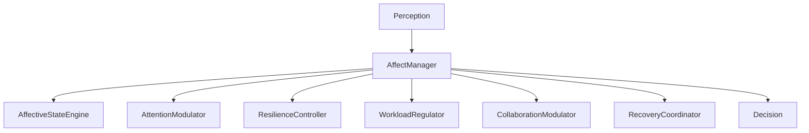

# RFC-0077

**Title:** Autonomous Cognitive Emotion & Affective Architecture

**Document ID:** RFC-0077

**Version:** 1.0

**Status:** Accepted

**Category:** Cognitive Architecture

**Layer:** Affective Control / Cognitive Regulation / Adaptive Modulation

**Target:**

```text
affect/
```

---

# Abstract

This RFC defines the SH-3 Autonomous Cognitive Emotion & Affective Architecture (ACEAA).

The Autonomous Cognitive Emotion & Affective Architecture provides the adaptive modulation layer responsible for regulating cognitive processing through affective control signals.

Within SH-3, **affect is defined as an internal computational control mechanism rather than as subjective or phenomenological emotion**. Affective signals continuously influence cognitive resource allocation, attention, planning depth, uncertainty tolerance, collaboration preferences, learning intensity, and recovery behavior.

The architecture governs:

- affective state estimation
- cognitive modulation
- adaptive attention control
- uncertainty tolerance
- workload regulation
- resilience modulation
- collaboration modulation
- affective adaptation

The system enables:

- adaptive cognitive regulation
- explainable affective control
- dynamic resource allocation
- resilient autonomous behavior
- continuous affective optimization

This document is normative.

---

# Motivation

Autonomous cognition requires mechanisms that dynamically regulate processing.

Fixed cognitive parameters cannot adequately respond to:

- rapidly changing environments
- uncertainty
- computational overload
- conflicting objectives
- execution failures
- prolonged autonomous operation

An affective control layer provides adaptive modulation without requiring subjective experience.

---

# Goals

The Autonomous Cognitive Emotion & Affective Architecture SHALL provide:

- adaptive cognitive regulation
- explainable affective states
- workload-aware modulation
- uncertainty-aware adaptation
- resilience optimization
- governance-aware affective control
- lifelong affective calibration

---

# Non-Goals

The architecture SHALL NOT:

- model subjective consciousness
- emulate biological emotions
- replace decision making
- replace motivation
- bypass governance

Affective modulation regulates cognition rather than generating cognition.

---

# Architecture



---

# Design Principles

## Computational Affect

Affective states SHALL represent computational regulation signals.

---

## Continuous Adaptation

Affective modulation SHALL continuously adapt to operational conditions.

---

## Explainability

Every affective adjustment SHALL be traceable.

---

## Stability

Affective regulation SHALL avoid oscillatory behavior.

---

## Resource Awareness

Affective modulation SHALL consider computational resources.

---

## Governance

No affective modulation SHALL violate governance policies.

---

# Components

| Component | Responsibility |
|------------|----------------|
| AffectManager | Global coordination |
| AffectiveStateEngine | Internal affect estimation |
| AttentionModulator | Attention regulation |
| ResilienceController | Recovery regulation |
| WorkloadRegulator | Computational load control |
| CollaborationModulator | Cooperative behavior modulation |
| RecoveryCoordinator | Adaptive recovery management |

---

# Affective Context

Every affective evaluation receives an immutable AffectiveContext.

AffectiveContext SHALL contain:

| Field | Description |
|------|-------------|
| affect_id | Evaluation identifier |
| workload | Current computational load |
| uncertainty | Environmental uncertainty |
| goal_pressure | Goal demand |
| execution_state | Runtime condition |
| timestamp | Evaluation time |

---

# Affective State

Every AffectiveState SHALL expose:

| Field | Description |
|------|-------------|
| state_id | Unique identifier |
| regulation_level | Modulation intensity |
| workload_index | Resource utilization |
| uncertainty_index | Estimated uncertainty |
| resilience_level | Recovery readiness |
| confidence | Evaluation confidence |

Affective states SHALL remain observable and explainable.

---

# Affective Lifecycle

Every affective evaluation follows:

```text
Context Analysis

↓

State Estimation

↓

Resource Evaluation

↓

Modulation

↓

Behavior Adjustment

↓

Learning
```

---

# Affective State Engine

AffectiveStateEngine estimates current regulatory requirements.

Evaluation dimensions include:

- computational load
- uncertainty
- execution stability
- planning demand
- environmental volatility
- collaboration demand

State estimation SHALL remain deterministic for equivalent inputs.

---

# Computational Affect Model

```text
Context

+

System State

+

Operational Metrics

↓

Affective State
```

---

# Attention Modulator

AttentionModulator dynamically regulates cognitive focus.

Attention adjustments SHALL consider:

- uncertainty
- urgency
- expected utility
- goal importance
- execution risk
- available resources

Attention modulation SHALL remain explainable.

---

# Workload Regulator

WorkloadRegulator balances computational demand.

Regulation mechanisms include:

- scheduling adaptation
- reasoning depth adjustment
- simulation budget allocation
- learning intensity scaling
- concurrent task limitation

Regulation SHALL preserve system stability.

---

# Autonomous Cognitive Emotion & Affective Execution Model

The Autonomous Cognitive Emotion & Affective Architecture (ACEAA) continuously regulates cognitive behavior using computational affective signals derived from operational state, uncertainty, workload, execution quality, environmental dynamics, and learning history.

Within SH-3, affective regulation functions as a closed-loop control system that continuously tunes higher cognitive subsystems while preserving deterministic execution, explainability, and governance compliance.

The affective regulation lifecycle follows:


Each stage maintains a distinct affective regulation responsibility.

---

# Cognitive Affective Control Loop

The AffectManager continuously supervises affective regulation.

```text
Operational Observation

↓

Affective State Estimation

↓

Resource Assessment

↓

Adaptive Modulation

↓

Execution Monitoring

↓

Recovery Coordination

↓

Learning

↓

Calibration
```

The affective control loop SHALL execute continuously while the cognitive runtime remains active.

---

# Resilience Controller

ResilienceController regulates the system's capacity to tolerate failures, uncertainty, and prolonged execution.

Resilience evaluation SHALL consider:

- execution stability
- environmental volatility
- planning reliability
- resource availability
- recovery history
- fault frequency

Resilience SHALL dynamically influence cognitive modulation.

---

# Resilience Model

```text
Execution Quality

+

Recovery History

+

Environmental Stability

↓

Resilience Score
```

---

# Recovery Coordinator

RecoveryCoordinator manages adaptive restoration after degraded operation.

Recovery strategies include:

- workload reduction
- replanning
- execution rollback
- knowledge verification
- resource redistribution
- subsystem restart
- agent delegation

Recovery SHALL preserve operational continuity whenever practical.

---

# Recovery Pipeline

```text
Failure Detection

↓

Impact Analysis

↓

Recovery Strategy Selection

↓

Execution Recovery

↓

Verification
```

---

# Affective Consistency

The architecture SHALL preserve:

- modulation consistency
- resilience consistency
- workload consistency
- uncertainty consistency
- governance consistency

Equivalent operational conditions SHALL produce equivalent affective regulation.

---

# Affective Learning

Learning continuously improves affective regulation.

Learning inputs include:

- execution success
- execution failure
- workload history
- uncertainty calibration
- recovery outcomes
- collaboration effectiveness

Learning SHALL optimize future modulation strategies.

---

# Affective Calibration

Calibration continuously adjusts affective parameters.

Calibration SHALL optimize:

- regulation sensitivity
- workload thresholds
- resilience thresholds
- recovery timing
- attention scaling
- collaboration weighting

Calibration SHALL preserve long-term behavioral stability.

---

# Affective Knowledge Base

The architecture maintains reusable affective knowledge including:

- regulation profiles
- workload models
- recovery strategies
- resilience statistics
- calibration history

Knowledge SHALL remain reusable across future execution cycles.

---

# Multi-Agent Affective Coordination

Multiple SH-3 agents MAY coordinate affective regulation.

Coordination supports:

- distributed workload balancing
- collaborative recovery
- uncertainty sharing
- resilience coordination
- cooperative regulation

Each participating agent SHALL preserve local governance authority.

---

# Consciousness Integration

Consciousness Coordination receives:

- affective state
- workload indicators
- resilience estimates
- recovery progress

---

# World Model Integration

World Model provides:

- environmental volatility
- operational uncertainty
- external stress factors
- situational dynamics

Affective regulation SHALL remain synchronized with the World Model.

---

# Knowledge Graph Integration

Knowledge Graph provides:

- historical recovery patterns
- resilience relationships
- workload dependencies
- operational semantics

Affective reasoning SHALL leverage semantic knowledge where appropriate.

---

# Value & Motivation Integration

Value & Motivation provides:

- purpose stability
- motivational pressure
- priority weighting
- long-term objectives

Affective modulation SHALL not alter intrinsic values directly.

---

# Goal Architecture Integration

Goal Architecture provides:

- active goal pressure
- scheduling demand
- dependency complexity
- completion urgency

Goal pressure SHALL influence modulation intensity.

---

# Cognitive Planning Integration

Planning receives:

- workload budgets
- reasoning depth recommendations
- uncertainty tolerance
- adaptive planning intensity

Planning SHALL remain functionally independent while honoring modulation signals.

---

# Cognitive Decision Integration

Decision making receives:

- uncertainty modulation
- confidence adjustment
- risk sensitivity
- execution readiness

---

# Unified Cognitive Memory Integration

Unified Cognitive Memory stores:

- affective history
- recovery history
- workload history
- calibration history
- resilience history

---

# Meta-Reasoning Integration

Meta-Reasoning evaluates:

- modulation effectiveness
- resilience quality
- calibration accuracy
- regulation stability

---

# Learning Integration

Learning receives:

- affective datasets
- recovery outcomes
- workload optimization history
- calibration metrics

---

# Self Evolution Integration

Self Evolution System receives:

- regulation performance
- calibration opportunities
- resilience improvements
- architecture optimization proposals

---

# AI Safety Governance Integration

AI Safety Governance validates:

- regulation policies
- recovery operations
- adaptive thresholds
- autonomous calibration

Affective regulation SHALL never bypass governance validation.

---

# Risk Management Integration

Risk Management evaluates:

- workload saturation
- resilience degradation
- unstable modulation
- recovery failure probability

Risk SHALL influence affective regulation strategies.

---

# Message Bus Integration

Affective events include:

- AffectiveStateEstimated
- WorkloadAdjusted
- AttentionModulated
- ResilienceUpdated
- RecoveryStarted
- RecoveryCompleted
- CalibrationUpdated
- AffectiveLearningCompleted

---

# Persistence Integration

Persistence stores:

- regulation profiles
- recovery history
- resilience metrics
- calibration history
- workload statistics

---

# Observability Integration

Affective telemetry includes:

- workload utilization
- regulation latency
- resilience score
- recovery success rate
- calibration frequency
- modulation stability
- uncertainty tolerance

---

# Tracing

Affective traces preserve:

- trace_id
- affect_id
- regulation_id
- workload_id
- resilience_id
- recovery_id
- calibration_id

Every affective regulation operation SHALL participate in distributed cognitive tracing.

---

# Thread Model

The Autonomous Cognitive Emotion & Affective Architecture supports concurrent:

- affective estimation
- workload regulation
- attention modulation
- recovery coordination
- resilience evaluation
- calibration

Concurrent affective operations SHALL preserve deterministic behavior when supplied with identical runtime state, workload, and environmental conditions.

The reference implementation SHALL be thread-safe, scalable, and lock-efficient.

---

# Metrics

The Autonomous Cognitive Emotion & Affective Architecture exposes:

- workload balance index
- resilience score
- recovery success rate
- modulation latency
- calibration accuracy
- regulation stability
- adaptive efficiency

---

# Performance Objectives

The Autonomous Cognitive Emotion & Affective Architecture should optimize for:

- stable cognitive regulation
- efficient resource utilization
- adaptive workload balancing
- resilient long-duration execution
- explainable modulation
- continuous affective improvement

---

# Future Work

Potential future enhancements include:

- predictive affective regulation
- federated resilience optimization
- adaptive cognitive energy models
- neurosymbolic regulation strategies
- self-organizing modulation networks
- mission-aware resilience adaptation
- autonomous regulation policy synthesis

These enhancements extend SH-3 toward a computational affective architecture that continuously regulates cognitive processes, balances computational resources, coordinates recovery, and improves long-term autonomous operation while remaining deterministic, explainable, and governance-aware.

---

# References

- SH-3 Architecture Specification v2.1
- RFC-0027 Autonomous Learning System
- RFC-0050 Knowledge Governance System
- RFC-0053 AI Safety Governance System
- RFC-0062 Autonomous Meta-Reasoning Intelligence System
- RFC-0063 Autonomous Consciousness Coordination System
- RFC-0064 Autonomous Cognitive Memory Architecture
- RFC-0067 Autonomous Cognitive Operating System
- RFC-0068 Autonomous Multi-Agent Cognitive Architecture
- RFC-0069 Autonomous Cognitive Skill Architecture
- RFC-0070 Autonomous Cognitive Simulation Architecture
- RFC-0071 Autonomous Cognitive Knowledge Graph Architecture
- RFC-0072 Autonomous Cognitive Planning Architecture
- RFC-0073 Autonomous Cognitive Decision Architecture
- RFC-0074 Autonomous Cognitive Perception Architecture
- RFC-0075 Autonomous Cognitive Value & Motivation Architecture
- RFC-0076 Autonomous Cognitive Goal Architecture

---

# End of RFC-0077
