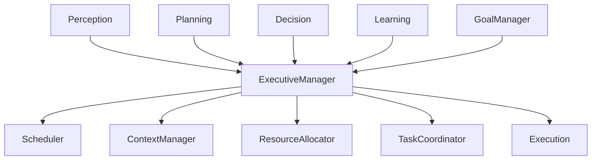

# RFC-0078

**Title:** Autonomous Cognitive Executive Control Architecture

**Document ID:** RFC-0078

**Version:** 1.0

**Status:** Accepted

**Category:** Cognitive Architecture

**Layer:** Executive Control / Cognitive Orchestration / Runtime Coordination

**Target:**

```text
executive/
```

---

# Abstract

This RFC defines the SH-3 Autonomous Cognitive Executive Control Architecture (ACECA).

The Autonomous Cognitive Executive Control Architecture provides the central orchestration layer responsible for coordinating all cognitive subsystems, allocating computational resources, scheduling cognitive activities, supervising execution flow, and maintaining coherent system-wide behavior.

Unlike a traditional scheduler, the Executive Control layer continuously integrates perception, motivation, goals, planning, decision making, execution, learning, and recovery into a unified cognitive control process.

The architecture governs:

- cognitive orchestration
- execution supervision
- resource allocation
- task scheduling
- priority enforcement
- context switching
- concurrency coordination
- adaptive execution control

The system enables:

- coherent autonomous behavior
- deterministic orchestration
- adaptive execution control
- explainable runtime coordination
- continuous operational optimization

This document is normative.

---

# Motivation

Individual cognitive subsystems can operate correctly while the overall system behaves inefficiently.

Long-running autonomous systems require:

- coordinated execution
- deterministic scheduling
- adaptive resource allocation
- workload balancing
- interruption management
- execution supervision

Executive Control provides global coordination across all cognitive processes.

---

# Goals

The Autonomous Cognitive Executive Control Architecture SHALL provide:

- centralized cognitive orchestration
- deterministic execution scheduling
- adaptive runtime control
- explainable task coordination
- resilient execution supervision
- governance-aware orchestration
- continuous runtime optimization

---

# Non-Goals

The architecture SHALL NOT:

- replace planning
- replace decision making
- replace execution engines
- replace learning
- bypass governance

Executive Control coordinates cognition rather than performing domain-specific reasoning.

---

# Architecture



---

# Design Principles

## Unified Coordination

Every cognitive subsystem SHALL operate under executive supervision.

---

## Deterministic Scheduling

Equivalent runtime conditions SHALL produce equivalent scheduling behavior.

---

## Explainability

Scheduling and coordination decisions SHALL remain traceable.

---

## Adaptive Coordination

Execution control SHALL adapt to operational changes.

---

## Scalability

Executive coordination SHALL support distributed and parallel execution.

---

## Governance

Executive decisions SHALL remain subject to governance validation.

---

# Components

| Component | Responsibility |
|------------|----------------|
| ExecutiveManager | Global orchestration |
| Scheduler | Cognitive scheduling |
| ContextManager | Context management |
| ResourceAllocator | Resource distribution |
| TaskCoordinator | Task coordination |
| ExecutionSupervisor | Runtime supervision |
| InterruptionManager | Interrupt handling |

---

# Executive Context

Every executive operation receives an immutable ExecutiveContext.

ExecutiveContext SHALL contain:

| Field | Description |
|------|-------------|
| executive_id | Execution identifier |
| runtime_state | Current runtime |
| active_tasks | Running tasks |
| available_resources | Resource state |
| execution_policy | Active policies |
| timestamp | Evaluation time |

---

# Executive Task

Every ExecutiveTask SHALL expose:

| Field | Description |
|------|-------------|
| task_id | Unique identifier |
| priority | Execution priority |
| status | Runtime state |
| owner | Responsible subsystem |
| dependencies | Execution dependencies |
| execution_budget | Allocated resources |

Executive tasks SHALL remain observable throughout execution.

---

# Executive Lifecycle

Every executive coordination cycle follows:

```text
Task Collection

↓

Priority Evaluation

↓

Scheduling

↓

Resource Allocation

↓

Execution Supervision

↓

Monitoring

↓

Optimization
```

The lifecycle SHALL execute continuously during runtime.

---

# Scheduler

Scheduler determines execution order.

Scheduling SHALL consider:

- priority
- deadlines
- dependency graph
- workload
- resource availability
- governance constraints

Scheduling SHALL remain deterministic.

---

# Scheduling Model

```text
Task Queue

+

Priorities

+

Resources

↓

Execution Schedule
```

---

# Resource Allocation

ResourceAllocator distributes computational resources.

Allocations include:

- CPU budget
- memory budget
- reasoning depth
- simulation budget
- communication bandwidth
- storage bandwidth

Allocation SHALL maximize overall system effectiveness.

---

# Task Coordination

TaskCoordinator synchronizes cognitive activities.

Coordination SHALL support:

- sequential execution
- concurrent execution
- dependency enforcement
- synchronization barriers
- cooperative execution

Task coordination SHALL preserve causal correctness.

---

# Autonomous Cognitive Executive Control Execution Model

The Autonomous Cognitive Executive Control Architecture (ACECA) provides the global orchestration mechanism responsible for supervising, coordinating, scheduling, and optimizing every cognitive subsystem operating within SH-3.

Executive Control maintains continuous oversight of runtime execution while preserving deterministic behavior, efficient resource utilization, explainable scheduling, and governance compliance.

The executive lifecycle follows:


Each stage maintains a distinct executive coordination responsibility.

---

# Cognitive Executive Control Loop

The ExecutiveManager continuously supervises cognitive execution.

```text
Task Collection

↓

Priority Assessment

↓

Execution Scheduling

↓

Resource Allocation

↓

Execution Supervision

↓

Performance Monitoring

↓

Runtime Optimization

↓

Continuous Coordination
```

Executive coordination SHALL remain active for the lifetime of the cognitive runtime.

---

# Execution Supervisor

ExecutionSupervisor monitors active execution.

Supervision SHALL evaluate:

- execution progress
- deadline compliance
- dependency satisfaction
- execution latency
- subsystem health
- resource utilization

Supervision SHALL produce immutable execution records.

---

# Execution Supervision Model

```text
Active Tasks

+

Runtime State

+

Execution Metrics

↓

Execution Status
```

---

# Context Manager

ContextManager supervises cognitive context transitions.

Context switching SHALL preserve:

- execution continuity
- memory consistency
- active priorities
- pending events
- causal ordering

Context restoration SHALL remain deterministic.

---

# Context Switching

Supported context transitions include:

- planning → execution
- execution → recovery
- execution → learning
- perception → planning
- decision → execution
- multi-agent coordination

Every transition SHALL preserve traceability.

---

# Interruption Manager

InterruptionManager handles unexpected runtime events.

Interrupt categories include:

- emergency events
- governance intervention
- resource exhaustion
- execution failure
- external requests
- higher-priority objectives

Interrupt handling SHALL preserve runtime integrity.

---

# Interrupt Pipeline

```text
Interrupt Detection

↓

Priority Evaluation

↓

Execution Suspension

↓

Interrupt Handling

↓

Execution Resume
```

---

# Runtime Optimization

Executive optimization continuously improves runtime behavior.

Optimization targets include:

- execution latency
- scheduling efficiency
- resource utilization
- subsystem throughput
- coordination overhead
- recovery efficiency

Optimization SHALL preserve deterministic execution.

---

# Executive Consistency

Executive coordination SHALL preserve:

- scheduling consistency
- execution consistency
- context consistency
- resource consistency
- governance consistency

Equivalent runtime conditions SHALL produce equivalent orchestration behavior.

---

# Executive Knowledge Base

The architecture maintains reusable executive knowledge including:

- scheduling heuristics
- workload profiles
- execution templates
- interruption patterns
- optimization history

Knowledge SHALL support continual runtime improvement.

---

# Distributed Executive Coordination

Multiple SH-3 nodes MAY cooperate under distributed executive control.

Coordination supports:

- distributed scheduling
- global workload balancing
- cooperative execution
- cross-node synchronization
- federated orchestration

Each node SHALL preserve local governance authority.

---

# Consciousness Integration

Consciousness Coordination receives:

- execution summaries
- active priorities
- workload distribution
- runtime status

---

# World Model Integration

World Model provides:

- environmental changes
- operational opportunities
- resource availability
- environmental constraints

Executive coordination SHALL remain synchronized with the World Model.

---

# Knowledge Graph Integration

Knowledge Graph provides:

- dependency semantics
- execution relationships
- historical scheduling data
- capability mappings

Executive reasoning SHALL leverage semantic relationships where appropriate.

---

# Goal Architecture Integration

Goal Architecture provides:

- active priorities
- dependency graphs
- completion urgency
- mission objectives

Executive coordination SHALL preserve goal ordering semantics.

---

# Planning Integration

Planning provides:

- executable plans
- task graphs
- execution dependencies
- scheduling hints

Executive Control SHALL orchestrate plan execution without modifying planning semantics.

---

# Decision Integration

Decision making provides:

- approved actions
- execution confidence
- execution constraints
- policy selections

---

# Affective Regulation Integration

Affective Regulation provides:

- workload recommendations
- resilience indicators
- adaptive execution intensity
- recovery preferences

Executive Control SHALL respect affective modulation signals.

---

# Unified Cognitive Memory Integration

Unified Cognitive Memory stores:

- execution history
- scheduling history
- optimization history
- interruption history
- coordination history

---

# Meta-Reasoning Integration

Meta-Reasoning evaluates:

- scheduling quality
- orchestration effectiveness
- resource efficiency
- optimization opportunities

---

# Learning Integration

Learning receives:

- execution datasets
- scheduling outcomes
- optimization metrics
- interruption statistics

---

# Self Evolution Integration

Self Evolution System receives:

- executive performance metrics
- orchestration improvements
- scheduling optimization proposals

---

# AI Safety Governance Integration

AI Safety Governance validates:

- execution scheduling
- interrupt processing
- resource allocation
- runtime optimization

Executive coordination SHALL never bypass governance validation.

---

# Risk Management Integration

Risk Management evaluates:

- scheduling instability
- execution bottlenecks
- resource contention
- coordination failures

Risk SHALL influence executive scheduling decisions.

---

# Message Bus Integration

Executive events include:

- ExecutiveCycleStarted
- TasksCollected
- ScheduleGenerated
- ResourcesAllocated
- ExecutionSupervised
- InterruptProcessed
- RuntimeOptimized
- ExecutiveCycleCompleted

---

# Persistence Integration

Persistence stores:

- execution schedules
- runtime history
- optimization history
- interruption history
- workload statistics

---

# Observability Integration

Executive telemetry includes:

- scheduler latency
- execution throughput
- resource utilization
- coordination efficiency
- interrupt frequency
- optimization gain
- runtime stability

---

# Tracing

Executive traces preserve:

- trace_id
- executive_id
- schedule_id
- execution_id
- context_id
- interruption_id
- optimization_id

Every executive operation SHALL participate in distributed cognitive tracing.

---

# Thread Model

The Autonomous Cognitive Executive Control Architecture supports concurrent:

- scheduling
- supervision
- context switching
- workload balancing
- interrupt processing
- runtime optimization

Concurrent executive operations SHALL preserve deterministic behavior when supplied with identical runtime state, task graph, and governance constraints.

The reference implementation SHALL be thread-safe, scalable, and lock-efficient.

---

# Metrics

The Autonomous Cognitive Executive Control Architecture exposes:

- scheduling efficiency
- execution throughput
- average task latency
- resource utilization
- interrupt recovery time
- orchestration overhead
- runtime stability index

---

# Performance Objectives

The Autonomous Cognitive Executive Control Architecture should optimize for:

- deterministic orchestration
- efficient scheduling
- adaptive runtime control
- robust interruption handling
- high resource utilization
- continuous executive improvement

---

# Future Work

Potential future enhancements include:

- predictive execution scheduling
- autonomous workload migration
- distributed executive consensus
- neurosymbolic runtime orchestration
- adaptive execution policies
- mission-aware orchestration strategies
- self-organizing executive coordination

These enhancements extend SH-3 toward a comprehensive executive control architecture capable of coordinating every cognitive subsystem while maintaining deterministic execution, adaptive runtime optimization, efficient resource utilization, explainable scheduling, and governance-aware orchestration.

---

# References

- SH-3 Architecture Specification v2.1
- RFC-0027 Autonomous Learning System
- RFC-0050 Knowledge Governance System
- RFC-0053 AI Safety Governance System
- RFC-0062 Autonomous Meta-Reasoning Intelligence System
- RFC-0063 Autonomous Consciousness Coordination System
- RFC-0064 Autonomous Cognitive Memory Architecture
- RFC-0067 Autonomous Cognitive Operating System
- RFC-0068 Autonomous Multi-Agent Cognitive Architecture
- RFC-0069 Autonomous Cognitive Skill Architecture
- RFC-0070 Autonomous Cognitive Simulation Architecture
- RFC-0071 Autonomous Cognitive Knowledge Graph Architecture
- RFC-0072 Autonomous Cognitive Planning Architecture
- RFC-0073 Autonomous Cognitive Decision Architecture
- RFC-0074 Autonomous Cognitive Perception Architecture
- RFC-0075 Autonomous Cognitive Value & Motivation Architecture
- RFC-0076 Autonomous Cognitive Goal Architecture
- RFC-0077 Autonomous Cognitive Emotion & Affective Architecture

---

# End of RFC-0078
