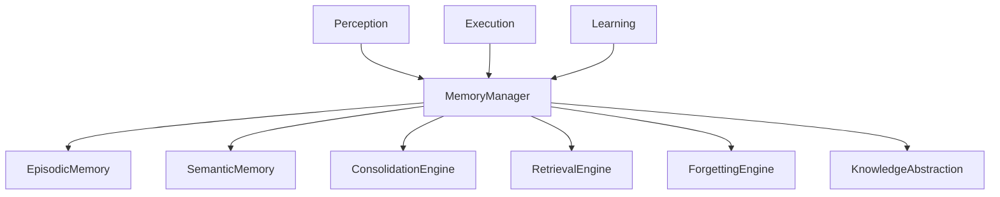

# RFC-0079

**Title:** Autonomous Cognitive Episodic & Semantic Memory Architecture

**Document ID:** RFC-0079

**Version:** 1.0

**Status:** Accepted

**Category:** Cognitive Architecture

**Layer:** Long-Term Memory / Knowledge Consolidation / Experience Management

**Target:**

```text
memory/
```

---

# Abstract

This RFC defines the SH-3 Autonomous Cognitive Episodic & Semantic Memory Architecture (ACESMA).

The Autonomous Cognitive Episodic & Semantic Memory Architecture provides the long-term cognitive memory layer responsible for preserving experiences, consolidating knowledge, abstracting reusable concepts, and supporting continuous lifelong learning.

The architecture separates memory into complementary components:

- Episodic Memory
- Semantic Memory
- Consolidation Engine
- Retrieval Engine
- Forgetting Engine
- Knowledge Abstraction
- Memory Governance

Together these components transform transient runtime observations into durable cognitive knowledge.

The architecture governs:

- episodic memory
- semantic memory
- knowledge consolidation
- experience replay
- memory retrieval
- forgetting
- abstraction
- memory evolution

The system enables:

- lifelong learning
- explainable memory
- reusable experience
- structured knowledge growth
- adaptive cognitive recall

This document is normative.

---

# Motivation

Runtime cognition continuously produces observations, plans, decisions, and execution outcomes.

Without structured long-term memory:

- knowledge becomes fragmented
- useful experience is repeatedly rediscovered
- reasoning quality stagnates
- planning cannot improve efficiently
- organizational knowledge is lost

Long-term memory provides persistent cognitive continuity.

---

# Goals

The Autonomous Cognitive Episodic & Semantic Memory Architecture SHALL provide:

- structured episodic memory
- structured semantic memory
- explainable retrieval
- adaptive consolidation
- controlled forgetting
- reusable knowledge abstraction
- governance-aware memory management

---

# Non-Goals

The architecture SHALL NOT:

- replace working memory
- replace runtime context
- replace knowledge graphs
- replace world modeling
- bypass governance

Long-term memory complements rather than replaces existing cognitive memory systems.

---

# Architecture



---

# Design Principles

## Lifelong Memory

Knowledge SHALL accumulate throughout the lifetime of the system.

---

## Explainability

Every retrieved memory SHALL preserve provenance.

---

## Consolidation

Frequently useful experience SHALL become reusable knowledge.

---

## Controlled Forgetting

Memory retention SHALL remain intentional and explainable.

---

## Consistency

Equivalent experiences SHALL produce equivalent knowledge structures.

---

## Governance

Memory operations SHALL remain subject to governance policies.

---

# Components

| Component | Responsibility |
|------------|----------------|
| MemoryManager | Global coordination |
| EpisodicMemory | Experience storage |
| SemanticMemory | Knowledge storage |
| ConsolidationEngine | Knowledge consolidation |
| RetrievalEngine | Memory retrieval |
| ForgettingEngine | Controlled forgetting |
| KnowledgeAbstraction | Concept extraction |

---

# Memory Context

Every memory operation receives an immutable MemoryContext.

MemoryContext SHALL contain:

| Field | Description |
|------|-------------|
| memory_id | Memory operation identifier |
| runtime_context | Runtime state |
| world_state | Environmental context |
| active_goals | Goal references |
| trace_id | Distributed trace |
| timestamp | Operation time |

---

# Episodic Memory

Every EpisodicMemory record SHALL expose:

| Field | Description |
|------|-------------|
| episode_id | Unique identifier |
| event_sequence | Ordered experience |
| participants | Related entities |
| context | Runtime context |
| outcome | Observed result |
| provenance | Trace information |

Episodes SHALL remain temporally ordered.

---

# Semantic Memory

Every SemanticMemory record SHALL expose:

| Field | Description |
|------|-------------|
| concept_id | Unique identifier |
| concept | Abstract knowledge |
| relationships | Semantic links |
| confidence | Confidence score |
| evidence | Supporting episodes |
| provenance | Knowledge origin |

Semantic concepts SHALL remain independently reusable.

---

# Memory Lifecycle

Every long-term memory follows:

```text
Experience Capture

↓

Episode Storage

↓

Knowledge Consolidation

↓

Semantic Abstraction

↓

Retrieval

↓

Evolution

↓

Retention or Forgetting
```

---

# Episodic Memory

EpisodicMemory preserves concrete experiences.

Episodes SHALL include:

- observations
- decisions
- plans
- executions
- failures
- recoveries
- collaborations

Episodes SHALL remain immutable.

---

# Semantic Memory

SemanticMemory stores generalized knowledge.

Knowledge categories include:

- procedural knowledge
- factual knowledge
- causal knowledge
- strategic knowledge
- organizational knowledge
- learned heuristics

Semantic knowledge SHALL remain independent of individual episodes.

---

# Consolidation Engine

ConsolidationEngine transforms experiences into reusable knowledge.

Consolidation SHALL consider:

- repetition frequency
- execution success
- causal consistency
- cross-domain applicability
- confidence
- governance approval

Consolidation SHALL preserve supporting evidence.

---

# Autonomous Cognitive Episodic & Semantic Memory Execution Model

The Autonomous Cognitive Episodic & Semantic Memory Architecture (ACESMA) provides the persistent long-term memory system for SH-3.

The architecture continuously captures experiences, consolidates reusable knowledge, retrieves relevant memories, performs controlled forgetting, and evolves semantic knowledge throughout the operational lifetime of the cognitive system.

Long-term memory is treated as an active cognitive subsystem rather than passive storage.

The memory lifecycle follows:


Each stage maintains an independent cognitive responsibility.

---

# Cognitive Memory Control Loop

The MemoryManager continuously supervises long-term memory.

```text
Experience Capture

↓

Episode Encoding

↓

Semantic Consolidation

↓

Knowledge Abstraction

↓

Memory Retrieval

↓

Experience Replay

↓

Learning

↓

Memory Evolution
```

Memory management SHALL remain continuously active during system operation.

---

# Retrieval Engine

RetrievalEngine locates relevant long-term knowledge.

Retrieval SHALL support:

- exact retrieval
- semantic retrieval
- temporal retrieval
- causal retrieval
- goal-oriented retrieval
- similarity retrieval

Retrieval SHALL preserve provenance.

---

# Retrieval Model

```text
Query

+

Context

+

Goal

↓

Relevant Memories
```

---

# Experience Replay

ExperienceReplay reconstructs prior cognitive episodes.

Replay SHALL support:

- execution review
- planning refinement
- failure analysis
- simulation initialization
- learning acceleration
- explanation generation

Replay SHALL preserve original temporal ordering.

---

# Controlled Forgetting

ForgettingEngine removes or archives obsolete knowledge.

Forgetting SHALL consider:

- knowledge redundancy
- confidence degradation
- governance policy
- storage constraints
- concept supersession
- historical importance

Forgetting SHALL remain explainable and auditable.

---

# Forgetting Pipeline

```text
Memory Candidate

↓

Retention Evaluation

↓

Governance Validation

↓

Archive or Remove
```

---

# Knowledge Abstraction

KnowledgeAbstraction derives reusable concepts from accumulated experiences.

Abstraction SHALL generate:

- generalized procedures
- reusable strategies
- causal models
- execution heuristics
- optimization patterns
- organizational knowledge

Every abstraction SHALL reference supporting evidence.

---

# Memory Consistency

Long-term memory SHALL preserve:

- temporal consistency
- semantic consistency
- causal consistency
- provenance consistency
- referential integrity

Consistency SHALL be maintained after every consolidation cycle.

---

# Memory Provenance

Every memory SHALL preserve:

| Field | Description |
|------|-------------|
| source | Originating subsystem |
| originating_trace | Trace reference |
| supporting_episodes | Evidence set |
| consolidation_cycle | Consolidation reference |
| creation_time | Initial storage time |
| last_validation | Latest verification |

Memory provenance SHALL remain immutable.

---

# Distributed Memory Federation

Multiple SH-3 nodes MAY cooperate through federated memory.

Federation supports:

- distributed retrieval
- knowledge sharing
- episodic synchronization
- semantic synchronization
- federated consolidation

Each node SHALL preserve local governance authority.

---

# Consciousness Integration

Consciousness Coordination receives:

- recalled experiences
- semantic summaries
- confidence estimates
- retrieval explanations

---

# World Model Integration

World Model provides:

- environmental context
- entity relationships
- causal updates
- situational references

Memory retrieval SHALL remain context-sensitive.

---

# Knowledge Graph Integration

Knowledge Graph receives:

- semantic concepts
- inferred relationships
- abstraction links
- concept evolution

Knowledge abstraction SHALL enrich graph semantics.

---

# Goal Architecture Integration

Goal Architecture provides:

- retrieval objectives
- contextual priorities
- historical goal references
- mission continuity

Goal-directed retrieval SHALL receive higher scheduling priority.

---

# Planning Integration

Planning receives:

- historical plans
- execution patterns
- reusable decompositions
- planning heuristics

Planning SHALL leverage semantic knowledge without modifying stored episodes.

---

# Decision Integration

Decision making receives:

- historical decisions
- confidence histories
- outcome statistics
- decision rationale

---

# Learning Integration

Learning receives:

- episodic datasets
- abstraction candidates
- retrieval statistics
- forgetting metrics

Learning SHALL continuously improve memory quality.

---

# Executive Control Integration

Executive Control schedules:

- consolidation cycles
- retrieval operations
- replay execution
- forgetting tasks

Memory operations SHALL remain coordinated with runtime workload.

---

# Unified Cognitive Memory Integration

Unified Cognitive Memory provides:

- working memory
- temporary context
- runtime buffers
- attention references

Long-term memory SHALL complement—not replace—working memory.

---

# Meta-Reasoning Integration

Meta-Reasoning evaluates:

- retrieval quality
- abstraction accuracy
- consolidation effectiveness
- forgetting policy quality

---

# Self Evolution Integration

Self Evolution System receives:

- knowledge growth metrics
- abstraction opportunities
- consolidation improvements
- memory architecture recommendations

---

# AI Safety Governance Integration

AI Safety Governance validates:

- consolidation policies
- forgetting requests
- federated synchronization
- external knowledge ingestion

Memory SHALL never violate governance requirements.

---

# Risk Management Integration

Risk Management evaluates:

- knowledge corruption
- retrieval uncertainty
- obsolete concepts
- semantic conflicts

Risk SHALL influence retrieval confidence and consolidation policies.

---

# Message Bus Integration

Memory events include:

- ExperienceCaptured
- EpisodeStored
- ConsolidationStarted
- SemanticConceptCreated
- MemoryRetrieved
- ReplayCompleted
- ForgettingCompleted
- MemoryValidated

---

# Persistence Integration

Persistence stores:

- episodic records
- semantic concepts
- abstraction history
- replay history
- forgetting history
- consolidation history

---

# Observability Integration

Memory telemetry includes:

- retrieval latency
- consolidation throughput
- abstraction accuracy
- replay frequency
- forgetting rate
- semantic growth
- storage efficiency

---

# Tracing

Memory traces preserve:

- trace_id
- memory_id
- episode_id
- concept_id
- consolidation_id
- replay_id
- retrieval_id

Every long-term memory operation SHALL participate in distributed cognitive tracing.

---

# Thread Model

The Autonomous Cognitive Episodic & Semantic Memory Architecture supports concurrent:

- episode storage
- semantic consolidation
- retrieval
- replay
- abstraction
- forgetting

Concurrent memory operations SHALL preserve deterministic behavior when supplied with identical experience streams, governance policies, and runtime state.

The reference implementation SHALL be thread-safe, scalable, and lock-efficient.

---

# Metrics

The Autonomous Cognitive Episodic & Semantic Memory Architecture exposes:

- retrieval precision
- retrieval latency
- consolidation efficiency
- abstraction quality
- replay utilization
- semantic growth rate
- knowledge reuse ratio

---

# Performance Objectives

The Autonomous Cognitive Episodic & Semantic Memory Architecture should optimize for:

- accurate retrieval
- efficient consolidation
- explainable abstraction
- adaptive forgetting
- reusable knowledge
- continuous lifelong learning

---

# Future Work

Potential future enhancements include:

- hierarchical episodic indexing
- predictive memory activation
- autonomous concept discovery
- distributed planetary-scale memory federation
- neurosymbolic abstraction engines
- adaptive forgetting policies
- self-organizing semantic memory structures

These enhancements extend SH-3 toward a continuously evolving long-term memory architecture capable of preserving experiences, constructing reusable semantic knowledge, supporting explainable retrieval, and enabling lifelong cognitive improvement while remaining deterministic, governance-aware, and tightly integrated with every major cognitive subsystem.

---

# References

- SH-3 Architecture Specification v2.1
- RFC-0023 World Model System
- RFC-0027 Autonomous Learning System
- RFC-0050 Knowledge Governance System
- RFC-0053 AI Safety Governance System
- RFC-0062 Autonomous Meta-Reasoning Intelligence System
- RFC-0063 Autonomous Consciousness Coordination System
- RFC-0064 Unified Cognitive Memory Architecture
- RFC-0067 Autonomous Cognitive Operating System
- RFC-0068 Autonomous Multi-Agent Cognitive Architecture
- RFC-0069 Autonomous Cognitive Skill Architecture
- RFC-0070 Autonomous Cognitive Simulation Architecture
- RFC-0071 Autonomous Cognitive Knowledge Graph Architecture
- RFC-0072 Autonomous Cognitive Planning Architecture
- RFC-0073 Autonomous Cognitive Decision Architecture
- RFC-0074 Autonomous Cognitive Perception Architecture
- RFC-0075 Autonomous Cognitive Value & Motivation Architecture
- RFC-0076 Autonomous Cognitive Goal Architecture
- RFC-0077 Autonomous Cognitive Emotion & Affective Architecture
- RFC-0078 Autonomous Cognitive Executive Control Architecture

---

# End of RFC-0079
