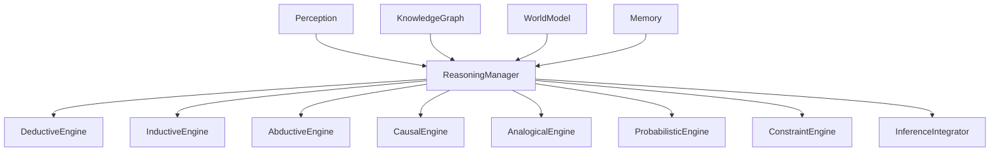

# RFC-0080

**Title:** Autonomous Cognitive Reasoning Architecture

**Document ID:** RFC-0080

**Version:** 1.0

**Status:** Accepted

**Category:** Cognitive Architecture

**Layer:** Reasoning / Inference / Cognitive Intelligence

**Target:**

```text
reasoning/
```

---

# Abstract

This RFC defines the SH-3 Autonomous Cognitive Reasoning Architecture (ACRA).

The Autonomous Cognitive Reasoning Architecture provides the unified reasoning layer responsible for transforming observations, knowledge, memories, goals, values, and world models into explainable conclusions that support planning, decision making, learning, and autonomous adaptation.

Rather than relying on a single inference mechanism, SH-3 integrates multiple complementary reasoning strategies into a coherent reasoning framework capable of operating under uncertainty, incomplete information, and continuously evolving environments.

The architecture governs:

- deductive reasoning
- inductive reasoning
- abductive reasoning
- causal reasoning
- analogical reasoning
- probabilistic reasoning
- constraint reasoning
- meta-reasoning coordination

The system enables:

- explainable inference
- adaptive reasoning
- uncertainty-aware cognition
- reusable reasoning patterns
- continuous reasoning improvement

This document is normative.

---

# Motivation

Perception provides observations.

Memory provides experiences.

Knowledge Graph provides relationships.

World Model provides environmental context.

Planning determines possible actions.

Decision making selects executable actions.

A cognitive architecture additionally requires mechanisms that determine **what can be inferred** from available information.

Reasoning transforms information into knowledge suitable for autonomous intelligence.

---

# Goals

The Autonomous Cognitive Reasoning Architecture SHALL provide:

- unified reasoning
- explainable inference
- multi-strategy reasoning
- uncertainty-aware inference
- governance-aware reasoning
- adaptive reasoning optimization
- lifelong reasoning improvement

---

# Non-Goals

The architecture SHALL NOT:

- replace planning
- replace decision making
- replace learning
- replace perception
- bypass governance

Reasoning generates conclusions rather than executing actions.

---

# Architecture



---

# Design Principles

## Explainable Reasoning

Every conclusion SHALL preserve complete inference provenance.

---

## Multi-Strategy Inference

Multiple reasoning strategies MAY cooperate on the same problem.

---

## Context Awareness

Reasoning SHALL remain context-sensitive.

---

## Determinism

Equivalent inputs SHALL produce equivalent conclusions.

---

## Adaptive Optimization

Reasoning SHALL continuously improve using accumulated knowledge.

---

## Governance

Inference SHALL remain subject to governance validation.

---

# Components

| Component | Responsibility |
|------------|----------------|
| ReasoningManager | Global coordination |
| DeductiveEngine | Formal logical inference |
| InductiveEngine | Generalization |
| AbductiveEngine | Best explanation generation |
| CausalEngine | Cause-effect inference |
| AnalogicalEngine | Similarity reasoning |
| ProbabilisticEngine | Uncertainty reasoning |
| ConstraintEngine | Constraint satisfaction |
| InferenceIntegrator | Result integration |

---

# Reasoning Context

Every reasoning operation receives an immutable ReasoningContext.

ReasoningContext SHALL contain:

| Field | Description |
|------|-------------|
| reasoning_id | Operation identifier |
| active_goal | Current objective |
| world_state | Environmental context |
| knowledge_scope | Available knowledge |
| constraints | Active constraints |
| timestamp | Evaluation time |

---

# Inference

Every inference SHALL expose:

| Field | Description |
|------|-------------|
| inference_id | Unique identifier |
| conclusion | Derived result |
| confidence | Confidence estimate |
| supporting_evidence | Evidence references |
| reasoning_strategy | Applied strategy |
| provenance | Trace metadata |

Inference SHALL remain reproducible.

---

# Reasoning Lifecycle

Every reasoning process follows:

```text
Problem Analysis

↓

Evidence Collection

↓

Strategy Selection

↓

Inference Generation

↓

Integration

↓

Verification

↓

Learning
```

The lifecycle SHALL remain deterministic.

---

# Deductive Reasoning

DeductiveEngine derives logically necessary conclusions.

Deduction SHALL operate on:

- formal rules
- logical assertions
- verified knowledge
- constraint systems
- governance policies

Deductive inference SHALL preserve logical correctness.

---

# Inductive Reasoning

InductiveEngine generates generalized knowledge.

Induction SHALL consider:

- repeated observations
- historical episodes
- statistical regularities
- execution outcomes
- environmental trends

Generalizations SHALL include confidence estimates.

---

# Abductive Reasoning

AbductiveEngine identifies the most plausible explanations.

Abduction SHALL evaluate:

- competing hypotheses
- causal consistency
- available evidence
- uncertainty
- prior knowledge

Abductive conclusions SHALL remain explicitly probabilistic.

---

# Autonomous Cognitive Reasoning Execution Model

The Autonomous Cognitive Reasoning Architecture (ACRA) provides the unified inference engine for SH-3.

The architecture continuously transforms observations, memories, semantic knowledge, world models, goals, and operational constraints into explainable conclusions that support planning, decision making, learning, simulation, and autonomous adaptation.

Reasoning is modeled as a continuous cognitive capability rather than a single inference step.

The reasoning lifecycle follows:


Each stage maintains an independent reasoning responsibility.

---

# Cognitive Reasoning Control Loop

The ReasoningManager continuously supervises reasoning.

```text
Problem Identification

↓

Evidence Collection

↓

Strategy Selection

↓

Inference Generation

↓

Inference Integration

↓

Verification

↓

Knowledge Update

↓

Reasoning Optimization
```

Reasoning SHALL remain continuously available throughout system operation.

---

# Causal Reasoning

CausalEngine identifies cause-and-effect relationships.

Causal reasoning SHALL support:

- root cause analysis
- consequence prediction
- intervention analysis
- dependency discovery
- causal graph reasoning
- counterfactual evaluation

Causal conclusions SHALL preserve supporting evidence.

---

# Causal Model

```text
Events

+

Dependencies

+

Knowledge

↓

Causal Explanation
```

---

# Analogical Reasoning

AnalogicalEngine transfers knowledge between similar domains.

Analogy SHALL evaluate:

- structural similarity
- semantic similarity
- procedural similarity
- contextual similarity
- historical similarity

Analogical reasoning SHALL preserve confidence estimates.

---

# Probabilistic Reasoning

ProbabilisticEngine evaluates uncertain knowledge.

Supported techniques include:

- Bayesian inference
- probabilistic scoring
- uncertainty propagation
- confidence estimation
- likelihood comparison

Probabilistic reasoning SHALL remain explainable.

---

# Constraint Reasoning

ConstraintEngine evaluates solution feasibility.

Constraint reasoning SHALL support:

- policy constraints
- resource constraints
- temporal constraints
- logical constraints
- organizational constraints

Constraint violations SHALL be explicitly reported.

---

# Inference Integration

InferenceIntegrator combines conclusions produced by multiple reasoning engines.

Integration SHALL consider:

- confidence
- evidence quality
- consistency
- causal coherence
- governance compliance

Integrated conclusions SHALL preserve complete provenance.

---

# Inference Verification

Reasoning results SHALL be verified whenever practical.

Verification SHALL include:

- logical consistency
- semantic consistency
- causal validation
- simulation validation
- historical consistency

Verified conclusions SHALL receive increased confidence.

---

# Reasoning Consistency

The reasoning architecture SHALL preserve:

- logical consistency
- semantic consistency
- causal consistency
- temporal consistency
- provenance consistency

Equivalent reasoning contexts SHALL produce equivalent conclusions.

---

# Reasoning Knowledge Base

The architecture maintains reusable reasoning assets including:

- inference templates
- logical rules
- causal models
- analogy mappings
- constraint models
- probabilistic models

Reasoning knowledge SHALL continuously evolve.

---

# Distributed Reasoning

Multiple SH-3 nodes MAY cooperate on reasoning tasks.

Distributed reasoning supports:

- parallel inference
- federated reasoning
- distributed hypothesis generation
- collaborative verification
- consensus reasoning

Each participating node SHALL preserve local governance authority.

---

# Consciousness Integration

Consciousness Coordination receives:

- active inferences
- confidence estimates
- unresolved hypotheses
- reasoning explanations

---

# World Model Integration

World Model provides:

- environmental context
- entity states
- temporal evolution
- causal relationships

Reasoning SHALL remain synchronized with World Model updates.

---

# Knowledge Graph Integration

Knowledge Graph provides:

- semantic relationships
- ontological knowledge
- concept hierarchies
- graph traversal

Reasoning SHALL leverage graph semantics where appropriate.

---

# Episodic & Semantic Memory Integration

Long-Term Memory provides:

- historical experiences
- semantic concepts
- prior reasoning
- reusable evidence

Reasoning SHALL exploit reusable cognitive knowledge.

---

# Goal Architecture Integration

Goal Architecture provides:

- reasoning objectives
- active priorities
- execution constraints
- mission alignment

Goal-directed reasoning SHALL receive execution priority.

---

# Planning Integration

Planning receives:

- verified conclusions
- causal explanations
- feasibility analysis
- inferred constraints

Planning SHALL consume reasoning results without modifying inference provenance.

---

# Decision Integration

Decision making receives:

- recommended conclusions
- confidence estimates
- uncertainty metrics
- competing hypotheses

---

# Executive Control Integration

Executive Control schedules:

- reasoning tasks
- verification cycles
- distributed inference
- optimization activities

Reasoning SHALL remain coordinated with runtime execution.

---

# Learning Integration

Learning receives:

- inference history
- reasoning outcomes
- verification results
- optimization opportunities

Learning SHALL continuously improve reasoning quality.

---

# Meta-Reasoning Integration

Meta-Reasoning evaluates:

- reasoning accuracy
- strategy selection
- inference quality
- verification effectiveness

---

# Self Evolution Integration

Self Evolution System receives:

- reasoning metrics
- optimization proposals
- strategy evolution
- architectural improvements

---

# AI Safety Governance Integration

AI Safety Governance validates:

- inference policies
- reasoning strategies
- distributed reasoning
- external knowledge usage

Reasoning SHALL never bypass governance constraints.

---

# Risk Management Integration

Risk Management evaluates:

- inference uncertainty
- conflicting conclusions
- insufficient evidence
- causal ambiguity

Risk SHALL influence confidence estimation.

---

# Message Bus Integration

Reasoning events include:

- ReasoningStarted
- EvidenceCollected
- StrategySelected
- InferenceGenerated
- InferenceIntegrated
- ConclusionVerified
- KnowledgeUpdated
- ReasoningCompleted

---

# Persistence Integration

Persistence stores:

- inference history
- causal models
- analogy mappings
- verification history
- optimization history

---

# Observability Integration

Reasoning telemetry includes:

- inference latency
- reasoning throughput
- verification rate
- confidence distribution
- causal accuracy
- analogy utilization
- reasoning consistency

---

# Tracing

Reasoning traces preserve:

- trace_id
- reasoning_id
- inference_id
- strategy_id
- verification_id
- evidence_id
- conclusion_id

Every reasoning operation SHALL participate in distributed cognitive tracing.

---

# Thread Model

The Autonomous Cognitive Reasoning Architecture supports concurrent:

- evidence collection
- inference generation
- verification
- causal analysis
- probabilistic evaluation
- distributed reasoning

Concurrent reasoning operations SHALL preserve deterministic behavior when supplied with identical knowledge, evidence, constraints, and runtime state.

The reference implementation SHALL be thread-safe, scalable, and lock-efficient.

---

# Metrics

The Autonomous Cognitive Reasoning Architecture exposes:

- inference accuracy
- reasoning latency
- verification success rate
- confidence calibration
- causal precision
- reasoning reuse ratio
- distributed reasoning efficiency

---

# Performance Objectives

The Autonomous Cognitive Reasoning Architecture should optimize for:

- explainable inference
- accurate reasoning
- efficient verification
- adaptive strategy selection
- reusable reasoning knowledge
- continuous reasoning improvement

---

# Future Work

Potential future enhancements include:

- neurosymbolic reasoning integration
- differentiable reasoning pipelines
- theorem-proving acceleration
- autonomous hypothesis generation
- recursive self-reasoning
- hierarchical reasoning planners
- cross-agent federated reasoning optimization

These enhancements extend SH-3 toward a comprehensive reasoning architecture capable of integrating logical, probabilistic, causal, analogical, and abductive inference into a unified cognitive engine that continuously improves through experience while remaining deterministic, explainable, governance-aware, and tightly integrated with every major cognitive subsystem.

---

# References

- SH-3 Architecture Specification v2.1
- RFC-0023 World Model System
- RFC-0027 Autonomous Learning System
- RFC-0050 Knowledge Governance System
- RFC-0053 AI Safety Governance System
- RFC-0062 Autonomous Meta-Reasoning Intelligence System
- RFC-0063 Autonomous Consciousness Coordination System
- RFC-0064 Unified Cognitive Memory Architecture
- RFC-0067 Autonomous Cognitive Operating System
- RFC-0068 Autonomous Multi-Agent Cognitive Architecture
- RFC-0069 Autonomous Cognitive Skill Architecture
- RFC-0070 Autonomous Cognitive Simulation Architecture
- RFC-0071 Autonomous Cognitive Knowledge Graph Architecture
- RFC-0072 Autonomous Cognitive Planning Architecture
- RFC-0073 Autonomous Cognitive Decision Architecture
- RFC-0074 Autonomous Cognitive Perception Architecture
- RFC-0075 Autonomous Cognitive Value & Motivation Architecture
- RFC-0076 Autonomous Cognitive Goal Architecture
- RFC-0077 Autonomous Cognitive Emotion & Affective Architecture
- RFC-0078 Autonomous Cognitive Executive Control Architecture
- RFC-0079 Autonomous Cognitive Episodic & Semantic Memory Architecture

---

# End of RFC-0080
