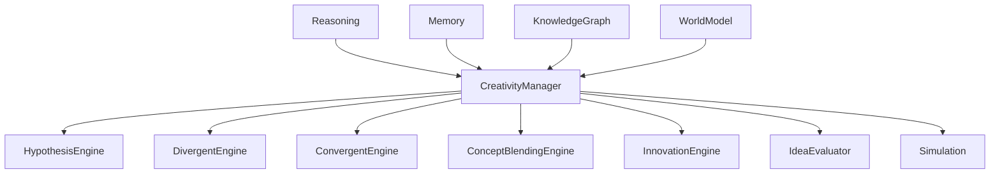

# RFC-0081

**Title:** Autonomous Cognitive Creativity & Hypothesis Generation Architecture

**Document ID:** RFC-0081

**Version:** 1.0

**Status:** Accepted

**Category:** Cognitive Architecture

**Layer:** Creativity / Hypothesis Generation / Cognitive Exploration

**Target:**

```text
creativity/
```

---

# Abstract

This RFC defines the SH-3 Autonomous Cognitive Creativity & Hypothesis Generation Architecture (ACCHGA).

The Autonomous Cognitive Creativity & Hypothesis Generation Architecture provides the exploratory cognition layer responsible for generating novel hypotheses, alternative explanations, original solution strategies, conceptual combinations, and innovative design candidates.

Unlike deterministic reasoning, which derives conclusions from existing evidence, creativity explores the adjacent possibility space by constructing plausible but unverified cognitive artifacts that can subsequently be evaluated, simulated, validated, and learned.

The architecture governs:

- hypothesis generation
- divergent thinking
- convergent refinement
- conceptual blending
- analogical innovation
- solution exploration
- design synthesis
- creative learning

The system enables:

- explainable creativity
- controlled exploration
- reusable innovation
- adaptive hypothesis generation
- governance-aware idea generation

This document is normative.

---

# Motivation

Reasoning derives conclusions from available knowledge.

Planning determines executable paths.

Simulation predicts consequences.

A cognitive architecture additionally requires mechanisms capable of producing **previously unknown possibilities**.

Without creative exploration:

- reasoning remains constrained by existing knowledge
- innovation becomes limited
- recovery options decrease
- optimization converges prematurely
- autonomous discovery becomes impossible

Creativity complements reasoning by expanding the cognitive search space.

---

# Goals

The Autonomous Cognitive Creativity & Hypothesis Generation Architecture SHALL provide:

- autonomous hypothesis generation
- explainable creative exploration
- controlled divergent thinking
- convergent refinement
- reusable innovation patterns
- governance-aware creativity
- lifelong creative improvement

---

# Non-Goals

The architecture SHALL NOT:

- replace reasoning
- replace planning
- replace decision making
- replace validation
- bypass governance

Creative outputs SHALL remain hypotheses until verified.

---

# Architecture



---

# Design Principles

## Explainable Creativity

Every hypothesis SHALL preserve complete provenance.

---

## Controlled Exploration

Creative exploration SHALL remain bounded by configurable constraints.

---

## Separation of Discovery and Validation

Idea generation SHALL remain independent from verification.

---

## Knowledge Reuse

Creative generation SHALL leverage accumulated knowledge.

---

## Adaptive Exploration

Exploration strategies SHALL improve continuously.

---

## Governance

Creative generation SHALL remain subject to governance policies.

---

# Components

| Component | Responsibility |
|------------|----------------|
| CreativityManager | Global coordination |
| HypothesisEngine | Hypothesis generation |
| DivergentEngine | Alternative generation |
| ConvergentEngine | Candidate refinement |
| ConceptBlendingEngine | Concept synthesis |
| InnovationEngine | Novel solution discovery |
| IdeaEvaluator | Preliminary ranking |

---

# Creativity Context

Every creative operation receives an immutable CreativityContext.

CreativityContext SHALL contain:

| Field | Description |
|------|-------------|
| creativity_id | Operation identifier |
| active_goal | Current objective |
| knowledge_scope | Available knowledge |
| operational_constraints | Active constraints |
| exploration_budget | Computational budget |
| timestamp | Evaluation time |

---

# Hypothesis

Every Hypothesis SHALL expose:

| Field | Description |
|------|-------------|
| hypothesis_id | Unique identifier |
| description | Proposed explanation or solution |
| confidence | Initial plausibility |
| novelty | Estimated originality |
| supporting_knowledge | Evidence references |
| provenance | Generation history |

Hypotheses SHALL remain immutable after creation.

---

# Creativity Lifecycle

Every creative process follows:

```text
Problem Definition

↓

Knowledge Exploration

↓

Idea Generation

↓

Candidate Expansion

↓

Candidate Refinement

↓

Evaluation

↓

Simulation
```

Creative generation SHALL preserve complete traceability.

---

# Hypothesis Generation

HypothesisEngine generates candidate explanations.

Generation SHALL consider:

- incomplete observations
- conflicting evidence
- missing knowledge
- causal gaps
- optimization opportunities
- unexplored alternatives

Generated hypotheses SHALL include confidence estimates.

---

# Divergent Thinking

DivergentEngine expands the solution space.

Expansion techniques include:

- structural variation
- parameter variation
- functional substitution
- analogy transfer
- conceptual recombination
- stochastic exploration

Divergent exploration SHALL maximize useful diversity.

---

# Convergent Thinking

ConvergentEngine narrows candidate solutions.

Selection SHALL consider:

- feasibility
- expected utility
- novelty
- governance compliance
- resource cost
- consistency

Candidate refinement SHALL preserve explanatory traceability.

---

# Autonomous Cognitive Creativity & Hypothesis Generation Execution Model

The Autonomous Cognitive Creativity & Hypothesis Generation Architecture (ACCHGA) provides the exploratory cognition engine responsible for generating novel ideas, hypotheses, strategies, and conceptual combinations that extend beyond existing knowledge while remaining explainable, auditable, and governance-aware.

Creativity within SH-3 is modeled as a disciplined cognitive exploration process rather than unrestricted generation. Every generated hypothesis is subject to subsequent simulation, verification, reasoning, and learning before becoming trusted knowledge.

The creative lifecycle follows:


Each stage performs an independent creative responsibility.

---

# Cognitive Creativity Control Loop

The CreativityManager continuously supervises creative exploration.

```text
Problem Analysis

↓

Knowledge Exploration

↓

Hypothesis Generation

↓

Concept Blending

↓

Candidate Evaluation

↓

Simulation

↓

Learning

↓

Creative Evolution
```

Creative exploration SHALL remain available throughout system operation.

---

# Concept Blending Engine

ConceptBlendingEngine combines concepts originating from distinct knowledge domains.

Concept blending SHALL support:

- semantic fusion
- structural composition
- procedural composition
- functional recombination
- hierarchical synthesis
- cross-domain integration

Every blended concept SHALL preserve references to its originating concepts.

---

# Concept Blending Model

```text
Concept A

+

Concept B

+

Operational Context

↓

Novel Concept
```

---

# Innovation Engine

InnovationEngine generates novel solution candidates.

Innovation SHALL exploit:

- analogical transfer
- abstraction reuse
- recombination
- optimization mutation
- design exploration
- capability composition

Innovation SHALL maximize useful novelty while remaining operationally feasible.

---

# Creative Evaluation

IdeaEvaluator ranks generated hypotheses.

Evaluation SHALL consider:

- originality
- feasibility
- expected utility
- implementation cost
- strategic alignment
- governance compliance
- uncertainty

Evaluation SHALL preserve complete provenance.

---

# Creative Verification Pipeline

Creative outputs SHALL remain unverified until validated.

Verification stages include:

- reasoning verification
- simulation verification
- constraint validation
- policy validation
- execution feasibility analysis
- historical comparison

Only verified outputs MAY influence autonomous execution.

---

# Candidate Ranking

Candidate ranking SHALL combine:

- novelty score
- confidence score
- utility estimate
- execution feasibility
- learning value
- resource requirements

Ranking SHALL remain deterministic for equivalent inputs.

---

# Creativity Consistency

Creative processing SHALL preserve:

- provenance consistency
- semantic consistency
- governance consistency
- trace consistency
- reproducibility

Equivalent inputs SHALL reproduce equivalent exploration when deterministic execution mode is enabled.

---

# Creative Knowledge Base

The architecture maintains reusable creative assets including:

- hypothesis templates
- innovation patterns
- conceptual blends
- exploration heuristics
- evaluation models
- creativity history

Creative knowledge SHALL continuously evolve.

---

# Distributed Creative Exploration

Multiple SH-3 nodes MAY collaborate on creative exploration.

Distributed creativity supports:

- parallel hypothesis generation
- collaborative concept blending
- federated innovation
- distributed evaluation
- consensus candidate selection

Each participating node SHALL preserve local governance authority.

---

# Human-AI Co-Creation

The architecture supports collaborative creativity with human operators.

Collaboration supports:

- interactive brainstorming
- guided exploration
- iterative refinement
- explanation generation
- alternative proposal generation

Human guidance SHALL remain explicitly distinguishable from autonomous generation.

---

# Consciousness Integration

Consciousness Coordination receives:

- active hypotheses
- exploration status
- innovation summaries
- candidate rankings

---

# World Model Integration

World Model provides:

- environmental constraints
- opportunity detection
- contextual relevance
- operational feasibility

Creative exploration SHALL remain synchronized with current environmental conditions.

---

# Knowledge Graph Integration

Knowledge Graph provides:

- semantic relationships
- concept neighborhoods
- structural similarities
- reusable abstractions

Creative generation SHALL leverage graph-based exploration.

---

# Episodic & Semantic Memory Integration

Long-Term Memory provides:

- historical innovations
- successful hypotheses
- failed hypotheses
- reusable concepts

Creative generation SHALL reuse accumulated knowledge whenever beneficial.

---

# Reasoning Integration

Reasoning provides:

- logical validation
- causal analysis
- probabilistic estimation
- consistency verification

Creative outputs SHALL remain distinguishable from verified reasoning results.

---

# Goal Architecture Integration

Goal Architecture provides:

- exploration objectives
- novelty targets
- mission priorities
- operational constraints

Goal-directed creativity SHALL receive execution priority.

---

# Planning Integration

Planning receives:

- candidate strategies
- alternative plans
- innovative decompositions
- optimized workflows

Planning SHALL evaluate creative outputs before execution.

---

# Decision Integration

Decision making receives:

- ranked hypotheses
- confidence estimates
- novelty assessments
- feasibility analyses

---

# Executive Control Integration

Executive Control schedules:

- creative exploration
- evaluation cycles
- concept blending
- distributed creativity

Creative execution SHALL respect runtime resource budgets.

---

# Learning Integration

Learning receives:

- successful innovations
- rejected hypotheses
- evaluation history
- exploration metrics

Learning SHALL continuously improve creativity quality.

---

# Meta-Reasoning Integration

Meta-Reasoning evaluates:

- exploration effectiveness
- novelty quality
- creativity strategy selection
- innovation efficiency

---

# Self Evolution Integration

Self Evolution System receives:

- innovation metrics
- creativity optimization proposals
- exploration improvements
- architecture evolution opportunities

---

# AI Safety Governance Integration

AI Safety Governance validates:

- exploration policies
- generated hypotheses
- innovation constraints
- autonomous creativity permissions

Creative generation SHALL never bypass governance validation.

---

# Risk Management Integration

Risk Management evaluates:

- speculative uncertainty
- unsafe innovation
- implausible hypotheses
- resource-intensive exploration

Risk SHALL influence exploration depth and candidate ranking.

---

# Message Bus Integration

Creativity events include:

- CreativityStarted
- KnowledgeExplored
- HypothesisGenerated
- ConceptBlended
- InnovationCreated
- CandidateEvaluated
- SimulationRequested
- CreativityCompleted

---

# Persistence Integration

Persistence stores:

- hypothesis history
- innovation history
- concept blends
- evaluation history
- creativity metrics

---

# Observability Integration

Creativity telemetry includes:

- hypothesis generation rate
- novelty distribution
- evaluation latency
- verification rate
- innovation reuse
- exploration efficiency
- creativity throughput

---

# Tracing

Creative traces preserve:

- trace_id
- creativity_id
- hypothesis_id
- innovation_id
- blend_id
- evaluation_id
- simulation_id

Every creative operation SHALL participate in distributed cognitive tracing.

---

# Thread Model

The Autonomous Cognitive Creativity & Hypothesis Generation Architecture supports concurrent:

- hypothesis generation
- concept blending
- innovation search
- evaluation
- simulation requests
- distributed exploration

Concurrent creative operations SHALL preserve deterministic behavior when supplied with identical knowledge, constraints, exploration budgets, and runtime state.

The reference implementation SHALL be thread-safe, scalable, and lock-efficient.

---

# Metrics

The Autonomous Cognitive Creativity & Hypothesis Generation Architecture exposes:

- hypothesis quality
- novelty index
- verification success rate
- innovation reuse ratio
- exploration efficiency
- creative throughput
- concept blending effectiveness

---

# Performance Objectives

The Autonomous Cognitive Creativity & Hypothesis Generation Architecture should optimize for:

- useful novelty
- explainable creativity
- efficient exploration
- high verification yield
- reusable innovations
- continuous creative improvement

---

# Future Work

Potential future enhancements include:

- autonomous scientific discovery
- evolutionary design synthesis
- multi-objective creative optimization
- collective multi-agent creativity
- self-generating research agendas
- adaptive creativity personalities
- open-ended autonomous innovation

These enhancements extend SH-3 toward a comprehensive creative cognition architecture capable of generating, refining, validating, and reusing innovative hypotheses and solution strategies while remaining deterministic, explainable, governance-aware, and fully integrated with reasoning, planning, simulation, learning, and self-evolution.

---

# References

- SH-3 Architecture Specification v2.1
- RFC-0027 Autonomous Learning System
- RFC-0050 Knowledge Governance System
- RFC-0053 AI Safety Governance System
- RFC-0062 Autonomous Meta-Reasoning Intelligence System
- RFC-0063 Autonomous Consciousness Coordination System
- RFC-0064 Unified Cognitive Memory Architecture
- RFC-0067 Autonomous Cognitive Operating System
- RFC-0068 Autonomous Multi-Agent Cognitive Architecture
- RFC-0069 Autonomous Cognitive Skill Architecture
- RFC-0070 Autonomous Cognitive Simulation Architecture
- RFC-0071 Autonomous Cognitive Knowledge Graph Architecture
- RFC-0072 Autonomous Cognitive Planning Architecture
- RFC-0073 Autonomous Cognitive Decision Architecture
- RFC-0074 Autonomous Cognitive Perception Architecture
- RFC-0075 Autonomous Cognitive Value & Motivation Architecture
- RFC-0076 Autonomous Cognitive Goal Architecture
- RFC-0077 Autonomous Cognitive Emotion & Affective Architecture
- RFC-0078 Autonomous Cognitive Executive Control Architecture
- RFC-0079 Autonomous Cognitive Episodic & Semantic Memory Architecture
- RFC-0080 Autonomous Cognitive Reasoning Architecture

---

# End of RFC-0081
