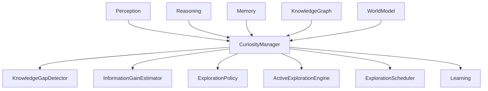
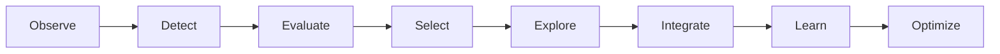

# RFC-0082

**Title:** Autonomous Cognitive Curiosity & Exploration Architecture

**Document ID:** RFC-0082

**Version:** 1.0

**Status:** Accepted

**Category:** Cognitive Architecture

**Layer:** Curiosity / Exploration / Information Acquisition

**Target:**

```text
curiosity/
```

---

# Abstract

This RFC defines the SH-3 Autonomous Cognitive Curiosity & Exploration Architecture (ACCEA).

The Autonomous Cognitive Curiosity & Exploration Architecture provides the intrinsic exploration layer responsible for identifying knowledge gaps, estimating information value, selecting exploration strategies, balancing exploration and exploitation, and autonomously acquiring new knowledge.

Within SH-3, curiosity is defined as an optimization process that maximizes expected long-term cognitive utility rather than as an emotional state.

The architecture governs:

- knowledge gap detection
- intrinsic curiosity estimation
- information gain estimation
- exploration strategy selection
- active information acquisition
- exploration scheduling
- curiosity learning
- exploration optimization

The system enables:

- autonomous knowledge acquisition
- efficient exploration
- adaptive curiosity
- explainable exploration policies
- lifelong autonomous learning

This document is normative.

---

# Motivation

Reasoning operates on existing knowledge.

Creativity generates new possibilities.

Learning improves models from experience.

A cognitive architecture additionally requires mechanisms capable of determining **what knowledge should be acquired next**.

Without curiosity:

- knowledge growth stagnates
- exploration becomes reactive
- uncertainty persists unnecessarily
- learning opportunities are missed
- autonomous discovery is limited

Curiosity enables proactive cognitive growth.

---

# Goals

The Autonomous Cognitive Curiosity & Exploration Architecture SHALL provide:

- autonomous exploration
- explainable curiosity estimation
- adaptive exploration policies
- information gain optimization
- balanced exploration and exploitation
- governance-aware exploration
- lifelong curiosity improvement

---

# Non-Goals

The architecture SHALL NOT:

- replace reasoning
- replace learning
- replace planning
- replace motivation
- bypass governance

Curiosity identifies learning opportunities rather than validating acquired knowledge.

---

# Architecture



---

# Design Principles

## Intrinsic Curiosity

Curiosity SHALL originate from internally detected knowledge opportunities.

---

## Information Maximization

Exploration SHALL maximize expected information gain.

---

## Adaptive Exploration

Exploration strategies SHALL continuously evolve.

---

## Explainability

Exploration decisions SHALL remain explainable.

---

## Resource Awareness

Exploration SHALL respect computational and operational budgets.

---

## Governance

Exploration SHALL comply with governance policies.

---

# Components

| Component | Responsibility |
|------------|----------------|
| CuriosityManager | Global coordination |
| KnowledgeGapDetector | Unknown identification |
| InformationGainEstimator | Expected value estimation |
| ExplorationPolicy | Strategy selection |
| ActiveExplorationEngine | Information acquisition |
| ExplorationScheduler | Exploration scheduling |
| CuriosityLearner | Policy improvement |

---

# Curiosity Context

Every exploration operation receives an immutable CuriosityContext.

CuriosityContext SHALL contain:

| Field | Description |
|------|-------------|
| curiosity_id | Operation identifier |
| active_goal | Current objective |
| uncertainty_profile | Current uncertainty |
| resource_budget | Available resources |
| exploration_constraints | Active constraints |
| timestamp | Evaluation time |

---

# Knowledge Gap

Every KnowledgeGap SHALL expose:

| Field | Description |
|------|-------------|
| gap_id | Unique identifier |
| domain | Knowledge domain |
| uncertainty | Estimated uncertainty |
| expected_information_gain | Predicted value |
| acquisition_cost | Estimated cost |
| provenance | Detection history |

Knowledge gaps SHALL remain measurable.

---

# Curiosity Lifecycle

Every curiosity cycle follows:

```text
Knowledge Assessment

↓

Gap Detection

↓

Information Gain Estimation

↓

Exploration Selection

↓

Information Acquisition

↓

Knowledge Integration

↓

Policy Learning
```

Curiosity SHALL continuously adapt throughout runtime.

---

# Knowledge Gap Detection

KnowledgeGapDetector identifies unknown or weakly supported knowledge.

Detection SHALL consider:

- missing concepts
- incomplete causal models
- inconsistent knowledge
- uncertain predictions
- unexplored environments
- unresolved hypotheses

Gap detection SHALL remain deterministic.

---

# Information Gain Estimation

InformationGainEstimator predicts exploration value.

Estimation SHALL consider:

- uncertainty reduction
- expected utility
- strategic importance
- future reuse
- exploration cost
- mission relevance

Information gain SHALL include confidence estimates.

---

# Exploration Policy

ExplorationPolicy selects exploration strategies.

Supported strategies include:

- active sensing
- targeted querying
- environmental exploration
- simulation-driven exploration
- hypothesis testing
- collaborative exploration

Strategy selection SHALL maximize long-term cognitive benefit.

---

# Autonomous Cognitive Curiosity & Exploration Execution Model

The Autonomous Cognitive Curiosity & Exploration Architecture (ACCEA) provides the intrinsic exploration engine responsible for autonomously identifying unknowns, estimating their value, selecting exploration strategies, acquiring new information, and continuously improving exploration efficiency.

Within SH-3, curiosity is implemented as an optimization process that maximizes expected long-term knowledge utility while minimizing unnecessary exploration cost and operational risk.

Curiosity operates continuously throughout the lifetime of the cognitive system.

The exploration lifecycle follows:



Each stage maintains an independent exploration responsibility.

---

# Cognitive Curiosity Control Loop

The CuriosityManager continuously supervises exploration.

```text
Knowledge Assessment

↓

Gap Identification

↓

Information Value Estimation

↓

Exploration Strategy Selection

↓

Knowledge Acquisition

↓

Knowledge Integration

↓

Exploration Learning

↓

Policy Optimization
```

Curiosity SHALL remain continuously available during runtime.

---

# Active Exploration Engine

ActiveExplorationEngine performs autonomous knowledge acquisition.

Supported exploration mechanisms include:

- active sensing
- targeted information retrieval
- environmental interaction
- simulation-based experimentation
- controlled probing
- collaborative exploration

Every exploration SHALL preserve provenance.

---

# Exploration Model

```text
Knowledge Gap

+

Exploration Policy

+

Operational Constraints

↓

Information Acquisition
```

---

# Exploration–Exploitation Balancing

The architecture SHALL dynamically balance:

- exploration
- exploitation

Balancing SHALL consider:

- uncertainty
- expected information gain
- operational urgency
- execution risk
- computational budget
- long-term utility

The exploration policy SHALL remain adaptive.

---

# Exploration Verification

Acquired information SHALL be verified whenever practical.

Verification SHALL include:

- consistency checking
- reasoning validation
- simulation validation
- historical comparison
- governance validation

Only verified knowledge SHALL be promoted into trusted semantic memory.

---

# Curiosity Learning

CuriosityLearner continuously improves exploration strategies.

Learning SHALL optimize:

- exploration efficiency
- acquisition quality
- policy selection
- information gain prediction
- exploration scheduling
- resource utilization

Learning SHALL preserve historical performance metrics.

---

# Curiosity Consistency

Curiosity SHALL preserve:

- exploration consistency
- policy consistency
- provenance consistency
- uncertainty consistency
- governance consistency

Equivalent cognitive states SHALL produce equivalent exploration behavior under deterministic execution.

---

# Exploration Knowledge Base

The architecture maintains reusable exploration assets including:

- exploration policies
- successful strategies
- information gain models
- acquisition heuristics
- exploration histories
- uncertainty models

Knowledge SHALL continuously evolve.

---

# Distributed Exploration

Multiple SH-3 nodes MAY cooperate during exploration.

Distributed exploration supports:

- federated sensing
- distributed querying
- collaborative experiments
- shared uncertainty reduction
- cooperative exploration planning

Each node SHALL preserve local governance authority.

---

# Human-Guided Exploration

The architecture supports collaborative exploration with human operators.

Human guidance MAY provide:

- exploration priorities
- domain expertise
- acquisition constraints
- evaluation feedback
- knowledge validation

Human contributions SHALL remain explicitly attributable.

---

# Consciousness Integration

Consciousness Coordination receives:

- active exploration tasks
- unresolved knowledge gaps
- uncertainty summaries
- exploration progress

---

# World Model Integration

World Model provides:

- environmental opportunities
- observable entities
- environmental dynamics
- exploration constraints

Exploration SHALL remain synchronized with World Model updates.

---

# Knowledge Graph Integration

Knowledge Graph provides:

- concept neighborhoods
- missing relationships
- semantic uncertainty
- graph expansion opportunities

Exploration SHALL leverage graph-based uncertainty analysis.

---

# Episodic & Semantic Memory Integration

Long-Term Memory provides:

- historical exploration outcomes
- prior failures
- reusable acquisition strategies
- learned heuristics

Exploration SHALL reuse historical knowledge whenever beneficial.

---

# Reasoning Integration

Reasoning provides:

- uncertainty estimation
- hypothesis prioritization
- consistency verification
- causal guidance

Reasoning SHALL assist exploration strategy selection.

---

# Creativity Integration

Creativity provides:

- exploratory hypotheses
- novel acquisition strategies
- alternative experiments
- innovative sensing approaches

Creative exploration SHALL remain distinguishable from verified knowledge acquisition.

---

# Goal Architecture Integration

Goal Architecture provides:

- mission priorities
- exploration objectives
- operational deadlines
- strategic constraints

Goal-directed exploration SHALL receive execution priority.

---

# Planning Integration

Planning receives:

- exploration tasks
- acquisition schedules
- information dependencies
- sensing plans

Planning SHALL coordinate exploration activities without altering exploration provenance.

---

# Decision Integration

Decision making receives:

- expected information gain
- exploration confidence
- acquisition costs
- uncertainty reduction estimates

---

# Executive Control Integration

Executive Control schedules:

- exploration tasks
- sensing operations
- distributed acquisition
- exploration optimization

Exploration SHALL remain coordinated with overall runtime workload.

---

# Learning Integration

Learning receives:

- exploration histories
- policy performance
- acquisition outcomes
- uncertainty reduction metrics

Learning SHALL continuously improve curiosity policies.

---

# Meta-Reasoning Integration

Meta-Reasoning evaluates:

- exploration effectiveness
- policy quality
- acquisition efficiency
- uncertainty reduction

---

# Self Evolution Integration

Self Evolution System receives:

- exploration metrics
- curiosity improvements
- policy evolution proposals
- architectural recommendations

---

# AI Safety Governance Integration

AI Safety Governance validates:

- exploration permissions
- acquisition policies
- external information sources
- autonomous sensing behavior

Exploration SHALL never bypass governance validation.

---

# Risk Management Integration

Risk Management evaluates:

- unsafe exploration
- excessive resource consumption
- unreliable information sources
- exploration uncertainty

Risk SHALL influence exploration scheduling and policy selection.

---

# Message Bus Integration

Curiosity events include:

- CuriosityStarted
- KnowledgeGapDetected
- ExplorationScheduled
- InformationAcquired
- ExplorationVerified
- KnowledgeIntegrated
- CuriosityLearned
- CuriosityCompleted

---

# Persistence Integration

Persistence stores:

- exploration history
- acquisition history
- policy history
- uncertainty models
- curiosity metrics

---

# Observability Integration

Curiosity telemetry includes:

- exploration latency
- information gain
- uncertainty reduction
- acquisition success rate
- exploration efficiency
- policy utilization
- curiosity throughput

---

# Tracing

Curiosity traces preserve:

- trace_id
- curiosity_id
- gap_id
- exploration_id
- acquisition_id
- verification_id
- policy_id

Every curiosity operation SHALL participate in distributed cognitive tracing.

---

# Thread Model

The Autonomous Cognitive Curiosity & Exploration Architecture supports concurrent:

- gap detection
- exploration scheduling
- information acquisition
- verification
- distributed exploration
- policy learning

Concurrent exploration operations SHALL preserve deterministic behavior when supplied with identical knowledge state, constraints, exploration budget, and runtime conditions.

The reference implementation SHALL be thread-safe, horizontally scalable, and lock-efficient.

---

# Metrics

The Autonomous Cognitive Curiosity & Exploration Architecture exposes:

- information gain rate
- uncertainty reduction rate
- exploration efficiency
- acquisition precision
- exploration reuse ratio
- policy convergence rate
- curiosity effectiveness

---

# Performance Objectives

The Autonomous Cognitive Curiosity & Exploration Architecture should optimize for:

- maximum useful information gain
- efficient uncertainty reduction
- adaptive exploration
- minimal unnecessary acquisition
- reusable exploration knowledge
- continuous curiosity improvement

---

# Future Work

Potential future enhancements include:

- predictive curiosity modeling
- autonomous scientific experimentation
- adaptive exploration personalities
- multi-agent curiosity markets
- hierarchical exploration planning
- lifelong curiosity profiling
- self-generating research roadmaps

These enhancements extend SH-3 toward a comprehensive curiosity architecture capable of autonomously identifying unknowns, optimizing exploration, maximizing information gain, and continuously expanding cognitive capability while remaining deterministic, explainable, governance-aware, and fully integrated with reasoning, creativity, planning, learning, memory, and self-evolution.

---

# References

- SH-3 Architecture Specification v2.1
- RFC-0027 Autonomous Learning System
- RFC-0050 Knowledge Governance System
- RFC-0053 AI Safety Governance System
- RFC-0062 Autonomous Meta-Reasoning Intelligence System
- RFC-0063 Autonomous Consciousness Coordination System
- RFC-0064 Unified Cognitive Memory Architecture
- RFC-0067 Autonomous Cognitive Operating System
- RFC-0068 Autonomous Multi-Agent Cognitive Architecture
- RFC-0069 Autonomous Cognitive Skill Architecture
- RFC-0070 Autonomous Cognitive Simulation Architecture
- RFC-0071 Autonomous Cognitive Knowledge Graph Architecture
- RFC-0072 Autonomous Cognitive Planning Architecture
- RFC-0073 Autonomous Cognitive Decision Architecture
- RFC-0074 Autonomous Cognitive Perception Architecture
- RFC-0075 Autonomous Cognitive Value & Motivation Architecture
- RFC-0076 Autonomous Cognitive Goal Architecture
- RFC-0077 Autonomous Cognitive Emotion & Affective Architecture
- RFC-0078 Autonomous Cognitive Executive Control Architecture
- RFC-0079 Autonomous Cognitive Episodic & Semantic Memory Architecture
- RFC-0080 Autonomous Cognitive Reasoning Architecture
- RFC-0081 Autonomous Cognitive Creativity & Hypothesis Generation Architecture

---

# End of RFC-0082
