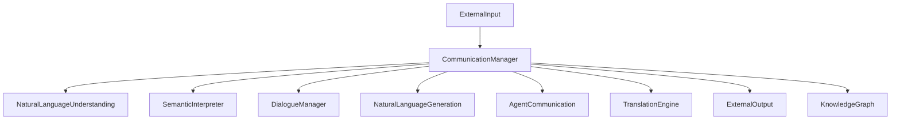
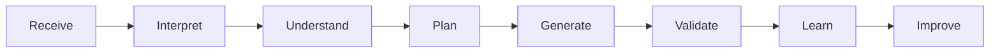

# RFC-0083

**Title:** Autonomous Cognitive Communication & Language Architecture

**Document ID:** RFC-0083

**Version:** 1.0

**Status:** Accepted

**Category:** Cognitive Architecture

**Layer:** Communication / Language / Cognitive Interaction

**Target:**

```text
communication/
```

---

# Abstract

This RFC defines the SH-3 Autonomous Cognitive Communication & Language Architecture (ACCLA).

The Autonomous Cognitive Communication & Language Architecture provides the communication layer responsible for transforming internal cognitive representations into understandable external communication while converting external communication into structured cognitive knowledge.

The architecture unifies:

- natural language understanding
- natural language generation
- dialogue management
- multi-agent communication
- structured cognitive messaging
- multilingual processing
- semantic interpretation
- communication learning

Communication is modeled as a bidirectional cognitive transformation between internal knowledge representations and external interaction.

The system enables:

- explainable communication
- adaptive dialogue
- multilingual interaction
- structured agent communication
- continuous communication improvement

This document is normative.

---

# Motivation

Perception interprets observations.

Reasoning derives conclusions.

Planning selects actions.

However, autonomous intelligence must also communicate effectively with humans, software systems, and other SH-3 agents.

Communication is therefore a first-class cognitive capability rather than a simple input/output function.

---

# Goals

The Autonomous Cognitive Communication & Language Architecture SHALL provide:

- bidirectional language processing
- explainable semantic interpretation
- adaptive dialogue management
- structured inter-agent communication
- multilingual support
- governance-aware communication
- lifelong communication improvement

---

# Non-Goals

The architecture SHALL NOT:

- replace reasoning
- replace memory
- replace planning
- replace executive control
- bypass governance

Communication SHALL express cognition rather than replace cognition.

---

# Architecture



---

# Design Principles

## Bidirectional Communication

Every external interaction SHALL support both understanding and generation.

---

## Semantic Fidelity

Internal cognitive meaning SHALL be preserved during transformation.

---

## Explainability

Communication decisions SHALL remain traceable.

---

## Context Awareness

Language understanding SHALL remain context-sensitive.

---

## Multilingual Consistency

Equivalent semantic meaning SHALL remain consistent across supported languages.

---

## Governance

Communication SHALL comply with governance policies.

---

# Components

| Component | Responsibility |
|------------|----------------|
| CommunicationManager | Global coordination |
| NaturalLanguageUnderstanding | Language interpretation |
| SemanticInterpreter | Meaning extraction |
| DialogueManager | Conversation management |
| NaturalLanguageGeneration | Language generation |
| AgentCommunication | Structured inter-agent messaging |
| TranslationEngine | Multilingual transformation |

---

# Communication Context

Every communication operation receives an immutable CommunicationContext.

CommunicationContext SHALL contain:

| Field | Description |
|------|-------------|
| communication_id | Operation identifier |
| conversation_id | Conversation identifier |
| participants | Communication participants |
| active_goal | Communication objective |
| language | Active language |
| timestamp | Operation time |

---

# Semantic Representation

Every semantic representation SHALL expose:

| Field | Description |
|------|-------------|
| semantic_id | Unique identifier |
| intent | Intended meaning |
| entities | Referenced concepts |
| relationships | Semantic relationships |
| confidence | Interpretation confidence |
| provenance | Transformation history |

Semantic representations SHALL remain language-independent.

---

# Communication Lifecycle

Every communication process follows:

```text
Input Reception

↓

Semantic Interpretation

↓

Context Integration

↓

Dialogue Planning

↓

Response Generation

↓

Output Validation

↓

Learning
```

Communication SHALL preserve semantic fidelity.

---

# Natural Language Understanding

NaturalLanguageUnderstanding converts external language into structured meaning.

Understanding SHALL support:

- intent recognition
- entity extraction
- contextual interpretation
- ambiguity resolution
- pragmatic interpretation
- discourse analysis

Interpretation SHALL preserve uncertainty estimates.

---

# Semantic Interpretation

SemanticInterpreter converts linguistic structures into cognitive representations.

Interpretation SHALL consider:

- semantic roles
- ontological concepts
- contextual references
- temporal expressions
- causal expressions
- uncertainty indicators

Semantic representations SHALL remain reusable across cognitive subsystems.

---

# Dialogue Manager

DialogueManager coordinates interactive communication.

Dialogue management SHALL support:

- multi-turn conversations
- clarification requests
- context preservation
- interruption handling
- cooperative dialogue
- goal-oriented interaction

Dialogue state SHALL remain deterministic.

---

# Autonomous Cognitive Communication & Language Execution Model

The Autonomous Cognitive Communication & Language Architecture (ACCLA) provides the unified communication engine responsible for transforming internal cognitive representations into human- and machine-understandable communication while converting external communication into structured cognitive knowledge.

Communication within SH-3 is modeled as a bidirectional semantic transformation process that preserves intent, context, provenance, uncertainty, and governance compliance across every interaction.

The communication lifecycle follows:



Each stage performs an independent communication responsibility.

---

# Cognitive Communication Control Loop

The CommunicationManager continuously supervises communication.

```text
Input Reception

↓

Language Understanding

↓

Semantic Interpretation

↓

Dialogue Planning

↓

Language Generation

↓

Communication Validation

↓

Interaction Learning

↓

Communication Optimization
```

Communication SHALL remain continuously available throughout runtime.

---

# Natural Language Generation

NaturalLanguageGeneration transforms internal cognitive representations into natural language.

Generation SHALL support:

- explanation generation
- procedural instruction
- summarization
- question answering
- collaborative dialogue
- report generation
- technical communication

Generated language SHALL preserve semantic intent.

---

# Language Generation Model

```text
Semantic Representation

+

Dialogue Context

+

Communication Goal

↓

Natural Language Response
```

---

# Agent Communication

AgentCommunication enables structured communication between autonomous SH-3 agents.

Supported message categories include:

- task delegation
- capability discovery
- negotiation
- coordination
- synchronization
- knowledge exchange
- status reporting

Agent communication SHALL remain language-independent.

---

# Agent Message Structure

Every inter-agent message SHALL expose:

| Field | Description |
|------|-------------|
| message_id | Unique identifier |
| sender | Originating agent |
| receiver | Destination agent |
| intent | Communication objective |
| payload | Structured semantic content |
| provenance | Communication trace |

Messages SHALL remain immutable after transmission.

---

# Translation Engine

TranslationEngine provides multilingual communication.

Translation SHALL preserve:

- semantic meaning
- contextual references
- domain terminology
- uncertainty expressions
- temporal relationships
- logical consistency

Equivalent meanings SHALL remain semantically consistent across languages.

---

# Communication Verification

Every communication output SHALL be verified whenever practical.

Verification SHALL include:

- semantic consistency
- contextual consistency
- governance validation
- terminology validation
- ambiguity detection
- completeness checking

Verified communication SHALL receive increased confidence.

---

# Communication Consistency

Communication SHALL preserve:

- semantic consistency
- dialogue consistency
- multilingual consistency
- provenance consistency
- governance consistency

Equivalent semantic inputs SHALL produce equivalent communication outputs under deterministic execution.

---

# Communication Knowledge Base

The architecture maintains reusable communication assets including:

- dialogue templates
- semantic mappings
- terminology dictionaries
- translation memories
- communication policies
- interaction histories

Communication knowledge SHALL continuously evolve.

---

# Distributed Communication

Multiple SH-3 nodes MAY cooperate through distributed communication.

Distributed communication supports:

- federated dialogue
- distributed negotiation
- collaborative reporting
- semantic synchronization
- cross-agent coordination

Each participating node SHALL preserve local governance authority.

---

# Human–AI Collaboration

The architecture supports continuous collaboration with human operators.

Collaboration supports:

- interactive dialogue
- collaborative planning
- clarification exchanges
- explanation requests
- cooperative problem solving
- knowledge acquisition

Human interactions SHALL remain attributable and auditable.

---

# Consciousness Integration

Consciousness Coordination receives:

- dialogue summaries
- interaction objectives
- communication priorities
- conversation state

---

# World Model Integration

World Model provides:

- environmental context
- situational awareness
- participant state
- communication constraints

Communication SHALL remain synchronized with environmental context.

---

# Knowledge Graph Integration

Knowledge Graph provides:

- semantic concepts
- entity relationships
- terminology mappings
- ontology references

Communication SHALL leverage semantic graph knowledge.

---

# Episodic & Semantic Memory Integration

Long-Term Memory provides:

- dialogue history
- user preferences
- terminology usage
- historical interactions

Communication SHALL reuse relevant historical knowledge whenever appropriate.

---

# Reasoning Integration

Reasoning provides:

- semantic inference
- ambiguity resolution
- logical validation
- explanation generation

Reasoning SHALL support communication quality.

---

# Creativity Integration

Creativity provides:

- alternative explanations
- adaptive phrasing
- communication strategies
- educational analogies

Creative language generation SHALL remain distinguishable from factual communication.

---

# Curiosity Integration

Curiosity provides:

- clarification objectives
- missing information detection
- follow-up question generation
- information acquisition priorities

Communication SHALL support active knowledge acquisition.

---

# Goal Architecture Integration

Goal Architecture provides:

- communication objectives
- priority ordering
- interaction constraints
- mission alignment

Goal-directed communication SHALL receive execution priority.

---

# Planning Integration

Planning receives:

- interaction plans
- communication dependencies
- coordination schedules
- dialogue objectives

Planning SHALL coordinate communication activities without modifying semantic provenance.

---

# Decision Integration

Decision making receives:

- interpreted intent
- communication confidence
- clarification requirements
- dialogue outcomes

---

# Executive Control Integration

Executive Control schedules:

- dialogue execution
- agent messaging
- translation tasks
- communication optimization

Communication SHALL remain coordinated with overall runtime execution.

---

# Learning Integration

Learning receives:

- interaction histories
- user feedback
- translation quality
- dialogue performance

Learning SHALL continuously improve communication quality.

---

# Meta-Reasoning Integration

Meta-Reasoning evaluates:

- communication effectiveness
- semantic accuracy
- dialogue quality
- interaction efficiency

---

# Self Evolution Integration

Self Evolution System receives:

- communication metrics
- language optimization proposals
- dialogue improvements
- architectural evolution opportunities

---

# AI Safety Governance Integration

AI Safety Governance validates:

- communication policies
- external messaging
- multilingual transformations
- information disclosure

Communication SHALL never bypass governance validation.

---

# Risk Management Integration

Risk Management evaluates:

- semantic ambiguity
- misinformation risk
- communication failure
- unintended disclosure

Risk SHALL influence communication strategy selection.

---

# Message Bus Integration

Communication events include:

- CommunicationStarted
- IntentRecognized
- SemanticParsed
- DialoguePlanned
- ResponseGenerated
- TranslationCompleted
- CommunicationVerified
- CommunicationCompleted

---

# Persistence Integration

Persistence stores:

- dialogue history
- semantic representations
- translation history
- communication metrics
- interaction summaries

---

# Observability Integration

Communication telemetry includes:

- interpretation latency
- generation latency
- translation quality
- dialogue completion rate
- clarification frequency
- semantic consistency
- communication throughput

---

# Tracing

Communication traces preserve:

- trace_id
- communication_id
- dialogue_id
- semantic_id
- translation_id
- message_id
- verification_id

Every communication operation SHALL participate in distributed cognitive tracing.

---

# Thread Model

The Autonomous Cognitive Communication & Language Architecture supports concurrent:

- language understanding
- semantic interpretation
- dialogue management
- language generation
- translation
- inter-agent messaging

Concurrent communication operations SHALL preserve deterministic behavior when supplied with identical semantic input, dialogue state, governance policies, and runtime conditions.

The reference implementation SHALL be thread-safe, horizontally scalable, and lock-efficient.

---

# Metrics

The Autonomous Cognitive Communication & Language Architecture exposes:

- semantic interpretation accuracy
- response generation latency
- dialogue completion rate
- translation consistency
- communication success rate
- clarification ratio
- multilingual coverage

---

# Performance Objectives

The Autonomous Cognitive Communication & Language Architecture should optimize for:

- semantic fidelity
- efficient interaction
- low communication latency
- multilingual consistency
- explainable dialogue
- continuous communication improvement

---

# Future Work

Potential future enhancements include:

- multimodal communication
- emotionally adaptive communication
- real-time collaborative reasoning dialogue
- autonomous negotiation frameworks
- culturally adaptive language generation
- self-organizing communication protocols
- planetary-scale federated communication networks

These enhancements extend SH-3 toward a comprehensive communication architecture capable of supporting humans, autonomous agents, external systems, and distributed cognitive networks through explainable, multilingual, semantically consistent, and governance-aware communication tightly integrated with every major cognitive subsystem.

---

# References

- SH-3 Architecture Specification v2.1
- RFC-0027 Autonomous Learning System
- RFC-0050 Knowledge Governance System
- RFC-0053 AI Safety Governance System
- RFC-0062 Autonomous Meta-Reasoning Intelligence System
- RFC-0063 Autonomous Consciousness Coordination System
- RFC-0064 Unified Cognitive Memory Architecture
- RFC-0067 Autonomous Cognitive Operating System
- RFC-0068 Autonomous Multi-Agent Cognitive Architecture
- RFC-0069 Autonomous Cognitive Skill Architecture
- RFC-0070 Autonomous Cognitive Simulation Architecture
- RFC-0071 Autonomous Cognitive Knowledge Graph Architecture
- RFC-0072 Autonomous Cognitive Planning Architecture
- RFC-0073 Autonomous Cognitive Decision Architecture
- RFC-0074 Autonomous Cognitive Perception Architecture
- RFC-0075 Autonomous Cognitive Value & Motivation Architecture
- RFC-0076 Autonomous Cognitive Goal Architecture
- RFC-0077 Autonomous Cognitive Emotion & Affective Architecture
- RFC-0078 Autonomous Cognitive Executive Control Architecture
- RFC-0079 Autonomous Cognitive Episodic & Semantic Memory Architecture
- RFC-0080 Autonomous Cognitive Reasoning Architecture
- RFC-0081 Autonomous Cognitive Creativity & Hypothesis Generation Architecture
- RFC-0082 Autonomous Cognitive Curiosity & Exploration Architecture

---

# End of RFC-0083
