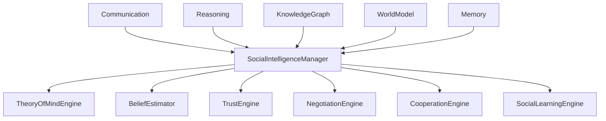
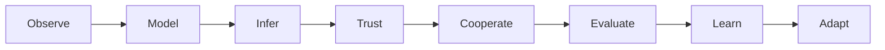

# RFC-0084

**Title:** Autonomous Cognitive Social Intelligence Architecture

**Document ID:** RFC-0084

**Version:** 1.0

**Status:** Accepted

**Category:** Cognitive Architecture

**Layer:** Social Intelligence / Theory of Mind / Cooperative Cognition

**Target:**

```text
social_intelligence/
```

---

# Abstract

This RFC defines the SH-3 Autonomous Cognitive Social Intelligence Architecture (ACSIA).

The Autonomous Cognitive Social Intelligence Architecture provides the social cognition layer responsible for modeling other agents, understanding intentions, estimating beliefs, coordinating collaborative behavior, negotiating objectives, establishing trust, and adapting behavior within multi-agent and human-agent environments.

Within SH-3, social intelligence is defined as the capability to reason about autonomous entities while maintaining explainability, governance compliance, and cooperative efficiency.

The architecture governs:

- theory of mind
- agent modeling
- intention recognition
- belief estimation
- trust modeling
- cooperative planning
- negotiation
- social learning

The system enables:

- explainable social reasoning
- adaptive cooperation
- distributed teamwork
- autonomous negotiation
- lifelong social learning

This document is normative.

---

# Motivation

Communication exchanges information.

Reasoning derives conclusions.

Planning selects actions.

However, effective autonomous systems must also understand that other agents possess:

- independent goals
- private knowledge
- beliefs
- intentions
- capabilities
- constraints

Social intelligence allows SH-3 to predict, coordinate, negotiate, and cooperate with autonomous entities while maintaining safe and explainable behavior.

---

# Goals

The Autonomous Cognitive Social Intelligence Architecture SHALL provide:

- autonomous agent modeling
- explainable intention recognition
- adaptive trust estimation
- cooperative reasoning
- negotiation support
- governance-aware collaboration
- lifelong social adaptation

---

# Non-Goals

The architecture SHALL NOT:

- replace communication
- replace planning
- replace reasoning
- replace governance
- bypass safety policies

Social intelligence augments cognition rather than replacing cognitive subsystems.

---

# Architecture



---

# Design Principles

## Theory of Mind

Every autonomous entity SHALL be represented as an independent cognitive model.

---

## Explainable Social Reasoning

Social conclusions SHALL preserve complete provenance.

---

## Cooperative Optimization

Cooperation SHALL maximize collective objective achievement whenever governance permits.

---

## Adaptive Trust

Trust SHALL evolve according to observed behavior.

---

## Context Awareness

Social reasoning SHALL remain context-sensitive.

---

## Governance

Social interactions SHALL comply with governance policies.

---

# Components

| Component | Responsibility |
|------------|----------------|
| SocialIntelligenceManager | Global coordination |
| TheoryOfMindEngine | Agent cognitive modeling |
| BeliefEstimator | Belief inference |
| TrustEngine | Trust estimation |
| NegotiationEngine | Objective negotiation |
| CooperationEngine | Collaborative coordination |
| SocialLearningEngine | Social adaptation |

---

# Social Context

Every social operation receives an immutable SocialContext.

SocialContext SHALL contain:

| Field | Description |
|------|-------------|
| social_id | Operation identifier |
| participants | Participating entities |
| interaction_goal | Social objective |
| environment | Social environment |
| governance_constraints | Active policies |
| timestamp | Evaluation time |

---

# Agent Model

Every modeled agent SHALL expose:

| Field | Description |
|------|-------------|
| agent_id | Unique identifier |
| estimated_goals | Predicted objectives |
| estimated_beliefs | Predicted beliefs |
| estimated_capabilities | Predicted capabilities |
| trust_score | Current trust estimate |
| provenance | Modeling history |

Agent models SHALL remain continuously updateable.

---

# Social Lifecycle

Every social reasoning cycle follows:

```text
Agent Observation

↓

Agent Modeling

↓

Belief Estimation

↓

Intention Recognition

↓

Cooperation / Negotiation

↓

Interaction Evaluation

↓

Social Learning
```

Social reasoning SHALL preserve traceability.

---

# Theory of Mind

TheoryOfMindEngine constructs cognitive models of other agents.

Modeling SHALL estimate:

- goals
- intentions
- beliefs
- preferences
- capabilities
- expected behavior

Theory of Mind SHALL remain probabilistic rather than absolute.

---

# Belief Estimation

BeliefEstimator predicts the knowledge state of other agents.

Belief estimation SHALL consider:

- observed behavior
- communication history
- environmental context
- prior interactions
- uncertainty
- information asymmetry

Estimated beliefs SHALL include confidence values.

---

# Trust Modeling

TrustEngine continuously estimates trustworthiness.

Trust SHALL evolve using:

- interaction outcomes
- consistency
- reliability
- honesty
- cooperation quality
- governance compliance

Trust SHALL never be binary.

---

# Autonomous Cognitive Social Intelligence Execution Model

The Autonomous Cognitive Social Intelligence Architecture (ACSIA) provides the social cognition engine responsible for understanding autonomous entities, estimating intentions and beliefs, establishing trust, coordinating cooperation, negotiating objectives, resolving conflicts, and continuously improving collaborative intelligence.

Within SH-3, social intelligence is treated as an explainable cognitive process operating across human-agent, agent-agent, and multi-agent environments.

Every social inference SHALL preserve provenance, uncertainty, and governance compliance.

The social cognition lifecycle follows:



Each stage performs an independent social reasoning responsibility.

---

# Cognitive Social Control Loop

The SocialIntelligenceManager continuously supervises social cognition.

```text
Agent Observation

↓

Theory of Mind Modeling

↓

Belief Estimation

↓

Trust Evaluation

↓

Negotiation & Cooperation

↓

Interaction Evaluation

↓

Social Learning

↓

Relationship Evolution
```

Social cognition SHALL remain continuously available during runtime.

---

# Negotiation Engine

NegotiationEngine coordinates objective alignment among autonomous entities.

Negotiation SHALL support:

- task allocation
- resource negotiation
- priority reconciliation
- schedule coordination
- conflict resolution
- consensus building

Negotiation SHALL preserve complete interaction history.

---

# Negotiation Model

```text
Participant Goals

+

Operational Constraints

+

Trust Estimates

↓

Negotiated Agreement
```

---

# Cooperation Engine

CooperationEngine coordinates collaborative execution.

Cooperation SHALL support:

- distributed planning
- cooperative execution
- capability sharing
- workload balancing
- dependency management
- synchronized completion

Cooperation SHALL maximize collective utility while respecting governance constraints.

---

# Social Conflict Resolution

Conflicting objectives SHALL be resolved using:

- priority analysis
- policy evaluation
- negotiation
- consensus mechanisms
- arbitration
- governance rules

Conflict resolution SHALL remain explainable.

---

# Social Learning

SocialLearningEngine continuously improves social behavior.

Learning SHALL optimize:

- trust estimation
- negotiation strategies
- collaboration efficiency
- communication quality
- interaction prediction
- coordination effectiveness

Learning SHALL preserve interaction history.

---

# Relationship Management

Relationships SHALL evolve dynamically.

Relationship attributes include:

- familiarity
- cooperation frequency
- historical reliability
- expertise estimation
- communication efficiency
- strategic importance

Relationship evolution SHALL remain evidence-based.

---

# Social Consistency

Social cognition SHALL preserve:

- behavioral consistency
- trust consistency
- interaction consistency
- provenance consistency
- governance consistency

Equivalent interaction histories SHALL produce equivalent relationship states.

---

# Social Knowledge Base

The architecture maintains reusable social assets including:

- interaction histories
- trust models
- negotiation patterns
- collaboration strategies
- relationship graphs
- organizational structures

Social knowledge SHALL continuously evolve.

---

# Distributed Multi-Agent Coordination

Multiple SH-3 nodes MAY cooperate through distributed cognition.

Distributed coordination supports:

- distributed planning
- cooperative reasoning
- consensus formation
- federated decision support
- shared situational awareness

Each participating node SHALL preserve local governance authority.

---

# Human–AI Collaboration

The architecture supports long-term collaboration with human operators.

Collaboration SHALL support:

- shared planning
- interactive decision support
- cooperative execution
- knowledge exchange
- adaptive assistance
- expertise transfer

Human contributions SHALL remain explicitly attributable.

---

# Consciousness Integration

Consciousness Coordination receives:

- interaction priorities
- relationship summaries
- trust state
- collaboration objectives

---

# World Model Integration

World Model provides:

- environmental context
- organizational structure
- participant locations
- environmental constraints

Social reasoning SHALL remain synchronized with environmental state.

---

# Knowledge Graph Integration

Knowledge Graph provides:

- relationship graphs
- organizational ontologies
- capability mappings
- historical interaction links

Social cognition SHALL leverage graph semantics.

---

# Episodic & Semantic Memory Integration

Long-Term Memory provides:

- interaction history
- negotiation outcomes
- successful collaborations
- historical trust evolution

Social reasoning SHALL exploit accumulated experience.

---

# Reasoning Integration

Reasoning provides:

- intention inference
- consistency validation
- causal analysis
- uncertainty estimation

Reasoning SHALL support social prediction.

---

# Creativity Integration

Creativity provides:

- negotiation alternatives
- cooperative strategies
- innovative agreements
- conflict resolution ideas

Creative proposals SHALL remain distinguishable from verified agreements.

---

# Curiosity Integration

Curiosity provides:

- missing social information
- clarification objectives
- relationship exploration
- capability discovery

Social cognition SHALL support active relationship learning.

---

# Communication Integration

Communication provides:

- dialogue interpretation
- semantic messaging
- multilingual interaction
- structured agent messaging

Communication SHALL remain the primary interaction channel.

---

# Goal Architecture Integration

Goal Architecture provides:

- cooperative objectives
- organizational priorities
- mission alignment
- collaboration constraints

Social coordination SHALL prioritize shared mission success.

---

# Planning Integration

Planning receives:

- negotiated plans
- cooperative schedules
- distributed task assignments
- dependency structures

Planning SHALL coordinate collaborative execution without altering social provenance.

---

# Decision Integration

Decision making receives:

- trust estimates
- negotiation outcomes
- cooperation recommendations
- consensus confidence

---

# Executive Control Integration

Executive Control schedules:

- negotiation sessions
- cooperation activities
- trust updates
- distributed coordination

Social cognition SHALL remain coordinated with runtime execution.

---

# Learning Integration

Learning receives:

- interaction histories
- negotiation metrics
- cooperation outcomes
- trust evolution

Learning SHALL continuously improve social intelligence.

---

# Meta-Reasoning Integration

Meta-Reasoning evaluates:

- cooperation quality
- negotiation effectiveness
- trust calibration
- relationship evolution

---

# Self Evolution Integration

Self Evolution System receives:

- social metrics
- collaboration improvements
- negotiation optimizations
- architectural evolution proposals

---

# AI Safety Governance Integration

AI Safety Governance validates:

- cooperation policies
- negotiation authority
- information disclosure
- autonomous commitments

Social cognition SHALL never bypass governance validation.

---

# Risk Management Integration

Risk Management evaluates:

- malicious behavior
- trust degradation
- coordination failure
- negotiation deadlock
- information leakage

Risk SHALL influence collaboration strategy selection.

---

# Message Bus Integration

Social events include:

- AgentObserved
- TheoryOfMindUpdated
- TrustEvaluated
- NegotiationStarted
- AgreementReached
- CooperationStarted
- InteractionEvaluated
- SocialLearningCompleted

---

# Persistence Integration

Persistence stores:

- interaction history
- trust evolution
- negotiation history
- cooperation history
- relationship graphs

---

# Observability Integration

Social telemetry includes:

- cooperation efficiency
- negotiation latency
- trust stability
- collaboration success rate
- relationship growth
- conflict resolution rate
- social throughput

---

# Tracing

Social traces preserve:

- trace_id
- social_id
- interaction_id
- negotiation_id
- cooperation_id
- trust_id
- relationship_id

Every social operation SHALL participate in distributed cognitive tracing.

---

# Thread Model

The Autonomous Cognitive Social Intelligence Architecture supports concurrent:

- agent modeling
- trust estimation
- negotiation
- cooperative planning
- distributed coordination
- relationship learning

Concurrent social operations SHALL preserve deterministic behavior when supplied with identical interaction histories, governance policies, and runtime state.

The reference implementation SHALL be thread-safe, horizontally scalable, and lock-efficient.

---

# Metrics

The Autonomous Cognitive Social Intelligence Architecture exposes:

- cooperation success rate
- trust prediction accuracy
- negotiation efficiency
- conflict resolution rate
- collaboration throughput
- relationship stability
- distributed coordination efficiency

---

# Performance Objectives

The Autonomous Cognitive Social Intelligence Architecture should optimize for:

- effective cooperation
- accurate trust estimation
- efficient negotiation
- explainable social reasoning
- adaptive collaboration
- continuous social learning

---

# Future Work

Potential future enhancements include:

- hierarchical organizational reasoning
- autonomous institution formation
- adaptive social norm learning
- large-scale federated societies
- reputation economy models
- collective intelligence optimization
- self-organizing cognitive ecosystems

These enhancements extend SH-3 toward a comprehensive social cognition architecture capable of understanding, predicting, coordinating, and continuously improving interactions among humans and autonomous agents while remaining deterministic, explainable, governance-aware, and fully integrated with reasoning, communication, planning, learning, executive control, and self-evolution.

---

# References

- SH-3 Architecture Specification v2.1
- RFC-0027 Autonomous Learning System
- RFC-0050 Knowledge Governance System
- RFC-0053 AI Safety Governance System
- RFC-0062 Autonomous Meta-Reasoning Intelligence System
- RFC-0063 Autonomous Consciousness Coordination System
- RFC-0064 Unified Cognitive Memory Architecture
- RFC-0067 Autonomous Cognitive Operating System
- RFC-0068 Autonomous Multi-Agent Cognitive Architecture
- RFC-0069 Autonomous Cognitive Skill Architecture
- RFC-0070 Autonomous Cognitive Simulation Architecture
- RFC-0071 Autonomous Cognitive Knowledge Graph Architecture
- RFC-0072 Autonomous Cognitive Planning Architecture
- RFC-0073 Autonomous Cognitive Decision Architecture
- RFC-0074 Autonomous Cognitive Perception Architecture
- RFC-0075 Autonomous Cognitive Value & Motivation Architecture
- RFC-0076 Autonomous Cognitive Goal Architecture
- RFC-0077 Autonomous Cognitive Emotion & Affective Architecture
- RFC-0078 Autonomous Cognitive Executive Control Architecture
- RFC-0079 Autonomous Cognitive Episodic & Semantic Memory Architecture
- RFC-0080 Autonomous Cognitive Reasoning Architecture
- RFC-0081 Autonomous Cognitive Creativity & Hypothesis Generation Architecture
- RFC-0082 Autonomous Cognitive Curiosity & Exploration Architecture
- RFC-0083 Autonomous Cognitive Communication & Language Architecture

---

# End of RFC-0084
