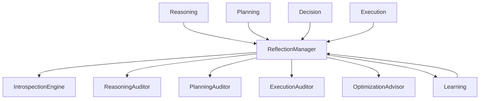

# RFC-0085

**Title:** Autonomous Cognitive Self-Reflection & Introspection Architecture

**Document ID:** RFC-0085

**Version:** 1.0

**Status:** Accepted

**Category:** Cognitive Architecture

**Layer:** Self-Reflection / Introspection / Cognitive Self-Monitoring

**Target:**

```text
self_reflection/
```

---

# Abstract

This RFC defines the SH-3 Autonomous Cognitive Self-Reflection & Introspection Architecture (ACSRIA).

The Autonomous Cognitive Self-Reflection & Introspection Architecture provides the metacognitive layer responsible for continuously observing, evaluating, explaining, and improving the system's own cognitive processes.

Unlike ordinary reasoning, which operates on external problems, self-reflection operates on the system itself.

The architecture governs:

- cognitive self-observation
- execution monitoring
- reasoning evaluation
- planning evaluation
- decision auditing
- learning assessment
- introspective explanation
- cognitive optimization

The system enables:

- explainable self-analysis
- autonomous cognitive optimization
- adaptive self-improvement
- continuous performance assessment
- governance-aware introspection

This document is normative.

---

# Motivation

Reasoning solves problems.

Learning improves knowledge.

Self Evolution modifies architecture.

However, an autonomous cognitive system additionally requires mechanisms capable of understanding **how well it is thinking**.

Without introspection:

- reasoning quality cannot be measured
- systematic failures persist
- inefficient strategies remain undetected
- self-improvement becomes reactive
- cognitive transparency decreases

Self-reflection enables continuous cognitive refinement.

---

# Goals

The Autonomous Cognitive Self-Reflection & Introspection Architecture SHALL provide:

- autonomous self-observation
- explainable cognitive evaluation
- adaptive optimization
- reasoning assessment
- execution auditing
- governance-aware introspection
- lifelong metacognitive improvement

---

# Non-Goals

The architecture SHALL NOT:

- replace reasoning
- replace learning
- replace governance
- replace planning
- directly modify cognition without validation

Reflection evaluates cognition rather than executing cognition.

---

# Architecture



---

# Design Principles

## Continuous Observation

Every significant cognitive activity SHALL be observable.

---

## Explainable Reflection

Every reflective conclusion SHALL preserve complete provenance.

---

## Separation of Evaluation and Execution

Reflection SHALL evaluate cognition without directly modifying runtime execution.

---

## Adaptive Optimization

Optimization proposals SHALL evolve from accumulated evidence.

---

## Deterministic Evaluation

Equivalent execution histories SHALL produce equivalent reflective conclusions.

---

## Governance

Reflection SHALL remain subject to governance policies.

---

# Components

| Component | Responsibility |
|------------|----------------|
| ReflectionManager | Global coordination |
| IntrospectionEngine | Cognitive observation |
| ReasoningAuditor | Reasoning assessment |
| PlanningAuditor | Planning evaluation |
| ExecutionAuditor | Runtime evaluation |
| OptimizationAdvisor | Improvement recommendation |
| ReflectionLearner | Reflective policy improvement |

---

# Reflection Context

Every reflective operation receives an immutable ReflectionContext.

ReflectionContext SHALL contain:

| Field | Description |
|------|-------------|
| reflection_id | Operation identifier |
| cognitive_scope | Evaluated subsystem |
| execution_history | Historical evidence |
| evaluation_constraints | Active constraints |
| governance_state | Active governance |
| timestamp | Evaluation time |

---

# Cognitive Observation

Every observed cognitive event SHALL expose:

| Field | Description |
|------|-------------|
| observation_id | Unique identifier |
| subsystem | Originating subsystem |
| event_type | Observed activity |
| performance | Measured performance |
| confidence | Observation confidence |
| provenance | Observation history |

Observations SHALL remain immutable.

---

# Reflection Lifecycle

Every reflection cycle follows:

```text
Observation

↓

Evidence Collection

↓

Performance Analysis

↓

Explanation

↓

Optimization Proposal

↓

Validation

↓

Learning
```

Reflection SHALL preserve complete traceability.

---

# Introspection Engine

IntrospectionEngine continuously observes cognitive activity.

Observation SHALL include:

- reasoning behavior
- planning behavior
- execution behavior
- communication behavior
- learning behavior
- resource utilization

Observation SHALL remain minimally intrusive.

---

# Reasoning Auditor

ReasoningAuditor evaluates reasoning quality.

Evaluation SHALL consider:

- logical consistency
- inference quality
- uncertainty calibration
- explanation quality
- efficiency
- reproducibility

Reasoning assessment SHALL remain deterministic.

---

# Planning Auditor

PlanningAuditor evaluates generated plans.

Evaluation SHALL consider:

- feasibility
- robustness
- execution success
- adaptability
- efficiency
- resource utilization

Planning assessments SHALL preserve historical evidence.

---

# Autonomous Cognitive Self-Reflection & Introspection Execution Model

The Autonomous Cognitive Self-Reflection & Introspection Architecture (ACSRIA) provides the metacognitive execution engine responsible for continuously observing, auditing, explaining, and improving the operation of every cognitive subsystem within SH-3.

Self-reflection is implemented as a continuous evidence-driven evaluation process that measures cognitive quality, detects improvement opportunities, and recommends validated optimizations without directly modifying runtime execution.

All reflective conclusions SHALL preserve provenance, uncertainty estimates, and governance compliance.

The reflective lifecycle follows:


Each stage performs an independent metacognitive responsibility.

---

# Cognitive Reflection Control Loop

The ReflectionManager continuously supervises introspection.

```text
Runtime Observation

↓

Evidence Aggregation

↓

Performance Evaluation

↓

Explanation Generation

↓

Optimization Recommendation

↓

Governance Validation

↓

Reflective Learning

↓

Policy Evolution
```

Reflection SHALL remain continuously available throughout system execution.

---

# Execution Auditor

ExecutionAuditor evaluates runtime execution quality.

Evaluation SHALL include:

- execution correctness
- latency
- resource efficiency
- failure recovery
- policy compliance
- deterministic behavior

Execution SHALL be evaluated independently from planning quality.

---

# Optimization Advisor

OptimizationAdvisor generates evidence-based improvement proposals.

Optimization SHALL support:

- reasoning refinement
- planning refinement
- scheduling optimization
- memory optimization
- communication optimization
- learning optimization
- execution optimization

Optimization proposals SHALL never bypass governance validation.

---

# Optimization Model

```text
Observed Performance

+

Historical Evidence

+

Optimization Policies

↓

Validated Recommendation
```

---

# Reflection Verification

Reflective recommendations SHALL be verified before adoption.

Verification SHALL include:

- evidence consistency
- reproducibility
- policy compliance
- expected benefit
- implementation feasibility
- regression analysis

Only validated recommendations MAY be forwarded to Self Evolution.

---

# Reflection Learning

ReflectionLearner continuously improves reflective quality.

Learning SHALL optimize:

- evaluation accuracy
- anomaly detection
- optimization precision
- explanation quality
- recommendation effectiveness
- evidence weighting

Learning SHALL preserve historical reflective performance.

---

# Reflection Consistency

Reflection SHALL preserve:

- observational consistency
- evaluation consistency
- provenance consistency
- governance consistency
- optimization consistency

Equivalent execution histories SHALL produce equivalent reflective outcomes under deterministic execution.

---

# Reflective Knowledge Base

The architecture maintains reusable reflective assets including:

- evaluation heuristics
- optimization policies
- historical audits
- anomaly patterns
- performance baselines
- explanation templates

Reflective knowledge SHALL continuously evolve.

---

# Distributed Introspection

Multiple SH-3 nodes MAY cooperate during reflective analysis.

Distributed introspection supports:

- federated performance analysis
- cross-node auditing
- distributed anomaly detection
- shared optimization knowledge
- collaborative benchmarking

Each participating node SHALL preserve local governance authority.

---

# Human-in-the-Loop Reflection

The architecture supports reflective collaboration with human operators.

Human participation MAY provide:

- expert evaluation
- optimization approval
- reflective feedback
- explanation review
- governance guidance

Human contributions SHALL remain explicitly attributable.

---

# Consciousness Integration

Consciousness Coordination receives:

- reflection summaries
- optimization priorities
- anomaly notifications
- cognitive health indicators

---

# World Model Integration

World Model provides:

- environmental context
- operational conditions
- execution constraints
- contextual performance expectations

Reflection SHALL remain synchronized with environmental conditions.

---

# Knowledge Graph Integration

Knowledge Graph provides:

- subsystem relationships
- dependency graphs
- causal structures
- optimization knowledge

Reflection SHALL exploit graph-based dependency analysis.

---

# Episodic & Semantic Memory Integration

Long-Term Memory provides:

- execution history
- historical audits
- successful optimizations
- recurring anomalies

Reflection SHALL exploit accumulated operational knowledge.

---

# Reasoning Integration

Reasoning provides:

- causal explanations
- logical consistency analysis
- uncertainty estimation
- hypothesis validation

Reasoning SHALL support reflective interpretation.

---

# Creativity Integration

Creativity provides:

- optimization alternatives
- novel improvement strategies
- adaptive explanations
- architectural alternatives

Creative proposals SHALL remain distinguishable from validated recommendations.

---

# Curiosity Integration

Curiosity provides:

- unexplored optimization opportunities
- missing diagnostic information
- additional evidence acquisition
- experimental evaluation priorities

Reflection SHALL support active self-discovery.

---

# Communication Integration

Communication provides:

- reflective reports
- diagnostic explanations
- optimization summaries
- collaborative review

Communication SHALL preserve semantic fidelity.

---

# Social Intelligence Integration

Social Intelligence provides:

- collaborative benchmarking
- peer comparison
- distributed evaluation
- cooperative optimization

Social reasoning SHALL assist reflective improvement.

---

# Goal Architecture Integration

Goal Architecture provides:

- optimization objectives
- performance priorities
- operational constraints
- mission alignment

Goal-directed optimization SHALL receive execution priority.

---

# Planning Integration

Planning receives:

- validated optimization recommendations
- execution refinements
- scheduling improvements
- dependency analyses

Planning SHALL evaluate optimization proposals before execution.

---

# Decision Integration

Decision making receives:

- optimization confidence
- reflective assessments
- anomaly severity
- implementation recommendations

---

# Executive Control Integration

Executive Control schedules:

- reflective cycles
- auditing tasks
- optimization analysis
- distributed benchmarking

Reflection SHALL remain coordinated with runtime execution.

---

# Learning Integration

Learning receives:

- reflective histories
- optimization outcomes
- audit metrics
- explanation quality

Learning SHALL continuously improve reflective capability.

---

# Meta-Reasoning Integration

Meta-Reasoning evaluates:

- reflection quality
- optimization effectiveness
- evidence quality
- introspection accuracy

---

# Self Evolution Integration

Self Evolution System receives:

- validated optimization proposals
- architectural recommendations
- performance evolution metrics
- reflective knowledge

Self Evolution SHALL remain the only subsystem authorized to adopt structural architectural changes.

---

# AI Safety Governance Integration

AI Safety Governance validates:

- optimization authority
- reflective recommendations
- architectural modifications
- evidence integrity

Reflection SHALL never bypass governance validation.

---

# Risk Management Integration

Risk Management evaluates:

- unsafe optimizations
- unintended regressions
- excessive adaptation
- architectural instability

Risk SHALL influence optimization adoption.

---

# Message Bus Integration

Reflection events include:

- ReflectionStarted
- ObservationRecorded
- AuditCompleted
- OptimizationGenerated
- RecommendationValidated
- ReflectionLearned
- ReflectionCompleted

---

# Persistence Integration

Persistence stores:

- reflection history
- audit history
- optimization history
- anomaly history
- cognitive health metrics

---

# Observability Integration

Reflection telemetry includes:

- audit latency
- optimization success rate
- anomaly detection rate
- recommendation precision
- explanation quality
- reflective throughput
- cognitive health score

---

# Tracing

Reflection traces preserve:

- trace_id
- reflection_id
- audit_id
- observation_id
- recommendation_id
- optimization_id
- validation_id

Every reflective operation SHALL participate in distributed cognitive tracing.

---

# Thread Model

The Autonomous Cognitive Self-Reflection & Introspection Architecture supports concurrent:

- runtime observation
- subsystem auditing
- optimization analysis
- distributed benchmarking
- anomaly detection
- reflective learning

Concurrent reflective operations SHALL preserve deterministic behavior when supplied with identical execution history, governance state, optimization policies, and runtime conditions.

The reference implementation SHALL be thread-safe, horizontally scalable, and lock-efficient.

---

# Metrics

The Autonomous Cognitive Self-Reflection & Introspection Architecture exposes:

- audit coverage
- optimization acceptance rate
- anomaly detection precision
- reflective latency
- recommendation effectiveness
- cognitive health score
- long-term performance improvement

---

# Performance Objectives

The Autonomous Cognitive Self-Reflection & Introspection Architecture should optimize for:

- comprehensive self-observation
- accurate evaluation
- explainable optimization
- efficient anomaly detection
- continuous cognitive refinement
- long-term architectural stability

---

# Future Work

Potential future enhancements include:

- hierarchical reflective hierarchies
- autonomous cognitive diagnostics
- predictive self-assessment
- reflective digital twins
- distributed metacognitive ecosystems
- self-calibrating optimization policies
- recursive reflective reasoning

These enhancements extend SH-3 toward a comprehensive metacognitive architecture capable of continuously observing, evaluating, explaining, and improving every cognitive subsystem while remaining deterministic, explainable, governance-aware, and fully integrated with reasoning, planning, communication, learning, social intelligence, executive control, and self-evolution.

---

# References

- SH-3 Architecture Specification v2.1
- RFC-0027 Autonomous Learning System
- RFC-0050 Knowledge Governance System
- RFC-0053 AI Safety Governance System
- RFC-0062 Autonomous Meta-Reasoning Intelligence System
- RFC-0063 Autonomous Consciousness Coordination System
- RFC-0064 Unified Cognitive Memory Architecture
- RFC-0067 Autonomous Cognitive Operating System
- RFC-0068 Autonomous Multi-Agent Cognitive Architecture
- RFC-0069 Autonomous Cognitive Skill Architecture
- RFC-0070 Autonomous Cognitive Simulation Architecture
- RFC-0071 Autonomous Cognitive Knowledge Graph Architecture
- RFC-0072 Autonomous Cognitive Planning Architecture
- RFC-0073 Autonomous Cognitive Decision Architecture
- RFC-0074 Autonomous Cognitive Perception Architecture
- RFC-0075 Autonomous Cognitive Value & Motivation Architecture
- RFC-0076 Autonomous Cognitive Goal Architecture
- RFC-0077 Autonomous Cognitive Emotion & Affective Architecture
- RFC-0078 Autonomous Cognitive Executive Control Architecture
- RFC-0079 Autonomous Cognitive Episodic & Semantic Memory Architecture
- RFC-0080 Autonomous Cognitive Reasoning Architecture
- RFC-0081 Autonomous Cognitive Creativity & Hypothesis Generation Architecture
- RFC-0082 Autonomous Cognitive Curiosity & Exploration Architecture
- RFC-0083 Autonomous Cognitive Communication & Language Architecture
- RFC-0084 Autonomous Cognitive Social Intelligence Architecture

---

# End of RFC-0085
