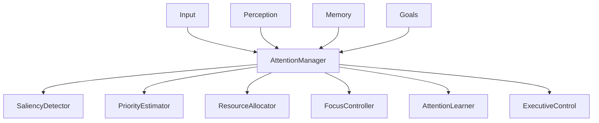
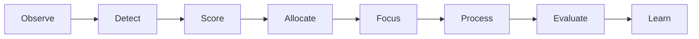

# RFC-0086

**Title:** Autonomous Cognitive Attention & Saliency Architecture

**Document ID:** RFC-0086

**Version:** 1.0

**Status:** Accepted

**Category:** Cognitive Architecture

**Layer:** Attention / Saliency / Cognitive Resource Allocation

**Target:**

```text
attention/
```

---

# Abstract

This RFC defines the SH-3 Autonomous Cognitive Attention & Saliency Architecture (ACASA).

The Autonomous Cognitive Attention & Saliency Architecture provides the cognitive resource management layer responsible for identifying important information, allocating computational resources, prioritizing cognitive processes, filtering irrelevant stimuli, and dynamically controlling focus.

Within SH-3, attention is defined as an adaptive resource allocation mechanism that maximizes cognitive efficiency under limited computational capacity.

The architecture governs:

- attention allocation
- saliency detection
- priority estimation
- cognitive resource management
- interruption handling
- focus control
- attention learning

The system enables:

- efficient cognition
- adaptive focus
- dynamic prioritization
- resource-aware reasoning
- autonomous attention optimization

This document is normative.

---

# Motivation

A cognitive system receives more information than it can process simultaneously.

Without attention:

- computational resources are wasted
- important signals are missed
- reasoning becomes inefficient
- decision latency increases
- cognitive overload occurs

Attention provides selective processing capability.

Saliency determines what deserves attention.

Together they enable efficient autonomous cognition.

---

# Goals

The Autonomous Cognitive Attention & Saliency Architecture SHALL provide:

- dynamic attention allocation
- saliency estimation
- cognitive prioritization
- resource optimization
- interruption management
- attention learning
- governance-aware focus control

---

# Non-Goals

The architecture SHALL NOT:

- replace perception
- replace reasoning
- replace planning
- replace executive control
- permanently suppress information

Attention selects processing priority rather than deleting information.

---

# Architecture



---

# Design Principles

## Adaptive Attention

Attention SHALL dynamically change according to context.

---

## Information Value

Attention SHALL prioritize information with high cognitive value.

---

## Resource Awareness

Attention SHALL optimize limited computational resources.

---

## Context Sensitivity

Attention SHALL consider goals, environment, and internal state.

---

## Explainability

Attention decisions SHALL preserve reasoning traces.

---

## Governance

Attention SHALL not suppress safety-critical information.

---

# Components

| Component | Responsibility |
|------------|----------------|
| AttentionManager | Global coordination |
| SaliencyDetector | Importance estimation |
| PriorityEstimator | Priority calculation |
| ResourceAllocator | Cognitive resource distribution |
| FocusController | Active focus management |
| InterruptionManager | Event handling |
| AttentionLearner | Attention optimization |

---

# Attention Context

Every attention operation receives an immutable AttentionContext.

AttentionContext SHALL contain:

| Field | Description |
|------|-------------|
| attention_id | Operation identifier |
| active_goals | Current objectives |
| available_resources | Cognitive budget |
| environmental_state | External context |
| internal_state | Cognitive state |
| timestamp | Evaluation time |

---

# Attention State

Every attention state SHALL expose:

| Field | Description |
|------|-------------|
| focus_target | Current focus |
| priority_score | Importance value |
| confidence | Estimation confidence |
| resource_allocation | Assigned resources |
| provenance | Decision history |

Attention states SHALL remain observable.

---

# Attention Lifecycle

Every attention cycle follows:

```text
Signal Reception

↓

Saliency Analysis

↓

Priority Estimation

↓

Resource Allocation

↓

Focus Selection

↓

Processing

↓

Attention Evaluation

↓

Learning
```

Attention SHALL continuously adapt.

---

# Saliency Detection

SaliencyDetector identifies cognitively important information.

Saliency SHALL consider:

- novelty
- relevance
- urgency
- uncertainty
- goal alignment
- expected impact
- safety significance

Saliency scores SHALL include confidence values.

---

# Priority Estimation

PriorityEstimator calculates processing priority.

Priority SHALL consider:

- active goals
- expected utility
- information gain
- temporal constraints
- resource cost
- risk level

Priority estimation SHALL remain explainable.

---

# Cognitive Resource Allocation

ResourceAllocator distributes computational capacity.

Allocation SHALL manage:

- CPU resources
- memory access
- reasoning depth
- simulation budget
- communication bandwidth
- learning capacity

Resource allocation SHALL remain adaptive.

---

# Focus Control

FocusController manages active cognitive targets.

Focus control SHALL support:

- sustained attention
- task switching
- background monitoring
- emergency interruption
- parallel attention channels

---

# Autonomous Cognitive Attention & Saliency Execution Model

The Autonomous Cognitive Attention & Saliency Architecture (ACASA) provides the cognitive resource allocation engine responsible for selecting, prioritizing, and managing information processing across SH-3.

Attention operates as a dynamic control mechanism that determines where cognitive resources are allocated while preserving safety-critical awareness, explainability, and governance compliance.

The attention lifecycle follows:



Each stage performs an independent attention management responsibility.

---

# Cognitive Attention Control Loop

The AttentionManager continuously supervises cognitive focus.

```text
Signal Collection

↓

Saliency Evaluation

↓

Priority Calculation

↓

Resource Allocation

↓

Focus Selection

↓

Cognitive Processing

↓

Attention Assessment

↓

Attention Policy Improvement
```

Attention SHALL remain continuously adaptive.

---

# Interruption Management

InterruptionManager handles unexpected high-priority events.

Interruption handling SHALL support:

- emergency events
- safety-critical signals
- urgent goals
- environmental changes
- external requests
- internal anomalies

Interruptions SHALL be prioritized according to:

- urgency
- expected impact
- safety importance
- governance constraints

---

# Interruption Model

```text
Incoming Event

+

Current Cognitive State

+

Priority Evaluation

↓

Interrupt Decision
```

---

# Attention Learning

AttentionLearner continuously improves attention policies.

Learning SHALL optimize:

- saliency accuracy
- priority prediction
- resource efficiency
- focus stability
- task switching efficiency
- attention recovery

Learning SHALL preserve historical attention outcomes.

---

# Multi-Channel Attention

The architecture supports simultaneous attention channels.

Supported channels include:

- primary task attention
- environmental monitoring
- safety monitoring
- communication monitoring
- background learning
- self-reflection monitoring

Each channel SHALL maintain independent priority values.

---

# Attention Competition

Multiple attention targets MAY compete for resources.

Competition SHALL consider:

- goal importance
- urgency
- uncertainty
- expected value
- resource cost

Attention selection SHALL remain explainable.

---

# Attention Verification

Attention decisions SHALL be evaluated.

Verification SHALL include:

- missed critical information analysis
- unnecessary focus analysis
- resource utilization analysis
- priority accuracy
- safety compliance

Verified attention policies SHALL improve future allocation.

---

# Attention Consistency

Attention SHALL preserve:

- priority consistency
- resource consistency
- safety consistency
- provenance consistency
- goal consistency

Equivalent cognitive states SHALL produce equivalent attention allocation under deterministic execution.

---

# Attention Knowledge Base

The architecture maintains reusable attention assets including:

- saliency patterns
- priority models
- resource allocation strategies
- interruption policies
- focus histories
- attention performance data

Attention knowledge SHALL continuously evolve.

---

# Distributed Attention Coordination

Multiple SH-3 nodes MAY coordinate attention.

Distributed attention supports:

- shared saliency analysis
- cooperative resource allocation
- distributed monitoring
- synchronized focus
- multi-agent awareness

Each node SHALL preserve local attention authority.

---

# Human-Guided Attention

The architecture supports human guidance of attention.

Human operators MAY provide:

- priority hints
- task emphasis
- safety alerts
- focus constraints

Human guidance SHALL remain explicit and traceable.

---

# Consciousness Integration

Consciousness Coordination receives:

- current focus state
- attention priorities
- resource availability
- interruption status

---

# World Model Integration

World Model provides:

- environmental changes
- predicted events
- situational importance
- temporal constraints

Attention SHALL adapt according to world state.

---

# Knowledge Graph Integration

Knowledge Graph provides:

- semantic importance
- relationship relevance
- concept activation
- dependency information

Attention SHALL leverage semantic structure.

---

# Episodic & Semantic Memory Integration

Long-Term Memory provides:

- historical importance
- previous attention outcomes
- successful focus patterns
- learned priorities

Attention SHALL reuse historical experience.

---

# Reasoning Integration

Reasoning provides:

- importance inference
- uncertainty estimation
- causal relevance
- consequence analysis

Attention SHALL support reasoning efficiency.

---

# Creativity Integration

Creativity provides:

- alternative focus strategies
- exploration priorities
- novel attention patterns

Creative attention strategies SHALL remain distinguishable from validated policies.

---

# Curiosity Integration

Curiosity provides:

- unexplored information priorities
- uncertainty targets
- knowledge acquisition focus

Attention SHALL support autonomous exploration.

---

# Communication Integration

Communication provides:

- dialogue priorities
- interaction urgency
- message importance

Attention SHALL prioritize meaningful communication.

---

# Social Intelligence Integration

Social Intelligence provides:

- social importance
- relationship priority
- cooperative urgency
- agent relevance

Attention SHALL incorporate social context.

---

# Goal Architecture Integration

Goal Architecture provides:

- objective priorities
- mission importance
- deadline constraints

Attention SHALL align with active goals.

---

# Planning Integration

Planning receives:

- prioritized information
- available cognitive resources
- interruption states

Planning SHALL operate using attention-aware context.

---

# Decision Integration

Decision making receives:

- focus candidates
- priority scores
- confidence values
- resource constraints

---

# Executive Control Integration

Executive Control manages:

- attention switching
- resource scheduling
- interruption policies
- cognitive workload

Attention SHALL remain coordinated with executive processes.

---

# Learning Integration

Learning receives:

- attention histories
- allocation results
- missed information analysis
- performance metrics

Learning SHALL continuously improve attention behavior.

---

# Meta-Reasoning Integration

Meta-Reasoning evaluates:

- attention quality
- priority accuracy
- resource efficiency
- cognitive workload

---

# Self Evolution Integration

Self Evolution System receives:

- attention optimization proposals
- allocation improvements
- policy evolution data

Structural attention changes SHALL require validation.

---

# AI Safety Governance Integration

AI Safety Governance validates:

- attention suppression policies
- priority rules
- emergency handling
- safety monitoring

Safety-critical information SHALL never be ignored by attention mechanisms.

---

# Risk Management Integration

Risk Management evaluates:

- attention failures
- missed hazards
- excessive focus
- resource exhaustion

Risk SHALL influence attention priorities.

---

# Message Bus Integration

Attention events include:

- AttentionStarted
- SaliencyDetected
- PriorityCalculated
- ResourceAllocated
- FocusChanged
- InterruptHandled
- AttentionEvaluated
- AttentionLearned

---

# Persistence Integration

Persistence stores:

- attention history
- focus transitions
- priority models
- resource allocation records
- learning outcomes

---

# Observability Integration

Attention telemetry includes:

- focus duration
- switching frequency
- priority accuracy
- resource utilization
- interruption response time
- missed-event rate
- attention efficiency

---

# Tracing

Attention traces preserve:

- trace_id
- attention_id
- signal_id
- focus_id
- interruption_id
- allocation_id
- evaluation_id

Every attention operation SHALL participate in distributed cognitive tracing.

---

# Thread Model

The Autonomous Cognitive Attention & Saliency Architecture supports concurrent:

- saliency detection
- priority estimation
- resource allocation
- focus management
- interruption handling
- attention learning

Concurrent attention operations SHALL preserve deterministic behavior when supplied with identical cognitive state, goals, resource budgets, and governance policies.

The reference implementation SHALL be thread-safe, horizontally scalable, and lock-efficient.

---

# Metrics

The Autonomous Cognitive Attention & Saliency Architecture exposes:

- attention accuracy
- saliency prediction quality
- resource utilization efficiency
- focus stability
- interruption handling latency
- task switching efficiency
- cognitive throughput

---

# Performance Objectives

The Autonomous Cognitive Attention & Saliency Architecture should optimize for:

- efficient cognitive resource allocation
- accurate priority estimation
- adaptive focus control
- minimal unnecessary processing
- safety-preserving attention
- continuous attention improvement

---

# Future Work

Potential future enhancements include:

- hierarchical attention networks
- predictive attention allocation
- neuromorphic attention systems
- autonomous cognitive workload balancing
- attention-based multi-agent coordination
- self-optimizing cognitive resource markets

These enhancements extend SH-3 toward a comprehensive attention architecture capable of dynamically controlling cognitive focus, optimizing computational resources, and maintaining awareness of critical information while remaining deterministic, explainable, governance-aware, and fully integrated with perception, reasoning, planning, learning, executive control, communication, social intelligence, and self-evolution.

---

# References

- SH-3 Architecture Specification v2.1
- RFC-0027 Autonomous Learning System
- RFC-0050 Knowledge Governance System
- RFC-0053 AI Safety Governance System
- RFC-0062 Autonomous Meta-Reasoning Intelligence System
- RFC-0063 Autonomous Consciousness Coordination System
- RFC-0064 Unified Cognitive Memory Architecture
- RFC-0067 Autonomous Cognitive Operating System
- RFC-0068 Autonomous Multi-Agent Cognitive Architecture
- RFC-0069 Autonomous Cognitive Skill Architecture
- RFC-0070 Autonomous Cognitive Simulation Architecture
- RFC-0071 Autonomous Cognitive Knowledge Graph Architecture
- RFC-0072 Autonomous Cognitive Planning Architecture
- RFC-0073 Autonomous Cognitive Decision Architecture
- RFC-0074 Autonomous Cognitive Perception Architecture
- RFC-0075 Autonomous Cognitive Value & Motivation Architecture
- RFC-0076 Autonomous Cognitive Goal Architecture
- RFC-0077 Autonomous Cognitive Emotion & Affective Architecture
- RFC-0078 Autonomous Cognitive Executive Control Architecture
- RFC-0079 Autonomous Cognitive Episodic & Semantic Memory Architecture
- RFC-0080 Autonomous Cognitive Reasoning Architecture
- RFC-0081 Autonomous Cognitive Creativity & Hypothesis Generation Architecture
- RFC-0082 Autonomous Cognitive Curiosity & Exploration Architecture
- RFC-0083 Autonomous Cognitive Communication & Language Architecture
- RFC-0084 Autonomous Cognitive Social Intelligence Architecture
- RFC-0085 Autonomous Cognitive Self-Reflection & Introspection Architecture

---

# End of RFC-0086
