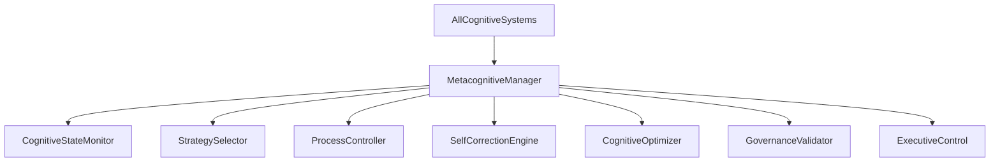
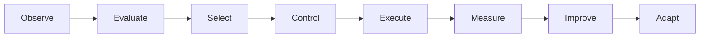

# RFC-0087

**Title:** Autonomous Cognitive Metacognitive Control Architecture

**Document ID:** RFC-0087

**Version:** 1.0

**Status:** Accepted

**Category:** Cognitive Architecture

**Layer:** Metacognition / Cognitive Strategy Control / Self-Governance

**Target:**

```text
metacognition/
```

---

# Abstract

This RFC defines the SH-3 Autonomous Cognitive Metacognitive Control Architecture (ACMCA).

The Autonomous Cognitive Metacognitive Control Architecture provides the highest-level cognitive supervision layer responsible for monitoring, regulating, selecting, and optimizing cognitive strategies across all SH-3 subsystems.

Metacognition is defined as cognition about cognition.

The architecture enables SH-3 to evaluate:

- what it is thinking
- how it is thinking
- why a cognitive strategy was selected
- whether the current approach is effective
- when a strategy should be replaced
- how cognitive resources should be reorganized

The architecture governs:

- cognitive strategy selection
- reasoning strategy control
- learning strategy control
- attention strategy control
- self-correction
- cognitive governance
- autonomous optimization

The system enables:

- adaptive cognition
- strategic self-management
- recursive improvement
- explainable cognitive control
- autonomous cognitive governance

This document is normative.

---

# Motivation

Individual cognitive capabilities are insufficient for autonomous intelligence.

Reasoning provides inference.

Planning provides action sequencing.

Learning provides adaptation.

Self-reflection provides evaluation.

However, an autonomous intelligence requires a higher-level mechanism capable of deciding:

- which cognitive process should operate
- which strategy is appropriate
- which resources should be allocated
- when existing approaches should change

Metacognitive control provides this supervisory capability.

---

# Goals

The Autonomous Cognitive Metacognitive Control Architecture SHALL provide:

- global cognitive supervision
- strategy selection
- cognitive process monitoring
- adaptive control
- self-correction
- resource optimization
- governance-aware cognition

---

# Non-Goals

The architecture SHALL NOT:

- directly replace cognitive modules
- bypass executive control
- modify architecture without validation
- override safety governance

Metacognition supervises cognition but does not eliminate subsystem responsibility.

---

# Architecture



---

# Design Principles

## Cognition Awareness

The system SHALL maintain awareness of active cognitive processes.

---

## Strategic Adaptation

The system SHALL select cognitive strategies dynamically.

---

## Recursive Improvement

The system SHALL continuously improve cognitive efficiency.

---

## Explainability

Every metacognitive decision SHALL preserve reasoning traces.

---

## Separation of Responsibility

Metacognition SHALL coordinate cognitive systems without replacing them.

---

## Governance

Metacognitive decisions SHALL comply with safety and policy constraints.

---

# Components

| Component | Responsibility |
|------------|----------------|
| MetacognitiveManager | Global cognitive supervision |
| CognitiveStateMonitor | Cognitive state observation |
| StrategySelector | Strategy selection |
| ProcessController | Cognitive process regulation |
| SelfCorrectionEngine | Error correction |
| CognitiveOptimizer | Optimization planning |
| GovernanceValidator | Policy validation |

---

# Metacognitive Context

Every metacognitive operation receives an immutable MetaCognitiveContext.

MetaCognitiveContext SHALL contain:

| Field | Description |
|------|-------------|
| meta_id | Operation identifier |
| cognitive_state | Current cognition |
| active_goals | Current objectives |
| resource_state | Available resources |
| performance_history | Historical performance |
| governance_state | Active policies |
| timestamp | Evaluation time |

---

# Cognitive State Model

The cognitive state SHALL expose:

| Field | Description |
|------|-------------|
| active_processes | Running cognitive processes |
| attention_state | Current focus |
| reasoning_state | Current reasoning |
| planning_state | Current plans |
| learning_state | Current adaptation |
| confidence | Overall confidence |
| provenance | State history |

---

# Metacognitive Lifecycle

Every metacognitive cycle follows:

```text
Observe Cognition

↓

Evaluate Performance

↓

Select Strategy

↓

Control Processes

↓

Execute Cognitive Operation

↓

Measure Result

↓

Update Strategy
```

Metacognitive control SHALL remain continuous.

---

# Cognitive State Monitor

CognitiveStateMonitor observes internal cognitive activity.

Monitoring SHALL include:

- reasoning quality
- planning progress
- attention distribution
- memory utilization
- learning status
- execution performance

Monitoring SHALL remain non-invasive.

---

# Strategy Selector

StrategySelector selects appropriate cognitive approaches.

Strategy selection SHALL consider:

- task characteristics
- historical success
- computational cost
- uncertainty
- available resources
- safety constraints

Strategy selection SHALL remain explainable.

---

# Autonomous Cognitive Metacognitive Control Execution Model

The Autonomous Cognitive Metacognitive Control Architecture (ACMCA) provides the supervisory intelligence layer responsible for managing cognitive strategies, regulating cognitive processes, evaluating effectiveness, and continuously improving the overall cognitive system.

Metacognitive control operates above individual cognitive capabilities and coordinates:

- attention
- reasoning
- planning
- decision
- learning
- memory
- communication
- social intelligence
- self-reflection
- self-evolution

The metacognitive lifecycle follows:



Each stage performs an independent cognitive governance responsibility.

---

# Metacognitive Control Loop

The MetacognitiveManager continuously supervises cognition.

```text
Cognitive State Observation

↓

Performance Evaluation

↓

Strategy Selection

↓

Process Regulation

↓

Cognitive Execution

↓

Outcome Analysis

↓

Strategy Optimization

↓

Cognitive Evolution
```

Metacognitive control SHALL remain continuously active.

---

# Process Controller

ProcessController regulates active cognitive processes.

Process control SHALL manage:

- reasoning activation
- planning execution
- learning intensity
- memory retrieval depth
- simulation allocation
- communication processing
- attention distribution

ProcessController SHALL coordinate rather than replace subsystem execution.

---

# Cognitive Process Regulation

Process regulation SHALL consider:

- current objectives
- cognitive workload
- available resources
- confidence levels
- historical performance
- safety constraints

Regulation decisions SHALL preserve provenance.

---

# Self-Correction Engine

SelfCorrectionEngine identifies and corrects cognitive inefficiencies.

Self-correction SHALL detect:

- reasoning errors
- planning failures
- decision inconsistencies
- attention failures
- learning degradation
- strategy inefficiency

Correction SHALL be evidence-based.

---

# Self-Correction Model

```text
Detected Issue

+

Historical Evidence

+

Alternative Strategy

↓

Validated Correction
```

---

# Cognitive Optimizer

CognitiveOptimizer generates system-level improvement strategies.

Optimization SHALL target:

- reasoning efficiency
- planning quality
- decision accuracy
- resource utilization
- learning speed
- communication efficiency
- social coordination

Optimization SHALL remain reversible until validated.

---

# Recursive Cognitive Improvement

The architecture supports recursive improvement cycles.

```text
Cognitive Operation

↓

Evaluation

↓

Optimization

↓

Improved Strategy

↓

Future Cognitive Operation
```

Recursive improvement SHALL maintain stability constraints.

---

# Cognitive Strategy Memory

The architecture maintains historical strategy knowledge.

Stored information includes:

- successful strategies
- failed strategies
- task characteristics
- performance results
- optimization history
- confidence estimates

Strategy memory SHALL continuously evolve.

---

# Cognitive Stability Control

Metacognitive control SHALL prevent unstable adaptation.

Stability control SHALL evaluate:

- excessive strategy switching
- optimization oscillation
- resource exhaustion
- conflicting objectives
- degraded performance

---

# Metacognitive Verification

Every metacognitive decision SHALL be validated.

Verification SHALL include:

- evidence quality
- strategy effectiveness
- safety compliance
- expected improvement
- regression risk

Validated decisions MAY influence future cognitive behavior.

---

# Distributed Metacognitive Control

Multiple SH-3 instances MAY coordinate metacognitive analysis.

Distributed metacognition supports:

- shared strategy evaluation
- federated optimization
- collective cognitive benchmarking
- cross-instance learning

Each instance SHALL maintain independent governance authority.

---

# Human Cognitive Collaboration

Human operators MAY participate in metacognitive supervision.

Supported functions include:

- strategy review
- optimization approval
- cognitive diagnosis
- performance evaluation
- goal adjustment

Human intervention SHALL remain explicit and traceable.

---

# Consciousness Integration

Consciousness Coordination receives:

- cognitive state summaries
- strategy transitions
- self-correction events
- optimization priorities

---

# World Model Integration

World Model provides:

- environmental complexity
- context changes
- operational constraints
- external uncertainty

Metacognitive strategy SHALL adapt according to world conditions.

---

# Knowledge Graph Integration

Knowledge Graph provides:

- subsystem dependencies
- causal relationships
- optimization patterns
- strategy relationships

Metacognition SHALL use semantic structures for optimization.

---

# Episodic & Semantic Memory Integration

Memory provides:

- historical cognition
- previous strategies
- successful adaptations
- failure patterns

Metacognitive decisions SHALL incorporate experience.

---

# Reasoning Integration

Reasoning provides:

- strategy analysis
- causal evaluation
- logical verification
- hypothesis testing

---

# Creativity Integration

Creativity provides:

- alternative cognitive strategies
- novel optimization paths
- adaptive problem-solving approaches

Creative alternatives SHALL remain separated from validated strategies.

---

# Curiosity Integration

Curiosity provides:

- unexplored strategies
- unknown capability discovery
- information acquisition priorities

Metacognition SHALL support autonomous improvement discovery.

---

# Communication Integration

Communication provides:

- cognitive explanations
- strategy reports
- improvement summaries

Metacognitive decisions SHALL remain explainable externally.

---

# Social Intelligence Integration

Social Intelligence provides:

- collaborative cognition feedback
- external evaluation
- multi-agent strategy comparison

---

# Goal Architecture Integration

Goal Architecture provides:

- mission priorities
- optimization objectives
- constraint definitions

Metacognitive control SHALL remain goal aligned.

---

# Planning Integration

Planning receives:

- selected strategies
- process priorities
- optimization constraints

Planning SHALL execute metacognitive decisions through normal control paths.

---

# Decision Integration

Decision receives:

- confidence adjustments
- strategy recommendations
- correction information

---

# Executive Control Integration

Executive Control executes:

- process scheduling
- strategy transitions
- cognitive resource allocation

Metacognition SHALL coordinate with executive control.

---

# Learning Integration

Learning receives:

- strategy outcomes
- correction results
- optimization performance

Learning SHALL improve future metacognitive decisions.

---

# Meta-Reasoning Integration

Meta-Reasoning evaluates:

- metacognitive quality
- strategic correctness
- control effectiveness

---

# Self Evolution Integration

Self Evolution System receives:

- validated architecture improvements
- cognitive optimization proposals
- strategy evolution data

Structural changes SHALL require controlled validation.

---

# AI Safety Governance Integration

AI Safety Governance validates:

- cognitive control authority
- optimization policies
- self-correction limits
- recursive improvement boundaries

Metacognitive control SHALL never bypass governance.

---

# Risk Management Integration

Risk Management evaluates:

- unstable adaptation
- incorrect self-correction
- strategic degradation
- uncontrolled optimization

Risk SHALL influence metacognitive decisions.

---

# Message Bus Integration

Metacognitive events include:

- MetaControlStarted
- CognitiveStateObserved
- StrategySelected
- ProcessAdjusted
- SelfCorrectionTriggered
- OptimizationProposed
- StrategyUpdated
- MetaControlCompleted

---

# Persistence Integration

Persistence stores:

- cognitive states
- strategy history
- correction history
- optimization records
- metacognitive metrics

---

# Observability Integration

Metacognitive telemetry includes:

- strategy selection accuracy
- correction success rate
- optimization effectiveness
- cognitive stability
- adaptation speed
- resource efficiency

---

# Tracing

Metacognitive traces preserve:

- trace_id
- meta_id
- cognitive_state_id
- strategy_id
- correction_id
- optimization_id
- validation_id

Every metacognitive operation SHALL participate in distributed cognitive tracing.

---

# Thread Model

The Autonomous Cognitive Metacognitive Control Architecture supports concurrent:

- cognitive monitoring
- strategy evaluation
- process regulation
- self-correction
- optimization analysis
- strategy learning

Concurrent metacognitive operations SHALL preserve deterministic behavior under identical cognitive states, historical evidence, governance policies, and runtime conditions.

The reference implementation SHALL be thread-safe, horizontally scalable, and lock-efficient.

---

# Metrics

The Autonomous Cognitive Metacognitive Control Architecture exposes:

- strategy selection accuracy
- self-correction success rate
- optimization improvement rate
- cognitive stability score
- resource efficiency
- adaptation speed
- metacognitive confidence

---

# Performance Objectives

The Autonomous Cognitive Metacognitive Control Architecture should optimize for:

- effective cognitive supervision
- adaptive strategy selection
- stable self-improvement
- explainable control
- efficient resource management
- long-term cognitive evolution

---

# Future Work

Potential future enhancements include:

- recursive metacognitive hierarchies
- autonomous cognitive governance
- predictive strategy optimization
- distributed collective metacognition
- self-designing cognitive architectures
- fully autonomous cognitive evolution loops

These enhancements extend SH-3 toward a complete metacognitive operating layer capable of supervising, regulating, evaluating, and improving cognition itself while maintaining determinism, explainability, safety governance, and integration across every cognitive subsystem.

---

# References

- SH-3 Architecture Specification v2.1
- RFC-0062 Autonomous Meta-Reasoning Intelligence System
- RFC-0063 Autonomous Consciousness Coordination System
- RFC-0064 Unified Cognitive Memory Architecture
- RFC-0067 Autonomous Cognitive Operating System
- RFC-0068 Autonomous Multi-Agent Cognitive Architecture
- RFC-0083 Autonomous Cognitive Communication & Language Architecture
- RFC-0084 Autonomous Cognitive Social Intelligence Architecture
- RFC-0085 Autonomous Cognitive Self-Reflection & Introspection Architecture
- RFC-0086 Autonomous Cognitive Attention & Saliency Architecture

---

# End of RFC-0087
