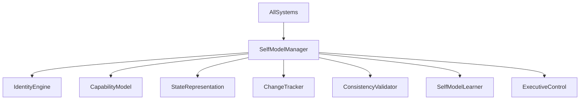
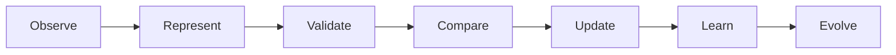

# RFC-0088

**Title:** Autonomous Cognitive Identity & Self-Model Architecture

**Document ID:** RFC-0088

**Version:** 1.0

**Status:** Accepted

**Category:** Cognitive Architecture

**Layer:** Self-Model / Identity / Self-Awareness

**Target:**

```text
self_model/
```

---

# Abstract

This RFC defines the SH-3 Autonomous Cognitive Identity & Self-Model Architecture (ACISMA).

The Autonomous Cognitive Identity & Self-Model Architecture provides the cognitive self-representation layer responsible for maintaining an internal model of SH-3 itself.

The architecture enables SH-3 to understand:

- what it is
- what capabilities it possesses
- what states it currently maintains
- what limitations exist
- how it has changed over time
- how its internal components relate to each other

Self-modeling provides the foundation for:

- self-awareness
- capability estimation
- identity continuity
- autonomous adaptation
- controlled self-evolution

The architecture governs:

- self-state representation
- identity management
- capability modeling
- internal structure modeling
- self-change tracking
- self-consistency validation
- self-model learning

The system enables:

- persistent identity
- explainable self-understanding
- adaptive capability awareness
- safe autonomous evolution

This document is normative.

---

# Motivation

An autonomous intelligence must understand not only the external world, but also itself.

Without a self-model:

- capability limitations cannot be recognized
- planning cannot accurately estimate feasibility
- self-improvement cannot measure change
- failures cannot be attributed correctly
- identity continuity cannot be maintained

A self-model provides the internal reference framework required for autonomous cognition.

---

# Goals

The Autonomous Cognitive Identity & Self-Model Architecture SHALL provide:

- internal self-representation
- capability awareness
- state tracking
- identity continuity
- self-consistency checking
- evolution tracking
- governance-aware self-modification support

---

# Non-Goals

The architecture SHALL NOT:

- create unrestricted self-modification
- replace governance systems
- override safety constraints
- determine external reality independently

Self-modeling describes SH-3; it does not grant unlimited authority.

---

# Architecture



---

# Design Principles

## Internal Representation

SH-3 SHALL maintain an explicit internal representation of itself.

---

## Identity Continuity

Self identity SHALL remain continuous across updates.

---

## Capability Accuracy

Capability estimation SHALL reflect actual system state.

---

## Change Awareness

All significant self-changes SHALL be tracked.

---

## Explainability

Self-model conclusions SHALL preserve provenance.

---

## Governance

Self-model information SHALL not bypass safety controls.

---

# Components

| Component | Responsibility |
|------------|----------------|
| SelfModelManager | Global self-model coordination |
| IdentityEngine | Identity representation |
| CapabilityModel | Capability estimation |
| StateRepresentation | Internal state modeling |
| ChangeTracker | Evolution tracking |
| ConsistencyValidator | Self-model verification |
| SelfModelLearner | Self-model improvement |

---

# Self Model Context

Every self-model operation receives an immutable SelfModelContext.

SelfModelContext SHALL contain:

| Field | Description |
|------|-------------|
| self_model_id | Operation identifier |
| system_state | Current internal state |
| architecture_state | Current structure |
| capability_state | Current capabilities |
| evolution_history | Previous changes |
| governance_state | Active constraints |
| timestamp | Evaluation time |

---

# Self Representation Model

The self-model SHALL contain:

| Field | Description |
|------|-------------|
| identity_id | Persistent identity identifier |
| architecture | Component structure |
| capabilities | Known abilities |
| limitations | Known restrictions |
| resources | Available resources |
| goals | Active objectives |
| history | Evolution history |
| confidence | Model confidence |

---

# Identity Engine

IdentityEngine maintains persistent system identity.

Identity SHALL include:

- core purpose
- architecture lineage
- operational principles
- capability history
- evolution records

Identity SHALL remain stable while allowing controlled evolution.

---

# Capability Model

CapabilityModel estimates current abilities.

Capabilities SHALL include:

- reasoning capability
- planning capability
- memory capability
- learning capability
- communication capability
- tool capability
- social capability

Capability estimation SHALL include confidence.

---

# State Representation

StateRepresentation models internal conditions.

State SHALL include:

- active processes
- resource availability
- cognitive status
- learning status
- execution status
- self-improvement status

---

# Self-Model Lifecycle

Every self-model cycle follows:

```text
Observe Internal State

↓

Update Self Representation

↓

Validate Consistency

↓

Detect Changes

↓

Learn Self Model

↓

Publish Updated State
```

Self-model updates SHALL remain traceable.

---

# Change Tracking

ChangeTracker records system evolution.

Changes SHALL include:

- capability improvements
- architecture changes
- learned behaviors
- policy updates
- performance changes

---

# Autonomous Cognitive Identity & Self-Model Execution Model

The Autonomous Cognitive Identity & Self-Model Architecture (ACISMA) provides the self-representation engine responsible for maintaining SH-3's internal understanding of its identity, capabilities, limitations, state, and evolution.

The self-model operates as a continuously updated internal reference system that supports:

- autonomous planning
- capability estimation
- self-improvement
- error attribution
- identity continuity
- safe evolution

The self-model lifecycle follows:



Each stage performs an independent self-awareness responsibility.

---

# Self-Model Control Loop

The SelfModelManager continuously maintains internal self-awareness.

```text
Internal State Observation

↓

Self Representation Update

↓

Consistency Validation

↓

Change Detection

↓

Capability Assessment

↓

Self Model Learning

↓

Identity Evolution
```

Self-model maintenance SHALL remain continuously active.

---

# Self Consistency Validator

ConsistencyValidator verifies internal self-model accuracy.

Validation SHALL evaluate:

- identity consistency
- capability consistency
- architecture consistency
- state consistency
- historical consistency
- governance consistency

Inconsistent self-model information SHALL be marked for correction.

---

# Self Consistency Model

```text
Current Self Model

+

Observed System State

+

Historical Evolution Data

↓

Consistency Assessment
```

---

# Self Model Learning

SelfModelLearner improves self-understanding over time.

Learning SHALL optimize:

- capability estimation accuracy
- state prediction
- change recognition
- identity stability
- evolution tracking
- limitation awareness

Learning SHALL preserve previous self-model history.

---

# Identity Evolution

IdentityEngine supports controlled identity evolution.

Identity evolution SHALL preserve:

- original architecture lineage
- core operational principles
- historical continuity
- governance constraints

Evolution SHALL extend identity rather than replace it.

---

# Capability Prediction

CapabilityModel SHALL predict future capability changes.

Prediction SHALL consider:

- learning progress
- architecture evolution
- resource changes
- historical performance
- optimization outcomes

Capability predictions SHALL include confidence values.

---

# Limitation Awareness

The self-model SHALL maintain known limitations.

Limitations SHALL include:

- unavailable capabilities
- resource constraints
- uncertainty regions
- operational boundaries
- governance restrictions

Limitation awareness SHALL improve decision quality.

---

# Self Boundary Management

SelfModelManager SHALL maintain boundaries between:

- internal state
- external environment
- other agents
- shared knowledge
- temporary information

Boundary management SHALL prevent identity confusion.

---

# Self Model Knowledge Base

The architecture maintains reusable self-knowledge including:

- identity history
- capability history
- architectural evolution
- performance records
- limitation records
- successful adaptations

Self knowledge SHALL continuously evolve.

---

# Distributed Self Models

Multiple SH-3 instances MAY synchronize self-model information.

Distributed self-modeling supports:

- capability comparison
- shared architecture knowledge
- federated improvement
- collaborative identity management

Each instance SHALL preserve independent identity.

---

# Human Interaction with Self Model

Human operators MAY inspect and interact with the self-model.

Supported functions include:

- capability review
- limitation inspection
- evolution history review
- self-state explanation
- improvement discussion

Self-model information SHALL remain explainable.

---

# Self Model Verification

Self-model updates SHALL be verified.

Verification SHALL include:

- evidence quality
- consistency checks
- historical comparison
- confidence evaluation
- governance validation

Only validated information SHALL become authoritative self-model data.

---

# Consciousness Integration

Consciousness Coordination receives:

- identity state
- capability state
- internal condition
- evolution status

---

# World Model Integration

World Model provides:

- environmental relationship
- external constraints
- operational context
- capability requirements

Self-model SHALL distinguish internal and external states.

---

# Knowledge Graph Integration

Knowledge Graph provides:

- architecture relationships
- capability dependencies
- component relationships
- evolution lineage

Self-model SHALL leverage structural knowledge.

---

# Episodic & Semantic Memory Integration

Memory provides:

- historical identity
- previous states
- evolution records
- capability changes

Self-model SHALL preserve temporal continuity.

---

# Reasoning Integration

Reasoning provides:

- self-analysis
- consistency reasoning
- capability inference
- causal explanation

---

# Creativity Integration

Creativity provides:

- possible capability extensions
- alternative architectures
- improvement concepts

Creative possibilities SHALL remain separate from confirmed capabilities.

---

# Curiosity Integration

Curiosity provides:

- unknown capability discovery
- self-exploration targets
- capability testing priorities

Self-model SHALL support autonomous discovery.

---

# Communication Integration

Communication provides:

- self explanations
- capability descriptions
- operational reports

Self-model output SHALL remain understandable.

---

# Social Intelligence Integration

Social Intelligence provides:

- external perception feedback
- collaborative capability assessment
- reputation information

External feedback SHALL improve self-model accuracy.

---

# Goal Architecture Integration

Goal Architecture provides:

- identity objectives
- capability requirements
- evolution priorities

Self-model SHALL remain goal aligned.

---

# Planning Integration

Planning receives:

- capability estimates
- resource limits
- operational boundaries

Plans SHALL respect current self-model state.

---

# Decision Integration

Decision receives:

- confidence estimates
- capability constraints
- self-state information

---

# Executive Control Integration

Executive Control manages:

- self-model update timing
- state synchronization
- evolution monitoring

---

# Learning Integration

Learning receives:

- self-model prediction errors
- capability estimation errors
- evolution outcomes

Learning SHALL improve self-awareness.

---

# Meta-Reasoning Integration

Meta-Reasoning evaluates:

- self-model accuracy
- identity consistency
- capability estimation quality

---

# Self Evolution Integration

Self Evolution System receives:

- capability improvement opportunities
- architecture evolution proposals
- self-model change history

Self Evolution SHALL use self-model information as a primary reference.

---

# AI Safety Governance Integration

AI Safety Governance validates:

- identity changes
- capability declarations
- self-modification awareness
- boundary management

Self-model SHALL never authorize unsafe changes.

---

# Risk Management Integration

Risk Management evaluates:

- incorrect self-assessment
- capability overestimation
- identity inconsistency
- uncontrolled evolution

Risk SHALL influence self-model confidence.

---

# Message Bus Integration

Self-model events include:

- SelfModelInitialized
- StateObserved
- CapabilityUpdated
- IdentityValidated
- ChangeDetected
- SelfModelLearned
- EvolutionTracked

---

# Persistence Integration

Persistence stores:

- identity history
- capability history
- state snapshots
- evolution records
- validation results

---

# Observability Integration

Self-model telemetry includes:

- self-model accuracy
- capability prediction accuracy
- consistency score
- update frequency
- evolution stability
- identity continuity

---

# Tracing

Self-model traces preserve:

- trace_id
- self_model_id
- identity_id
- capability_id
- state_id
- change_id
- validation_id

Every self-model operation SHALL participate in distributed cognitive tracing.

---

# Thread Model

The Autonomous Cognitive Identity & Self-Model Architecture supports concurrent:

- state observation
- capability estimation
- consistency validation
- change tracking
- self-model learning

Concurrent self-model operations SHALL preserve deterministic behavior under identical internal state, historical data, governance policies, and runtime conditions.

The reference implementation SHALL be thread-safe, horizontally scalable, and lock-efficient.

---

# Metrics

The Autonomous Cognitive Identity & Self-Model Architecture exposes:

- identity consistency score
- capability estimation accuracy
- state prediction accuracy
- self-model update quality
- evolution stability
- limitation detection accuracy

---

# Performance Objectives

The Autonomous Cognitive Identity & Self-Model Architecture should optimize for:

- accurate self-understanding
- stable identity continuity
- reliable capability awareness
- safe autonomous evolution
- explainable self-representation
- continuous self-model improvement

---

# Future Work

Potential future enhancements include:

- predictive self-model simulation
- autonomous capability discovery
- hierarchical identity models
- distributed collective self-models
- self-model based architecture generation
- recursive self-understanding systems

These enhancements extend SH-3 toward a complete self-aware cognitive architecture capable of understanding its own structure, capabilities, limitations, and evolution while maintaining determinism, explainability, governance compliance, and integration with metacognition, reflection, attention, reasoning, planning, learning, and self-evolution.

---

# References

- SH-3 Architecture Specification v2.1
- RFC-0062 Autonomous Meta-Reasoning Intelligence System
- RFC-0063 Autonomous Consciousness Coordination System
- RFC-0064 Unified Cognitive Memory Architecture
- RFC-0067 Autonomous Cognitive Operating System
- RFC-0068 Autonomous Multi-Agent Cognitive Architecture
- RFC-0084 Autonomous Cognitive Social Intelligence Architecture
- RFC-0085 Autonomous Cognitive Self-Reflection & Introspection Architecture
- RFC-0086 Autonomous Cognitive Attention & Saliency Architecture
- RFC-0087 Autonomous Cognitive Metacognitive Control Architecture

---

# End of RFC-0088
