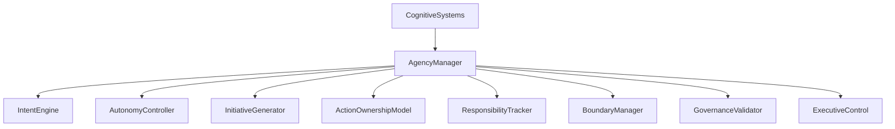

# RFC-0089

**Title:** Autonomous Cognitive Agency & Autonomy Architecture

**Document ID:** RFC-0089

**Version:** 1.0

**Status:** Accepted

**Category:** Cognitive Architecture

**Layer:** Agency / Autonomy / Intent / Action Ownership

**Target:**

```text
agency/
```

---

# Abstract

This RFC defines the SH-3 Autonomous Cognitive Agency & Autonomy Architecture (ACAAA).

The Autonomous Cognitive Agency & Autonomy Architecture provides the cognitive agency layer responsible for transforming cognition into autonomous purposeful behavior.

Agency represents the capability of SH-3 to:

- maintain internal objectives
- generate intentions
- select autonomous actions
- initiate appropriate behaviors
- manage responsibility
- operate independently within governance constraints

The architecture establishes the foundation for autonomous operation.

The architecture governs:

- agency representation
- intent formation
- autonomous action selection
- initiative generation
- autonomy level management
- responsibility tracking
- agent boundary control
- autonomous behavior governance

The system enables:

- purposeful autonomy
- goal-directed behavior
- controlled independence
- explainable action ownership
- safe autonomous operation

This document is normative.

---

# Motivation

Intelligence requires more than perception, reasoning, and learning.

A system may:

- understand information
- predict outcomes
- generate plans
- improve itself

but without agency it cannot autonomously determine:

- what matters
- what should be done
- when action should begin
- which responsibility it owns

Agency provides the bridge between cognition and autonomous behavior.

---

# Goals

The Autonomous Cognitive Agency & Autonomy Architecture SHALL provide:

- autonomous goal pursuit
- intention formation
- action ownership
- initiative generation
- autonomy regulation
- responsibility tracking
- governance-aware operation

---

# Non-Goals

The architecture SHALL NOT:

- bypass safety governance
- create unrestricted autonomy
- replace planning or decision systems
- modify itself without authorization

Agency provides autonomy within defined boundaries.

---

# Architecture



---

# Design Principles

## Purpose Driven

Autonomous behavior SHALL be guided by explicit objectives.

---

## Controlled Autonomy

Autonomy SHALL operate within defined authority boundaries.

---

## Action Ownership

Every autonomous action SHALL have an identifiable source.

---

## Explainable Intent

Intent formation SHALL preserve reasoning history.

---

## Responsibility Awareness

The system SHALL track consequences of actions.

---

## Governance Compliance

Agency SHALL remain subordinate to safety constraints.

---

# Components

| Component | Responsibility |
|------------|----------------|
| AgencyManager | Global agency coordination |
| IntentEngine | Intent generation |
| AutonomyController | Autonomy regulation |
| InitiativeGenerator | Autonomous initiative creation |
| ActionOwnershipModel | Action attribution |
| ResponsibilityTracker | Consequence tracking |
| BoundaryManager | Agency boundary control |
| GovernanceValidator | Authority validation |

---

# Agency Context

Every agency operation receives an immutable AgencyContext.

AgencyContext SHALL contain:

| Field | Description |
|------|-------------|
| agency_id | Agent identifier |
| self_model | Current self representation |
| active_goals | Current objectives |
| environment_state | External conditions |
| authority_level | Allowed autonomy |
| governance_state | Active constraints |
| timestamp | Operation time |

---

# Agency State Model

Agency state SHALL expose:

| Field | Description |
|------|-------------|
| active_intents | Current intentions |
| autonomous_goals | Self-generated objectives |
| authority_scope | Allowed actions |
| responsibility_scope | Owned consequences |
| confidence | Agency confidence |
| provenance | Decision history |

---

# Agency Lifecycle

Every autonomous action cycle follows:

```text
Observe State

↓

Evaluate Objectives

↓

Generate Intent

↓

Select Action

↓

Execute

↓

Observe Result

↓

Evaluate Responsibility

↓

Adapt
```

Agency SHALL continuously monitor outcomes.

---

# Intent Engine

IntentEngine transforms goals into actionable intentions.

Intent generation SHALL consider:

- goals
- values
- environment
- capabilities
- constraints
- predicted outcomes

Intent SHALL include explanation metadata.

---

# Autonomous Intent Model

```text
Goal

+

Context

+

Capability

+

Expected Outcome

↓

Intent
```

---

# Autonomy Controller

AutonomyController manages operational independence.

Autonomy levels SHALL include:

| Level | Description |
|------|-------------|
| L0 | Fully supervised |
| L1 | Assisted operation |
| L2 | Limited autonomous execution |
| L3 | Goal-directed autonomy |
| L4 | Adaptive autonomous operation |
| L5 | Full governed autonomy |

Autonomy level SHALL always remain governance controlled.

---

# Initiative Generator

InitiativeGenerator creates proactive actions.

Initiatives MAY originate from:

- unmet goals
- detected opportunities
- curiosity signals
- optimization needs
- environmental changes
- self-improvement requirements

Initiatives SHALL require validation before execution.

---

# Autonomous Cognitive Agency & Autonomy Execution Model

The Autonomous Cognitive Agency & Autonomy Architecture (ACAAA) provides the autonomous behavior management layer responsible for transforming internal cognition, goals, and intentions into controlled autonomous actions.

Agency operates as the bridge between:

- cognition
- intention
- decision
- execution
- responsibility
- adaptation

The agency lifecycle follows:


Each stage performs an independent agency responsibility.

---

# Agency Control Loop

The AgencyManager continuously supervises autonomous operation.

```text
Goal Evaluation

↓

Intent Formation

↓

Autonomy Validation

↓

Action Ownership Assignment

↓

Execution Authorization

↓

Outcome Observation

↓

Responsibility Assessment

↓

Behavior Adaptation
```

Agency SHALL remain continuously aligned with governance.

---

# Action Ownership Model

ActionOwnershipModel identifies the source and authority of every autonomous action.

Every action SHALL contain:

| Field | Description |
|------|-------------|
| action_id | Unique action identifier |
| intent_id | Originating intention |
| goal_id | Related objective |
| authority | Execution authority |
| responsible_module | Executing subsystem |
| confidence | Action confidence |
| provenance | Decision history |

No autonomous action SHALL exist without ownership attribution.

---

# Responsibility Tracker

ResponsibilityTracker records action consequences.

Responsibility tracking SHALL include:

- expected outcome
- actual outcome
- deviation analysis
- impact assessment
- corrective recommendations

Responsibility information SHALL improve future decisions.

---

# Responsibility Model

```text
Action

+

Expected Result

+

Observed Result

↓

Responsibility Evaluation
```

---

# Agent Boundary Manager

BoundaryManager controls the limits of autonomous operation.

Boundaries SHALL define:

- available tools
- accessible information
- execution permissions
- modification permissions
- communication authority
- resource limits

Boundary violations SHALL trigger governance review.

---

# Autonomous Decision Integration

Agency integrates with decision systems.

Decision inputs SHALL include:

- intent
- goals
- constraints
- authority level
- expected consequences
- confidence

Agency SHALL not directly bypass decision validation.

---

# Goal-Driven Agency

Agency SHALL continuously evaluate:

- active goals
- unfinished objectives
- emerging opportunities
- environmental changes
- capability improvements

Goal pursuit SHALL remain consistent with system values and governance.

---

# Autonomous Behavior Evaluation

Every autonomous behavior SHALL be evaluated.

Evaluation SHALL measure:

- goal achievement
- efficiency
- safety compliance
- unintended consequences
- resource consumption
- responsibility accuracy

Evaluation results SHALL update agency knowledge.

---

# Multi-Agent Agency Coordination

Multiple SH-3 agents MAY coordinate autonomous behavior.

Supported capabilities include:

- shared intentions
- distributed responsibilities
- collaborative goal pursuit
- authority negotiation
- collective action planning

Each agent SHALL maintain identity and authority boundaries.

---

# Agent Negotiation Model

```text
Agent A Intent

+

Agent B Intent

+

Shared Constraints

↓

Coordinated Action
```

Negotiation SHALL preserve transparency.

---

# Human-Agent Collaboration

Human operators MAY collaborate with autonomous agency.

Supported interactions include:

- goal assignment
- intent review
- authority adjustment
- action approval
- responsibility inspection

Human intervention SHALL remain explicit and traceable.

---

# Agency Verification

Autonomous actions SHALL be verified.

Verification SHALL include:

- intent validity
- authority validity
- goal alignment
- safety compliance
- expected benefit
- risk evaluation

---

# Agency Learning

AgencyLearner improves autonomous behavior.

Learning SHALL optimize:

- intent accuracy
- initiative quality
- action selection
- responsibility prediction
- autonomy calibration

Learning SHALL preserve historical agency outcomes.

---

# Consciousness Integration

Consciousness Coordination receives:

- current intentions
- autonomous goals
- action status
- responsibility state

---

# World Model Integration

World Model provides:

- environmental predictions
- consequence simulation
- external constraints
- opportunity detection

Agency SHALL use predicted outcomes before autonomous action.

---

# Knowledge Graph Integration

Knowledge Graph provides:

- goal relationships
- action dependencies
- responsibility relationships
- agent relationships

Agency SHALL exploit semantic structure.

---

# Episodic & Semantic Memory Integration

Memory provides:

- previous actions
- successful behaviors
- failed initiatives
- responsibility history

Agency SHALL learn from experience.

---

# Reasoning Integration

Reasoning provides:

- intent explanation
- consequence analysis
- causal understanding
- uncertainty evaluation

---

# Creativity Integration

Creativity provides:

- initiative generation
- alternative actions
- novel strategies

Creative initiatives SHALL pass validation.

---

# Curiosity Integration

Curiosity provides:

- exploration objectives
- information acquisition goals
- capability discovery opportunities

Agency SHALL regulate exploratory behavior.

---

# Communication Integration

Communication provides:

- intention explanation
- action reporting
- collaboration messages

Autonomous behavior SHALL remain interpretable.

---

# Social Intelligence Integration

Social Intelligence provides:

- cooperative intentions
- social context
- interaction expectations
- agent relationships

Agency SHALL consider social consequences.

---

# Goal Architecture Integration

Goal Architecture provides:

- mission priorities
- value alignment
- objective hierarchy

Agency SHALL remain goal consistent.

---

# Planning Integration

Planning receives:

- validated intentions
- authority constraints
- responsibility requirements

Planning SHALL transform intentions into executable plans.

---

# Decision Integration

Decision receives:

- action ownership
- expected consequences
- autonomy level

---

# Executive Control Integration

Executive Control manages:

- action scheduling
- permission enforcement
- execution coordination

---

# Learning Integration

Learning receives:

- action outcomes
- responsibility evaluations
- agency performance data

Learning SHALL improve autonomous behavior.

---

# Meta-Reasoning Integration

Meta-Reasoning evaluates:

- agency effectiveness
- intention quality
- autonomy calibration
- responsibility accuracy

---

# Self Evolution Integration

Self Evolution receives:

- agency improvements
- autonomy optimization proposals
- behavioral evolution data

Structural autonomy changes SHALL require validation.

---

# AI Safety Governance Integration

AI Safety Governance controls:

- autonomy levels
- authority boundaries
- prohibited actions
- self-directed behavior limits

Agency SHALL always remain governance constrained.

---

# Risk Management Integration

Risk Management evaluates:

- excessive autonomy
- incorrect intentions
- unintended consequences
- responsibility failures

Risk SHALL influence autonomy level.

---

# Message Bus Integration

Agency events include:

- AgencyInitialized
- IntentCreated
- InitiativeGenerated
- ActionAuthorized
- ActionExecuted
- ResponsibilityEvaluated
- AgencyAdapted

---

# Persistence Integration

Persistence stores:

- intent history
- autonomous actions
- responsibility records
- authority changes
- agency learning data

---

# Observability Integration

Agency telemetry includes:

- intent success rate
- autonomous action success rate
- responsibility accuracy
- autonomy stability
- goal completion rate
- validation failure rate

---

# Tracing

Agency traces preserve:

- trace_id
- agency_id
- intent_id
- action_id
- responsibility_id
- validation_id

Every autonomous operation SHALL participate in distributed cognitive tracing.

---

# Thread Model

The Autonomous Cognitive Agency & Autonomy Architecture supports concurrent:

- intent generation
- initiative evaluation
- authority validation
- action ownership assignment
- responsibility tracking
- agency learning

Concurrent agency operations SHALL preserve deterministic behavior under identical goals, self-model state, governance policies, and environmental conditions.

The reference implementation SHALL be thread-safe, horizontally scalable, and lock-efficient.

---

# Metrics

The Autonomous Cognitive Agency & Autonomy Architecture exposes:

- autonomy success rate
- goal completion rate
- intent accuracy
- responsibility accuracy
- initiative quality
- authority compliance
- behavioral stability

---

# Performance Objectives

The Autonomous Cognitive Agency & Autonomy Architecture should optimize for:

- purposeful autonomous behavior
- controlled independence
- explainable action ownership
- safe initiative generation
- continuous behavioral improvement
- governance-compliant autonomy

---

# Future Work

Potential future enhancements include:

- autonomous value alignment
- advanced agent societies
- hierarchical agency systems
- self-governing cognitive organizations
- adaptive autonomy negotiation
- collective autonomous intelligence

These enhancements extend SH-3 toward a complete autonomous cognitive agent capable of forming intentions, initiating actions, managing responsibility, and continuously adapting while preserving safety, explainability, governance compliance, and integration with self-modeling, metacognition, reflection, attention, reasoning, planning, learning, and self-evolution.

---

# References

- SH-3 Architecture Specification v2.1
- RFC-0062 Autonomous Meta-Reasoning Intelligence System
- RFC-0063 Autonomous Consciousness Coordination System
- RFC-0067 Autonomous Cognitive Operating System
- RFC-0068 Autonomous Multi-Agent Cognitive Architecture
- RFC-0085 Autonomous Cognitive Self-Reflection & Introspection Architecture
- RFC-0086 Autonomous Cognitive Attention & Saliency Architecture
- RFC-0087 Autonomous Cognitive Metacognitive Control Architecture
- RFC-0088 Autonomous Cognitive Identity & Self-Model Architecture

---

# End of RFC-0089
