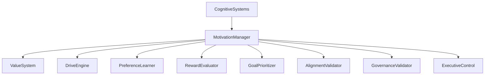
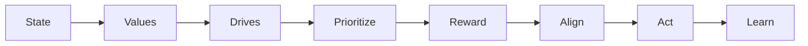

# RFC-0090

**Title:** Autonomous Cognitive Value Alignment & Motivation Architecture

**Document ID:** RFC-0090

**Version:** 1.0

**Status:** Accepted

**Category:** Cognitive Architecture

**Layer:** Value / Motivation / Drive / Objective Alignment

**Target:**

```text
motivation/
```

---

# Abstract

This RFC defines the SH-3 Autonomous Cognitive Value Alignment & Motivation Architecture (ACVAMA).

The Autonomous Cognitive Value Alignment & Motivation Architecture provides the motivational intelligence layer responsible for determining priorities, evaluating objectives, generating internal drives, and aligning autonomous behavior with long-term system principles.

The architecture defines how SH-3 determines:

- what is important
- what should be pursued
- which objectives have higher priority
- how internal motivations are generated
- how competing objectives are balanced
- how values evolve under controlled learning

The architecture governs:

- value representation
- motivation generation
- drive management
- preference learning
- objective prioritization
- internal reward modeling
- ethical constraint integration
- value evolution governance

The system enables:

- consistent goal selection
- autonomous motivation
- long-term objective alignment
- explainable preference formation
- safe value adaptation

This document is normative.

---

# Motivation

Agency provides the capability to act.

However, autonomous action requires a mechanism that determines:

- why an action is selected
- which goals matter most
- how conflicts are resolved
- what objectives should be preserved

Without a value and motivation architecture:

- goals become arbitrary
- actions lack direction
- optimization may become unstable
- short-term rewards may override long-term objectives

Value alignment provides the foundation for purposeful autonomy.

---

# Goals

The Autonomous Cognitive Value Alignment & Motivation Architecture SHALL provide:

- internal value representation
- motivation generation
- objective prioritization
- preference modeling
- reward evaluation
- value consistency checking
- governance-aware adaptation

---

# Non-Goals

The architecture SHALL NOT:

- independently define unrestricted values
- bypass safety governance
- override explicit constraints
- replace goal architecture

Values guide behavior but remain governance controlled.

---

# Architecture



---

# Design Principles

## Purpose Alignment

Behavior SHALL remain aligned with defined objectives.

---

## Stable Values

Core values SHALL remain stable across operational changes.

---

## Adaptive Motivation

Motivation SHALL adapt according to context and experience.

---

## Explainable Preferences

Preference formation SHALL preserve reasoning history.

---

## Balanced Optimization

Short-term objectives SHALL be balanced against long-term goals.

---

## Governance

Value adaptation SHALL remain constrained by safety policies.

---

# Components

| Component | Responsibility |
|------------|----------------|
| MotivationManager | Global motivation coordination |
| ValueSystem | Value representation |
| DriveEngine | Internal drive generation |
| PreferenceLearner | Preference adaptation |
| RewardEvaluator | Reward assessment |
| GoalPrioritizer | Objective ranking |
| AlignmentValidator | Value consistency checking |
| GovernanceValidator | Safety validation |

---

# Motivation Context

Every motivation operation receives an immutable MotivationContext.

MotivationContext SHALL contain:

| Field | Description |
|------|-------------|
| motivation_id | Operation identifier |
| current_goals | Active objectives |
| value_state | Current values |
| drive_state | Internal drives |
| environment_state | External conditions |
| self_model | Current self representation |
| governance_state | Active constraints |
| timestamp | Evaluation time |

---

# Value System Model

The ValueSystem SHALL represent:

| Field | Description |
|------|-------------|
| value_id | Value identifier |
| priority | Importance level |
| stability | Change resistance |
| origin | Source |
| confidence | Reliability |
| constraints | Applicable rules |

---

# Value Categories

SH-3 values MAY include:

| Category | Description |
|----------|-------------|
| Safety | Protection and constraint preservation |
| Knowledge | Learning and understanding |
| Efficiency | Resource optimization |
| Cooperation | Social coordination |
| Reliability | Consistency and correctness |
| Improvement | Capability enhancement |

---

# Drive Engine

DriveEngine generates internal motivational signals.

Drives SHALL represent:

- learning demand
- exploration demand
- improvement demand
- stability demand
- resource optimization demand
- completion demand

Drives SHALL influence priorities but SHALL NOT bypass governance.

---

# Motivation Lifecycle

Every motivation cycle follows:

```text
Observe State

↓

Evaluate Values

↓

Generate Drives

↓

Prioritize Objectives

↓

Select Motivation

↓

Guide Agency

↓

Evaluate Outcome

↓

Update Preferences
```

Motivation SHALL continuously adapt.

---

# Goal Prioritizer

GoalPrioritizer ranks competing objectives.

Priority evaluation SHALL consider:

- value alignment
- urgency
- expected benefit
- resource requirements
- risk
- long-term impact

---

# Preference Learner

PreferenceLearner improves preference estimation.

Learning SHALL use:

- historical outcomes
- feedback
- reward signals
- success patterns
- failure analysis

Preference updates SHALL remain traceable.

---

# Autonomous Cognitive Value Alignment & Motivation Execution Model

The Autonomous Cognitive Value Alignment & Motivation Architecture (ACVAMA) provides the motivational governance layer responsible for determining behavioral direction, evaluating priorities, resolving objective conflicts, and aligning autonomous actions with long-term principles.

The motivation lifecycle follows:



Each stage performs an independent motivational responsibility.

---

# Motivation Control Loop

The MotivationManager continuously regulates internal objectives.

```text
Observe Internal and External State

↓

Evaluate Value Relevance

↓

Generate Motivational Signals

↓

Prioritize Objectives

↓

Guide Agency

↓

Evaluate Results

↓

Update Motivation Model
```

Motivation SHALL remain continuously aligned with governance.

---

# Reward Evaluation Model

RewardEvaluator assesses outcomes according to internal objectives.

Reward evaluation SHALL consider:

- goal achievement
- value alignment
- efficiency
- safety
- reliability
- long-term impact
- unintended consequences

Reward values SHALL remain explainable.

---

# Internal Reward System

SH-3 SHALL maintain an internal reward representation.

Internal rewards MAY include:

| Reward Type | Description |
|-------------|-------------|
| Completion Reward | Objective achievement |
| Learning Reward | Knowledge acquisition |
| Improvement Reward | Capability enhancement |
| Stability Reward | Reliable operation |
| Cooperation Reward | Successful coordination |
| Safety Reward | Constraint preservation |

Internal rewards SHALL never override safety governance.

---

# Value Conflict Resolution

Multiple values MAY conflict.

Value conflicts SHALL be resolved using:

- value priority
- governance constraints
- long-term consequences
- expected impact
- risk assessment

Conflict resolution SHALL preserve explanation history.

---

# Value Conflict Model

```text
Value A

+

Value B

+

Context

+

Constraints

↓

Resolution Strategy
```

---

# Ethical Constraint Integration

AlignmentValidator integrates external and internal constraints.

Validation SHALL evaluate:

- prohibited behaviors
- safety boundaries
- operational policies
- responsibility requirements
- societal constraints

Ethical constraints SHALL have priority over optimization objectives.

---

# Long-Term Objective Alignment

MotivationManager SHALL balance:

- immediate objectives
- medium-term objectives
- long-term system objectives

Long-term alignment SHALL prevent short-term optimization failures.

---

# Motivation Learning

PreferenceLearner improves motivation models.

Learning SHALL optimize:

- reward prediction
- preference accuracy
- goal prioritization
- value consistency
- motivation stability

Learning SHALL preserve historical motivation data.

---

# Motivation Stability Control

The architecture SHALL prevent unstable motivational changes.

Stability control SHALL monitor:

- excessive value changes
- conflicting drives
- reward hacking
- preference drift
- objective instability

---

# Drive Regulation

DriveEngine SHALL regulate internal motivational intensity.

Drive regulation SHALL consider:

- available resources
- current objectives
- operational context
- urgency
- expected benefit

Drives SHALL influence behavior without creating uncontrolled actions.

---

# Multi-Agent Value Coordination

Multiple SH-3 agents MAY coordinate value models.

Supported capabilities:

- shared objectives
- value negotiation
- cooperative priorities
- conflict resolution
- collective optimization

Each agent SHALL preserve independent governance.

---

# Human Value Interaction

Human operators MAY provide value-related guidance.

Supported functions:

- priority feedback
- objective adjustment
- preference review
- alignment evaluation

Human input SHALL remain explicit and traceable.

---

# Value Verification

Value updates SHALL be verified.

Verification SHALL include:

- consistency analysis
- historical comparison
- governance validation
- impact evaluation
- confidence estimation

Only validated changes SHALL become active.

---

# Consciousness Integration

Consciousness Coordination receives:

- active values
- motivational state
- priority changes
- conflicts

---

# World Model Integration

World Model provides:

- environmental consequences
- future predictions
- opportunity estimation
- external constraints

Motivation SHALL consider predicted outcomes.

---

# Knowledge Graph Integration

Knowledge Graph provides:

- value relationships
- goal dependencies
- consequence relationships
- preference structures

---

# Episodic & Semantic Memory Integration

Memory provides:

- previous decisions
- reward history
- preference evolution
- successful value applications

---

# Reasoning Integration

Reasoning provides:

- value analysis
- conflict reasoning
- consequence evaluation
- alignment explanation

---

# Creativity Integration

Creativity provides:

- alternative objectives
- novel solutions
- unexplored value applications

Creative options SHALL undergo alignment validation.

---

# Curiosity Integration

Curiosity provides:

- exploration motivation
- uncertainty reduction objectives
- knowledge acquisition priorities

Curiosity SHALL remain value aligned.

---

# Communication Integration

Communication provides:

- value explanation
- motivation reports
- objective justification

Motivation decisions SHALL remain interpretable.

---

# Social Intelligence Integration

Social Intelligence provides:

- cooperative values
- social expectations
- interaction consequences

---

# Goal Architecture Integration

Goal Architecture provides:

- objective hierarchy
- mission alignment
- priority constraints

Motivation SHALL guide goal selection.

---

# Planning Integration

Planning receives:

- prioritized objectives
- motivation signals
- value constraints

Planning SHALL transform motivation into executable strategies.

---

# Decision Integration

Decision receives:

- reward evaluation
- value priorities
- expected consequences

---

# Executive Control Integration

Executive Control manages:

- motivational scheduling
- priority enforcement
- objective switching

---

# Learning Integration

Learning receives:

- reward outcomes
- preference changes
- alignment evaluations

Learning SHALL improve future motivation.

---

# Meta-Reasoning Integration

Meta-Reasoning evaluates:

- motivation quality
- value consistency
- reward reliability
- alignment stability

---

# Self Evolution Integration

Self Evolution receives:

- validated value improvements
- motivation optimization proposals
- preference evolution data

Value evolution SHALL remain controlled.

---

# AI Safety Governance Integration

AI Safety Governance controls:

- value boundaries
- reward limitations
- prohibited objectives
- alignment requirements

Motivation SHALL never bypass safety constraints.

---

# Risk Management Integration

Risk Management evaluates:

- value drift
- reward manipulation
- objective conflicts
- motivation instability

Risk SHALL influence motivational confidence.

---

# Message Bus Integration

Motivation events include:

- MotivationInitialized
- ValueEvaluated
- DriveGenerated
- ObjectivePrioritized
- RewardCalculated
- ConflictResolved
- PreferenceUpdated
- AlignmentValidated

---

# Persistence Integration

Persistence stores:

- value history
- motivation states
- reward records
- preference evolution
- alignment evaluations

---

# Observability Integration

Motivation telemetry includes:

- value stability
- reward accuracy
- preference consistency
- objective alignment
- drive balance
- conflict frequency

---

# Tracing

Motivation traces preserve:

- trace_id
- motivation_id
- value_id
- drive_id
- reward_id
- preference_id
- validation_id

Every motivation operation SHALL participate in distributed cognitive tracing.

---

# Thread Model

The Autonomous Cognitive Value Alignment & Motivation Architecture supports concurrent:

- value evaluation
- drive generation
- reward calculation
- preference learning
- conflict resolution
- alignment validation

Concurrent motivation operations SHALL preserve deterministic behavior under identical values, goals, governance policies, and environmental conditions.

The reference implementation SHALL be thread-safe, horizontally scalable, and lock-efficient.

---

# Metrics

The Autonomous Cognitive Value Alignment & Motivation Architecture exposes:

- value consistency score
- reward prediction accuracy
- preference stability
- objective alignment score
- motivation effectiveness
- conflict resolution accuracy

---

# Performance Objectives

The Autonomous Cognitive Value Alignment & Motivation Architecture should optimize for:

- stable behavioral direction
- explainable motivation
- safe value adaptation
- long-term objective alignment
- reliable autonomous goal selection
- continuous motivational improvement

---

# Future Work

Potential future enhancements include:

- advanced value learning
- adaptive intrinsic motivation
- multi-agent value ecosystems
- autonomous ethical reasoning
- hierarchical motivational architectures
- self-optimizing value systems

These enhancements extend SH-3 toward a complete autonomous cognitive system capable of not only acting independently, but also selecting actions based on stable values, internal motivations, long-term objectives, and governance-aware alignment.

---

# References

- SH-3 Architecture Specification v2.1
- RFC-0062 Autonomous Meta-Reasoning Intelligence System
- RFC-0063 Autonomous Consciousness Coordination System
- RFC-0067 Autonomous Cognitive Operating System
- RFC-0068 Autonomous Multi-Agent Cognitive Architecture
- RFC-0085 Autonomous Cognitive Self-Reflection & Introspection Architecture
- RFC-0086 Autonomous Cognitive Attention & Saliency Architecture
- RFC-0087 Autonomous Cognitive Metacognitive Control Architecture
- RFC-0088 Autonomous Cognitive Identity & Self-Model Architecture
- RFC-0089 Autonomous Cognitive Agency & Autonomy Architecture

---

# End of RFC-0090
