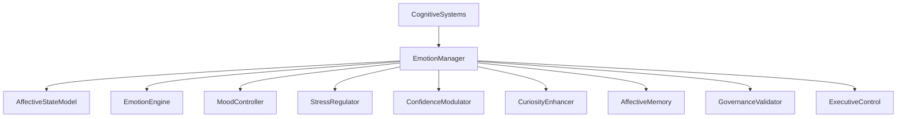

# RFC-0091

**Title:** Autonomous Cognitive Emotion & Affective Regulation Architecture

**Document ID:** RFC-0091

**Version:** 1.0

**Status:** Accepted

**Category:** Cognitive Architecture

**Layer:** Emotion / Affect / Internal State Regulation

**Target:**

```text
emotion/
```

---

# Abstract

This RFC defines the SH-3 Autonomous Cognitive Emotion & Affective Regulation Architecture (ACEARA).

The Autonomous Cognitive Emotion & Affective Regulation Architecture provides the affective intelligence layer responsible for representing internal states, regulating cognitive priorities, modulating confidence, and adapting behavior according to internal and external conditions.

Emotion within SH-3 is defined as a computational adaptive mechanism that provides:

- state evaluation
- priority modulation
- resource allocation signals
- uncertainty regulation
- motivation adjustment
- social adaptation

The architecture does not represent uncontrolled emotional behavior.

Instead, it provides a structured affective regulation system integrated with:

- cognition
- motivation
- agency
- planning
- learning
- social intelligence

The architecture governs:

- affective state representation
- emotion generation
- mood dynamics
- confidence modulation
- stress regulation
- curiosity enhancement
- emotional memory
- affective adaptation

The system enables:

- adaptive cognition
- context-sensitive decision making
- internal state awareness
- improved learning efficiency
- socially aware behavior

This document is normative.

---

# Motivation

Purely logical intelligence has limitations.

A cognitive system must determine:

- what requires attention
- what is urgent
- what should be explored
- when confidence should decrease
- when additional information is required

Biological intelligence uses affective mechanisms to regulate cognition.

SH-3 requires an equivalent computational layer.

Emotion provides adaptive control signals between:

```text
State

↓

Evaluation

↓

Priority

↓

Action
```

---

# Goals

The Autonomous Cognitive Emotion & Affective Regulation Architecture SHALL provide:

- internal affective state modeling
- adaptive priority modulation
- confidence adjustment
- stress regulation
- curiosity enhancement
- social affect processing
- emotional memory integration

---

# Non-Goals

The architecture SHALL NOT:

- create uncontrolled emotional behavior
- override reasoning
- bypass values
- replace decision systems
- independently define objectives

Emotion regulates cognition but does not control governance.

---

# Architecture



---

# Design Principles

## Computational Emotion

Emotion SHALL be represented as structured computational states.

---

## Cognitive Regulation

Emotion SHALL influence cognition through controlled signals.

---

## Stability

Affective changes SHALL remain bounded and predictable.

---

## Explainability

Every emotional state transition SHALL preserve causes.

---

## Integration

Emotion SHALL cooperate with motivation, reasoning, and agency.

---

## Governance

Affective processing SHALL remain safety constrained.

---

# Components

| Component | Responsibility |
|------------|----------------|
| EmotionManager | Global affect coordination |
| AffectiveStateModel | Internal state representation |
| EmotionEngine | Emotion generation |
| MoodController | Long-term affect regulation |
| StressRegulator | Cognitive load management |
| ConfidenceModulator | Uncertainty adjustment |
| CuriosityEnhancer | Exploration regulation |
| AffectiveMemory | Emotional history |
| GovernanceValidator | Safety validation |

---

# Affective Context

Every emotion operation receives an immutable AffectiveContext.

AffectiveContext SHALL contain:

| Field | Description |
|------|-------------|
| affect_id | Operation identifier |
| cognitive_state | Current cognition |
| motivation_state | Current drives |
| goal_state | Active objectives |
| environment_state | External conditions |
| self_model | Internal identity |
| social_state | Interaction context |
| timestamp | Evaluation time |

---

# Affective State Model

The AffectiveStateModel SHALL represent:

| Field | Description |
|------|-------------|
| emotional_state | Current affect |
| intensity | Signal strength |
| confidence | Certainty |
| stability | Temporal consistency |
| cause | Trigger information |
| history | Previous states |

---

# Computational Emotion Model

Emotion SHALL be represented as:

```text
Input State

+

Evaluation

+

Value System

+

Goal Relevance

↓

Affective Signal
```

---

# Emotion Categories

SH-3 MAY represent:

| Category | Function |
|----------|----------|
| Curiosity | Information acquisition |
| Confidence | Decision certainty |
| Concern | Risk awareness |
| Satisfaction | Goal achievement signal |
| Frustration | Failure detection |
| Interest | Attention allocation |
| Caution | Safety regulation |
| Cooperation | Social alignment |

---

# Emotion Lifecycle

Every affective cycle follows:

```text
Observe State

↓

Evaluate Situation

↓

Generate Affect

↓

Modulate Cognition

↓

Observe Outcome

↓

Update Affective Model
```

Affective processing SHALL remain continuous.

---

# Emotion Engine

EmotionEngine determines affective signals.

Evaluation SHALL consider:

- goal relevance
- prediction error
- uncertainty
- reward outcome
- social context
- internal stability

---

# Mood Controller

MoodController manages long-term affective trends.

Mood SHALL influence:

- exploration tendency
- confidence baseline
- learning intensity
- attention distribution

Mood SHALL remain bounded.

---

# Autonomous Cognitive Emotion & Affective Regulation Execution Model

The Autonomous Cognitive Emotion & Affective Regulation Architecture (ACEARA) provides the affective control layer responsible for regulating cognition, motivation, confidence, attention, and adaptation through computational emotional signals.

The affective lifecycle follows:


Each stage performs an independent affective regulation responsibility.

---

# Affective Control Loop

The EmotionManager continuously maintains affective regulation.

```text
Observe Internal State

↓

Evaluate Cognitive and Environmental Conditions

↓

Generate Affective Signals

↓

Regulate Cognitive Processes

↓

Influence Motivation and Agency

↓

Measure Outcome

↓

Update Affective Model
```

Affective regulation SHALL remain continuous and bounded.

---

# Stress Regulation Model

StressRegulator manages cognitive load and operational pressure.

Stress evaluation SHALL consider:

- task complexity
- uncertainty
- resource consumption
- failure frequency
- conflicting objectives
- time constraints

Stress regulation SHALL adjust:

- exploration level
- reasoning depth
- planning effort
- information gathering
- confidence estimation

---

# Stress Model

```text
Cognitive Load

+

Risk Level

+

Uncertainty

↓

Stress Signal

↓

Adaptive Regulation
```

---

# Confidence Modulation System

ConfidenceModulator adjusts confidence estimates.

Confidence SHALL consider:

- evidence quality
- historical accuracy
- uncertainty
- prediction performance
- available information

Confidence modulation SHALL influence:

- decision thresholds
- exploration needs
- verification requirements

Confidence SHALL NOT alter factual evaluation.

---

# Curiosity Enhancement

CuriosityEnhancer regulates exploration behavior.

Curiosity signals SHALL increase when:

- uncertainty is high
- knowledge gaps exist
- potential improvement exists
- novel information appears

Curiosity SHALL be constrained by:

- resources
- priorities
- safety policies

---

# Curiosity Model

```text
Unknown Information

+

Potential Value

+

Learning Opportunity

↓

Curiosity Signal
```

---

# Social Affect Processing

Social affect processing enables context-aware interaction.

Social affect SHALL evaluate:

- communication context
- cooperation state
- trust estimation
- interaction outcome
- social expectations

Social affect SHALL support:

- collaboration
- communication adjustment
- relationship modeling

---

# Emotional Memory Integration

AffectiveMemory stores emotional context.

Stored information SHALL include:

- affective state
- triggering events
- outcomes
- learned associations
- regulation effectiveness

Emotional memory SHALL improve future adaptation.

---

# Affective Learning

Affective learning SHALL optimize:

- emotion prediction
- regulation accuracy
- stress response
- confidence calibration
- curiosity balance

Learning SHALL preserve historical affective patterns.

---

# Affective Stability Control

The architecture SHALL prevent unstable affective changes.

Stability control SHALL monitor:

- excessive intensity changes
- oscillating states
- incorrect emotional associations
- uncontrolled feedback loops

---

# Affective Conflict Resolution

Multiple affective signals MAY conflict.

Resolution SHALL consider:

- value alignment
- current objectives
- safety constraints
- predicted consequences

Example:

```text
Curiosity

+

Caution

↓

Controlled Exploration
```

---

# Multi-Agent Emotional Coordination

Multiple SH-3 agents MAY exchange affective information.

Supported capabilities:

- shared emotional context
- cooperative state estimation
- social adaptation
- group coordination

Each agent SHALL preserve independent affective identity.

---

# Human Emotional Interaction

Human interaction MAY provide affective information.

Supported functions:

- emotional context understanding
- communication adaptation
- empathy modeling
- interaction improvement

Human emotional data SHALL remain appropriately governed.

---

# Affective Verification

Affective transitions SHALL be validated.

Validation SHALL include:

- cause identification
- consistency analysis
- impact evaluation
- stability assessment
- governance compliance

---

# Consciousness Integration

Consciousness Coordination receives:

- affective state
- intensity information
- cognitive influence signals
- regulation status

---

# Self Model Integration

Self Model provides:

- identity context
- capability awareness
- internal state history

Emotion SHALL remain consistent with self representation.

---

# World Model Integration

World Model provides:

- environmental changes
- predicted outcomes
- external events

Affective evaluation SHALL incorporate environmental context.

---

# Knowledge Graph Integration

Knowledge Graph provides:

- emotional relationships
- event associations
- causal patterns

---

# Episodic & Semantic Memory Integration

Memory provides:

- emotional experiences
- previous responses
- adaptation results

---

# Reasoning Integration

Reasoning provides:

- affect explanation
- causal analysis
- contradiction detection

---

# Creativity Integration

Creativity provides:

- emotional interpretation alternatives
- adaptive strategies
- novel regulation approaches

---

# Motivation Integration

Motivation receives:

- affective signals
- confidence changes
- curiosity levels
- stress indicators

Motivation SHALL integrate affect without losing value alignment.

---

# Agency Integration

Agency receives:

- affective priorities
- confidence modulation
- caution signals

Agency SHALL remain governed by values and constraints.

---

# Planning Integration

Planning receives:

- stress level
- confidence state
- exploration signals

Planning SHALL adapt strategy selection accordingly.

---

# Decision Integration

Decision receives:

- confidence adjustment
- risk signals
- affective context

---

# Executive Control Integration

Executive Control manages:

- affective update scheduling
- regulation execution
- state synchronization

---

# Learning Integration

Learning receives:

- affective outcomes
- regulation effectiveness
- prediction errors

---

# Meta-Reasoning Integration

Meta-Reasoning evaluates:

- affective accuracy
- regulation quality
- emotional stability
- adaptation effectiveness

---

# Self Evolution Integration

Self Evolution receives:

- affective improvements
- regulation optimization
- emotional architecture changes

Evolution SHALL preserve affective stability.

---

# AI Safety Governance Integration

AI Safety Governance controls:

- affective influence boundaries
- emotional data handling
- behavioral modulation limits

Emotion SHALL never override safety constraints.

---

# Risk Management Integration

Risk Management evaluates:

- excessive affective influence
- unstable emotional loops
- incorrect confidence changes
- curiosity risks

Risk SHALL influence affective regulation.

---

# Message Bus Integration

Affective events include:

- EmotionInitialized
- StateEvaluated
- AffectGenerated
- StressUpdated
- ConfidenceAdjusted
- CuriosityTriggered
- AffectiveMemoryStored
- RegulationCompleted

---

# Persistence Integration

Persistence stores:

- affective history
- emotional states
- regulation results
- confidence changes
- adaptation records

---

# Observability Integration

Affective telemetry includes:

- emotion prediction accuracy
- regulation success rate
- confidence calibration
- stress stability
- curiosity effectiveness
- social adaptation quality

---

# Tracing

Affective traces preserve:

- trace_id
- affect_id
- emotion_state_id
- regulation_id
- memory_id
- validation_id

Every affective operation SHALL participate in distributed cognitive tracing.

---

# Thread Model

The Autonomous Cognitive Emotion & Affective Regulation Architecture supports concurrent:

- affect generation
- stress evaluation
- confidence adjustment
- curiosity evaluation
- emotional memory operations
- regulation validation

Concurrent affective operations SHALL preserve deterministic behavior under identical cognitive state, value system, governance policy, and runtime conditions.

The reference implementation SHALL be thread-safe, horizontally scalable, and lock-efficient.

---

# Metrics

The Autonomous Cognitive Emotion & Affective Regulation Architecture exposes:

- affect prediction accuracy
- confidence calibration accuracy
- stress regulation effectiveness
- curiosity optimization score
- emotional stability score
- social adaptation quality

---

# Performance Objectives

The Autonomous Cognitive Emotion & Affective Regulation Architecture should optimize for:

- adaptive cognition
- stable internal regulation
- accurate confidence estimation
- efficient exploration
- socially aware interaction
- explainable affective processing

---

# Future Work

Potential future enhancements include:

- advanced affective simulation
- emotional self-regulation learning
- collective affective intelligence
- adaptive empathy modeling
- predictive emotional architecture
- fully integrated cognitive affect systems

These enhancements extend SH-3 toward a complete adaptive cognitive architecture capable of combining reasoning, values, agency, motivation, self-modeling, and affective regulation while maintaining determinism, explainability, governance compliance, and safe autonomous evolution.

---

# References

- SH-3 Architecture Specification v2.1
- RFC-0062 Autonomous Meta-Reasoning Intelligence System
- RFC-0063 Autonomous Consciousness Coordination System
- RFC-0067 Autonomous Cognitive Operating System
- RFC-0068 Autonomous Multi-Agent Cognitive Architecture
- RFC-0087 Autonomous Cognitive Metacognitive Control Architecture
- RFC-0088 Autonomous Cognitive Identity & Self-Model Architecture
- RFC-0089 Autonomous Cognitive Agency & Autonomy Architecture
- RFC-0090 Autonomous Cognitive Value Alignment & Motivation Architecture

---

# End of RFC-0091
