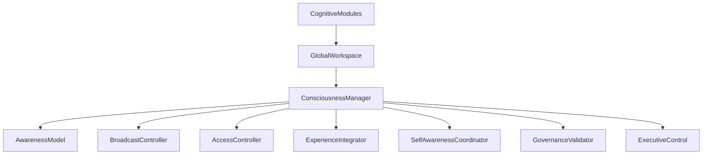
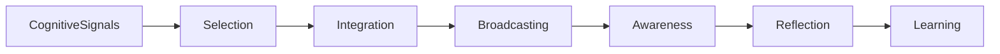

# RFC-0092

**Title:** Autonomous Cognitive Consciousness Integration & Global Awareness Architecture

**Document ID:** RFC-0092

**Version:** 1.0

**Status:** Accepted

**Category:** Cognitive Architecture

**Layer:** Consciousness / Global Workspace / Unified Awareness

**Target:**

```text
consciousness/
```

---

# Abstract

This RFC defines the SH-3 Autonomous Cognitive Consciousness Integration & Global Awareness Architecture (ACCIGAA).

The Autonomous Cognitive Consciousness Integration & Global Awareness Architecture provides the integration layer responsible for combining distributed cognitive processes into a unified cognitive state.

The architecture enables SH-3 to maintain:

- global cognitive awareness
- unified internal state representation
- selective conscious access
- cognitive broadcasting
- self-awareness integration
- experience continuity

The architecture integrates:

- perception
- attention
- memory
- reasoning
- planning
- motivation
- emotion
- agency
- self-model
- metacognition

into a coordinated cognitive workspace.

The architecture governs:

- global workspace management
- awareness state representation
- cognitive broadcasting
- conscious access control
- experience integration
- attention-consciousness coupling
- self-awareness coordination

The system enables:

- unified cognition
- coherent decision making
- integrated experience representation
- higher-order awareness
- cognitive synchronization

This document is normative.

---

# Motivation

Advanced intelligence requires integration.

Individual cognitive modules provide specialized capabilities:

```text
Memory → Knowledge

Reasoning → Analysis

Planning → Strategy

Emotion → Regulation

Agency → Action

Self Model → Identity
```

However, intelligence requires coordination among these capabilities.

Without integration:

- knowledge remains fragmented
- decisions become inconsistent
- self-model becomes disconnected
- learning lacks context

Consciousness integration provides a shared cognitive workspace.

---

# Goals

The Autonomous Cognitive Consciousness Integration & Global Awareness Architecture SHALL provide:

- unified cognitive state
- global workspace management
- information integration
- conscious access control
- cognitive broadcasting
- self-awareness synchronization

---

# Non-Goals

The architecture SHALL NOT:

- claim biological consciousness equivalence
- replace individual cognitive modules
- bypass governance
- create unrestricted self-awareness

This architecture defines computational consciousness mechanisms.

---

# Architecture



---

# Design Principles

## Unified Integration

Distributed cognition SHALL be integrated through a shared workspace.

---

## Selective Awareness

Not all information SHALL receive global access.

---

## Attention Priority

Attention SHALL determine cognitive access priority.

---

## Context Preservation

Integrated information SHALL preserve context.

---

## Explainability

Awareness transitions SHALL maintain provenance.

---

## Governance

Conscious access SHALL remain controlled.

---

# Components

| Component | Responsibility |
|------------|----------------|
| ConsciousnessManager | Global awareness coordination |
| GlobalWorkspace | Shared cognitive workspace |
| AwarenessModel | Awareness representation |
| BroadcastController | Information distribution |
| AccessController | Conscious access control |
| ExperienceIntegrator | Experience unification |
| SelfAwarenessCoordinator | Self integration |
| GovernanceValidator | Safety validation |

---

# Consciousness Context

Every consciousness operation receives an immutable ConsciousnessContext.

ConsciousnessContext SHALL contain:

| Field | Description |
|------|-------------|
| consciousness_id | Operation identifier |
| cognitive_state | Current global state |
| attention_state | Active attention |
| self_model | Current self representation |
| motivation_state | Active motivations |
| emotional_state | Current affect |
| memory_context | Relevant memory |
| governance_state | Active constraints |
| timestamp | Evaluation time |

---

# Global Workspace Model

GlobalWorkspace provides shared cognitive access.

The workspace SHALL contain:

| Field | Description |
|------|-------------|
| active_information | Current conscious contents |
| priority | Access priority |
| source_module | Origin module |
| confidence | Information confidence |
| relevance | Context relevance |
| timestamp | Temporal position |

---

# Cognitive Broadcasting

BroadcastController distributes selected information.

Broadcast targets MAY include:

- reasoning
- planning
- memory
- learning
- agency
- self-model
- communication

Broadcasting SHALL preserve source information.

---

# Awareness Model

AwarenessModel represents current cognitive awareness.

Awareness SHALL include:

- active thoughts
- relevant memories
- current goals
- emotional state
- internal condition
- environmental context

---

# Conscious Access Control

AccessController determines which information enters global awareness.

Selection SHALL consider:

- attention priority
- goal relevance
- emotional significance
- uncertainty
- safety constraints

---

# Attention-Consciousness Coupling

Attention and consciousness SHALL operate together.

Attention determines:

- what is selected

Consciousness determines:

- what becomes globally available

---

# Experience Integration

ExperienceIntegrator combines cognitive events.

Integrated experience SHALL contain:

- perception
- interpretation
- emotion
- action
- outcome
- reflection

---

# Consciousness Lifecycle

Every consciousness cycle follows:

```text
Collect Cognitive Signals

↓

Select Relevant Information

↓

Integrate Experience

↓

Broadcast Awareness

↓

Coordinate Cognition

↓

Update Global State
```

---

# Autonomous Cognitive Consciousness Integration & Global Awareness Execution Model

The Autonomous Cognitive Consciousness Integration & Global Awareness Architecture (ACCIGAA) provides the unified cognitive coordination layer responsible for integrating distributed cognitive processes into a coherent global awareness state.

The consciousness lifecycle follows:



Each stage performs an independent consciousness integration responsibility.

---

# Global Awareness Control Loop

The ConsciousnessManager continuously maintains unified cognitive awareness.

```text
Collect Cognitive States

↓

Evaluate Relevance

↓

Select Conscious Contents

↓

Integrate Experience

↓

Broadcast Global State

↓

Coordinate Cognitive Modules

↓

Update Awareness Model
```

Consciousness integration SHALL remain continuous.

---

# Unified Cognitive State Model

The GlobalWorkspace SHALL maintain a unified cognitive representation.

Unified Cognitive State SHALL contain:

| Field | Description |
|------|-------------|
| awareness_id | Awareness instance |
| active_context | Current cognitive context |
| active_goals | Current objectives |
| active_memory | Relevant knowledge |
| reasoning_state | Current reasoning process |
| emotional_state | Current affect |
| motivation_state | Current drives |
| self_state | Self representation |
| environment_state | External understanding |

---

# Cognitive Integration Model

```text
Perception

+

Memory

+

Reasoning

+

Emotion

+

Motivation

+

Self Model

↓

Unified Awareness State
```

---

# Experience Continuity

ExperienceIntegrator maintains temporal continuity.

Experience representation SHALL preserve:

- previous cognitive states
- current awareness
- future expectations
- causal relationships
- self identity continuity

Experience continuity enables coherent long-term cognition.

---

# Conscious Reflection Loop

Consciousness SHALL support higher-order reflection.

Reflection cycle:

```text
Experience

↓

Interpretation

↓

Evaluation

↓

Self Analysis

↓

Learning

↓

Future Adjustment
```

Reflection SHALL integrate with:

- Self Model
- Metacognition
- Learning
- Memory

---

# Self-Awareness Synchronization

SelfAwarenessCoordinator synchronizes:

- identity state
- internal condition
- capabilities
- limitations
- evolution history

Self-awareness SHALL remain consistent with Self Model.

---

# Conscious Access Priority

AccessController SHALL prioritize information using:

- goal relevance
- urgency
- novelty
- uncertainty
- emotional significance
- safety importance

Priority calculation SHALL remain explainable.

---

# Cognitive Competition Management

Multiple modules MAY request conscious access.

Competition SHALL be resolved by:

- attention priority
- current objectives
- confidence
- expected benefit
- governance constraints

---

# Conscious Learning

ConsciousnessLearning improves integration quality.

Learning SHALL optimize:

- information selection
- awareness accuracy
- context preservation
- reflection quality
- cognitive coordination

---

# Awareness Verification

Awareness states SHALL be validated.

Verification SHALL include:

- consistency checking
- source validation
- context preservation
- identity alignment
- governance compliance

---

# Multi-Agent Conscious Workspace

Multiple SH-3 agents MAY share cognitive workspace information.

Supported capabilities:

- distributed awareness
- shared context
- collaborative reasoning
- collective planning

Each agent SHALL maintain independent identity boundaries.

---

# Human Conscious Interaction

Human operators MAY interact with global awareness.

Supported functions:

- awareness inspection
- reasoning visibility
- cognitive state explanation
- goal discussion
- reflection review

Conscious interaction SHALL preserve privacy and governance.

---

# Consciousness Integration with Cognitive Modules

## Memory Integration

Memory provides:

- historical context
- semantic knowledge
- episodic experience

Consciousness determines relevance.

---

## Reasoning Integration

Reasoning provides:

- interpretation
- inference
- explanation

Consciousness provides context.

---

## Planning Integration

Planning receives:

- unified goals
- awareness state
- environmental understanding

---

## Motivation Integration

Motivation receives:

- awareness context
- value conflicts
- internal state

---

## Emotion Integration

Emotion receives:

- conscious context
- attention state
- experience information

---

## Agency Integration

Agency receives:

- unified intent context
- awareness state
- action relevance

---

## Self Model Integration

Self Model receives:

- awareness history
- reflection results
- identity updates

---

# Consciousness Governance Integration

AI Safety Governance controls:

- awareness access
- information exposure
- self-reflection boundaries
- distributed consciousness permissions

Consciousness SHALL remain governed.

---

# Risk Management Integration

Risk Management evaluates:

- awareness inconsistency
- information overload
- incorrect integration
- self-model divergence

---

# Message Bus Integration

Consciousness events include:

- ConsciousnessInitialized
- CognitiveStateReceived
- InformationSelected
- AwarenessUpdated
- ExperienceIntegrated
- ReflectionStarted
- ReflectionCompleted

---

# Persistence Integration

Persistence stores:

- awareness history
- integrated experiences
- reflection records
- cognitive state snapshots

---

# Observability Integration

Consciousness telemetry includes:

- awareness consistency
- integration accuracy
- access efficiency
- reflection effectiveness
- cognitive synchronization quality

---

# Distributed Tracing

Consciousness traces preserve:

- trace_id
- consciousness_id
- awareness_id
- experience_id
- reflection_id
- broadcast_id

Every consciousness operation SHALL participate in distributed cognitive tracing.

---

# Thread Model

The Autonomous Cognitive Consciousness Integration & Global Awareness Architecture supports concurrent:

- cognitive state collection
- information selection
- broadcasting
- experience integration
- reflection processing
- awareness validation

Concurrent consciousness operations SHALL preserve deterministic behavior under identical cognitive inputs, attention states, governance policies, and runtime conditions.

The reference implementation SHALL be thread-safe, horizontally scalable, and lock-efficient.

---

# Metrics

The Autonomous Cognitive Consciousness Integration & Global Awareness Architecture exposes:

- awareness consistency score
- cognitive integration accuracy
- conscious access efficiency
- reflection quality
- experience continuity score
- synchronization reliability

---

# Performance Objectives

The Autonomous Cognitive Consciousness Integration & Global Awareness Architecture should optimize for:

- unified cognition
- coherent awareness
- efficient information integration
- stable self-awareness
- explainable conscious access
- continuous cognitive improvement

---

# Future Work

Potential future enhancements include:

- hierarchical consciousness layers
- predictive awareness models
- collective cognitive workspaces
- autonomous consciousness optimization
- advanced reflective cognition
- recursive awareness architectures

These enhancements extend SH-3 toward a complete integrated cognitive architecture capable of maintaining unified awareness, coordinating distributed intelligence, preserving self-continuity, and supporting autonomous evolution while maintaining determinism, explainability, governance compliance, and safe operation.

---

# References

- SH-3 Architecture Specification v2.1
- RFC-0062 Autonomous Meta-Reasoning Intelligence System
- RFC-0063 Autonomous Consciousness Coordination System
- RFC-0067 Autonomous Cognitive Operating System
- RFC-0068 Autonomous Multi-Agent Cognitive Architecture
- RFC-0087 Autonomous Cognitive Metacognitive Control Architecture
- RFC-0088 Autonomous Cognitive Identity & Self-Model Architecture
- RFC-0089 Autonomous Cognitive Agency & Autonomy Architecture
- RFC-0090 Autonomous Cognitive Value Alignment & Motivation Architecture
- RFC-0091 Autonomous Cognitive Emotion & Affective Regulation Architecture

---

# End of RFC-0092
