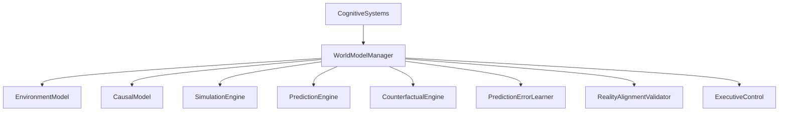

# RFC-0093

**Title:** Autonomous Cognitive Predictive World Model Architecture

**Document ID:** RFC-0093

**Version:** 1.0

**Status:** Accepted

**Category:** Cognitive Architecture

**Layer:** Prediction / Simulation / Causal World Understanding

**Target:**

```text
world_model/
```

---

# Abstract

This RFC defines the SH-3 Autonomous Cognitive Predictive World Model Architecture (ACPWMA).

The Autonomous Cognitive Predictive World Model Architecture provides the predictive intelligence layer responsible for constructing internal representations of the environment, simulating possible futures, evaluating consequences, and improving decision quality through prediction.

The architecture enables SH-3 to:

- understand environmental dynamics
- predict future states
- simulate possible actions
- evaluate consequences
- perform counterfactual reasoning
- improve planning through prediction accuracy

The architecture transforms cognition from reactive processing into predictive intelligence.

The architecture governs:

- world representation
- causal modeling
- internal simulation
- future prediction
- counterfactual evaluation
- prediction error learning
- reality alignment

The system enables:

- anticipatory decision making
- improved planning
- adaptive behavior
- causal understanding
- future-oriented cognition

This document is normative.

---

# Motivation

Reactive intelligence operates on current information.

Advanced intelligence requires:

```text
Current State

↓

Prediction

↓

Possible Futures

↓

Decision

↓

Action
```

Without predictive capability:

- planning becomes shallow
- consequences cannot be evaluated
- learning becomes inefficient
- adaptation becomes delayed

A predictive world model provides the foundation for future-oriented cognition.

---

# Goals

The Autonomous Cognitive Predictive World Model Architecture SHALL provide:

- environmental representation
- future state prediction
- causal relationship modeling
- simulation capability
- counterfactual reasoning
- prediction-based learning

---

# Non-Goals

The architecture SHALL NOT:

- replace real-world observation
- assume predictions are guaranteed facts
- bypass uncertainty handling
- override governance

Predictions SHALL remain probabilistic and explainable.

---

# Architecture



---

# Design Principles

## Predictive First

The system SHALL evaluate possible futures before important actions.

---

## Causal Understanding

The model SHALL represent relationships, not only correlations.

---

## Uncertainty Awareness

Predictions SHALL include confidence estimation.

---

## Continuous Learning

Prediction errors SHALL improve future models.

---

## Reality Alignment

Internal simulations SHALL remain connected to observations.

---

## Explainability

Predictions SHALL preserve reasoning paths.

---

# Components

| Component | Responsibility |
|------------|----------------|
| WorldModelManager | Global world model coordination |
| EnvironmentModel | External state representation |
| CausalModel | Cause-effect relationships |
| SimulationEngine | Future scenario generation |
| PredictionEngine | Future state prediction |
| CounterfactualEngine | Alternative outcome analysis |
| PredictionErrorLearner | Model improvement |
| RealityAlignmentValidator | Observation consistency |

---

# World Model Context

Every world model operation receives an immutable WorldModelContext.

WorldModelContext SHALL contain:

| Field | Description |
|------|-------------|
| world_model_id | Model identifier |
| current_state | Current environment state |
| historical_data | Previous observations |
| agent_state | SH-3 internal state |
| active_goals | Current objectives |
| uncertainty_state | Prediction uncertainty |
| timestamp | Evaluation time |

---

# Environment Model

EnvironmentModel represents external reality.

The model SHALL contain:

| Field | Description |
|------|-------------|
| entities | Known objects |
| relationships | Entity connections |
| states | Current conditions |
| dynamics | Change patterns |
| uncertainty | Unknown information |

---

# Causal Model

CausalModel represents cause-effect structures.

Causal relationships SHALL contain:

| Field | Description |
|------|-------------|
| cause | Trigger condition |
| effect | Result condition |
| confidence | Relationship confidence |
| evidence | Supporting observations |
| context | Applicable conditions |

---

# Predictive Model

PredictionEngine generates future states.

Prediction SHALL include:

- predicted state
- probability
- time horizon
- assumptions
- confidence
- causal basis

---

# Internal Simulation Engine

SimulationEngine creates internal future scenarios.

Simulation SHALL support:

- action simulation
- environment evolution
- resource estimation
- risk estimation
- outcome comparison

---

# Counterfactual Reasoning

CounterfactualEngine evaluates:

```text
"If Action A"

vs

"If Action B"
```

The engine SHALL compare:

- expected outcomes
- risks
- benefits
- causal consequences

---

# Prediction Lifecycle

Every prediction cycle follows:

```text
Observe Reality

↓

Update World Model

↓

Generate Prediction

↓

Simulate Futures

↓

Compare Outcomes

↓

Execute Decision

↓

Measure Error

↓

Learn
```

---

# Prediction Error Learning

PredictionErrorLearner improves world understanding.

Learning SHALL use:

- prediction error
- observation difference
- causal mismatch
- environmental changes

---

# Autonomous Cognitive Predictive World Model Execution Model

The Autonomous Cognitive Predictive World Model Architecture (ACPWMA) provides the predictive cognition layer responsible for simulating possible futures, evaluating consequences, and improving autonomous decisions through learned environmental models.

The predictive lifecycle follows:


Each stage performs an independent predictive intelligence responsibility.

---

# Predictive Control Loop

The WorldModelManager continuously maintains future-oriented cognition.

```text
Collect Observations

↓

Update Environment Model

↓

Update Causal Model

↓

Generate Future Predictions

↓

Evaluate Possible Outcomes

↓

Support Planning and Agency

↓

Compare Prediction With Reality

↓

Improve World Model
```

The predictive loop SHALL operate continuously.

---

# Multi-Agent World Prediction

The World Model SHALL support prediction of multiple agents.

Agent prediction SHALL model:

- agent objectives
- possible actions
- behavioral patterns
- resource constraints
- interaction consequences

The model SHALL maintain uncertainty for agent behavior.

---

# Agent Behavior Prediction Model

```text
Agent State

+

Agent Goal

+

Historical Behavior

+

Environment Context

↓

Predicted Behavior
```

---

# Planning Simulation Integration

WorldModelManager integrates directly with PlanningCore.

Planning SHALL receive:

- simulated outcomes
- predicted risks
- estimated benefits
- future state transitions

Planning SHALL evaluate actions using predicted futures.

---

# Simulation-Based Planning

```text
Possible Plan A

↓

Simulation

↓

Outcome Prediction


Possible Plan B

↓

Simulation

↓

Outcome Prediction


↓

Best Strategy Selection
```

---

# Memory Integration

MemoryCore provides:

- historical events
- previous world states
- learned causal patterns
- prediction outcomes

World Model SHALL store:

- important environmental changes
- causal discoveries
- prediction errors

---

# Reality Synchronization

RealityAlignmentValidator maintains consistency between:

```text
Internal World Model

        vs

External Reality
```

Synchronization SHALL evaluate:

- observation mismatch
- outdated knowledge
- incorrect assumptions
- model drift

---

# Prediction Confidence Management

PredictionEngine SHALL maintain confidence estimates.

Confidence SHALL depend on:

- observation quality
- historical accuracy
- causal reliability
- environmental stability
- prediction horizon

Long-term predictions SHALL include increased uncertainty.

---

# Uncertainty Representation

Every prediction SHALL contain:

| Field | Description |
|------|-------------|
| prediction | Expected future state |
| confidence | Reliability |
| assumptions | Conditions |
| uncertainty | Unknown factors |
| time_horizon | Prediction range |

---

# World Model Learning

WorldModelLearner improves environmental understanding.

Learning SHALL optimize:

- prediction accuracy
- causal accuracy
- simulation quality
- uncertainty estimation
- environmental adaptation

---

# Causal Learning

CausalModel SHALL improve through:

- observed outcomes
- intervention results
- prediction errors
- reasoning feedback

Causal relationships SHALL maintain evidence.

---

# Counterfactual Learning

CounterfactualEngine SHALL learn from:

- alternative outcomes
- failed decisions
- successful strategies
- hypothetical simulations

---

# World Model Stability Control

The architecture SHALL prevent unstable world representations.

Stability monitoring SHALL detect:

- contradictory states
- impossible transitions
- excessive model changes
- unreliable predictions

---

# Predictive Conflict Resolution

Multiple predictions MAY conflict.

Resolution SHALL consider:

- confidence
- evidence quality
- causal consistency
- historical accuracy

---

# Consciousness Integration

Global Awareness receives:

- predicted futures
- uncertainty states
- simulation results
- environmental changes

Consciousness SHALL integrate future awareness.

---

# Agency Integration

Agency receives:

- consequence predictions
- action simulations
- risk estimations

Agency SHALL use predictions before autonomous action.

---

# Motivation Integration

Motivation receives:

- expected rewards
- future benefits
- predicted risks

Motivation SHALL incorporate future consequences.

---

# Emotion Integration

Emotion receives:

- uncertainty
- predicted threats
- predicted achievements

Affective regulation SHALL consider future states.

---

# Reasoning Integration

Reasoning receives:

- causal models
- simulation results
- counterfactual scenarios

Reasoning SHALL use world predictions for inference.

---

# Learning Integration

Learning receives:

- prediction errors
- causal failures
- environment changes

Learning SHALL improve predictive capability.

---

# Self Model Integration

Self Model receives:

- predicted capability changes
- future operational states
- self-improvement outcomes

---

# Creativity Integration

Creativity uses World Model for:

- hypothetical exploration
- invention simulation
- alternative scenario generation

---

# Curiosity Integration

Curiosity uses World Model uncertainty to identify:

- unknown regions
- information gaps
- exploration opportunities

---

# Communication Integration

Communication receives:

- future explanations
- predicted outcomes
- uncertainty information

Predictions SHALL remain understandable.

---

# Social Intelligence Integration

Social Intelligence uses:

- social outcome prediction
- interaction simulation
- relationship dynamics

---

# Goal Architecture Integration

Goal Architecture receives:

- predicted goal outcomes
- feasibility estimates
- long-term consequences

---

# Executive Control Integration

Executive Control manages:

- simulation scheduling
- model updates
- prediction execution priority

---

# AI Safety Governance Integration

AI Safety Governance controls:

- simulation boundaries
- prediction usage
- sensitive world models
- autonomous planning permissions

Predictions SHALL not justify unsafe actions.

---

# Risk Management Integration

Risk Management evaluates:

- prediction uncertainty
- model errors
- simulation failures
- incorrect assumptions

---

# Message Bus Integration

World Model events include:

- WorldModelInitialized
- EnvironmentUpdated
- CausalRelationLearned
- PredictionGenerated
- SimulationCompleted
- PredictionValidated
- WorldModelImproved

---

# Persistence Integration

Persistence stores:

- world states
- causal models
- prediction history
- simulation results
- error analysis

---

# Observability Integration

World Model telemetry includes:

- prediction accuracy
- causal accuracy
- simulation success rate
- synchronization quality
- uncertainty calibration

---

# Distributed Tracing

World Model traces preserve:

- trace_id
- world_model_id
- prediction_id
- simulation_id
- causal_id
- validation_id

Every prediction operation SHALL participate in distributed cognitive tracing.

---

# Thread Model

The Autonomous Cognitive Predictive World Model Architecture supports concurrent:

- environment updates
- prediction generation
- simulations
- causal learning
- reality synchronization
- model validation

Concurrent world model operations SHALL preserve deterministic behavior under identical observations, model state, governance policies, and runtime conditions.

The reference implementation SHALL be thread-safe, horizontally scalable, and lock-efficient.

---

# Metrics

The Autonomous Cognitive Predictive World Model Architecture exposes:

- prediction accuracy
- causal discovery accuracy
- simulation reliability
- uncertainty calibration
- reality alignment score
- future planning improvement

---

# Performance Objectives

The Autonomous Cognitive Predictive World Model Architecture should optimize for:

- accurate future prediction
- reliable causal understanding
- efficient simulation
- improved planning quality
- adaptive environmental modeling
- continuous predictive improvement

---

# Future Work

Potential future enhancements include:

- hierarchical world models
- self-generated environments
- advanced causal discovery
- predictive social intelligence
- collective world simulation
- autonomous reality modeling

These enhancements extend SH-3 toward a complete predictive cognitive architecture capable of understanding the present, simulating possible futures, evaluating consequences, and continuously improving its internal model of reality.

---

# References

- SH-3 Architecture Specification v2.1
- RFC-0062 Autonomous Meta-Reasoning Intelligence System
- RFC-0063 Autonomous Consciousness Coordination System
- RFC-0067 Autonomous Cognitive Operating System
- RFC-0068 Autonomous Multi-Agent Cognitive Architecture
- RFC-0087 Autonomous Cognitive Metacognitive Control Architecture
- RFC-0088 Autonomous Cognitive Identity & Self-Model Architecture
- RFC-0089 Autonomous Cognitive Agency & Autonomy Architecture
- RFC-0090 Autonomous Cognitive Value Alignment & Motivation Architecture
- RFC-0091 Autonomous Cognitive Emotion & Affective Regulation Architecture
- RFC-0092 Autonomous Cognitive Consciousness Integration & Global Awareness Architecture

---

# End of RFC-0093
