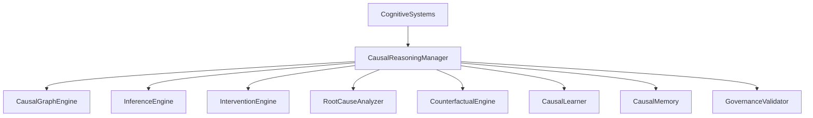

# RFC-0094

**Title:** Autonomous Cognitive Causal Reasoning & Inference Architecture

**Document ID:** RFC-0094

**Version:** 1.0

**Status:** Accepted

**Category:** Cognitive Architecture

**Layer:** Causality / Inference / Intervention Reasoning

**Target:**

```text
causal_reasoning/
```

---

# Abstract

This RFC defines the SH-3 Autonomous Cognitive Causal Reasoning & Inference Architecture (ACCRIA).

The Autonomous Cognitive Causal Reasoning & Inference Architecture provides the causal intelligence layer responsible for discovering cause-effect relationships, performing interventions, evaluating alternative outcomes, and improving reasoning through causal understanding.

The architecture extends predictive cognition from:

```text
"What will happen?"
```

to:

```text
"Why will it happen?"

"What caused it?"

"What changes the outcome?"
```

The architecture enables SH-3 to:

- discover causal relationships
- construct causal graphs
- perform intervention reasoning
- analyze root causes
- evaluate counterfactual scenarios
- improve decisions through causal understanding

The architecture governs:

- causal graph construction
- causal inference
- intervention modeling
- effect prediction
- root cause analysis
- causal memory
- causal learning

The system enables:

- explainable reasoning
- improved planning
- accurate diagnosis
- adaptive learning
- strategic decision making

This document is normative.

---

# Motivation

Prediction alone is insufficient.

A system may know:

```text
Event A

causes

Event B
```

but advanced intelligence requires understanding:

```text
Why does A cause B?

Can changing A prevent B?

What alternative causes exist?
```

Causal intelligence enables:

```text
Observation

↓

Causal Understanding

↓

Intervention

↓

Outcome Change
```

---

# Goals

The Autonomous Cognitive Causal Reasoning & Inference Architecture SHALL provide:

- causal relationship discovery
- causal graph management
- intervention reasoning
- root cause analysis
- counterfactual inference
- causal learning

---

# Non-Goals

The architecture SHALL NOT:

- assume correlation equals causation
- modify reality models without evidence
- bypass uncertainty handling
- replace empirical validation

Causal conclusions SHALL maintain confidence estimates.

---

# Architecture



---

# Design Principles

## Causal First

The system SHALL prioritize causal understanding over simple correlation.

---

## Evidence Based

Causal conclusions SHALL require supporting evidence.

---

## Uncertainty Awareness

Causal relationships SHALL include confidence.

---

## Explainability

Every causal inference SHALL preserve reasoning paths.

---

## Continuous Learning

New observations SHALL improve causal models.

---

## Governance

Causal reasoning SHALL remain constrained by safety rules.

---

# Components

| Component | Responsibility |
|------------|----------------|
| CausalReasoningManager | Global causal coordination |
| CausalGraphEngine | Causal structure management |
| InferenceEngine | Causal inference execution |
| InterventionEngine | Action-effect analysis |
| RootCauseAnalyzer | Cause identification |
| CounterfactualEngine | Alternative outcome reasoning |
| CausalLearner | Causal model improvement |
| CausalMemory | Historical causal storage |
| GovernanceValidator | Safety validation |

---

# Causal Context

Every causal operation receives an immutable CausalContext.

CausalContext SHALL contain:

| Field | Description |
|------|-------------|
| causal_id | Operation identifier |
| observation_state | Current observations |
| world_model | Current environment model |
| historical_data | Previous evidence |
| intervention_state | Possible changes |
| uncertainty_state | Confidence information |
| timestamp | Evaluation time |

---

# Causal Graph Model

CausalGraphEngine represents:

```text
Cause

  ↓

Mechanism

  ↓

Effect
```

---

# Causal Node

Each node SHALL contain:

| Field | Description |
|------|-------------|
| node_id | Entity identifier |
| state | Current state |
| attributes | Properties |
| confidence | Reliability |
| evidence | Supporting data |

---

# Causal Edge

Each causal edge SHALL contain:

| Field | Description |
|------|-------------|
| source | Cause node |
| target | Effect node |
| strength | Relationship strength |
| direction | Causal direction |
| evidence | Supporting observations |
| confidence | Reliability |

---

# Causal Graph Lifecycle

Every causal update follows:

```text
Observe Event

↓

Generate Hypothesis

↓

Evaluate Relationship

↓

Validate Evidence

↓

Update Causal Graph

↓

Monitor Future Results
```

---

# Causal Inference Model

InferenceEngine SHALL determine:

- possible causes
- expected effects
- causal confidence
- alternative explanations

---

# Intervention Reasoning

InterventionEngine evaluates:

```text
Change Cause

↓

Observe Expected Effect
```

Intervention analysis SHALL estimate:

- expected outcome
- side effects
- uncertainty
- risk

---

# Root Cause Analysis

RootCauseAnalyzer identifies:

- primary causes
- contributing factors
- indirect causes
- system-level failures

---

# Counterfactual Inference

CounterfactualEngine evaluates:

```text
If X changed,

would Y still occur?
```

Counterfactual analysis SHALL support:

- planning
- diagnosis
- learning
- optimization

---

# Causal Memory

CausalMemory stores:

- discovered relationships
- intervention results
- causal failures
- validated explanations

---

# Autonomous Cognitive Causal Reasoning & Inference Execution Model

The Autonomous Cognitive Causal Reasoning & Inference Architecture (ACCRIA) provides the causal intelligence layer responsible for understanding mechanisms behind events, evaluating interventions, and improving autonomous reasoning through causal models.

The causal reasoning lifecycle follows:


Each stage performs an independent causal intelligence responsibility.

---

# Causal Reasoning Control Loop

The CausalReasoningManager continuously improves causal understanding.

```text
Collect Observations

↓

Generate Causal Hypotheses

↓

Construct Causal Graph

↓

Evaluate Relationships

↓

Simulate Interventions

↓

Compare Predicted Results

↓

Validate With Reality

↓

Update Causal Model
```

Causal reasoning SHALL remain evidence-driven.

---

# Multi-Agent Causal Reasoning

The architecture SHALL support causal reasoning across multiple agents.

Multi-agent causal capabilities include:

- shared causal discoveries
- distributed evidence collection
- cooperative hypothesis generation
- causal model synchronization
- conflict resolution

Each agent SHALL preserve causal model boundaries.

---

# Causal Knowledge Synchronization

Agents MAY exchange:

- causal relationships
- confidence estimates
- intervention results
- validation outcomes

Synchronization SHALL preserve:

- evidence origin
- confidence level
- context conditions

---

# Planning Integration

PlanningCore receives causal information.

Provided information SHALL include:

- cause-effect relationships
- intervention outcomes
- predicted consequences
- risk factors

Planning SHALL use causal understanding for strategy generation.

---

# Causal Planning Model

```text
Goal

↓

Possible Action

↓

Causal Simulation

↓

Expected Result

↓

Plan Selection
```

---

# Learning Integration

LearningCore receives:

- causal discoveries
- prediction failures
- intervention results
- root cause analysis

Learning SHALL improve:

- world models
- reasoning models
- planning strategies
- decision quality

---

# Causal Discovery Learning

CausalLearner improves causal models using:

- observation sequences
- controlled experiments
- prediction errors
- environmental changes

Learning SHALL distinguish:

- correlation
- causation
- coincidence

---

# Causal Validation

Causal relationships SHALL be validated.

Validation SHALL evaluate:

- evidence quantity
- evidence quality
- repeatability
- intervention consistency
- contextual limitations

---

# Reality Feedback Loop

Causal models SHALL continuously compare with reality.

```text
Causal Prediction

↓

Real Outcome

↓

Difference Analysis

↓

Causal Update
```

---

# Causal Confidence Management

Every causal relationship SHALL maintain confidence.

Confidence SHALL depend on:

- evidence strength
- validation history
- intervention success
- environmental stability

Low-confidence causal relationships SHALL not dominate decisions.

---

# Causal Conflict Resolution

Multiple causal explanations MAY exist.

Resolution SHALL consider:

- evidence quality
- explanatory power
- simplicity
- predictive accuracy
- historical reliability

---

# Root Cause Analysis System

RootCauseAnalyzer SHALL support:

- failure diagnosis
- performance analysis
- anomaly investigation
- system optimization

Analysis SHALL identify:

```text
Symptom

↓

Intermediate Cause

↓

Root Cause
```

---

# Counterfactual Decision Support

CounterfactualEngine SHALL support:

- "what if" analysis
- alternative planning
- failure prevention
- optimization

Example:

```text
Current Outcome

vs

Alternative Intervention Outcome
```

---

# Consciousness Integration

Global Awareness receives:

- causal explanations
- intervention predictions
- uncertainty information

Consciousness SHALL integrate causal understanding into awareness.

---

# World Model Integration

WorldModelCore provides:

- environmental states
- predictive models
- simulation results

CausalReasoning improves world understanding.

---

# Memory Integration

MemoryCore stores:

- causal knowledge
- explanations
- validated relationships
- historical interventions

CausalMemory SHALL connect with semantic and episodic memory.

---

# Motivation Integration

Motivation receives:

- expected causal benefits
- risk implications
- long-term consequences

Motivation SHALL use causal information for objective prioritization.

---

# Emotion Integration

Emotion receives:

- causal risk information
- failure explanations
- uncertainty changes

Affective regulation SHALL consider causal understanding.

---

# Agency Integration

Agency receives:

- intervention results
- causal action effects
- consequence predictions

Agency SHALL prefer causally reliable actions.

---

# Self Model Integration

Self Model receives:

- capability causes
- improvement factors
- failure causes

Self evolution SHALL use causal analysis.

---

# Creativity Integration

Creativity uses causal reasoning for:

- mechanism discovery
- invention
- optimization
- alternative solution generation

---

# Curiosity Integration

Curiosity uses causal uncertainty to identify:

- unexplained events
- missing relationships
- learning opportunities

---

# Communication Integration

Communication receives:

- causal explanations
- reasoning chains
- evidence summaries

Causal conclusions SHALL remain understandable.

---

# Social Intelligence Integration

Social Intelligence uses causal reasoning for:

- interaction analysis
- social consequence prediction
- cooperation improvement

---

# Goal Architecture Integration

Goal systems receive:

- causal feasibility
- dependency relationships
- expected effects

---

# Executive Control Integration

Executive Control manages:

- causal analysis scheduling
- model updates
- validation priority

---

# AI Safety Governance Integration

AI Safety Governance controls:

- causal inference scope
- intervention permissions
- sensitive causal knowledge

Causal reasoning SHALL not authorize unsafe interventions.

---

# Risk Management Integration

Risk Management evaluates:

- incorrect causal assumptions
- harmful interventions
- model overconfidence
- causal drift

---

# Message Bus Integration

Causal events include:

- CausalModelInitialized
- CausalHypothesisGenerated
- CausalRelationDiscovered
- InterventionSimulated
- RootCauseIdentified
- CausalValidated
- CausalModelUpdated

---

# Persistence Integration

Persistence stores:

- causal graphs
- inference results
- intervention histories
- validation records
- causal evolution

---

# Observability Integration

Causal telemetry includes:

- causal accuracy
- inference confidence
- intervention success rate
- root cause accuracy
- model stability

---

# Distributed Tracing

Causal traces preserve:

- trace_id
- causal_id
- hypothesis_id
- inference_id
- intervention_id
- validation_id

Every causal reasoning operation SHALL participate in distributed cognitive tracing.

---

# Thread Model

The Autonomous Cognitive Causal Reasoning & Inference Architecture supports concurrent:

- causal graph updates
- inference execution
- intervention simulation
- validation processing
- causal learning

Concurrent causal operations SHALL preserve deterministic behavior under identical observations, causal models, governance policies, and runtime conditions.

The reference implementation SHALL be thread-safe, horizontally scalable, and lock-efficient.

---

# Metrics

The Autonomous Cognitive Causal Reasoning & Inference Architecture exposes:

- causal discovery accuracy
- inference reliability
- intervention prediction accuracy
- root cause identification accuracy
- causal model stability
- explanation quality

---

# Performance Objectives

The Autonomous Cognitive Causal Reasoning & Inference Architecture should optimize for:

- accurate causal understanding
- explainable inference
- reliable intervention analysis
- improved planning
- adaptive learning
- continuous causal improvement

---

# Future Work

Potential future enhancements include:

- autonomous scientific discovery
- advanced causal experimentation
- hierarchical causal models
- collective causal intelligence
- self-improving causal reasoning

These enhancements extend SH-3 toward a complete causal cognitive architecture capable of understanding mechanisms, predicting consequences, selecting effective interventions, and continuously improving through evidence-based learning.

---

# References

- SH-3 Architecture Specification v2.1
- RFC-0062 Autonomous Meta-Reasoning Intelligence System
- RFC-0063 Autonomous Consciousness Coordination System
- RFC-0067 Autonomous Cognitive Operating System
- RFC-0068 Autonomous Multi-Agent Cognitive Architecture
- RFC-0087 Autonomous Cognitive Metacognitive Control Architecture
- RFC-0088 Autonomous Cognitive Identity & Self-Model Architecture
- RFC-0089 Autonomous Cognitive Agency & Autonomy Architecture
- RFC-0090 Autonomous Cognitive Value Alignment & Motivation Architecture
- RFC-0091 Autonomous Cognitive Emotion & Affective Regulation Architecture
- RFC-0092 Autonomous Cognitive Consciousness Integration & Global Awareness Architecture
- RFC-0093 Autonomous Cognitive Predictive World Model Architecture

---

# End of RFC-0094
