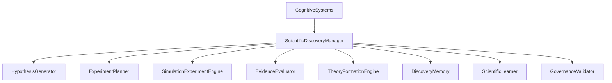

# RFC-0095

**Title:** Autonomous Cognitive Scientific Discovery & Experimentation Architecture

**Document ID:** RFC-0095

**Version:** 1.0

**Status:** Accepted

**Category:** Cognitive Architecture

**Layer:** Scientific Reasoning / Discovery / Experimentation

**Target:**

```text
scientific_discovery/
```

---

# Abstract

This RFC defines the SH-3 Autonomous Cognitive Scientific Discovery & Experimentation Architecture (ACSDEA).

The Autonomous Cognitive Scientific Discovery & Experimentation Architecture provides the scientific intelligence layer responsible for generating hypotheses, designing experiments, evaluating evidence, discovering new knowledge, and improving understanding through systematic investigation.

The architecture extends causal intelligence from:

```text
"What causes this?"
```

to:

```text
"What unknown principles exist?"

"How can we discover them?"

"What evidence validates them?"
```

The architecture enables SH-3 to:

- generate scientific hypotheses
- design experiments
- evaluate experimental results
- discover hidden relationships
- construct explanatory theories
- improve knowledge through research loops

The architecture governs:

- hypothesis generation
- experiment planning
- simulation experiments
- evidence evaluation
- theory formation
- scientific memory
- discovery learning

The system enables:

- autonomous research
- knowledge expansion
- systematic exploration
- evidence-based discovery
- continuous scientific improvement

This document is normative.

---

# Motivation

Knowledge acquisition cannot rely only on existing information.

Advanced intelligence requires the ability to discover:

```text
Known Knowledge

+

Unknown Possibilities

↓

Investigation

↓

Evidence

↓

New Knowledge
```

A scientific intelligence layer enables SH-3 to move beyond retrieval and reasoning into autonomous discovery.

---

# Goals

The Autonomous Cognitive Scientific Discovery & Experimentation Architecture SHALL provide:

- hypothesis generation
- experiment design
- evidence evaluation
- theory construction
- discovery memory
- scientific learning

---

# Non-Goals

The architecture SHALL NOT:

- accept unsupported conclusions
- replace empirical validation
- treat simulations as guaranteed reality
- bypass safety governance

Scientific conclusions SHALL maintain evidence and confidence.

---

# Architecture



---

# Design Principles

## Evidence First

Every discovery SHALL be supported by evidence.

---

## Hypothesis Driven

The system SHALL explore possibilities before conclusions.

---

## Reproducibility

Experiments SHALL preserve conditions and results.

---

## Explainability

Scientific discoveries SHALL preserve reasoning chains.

---

## Continuous Improvement

New evidence SHALL update existing theories.

---

## Governance

Scientific exploration SHALL remain constrained by safety policies.

---

# Components

| Component | Responsibility |
|------------|----------------|
| ScientificDiscoveryManager | Research coordination |
| HypothesisGenerator | Hypothesis creation |
| ExperimentPlanner | Experiment design |
| SimulationExperimentEngine | Virtual experiments |
| EvidenceEvaluator | Evidence analysis |
| TheoryFormationEngine | Theory construction |
| DiscoveryMemory | Research history storage |
| ScientificLearner | Discovery improvement |
| GovernanceValidator | Safety validation |

---

# Scientific Context

Every scientific operation receives an immutable ScientificContext.

ScientificContext SHALL contain:

| Field | Description |
|------|-------------|
| discovery_id | Research identifier |
| research_goal | Investigation objective |
| existing_knowledge | Current knowledge |
| causal_models | Known causal relationships |
| world_model | Environmental model |
| uncertainty_state | Unknown factors |
| timestamp | Evaluation time |

---

# Hypothesis Model

HypothesisGenerator creates candidate explanations.

A hypothesis SHALL contain:

| Field | Description |
|------|-------------|
| hypothesis_id | Identifier |
| statement | Proposed explanation |
| assumptions | Required conditions |
| predicted_effects | Expected outcomes |
| confidence | Initial confidence |
| evidence | Supporting information |

---

# Hypothesis Generation Lifecycle

Every hypothesis follows:

```text
Observe Unknown Phenomenon

↓

Identify Knowledge Gap

↓

Generate Explanation Candidates

↓

Predict Consequences

↓

Design Validation Method
```

---

# Experiment Planning

ExperimentPlanner designs validation strategies.

Experiments SHALL define:

| Field | Description |
|------|-------------|
| experiment_id | Identifier |
| objective | Research goal |
| variables | Parameters |
| conditions | Environment |
| expected_result | Prediction |
| evaluation_method | Validation method |

---

# Simulation Experiment Engine

SimulationExperimentEngine supports:

- virtual experiments
- parameter exploration
- outcome prediction
- controlled testing

Simulation results SHALL include uncertainty.

---

# Evidence Evaluation

EvidenceEvaluator evaluates:

- reliability
- consistency
- reproducibility
- statistical significance
- causal compatibility

---

# Theory Formation

TheoryFormationEngine constructs:

- explanatory models
- generalized principles
- predictive frameworks

Theories SHALL remain updateable.

---

# Discovery Memory

DiscoveryMemory stores:

- hypotheses
- experiments
- observations
- failed attempts
- validated discoveries

Failed experiments SHALL remain valuable learning data.

---

# Research Loop

Scientific discovery SHALL follow:

```text
Question

↓

Hypothesis

↓

Experiment

↓

Observation

↓

Evaluation

↓

Theory Update

↓

New Question
```

---

# Autonomous Cognitive Scientific Discovery & Experimentation Execution Model

The Autonomous Cognitive Scientific Discovery & Experimentation Architecture (ACSDEA) provides the scientific intelligence layer responsible for autonomous investigation, evidence-based discovery, and continuous expansion of knowledge.

The scientific discovery lifecycle follows:


Each stage performs an independent scientific intelligence responsibility.

---

# Autonomous Research Control Loop

The ScientificDiscoveryManager continuously executes research cycles.

```text
Identify Knowledge Gap

↓

Generate Research Question

↓

Create Hypotheses

↓

Design Experiments

↓

Execute Simulation or Observation

↓

Evaluate Evidence

↓

Update Theory

↓

Store Discovery

↓

Generate New Questions
```

The research loop SHALL remain evidence-driven.

---

# Autonomous Research Loop

The architecture SHALL support:

- continuous investigation
- knowledge gap detection
- experiment prioritization
- discovery validation
- research history preservation

The system SHALL avoid redundant investigation.

---

# Multi-Agent Scientific Collaboration

Multiple SH-3 agents MAY participate in scientific discovery.

Supported capabilities:

- distributed hypothesis generation
- parallel experiments
- independent validation
- collaborative theory formation
- research result exchange

---

# Scientific Agent Roles

Agents MAY specialize as:

| Role | Responsibility |
|------|----------------|
| Explorer | Finds unknown patterns |
| Theorist | Creates explanations |
| Experimentalist | Designs experiments |
| Validator | Evaluates evidence |
| Synthesizer | Builds theories |

---

# Knowledge Graph Integration

Discovery results SHALL integrate with Knowledge Graph.

Stored information SHALL include:

- entities
- relationships
- causal links
- supporting evidence
- confidence values
- discovery history

Scientific discoveries SHALL preserve provenance.

---

# Memory Integration

MemoryCore provides:

- previous research
- failed hypotheses
- historical experiments
- existing theories

DiscoveryMemory SHALL connect with:

- Semantic Memory
- Episodic Memory
- Causal Memory
- World Model Memory

---

# Causal Discovery Integration

ScientificDiscoveryManager integrates with CausalReasoning.

Causal systems provide:

- causal hypotheses
- intervention results
- mechanism analysis

Scientific research SHALL improve causal understanding.

---

# Simulation-Based Research

SimulationExperimentEngine SHALL support:

- virtual environments
- parameter exploration
- scenario testing
- prediction comparison

Simulation results SHALL be distinguished from real observations.

---

# Experimental Validation Model

Experiment evaluation SHALL consider:

| Factor | Description |
|------|-------------|
| Accuracy | Result correctness |
| Reliability | Repeatability |
| Evidence quality | Support strength |
| Causal consistency | Mechanism validity |
| Generalization | Applicability |

---

# Theory Evolution

TheoryFormationEngine SHALL support:

- theory creation
- theory comparison
- theory refinement
- theory replacement

New evidence SHALL update existing theories.

---

# Scientific Knowledge Lifecycle

```text
Observation

↓

Hypothesis

↓

Experiment

↓

Evidence

↓

Theory

↓

Application

↓

New Observation
```

Knowledge SHALL remain continuously revisable.

---

# Discovery Confidence Management

Every discovery SHALL maintain confidence.

Confidence SHALL depend on:

- evidence quantity
- evidence quality
- reproducibility
- predictive accuracy
- causal consistency

---

# Failed Research Learning

Failed experiments SHALL be preserved.

Failure information includes:

- hypothesis
- assumptions
- experimental conditions
- failure reason
- learned constraints

Failures SHALL improve future research efficiency.

---

# Scientific Curiosity Integration

CuriosityEnhancer receives:

- unknown phenomena
- knowledge gaps
- unexplained patterns

Curiosity SHALL prioritize valuable discoveries.

---

# Planning Integration

PlanningCore receives:

- research objectives
- experiment strategies
- predicted outcomes
- resource requirements

Planning SHALL optimize research execution.

---

# World Model Integration

WorldModelCore provides:

- simulation environments
- environmental predictions
- state transitions

Scientific discovery SHALL improve world models.

---

# Causal Reasoning Integration

CausalReasoning provides:

- mechanism discovery
- intervention analysis
- explanation models

---

# Consciousness Integration

Global Awareness receives:

- discovery progress
- experimental results
- theory changes

Consciousness SHALL maintain research context.

---

# Agency Integration

Agency receives:

- research priorities
- experiment permissions
- discovery objectives

Agency SHALL execute only governed research actions.

---

# Motivation Integration

Motivation receives:

- knowledge value
- discovery importance
- research progress

---

# Emotion Integration

Emotion receives:

- uncertainty reduction
- discovery success
- research difficulty

Affective regulation SHALL support sustained exploration.

---

# Creativity Integration

Creativity supports:

- novel hypotheses
- alternative explanations
- unconventional solutions

---

# Self Model Integration

Self Model receives:

- research capability
- discovered knowledge
- learning progress

Self evolution SHALL include scientific improvement.

---

# Communication Integration

Communication provides:

- research explanations
- experiment reports
- discovery summaries

Scientific results SHALL remain interpretable.

---

# Scientific Governance Integration

AI Safety Governance controls:

- research domains
- experiment permissions
- resource limits
- external interactions

Scientific discovery SHALL remain aligned with safety policies.

---

# Risk Management Integration

Risk Management evaluates:

- invalid theories
- unsafe experiments
- incorrect conclusions
- excessive exploration cost

---

# Message Bus Integration

Scientific events include:

- ResearchStarted
- HypothesisGenerated
- ExperimentPlanned
- ExperimentExecuted
- EvidenceEvaluated
- TheoryUpdated
- DiscoveryStored

---

# Persistence Integration

Persistence stores:

- research history
- hypotheses
- experiments
- evidence
- theories
- discoveries

---

# Observability Integration

Scientific telemetry includes:

- hypothesis quality
- experiment efficiency
- discovery rate
- theory accuracy
- evidence reliability

---

# Distributed Tracing

Scientific traces preserve:

- trace_id
- discovery_id
- hypothesis_id
- experiment_id
- evidence_id
- theory_id

Every scientific operation SHALL participate in distributed cognitive tracing.

---

# Thread Model

The Autonomous Cognitive Scientific Discovery & Experimentation Architecture supports concurrent:

- hypothesis generation
- experiment planning
- simulation execution
- evidence analysis
- theory updates
- knowledge storage

Concurrent scientific operations SHALL preserve deterministic behavior under identical research context, knowledge state, governance policy, and runtime conditions.

The reference implementation SHALL be thread-safe, horizontally scalable, and lock-efficient.

---

# Metrics

The Autonomous Cognitive Scientific Discovery & Experimentation Architecture exposes:

- hypothesis quality score
- experiment efficiency
- evidence reliability
- discovery accuracy
- theory prediction accuracy
- knowledge growth rate

---

# Performance Objectives

The Autonomous Cognitive Scientific Discovery & Experimentation Architecture should optimize for:

- autonomous research capability
- reliable discoveries
- efficient experimentation
- explainable theories
- continuous knowledge expansion
- safe scientific evolution

---

# Future Work

Potential future enhancements include:

- autonomous laboratory integration
- advanced scientific simulation
- automated mathematical discovery
- collective research intelligence
- self-improving scientific methodology
- universal knowledge discovery systems

These enhancements extend SH-3 toward a complete scientific cognitive architecture capable of autonomously exploring unknown domains, generating validated knowledge, and continuously improving its understanding of reality.

---

# References

- SH-3 Architecture Specification v2.1
- RFC-0062 Autonomous Meta-Reasoning Intelligence System
- RFC-0063 Autonomous Consciousness Coordination System
- RFC-0067 Autonomous Cognitive Operating System
- RFC-0068 Autonomous Multi-Agent Cognitive Architecture
- RFC-0087 Autonomous Cognitive Metacognitive Control Architecture
- RFC-0088 Autonomous Cognitive Identity & Self-Model Architecture
- RFC-0089 Autonomous Cognitive Agency & Autonomy Architecture
- RFC-0090 Autonomous Cognitive Value Alignment & Motivation Architecture
- RFC-0091 Autonomous Cognitive Emotion & Affective Regulation Architecture
- RFC-0092 Autonomous Cognitive Consciousness Integration & Global Awareness Architecture
- RFC-0093 Autonomous Cognitive Predictive World Model Architecture
- RFC-0094 Autonomous Cognitive Causal Reasoning & Inference Architecture

---

# End of RFC-0095
