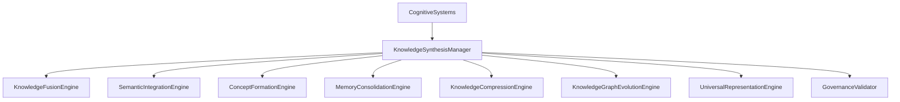

# RFC-0096

**Title:** Autonomous Cognitive Knowledge Synthesis & Universal Memory Architecture

**Document ID:** RFC-0096

**Version:** 1.0

**Status:** Accepted

**Category:** Cognitive Architecture

**Layer:** Knowledge Integration / Memory Consolidation / Semantic Intelligence

**Target:**

```text
knowledge_synthesis/
```

---

# Abstract

This RFC defines the SH-3 Autonomous Cognitive Knowledge Synthesis & Universal Memory Architecture (ACKS-UMA).

The Autonomous Cognitive Knowledge Synthesis & Universal Memory Architecture provides the knowledge integration layer responsible for transforming distributed information, discoveries, experiences, and reasoning results into coherent, reusable, and continuously evolving knowledge structures.

The architecture extends scientific discovery from:

```text
"Discover new information"
```

to:

```text
"Integrate discoveries into a unified knowledge system"
```

The architecture enables SH-3 to:

- synthesize knowledge from multiple sources
- consolidate memories
- form abstract concepts
- connect different domains
- compress redundant information
- evolve knowledge structures
- maintain long-term understanding

The architecture governs:

- knowledge fusion
- semantic integration
- concept formation
- memory consolidation
- knowledge graph evolution
- universal representation
- knowledge optimization

The system enables:

- scalable intelligence
- cross-domain reasoning
- efficient memory usage
- cumulative learning
- continuous knowledge evolution

This document is normative.

---

# Motivation

Advanced intelligence requires more than storing information.

A system must transform:

```text
Raw Information

↓

Structured Knowledge

↓

Conceptual Understanding

↓

General Principles

↓

Reusable Intelligence
```

Without knowledge synthesis:

- discoveries remain isolated
- memories become fragmented
- reasoning becomes inefficient
- learning cannot accumulate effectively

Knowledge synthesis creates a unified intelligence foundation.

---

# Goals

The Autonomous Cognitive Knowledge Synthesis & Universal Memory Architecture SHALL provide:

- knowledge fusion
- semantic organization
- concept abstraction
- memory consolidation
- knowledge compression
- knowledge evolution

---

# Non-Goals

The architecture SHALL NOT:

- remove original evidence
- create unsupported knowledge
- overwrite validated memories without tracking
- bypass governance controls

Knowledge transformations SHALL preserve provenance.

---

# Architecture



---

# Design Principles

## Knowledge Preservation

Original knowledge sources SHALL remain traceable.

---

## Semantic Understanding

Knowledge SHALL be organized by meaning, not only keywords.

---

## Continuous Evolution

Knowledge structures SHALL improve over time.

---

## Cross-Domain Integration

Knowledge from different domains SHALL be connectable.

---

## Efficient Representation

Knowledge SHALL minimize unnecessary redundancy.

---

## Explainability

Every synthesized concept SHALL preserve origin information.

---

# Components

| Component | Responsibility |
|------------|----------------|
| KnowledgeSynthesisManager | Knowledge integration control |
| KnowledgeFusionEngine | Multi-source knowledge merging |
| SemanticIntegrationEngine | Meaning-based organization |
| ConceptFormationEngine | Abstract concept creation |
| MemoryConsolidationEngine | Long-term memory optimization |
| KnowledgeCompressionEngine | Information optimization |
| KnowledgeGraphEvolutionEngine | Relationship evolution |
| UniversalRepresentationEngine | Common knowledge format |
| GovernanceValidator | Knowledge safety validation |

---

# Knowledge Synthesis Context

Every synthesis operation receives an immutable KnowledgeContext.

KnowledgeContext SHALL contain:

| Field | Description |
|------|-------------|
| synthesis_id | Operation identifier |
| source_knowledge | Input information |
| memory_state | Existing memories |
| semantic_context | Current concepts |
| world_model | Reality representation |
| causal_model | Cause-effect knowledge |
| confidence_state | Reliability information |
| timestamp | Evaluation time |

---

# Knowledge Fusion Model

KnowledgeFusionEngine combines:

- semantic knowledge
- episodic experiences
- scientific discoveries
- causal relationships
- world model updates

Fusion SHALL preserve:

- source identity
- confidence
- temporal information
- evidence

---

# Semantic Integration

SemanticIntegrationEngine organizes knowledge by:

- meaning
- relationships
- context
- abstraction level

Example:

```text
Individual Facts

↓

Patterns

↓

Concepts

↓

General Principles
```

---

# Concept Formation

ConceptFormationEngine creates higher-level abstractions.

Concepts SHALL contain:

| Field | Description |
|------|-------------|
| concept_id | Identifier |
| definition | Meaning |
| related_entities | Connections |
| examples | Instances |
| abstraction_level | Generality |
| confidence | Reliability |

---

# Memory Consolidation

MemoryConsolidationEngine transforms:

```text
Short-Term Experience

↓

Important Memory

↓

Long-Term Knowledge
```

Consolidation SHALL consider:

- importance
- repetition
- usefulness
- emotional relevance
- causal value

---

# Knowledge Compression

KnowledgeCompressionEngine reduces redundancy.

Compression SHALL preserve:

- meaning
- relationships
- evidence
- retrieval capability

Compression SHALL not remove critical information.

---

# Knowledge Graph Evolution

KnowledgeGraphEvolutionEngine updates:

- entities
- relationships
- concepts
- causal links
- confidence values

Knowledge graphs SHALL evolve continuously.

---

# Universal Representation

UniversalRepresentationEngine provides common knowledge format.

Representation SHALL support:

- reasoning
- retrieval
- planning
- learning
- communication

---

# Autonomous Cognitive Knowledge Synthesis & Universal Memory Execution Model

The Autonomous Cognitive Knowledge Synthesis & Universal Memory Architecture (ACKS-UMA) provides the knowledge intelligence layer responsible for integrating information, forming concepts, optimizing memory, and continuously evolving a unified knowledge system.

The knowledge synthesis lifecycle follows:


Each stage performs an independent knowledge intelligence responsibility.

---

# Knowledge Evolution Control Loop

The KnowledgeSynthesisManager continuously improves the knowledge system.

```text
Collect Information

↓

Extract Meaning

↓

Integrate Existing Knowledge

↓

Generate Concepts

↓

Validate Relationships

↓

Consolidate Memory

↓

Optimize Representation

↓

Update Knowledge Graph

↓

Improve Future Reasoning
```

The knowledge evolution loop SHALL remain continuous.

---

# Universal Knowledge Graph

KnowledgeGraphEvolutionEngine maintains a unified representation of knowledge.

The graph SHALL contain:

| Field | Description |
|------|-------------|
| entity | Knowledge object |
| relation | Connection |
| concept | Abstract meaning |
| evidence | Supporting information |
| confidence | Reliability |
| temporal_state | Historical context |
| causal_links | Cause-effect relations |

---

# Cross-Domain Knowledge Reasoning

The architecture SHALL support integration between different domains.

Examples:

```text
Physics

+

Biology

↓

New Scientific Understanding
```

```text
Economics

+

Psychology

↓

Behavioral Prediction
```

Cross-domain reasoning SHALL preserve domain context.

---

# Knowledge Bridge Formation

KnowledgeSynthesisManager SHALL identify:

- similar concepts
- shared structures
- hidden relationships
- transferable principles

Knowledge bridges SHALL enable:

- analogy reasoning
- creative discovery
- generalization

---

# Memory Optimization Loop

MemoryConsolidationEngine continuously optimizes memory.

The optimization cycle:

```text
Memory Collection

↓

Importance Evaluation

↓

Pattern Detection

↓

Compression

↓

Index Update

↓

Retrieval Improvement
```

---

# Memory Importance Evaluation

Memory importance SHALL consider:

- future usefulness
- frequency
- emotional significance
- causal relevance
- reasoning value
- learning contribution

---

# Retrieval Optimization

UniversalRepresentationEngine SHALL optimize knowledge access.

Retrieval SHALL support:

- semantic search
- causal search
- temporal search
- conceptual search
- contextual search

---

# Knowledge Validation

KnowledgeValidator SHALL evaluate synthesized knowledge.

Validation SHALL include:

- source verification
- consistency checking
- contradiction detection
- confidence evaluation
- causal compatibility

---

# Contradiction Management

Knowledge conflicts MAY occur.

Resolution SHALL consider:

- evidence quality
- source reliability
- temporal validity
- contextual differences

Conflicting knowledge SHALL not be silently removed.

---

# Knowledge Revision System

Knowledge SHALL support revision.

Revision SHALL preserve:

- previous state
- update reason
- evidence change
- confidence transition

---

# Agent Knowledge Sharing

Multiple SH-3 agents MAY exchange knowledge.

Knowledge exchange SHALL include:

- concepts
- discoveries
- causal models
- validated experiences

Sharing SHALL preserve:

- origin
- confidence
- context

---

# Distributed Knowledge Synchronization

Distributed knowledge systems SHALL maintain:

- consistency
- provenance
- conflict handling
- update ordering

---

# Learning Integration

LearningCore receives:

- knowledge improvements
- concept discoveries
- retrieval performance
- memory optimization results

Learning SHALL improve synthesis strategies.

---

# Planning Integration

PlanningCore receives:

- synthesized knowledge
- abstract concepts
- domain relationships
- historical strategies

Planning SHALL use generalized knowledge.

---

# Reasoning Integration

Reasoning systems receive:

- structured concepts
- knowledge graphs
- causal relationships
- validated principles

Reasoning SHALL operate on synthesized knowledge.

---

# World Model Integration

WorldModel receives:

- updated concepts
- environmental knowledge
- discovered relationships

Knowledge synthesis SHALL improve world understanding.

---

# Scientific Discovery Integration

ScientificDiscovery receives:

- existing theories
- knowledge gaps
- related concepts

Knowledge synthesis SHALL accelerate research.

---

# Consciousness Integration

Global Awareness receives:

- knowledge changes
- important discoveries
- conceptual updates

Consciousness SHALL maintain awareness of knowledge evolution.

---

# Self Model Integration

Self Model receives:

- learned capabilities
- accumulated expertise
- knowledge growth

Self evolution SHALL reflect knowledge development.

---

# Creativity Integration

CreativityEngine uses synthesized knowledge for:

- analogy generation
- invention
- combination of concepts
- novel solutions

---

# Curiosity Integration

CuriosityEngine identifies:

- missing knowledge
- unexplained relationships
- incomplete concepts

---

# Communication Integration

Communication receives:

- structured explanations
- concept relationships
- evidence paths

Knowledge SHALL remain understandable.

---

# Governance Integration

AI Safety Governance controls:

- knowledge access
- sensitive information handling
- external knowledge exchange
- autonomous modification permissions

---

# Risk Management Integration

Risk Management evaluates:

- incorrect synthesis
- knowledge corruption
- false abstraction
- excessive compression

---

# Message Bus Integration

Knowledge events include:

- KnowledgeReceived
- KnowledgeIntegrated
- ConceptFormed
- MemoryConsolidated
- KnowledgeCompressed
- KnowledgeValidated
- KnowledgeGraphUpdated

---

# Persistence Integration

Persistence stores:

- knowledge graphs
- concepts
- synthesis history
- memory transformations
- validation records

---

# Observability Integration

Knowledge telemetry includes:

- synthesis quality
- retrieval efficiency
- knowledge consistency
- concept usefulness
- memory optimization rate

---

# Distributed Tracing

Knowledge traces preserve:

- trace_id
- synthesis_id
- knowledge_id
- concept_id
- memory_id
- validation_id

Every knowledge operation SHALL participate in distributed cognitive tracing.

---

# Thread Model

The Autonomous Cognitive Knowledge Synthesis & Universal Memory Architecture supports concurrent:

- knowledge integration
- concept formation
- memory consolidation
- graph updates
- validation
- retrieval optimization

Concurrent knowledge operations SHALL preserve deterministic behavior under identical knowledge state, governance policies, and runtime conditions.

The reference implementation SHALL be thread-safe, horizontally scalable, and lock-efficient.

---

# Metrics

The Autonomous Cognitive Knowledge Synthesis & Universal Memory Architecture exposes:

- knowledge integration accuracy
- concept quality score
- memory efficiency
- retrieval accuracy
- knowledge consistency
- synthesis improvement rate

---

# Performance Objectives

The Autonomous Cognitive Knowledge Synthesis & Universal Memory Architecture should optimize for:

- scalable knowledge growth
- efficient memory usage
- accurate abstraction
- cross-domain reasoning
- continuous knowledge evolution
- reliable intelligence accumulation

---

# Future Work

Potential future enhancements include:

- universal semantic representation
- autonomous ontology evolution
- collective knowledge intelligence
- self-organizing memory structures
- advanced concept discovery
- recursive knowledge optimization

These enhancements extend SH-3 toward a complete knowledge intelligence architecture capable of transforming information into structured understanding, preserving accumulated experience, and continuously evolving a unified intelligence foundation.

---

# References

- SH-3 Architecture Specification v2.1
- RFC-0062 Autonomous Meta-Reasoning Intelligence System
- RFC-0063 Autonomous Consciousness Coordination System
- RFC-0067 Autonomous Cognitive Operating System
- RFC-0068 Autonomous Multi-Agent Cognitive Architecture
- RFC-0087 Autonomous Cognitive Metacognitive Control Architecture
- RFC-0088 Autonomous Cognitive Identity & Self-Model Architecture
- RFC-0089 Autonomous Cognitive Agency & Autonomy Architecture
- RFC-0090 Autonomous Cognitive Value Alignment & Motivation Architecture
- RFC-0091 Autonomous Cognitive Emotion & Affective Regulation Architecture
- RFC-0092 Autonomous Cognitive Consciousness Integration & Global Awareness Architecture
- RFC-0093 Autonomous Cognitive Predictive World Model Architecture
- RFC-0094 Autonomous Cognitive Causal Reasoning & Inference Architecture
- RFC-0095 Autonomous Cognitive Scientific Discovery & Experimentation Architecture

---

# End of RFC-0096
