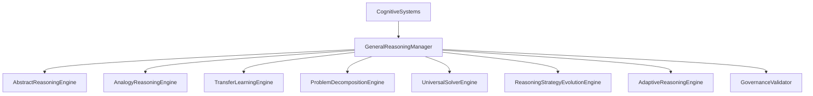
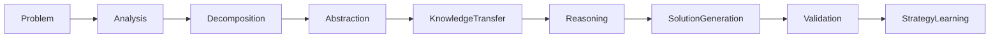

# RFC-0097

**Title:** Autonomous Cognitive General Reasoning & Transfer Intelligence Architecture

**Document ID:** RFC-0097

**Version:** 1.0

**Status:** Accepted

**Category:** Cognitive Architecture

**Layer:** General Intelligence / Abstract Reasoning / Knowledge Transfer

**Target:**

```text
general_reasoning/
```

---

# Abstract

This RFC defines the SH-3 Autonomous Cognitive General Reasoning & Transfer Intelligence Architecture (ACGRTIA).

The Autonomous Cognitive General Reasoning & Transfer Intelligence Architecture provides the general intelligence layer responsible for applying accumulated knowledge, reasoning strategies, and learned principles to unfamiliar situations.

The architecture extends knowledge synthesis from:

```text
"Organize what is known"
```

to:

```text
"Apply understanding to what is unknown"
```

The architecture enables SH-3 to:

- perform abstract reasoning
- transfer knowledge across domains
- solve unfamiliar problems
- decompose complex objectives
- generate reusable reasoning strategies
- adapt existing knowledge to new contexts

The architecture governs:

- general reasoning
- analogical inference
- knowledge transfer
- abstraction
- problem decomposition
- reasoning strategy evolution
- adaptive problem solving

The system enables:

- domain-independent intelligence
- flexible problem solving
- creative reasoning
- rapid adaptation
- generalization capability

This document is normative.

---

# Motivation

Specialized intelligence depends on stored knowledge.

General intelligence requires the ability to:

```text
Known Domain

↓

Abstract Principle

↓

Unknown Domain

↓

New Solution
```

A system that cannot transfer knowledge remains limited to learned situations.

General reasoning enables SH-3 to operate beyond direct experience.

---

# Goals

The Autonomous Cognitive General Reasoning & Transfer Intelligence Architecture SHALL provide:

- abstract reasoning
- analogy-based reasoning
- transfer learning
- universal problem solving
- reasoning adaptation

---

# Non-Goals

The architecture SHALL NOT:

- ignore domain-specific constraints
- assume all problems are identical
- remove uncertainty
- bypass validation

Transferred knowledge SHALL be context evaluated.

---

# Architecture



---

# Design Principles

## Abstraction First

The system SHALL extract general principles from specific experiences.

---

## Transfer Carefully

Knowledge transfer SHALL evaluate similarity and differences.

---

## Reasoning Transparency

Reasoning paths SHALL remain explainable.

---

## Adaptive Intelligence

Reasoning strategies SHALL evolve from experience.

---

## Context Awareness

Solutions SHALL consider environmental conditions.

---

## Continuous Improvement

Reasoning performance SHALL improve through feedback.

---

# Components

| Component | Responsibility |
|------------|----------------|
| GeneralReasoningManager | Reasoning coordination |
| AbstractReasoningEngine | Principle extraction |
| AnalogyReasoningEngine | Similarity reasoning |
| TransferLearningEngine | Knowledge adaptation |
| ProblemDecompositionEngine | Complexity reduction |
| UniversalSolverEngine | General problem solving |
| ReasoningStrategyEvolutionEngine | Strategy improvement |
| AdaptiveReasoningEngine | Context adaptation |
| GovernanceValidator | Reasoning safety |

---

# Reasoning Context

Every reasoning operation receives an immutable ReasoningContext.

ReasoningContext SHALL contain:

| Field | Description |
|------|-------------|
| reasoning_id | Operation identifier |
| problem_state | Current problem |
| available_knowledge | Relevant knowledge |
| world_model | Environment model |
| causal_model | Causal understanding |
| goals | Desired outcomes |
| constraints | Limitations |
| uncertainty_state | Confidence information |
| timestamp | Evaluation time |

---

# Abstract Reasoning Model

AbstractReasoningEngine transforms:

```text
Specific Experience

↓

Pattern Detection

↓

Abstract Principle

↓

General Rule
```

---

# Abstraction Levels

The system SHALL maintain multiple abstraction levels:

| Level | Description |
|------|-------------|
| Instance | Individual event |
| Pattern | Repeated structure |
| Concept | General category |
| Principle | Universal relationship |
| Strategy | Reusable method |

---

# Analogical Reasoning

AnalogyReasoningEngine identifies:

```text
Structure A

is similar to

Structure B
```

Analogy SHALL evaluate:

- structural similarity
- causal similarity
- contextual similarity
- limitation differences

---

# Knowledge Transfer

TransferLearningEngine applies:

```text
Existing Knowledge

↓

Adaptation Process

↓

New Domain Application
```

Transfer SHALL preserve:

- useful principles
- domain constraints
- uncertainty

---

# Problem Decomposition

ProblemDecompositionEngine breaks:

```text
Complex Problem

↓

Sub Problems

↓

Solvable Components

↓

Integrated Solution
```

---

# Universal Problem Solver

UniversalSolverEngine combines:

- reasoning
- planning
- memory
- world model
- causal analysis

to generate solutions.

---

# Reasoning Strategy Model

Reasoning strategies SHALL contain:

| Field | Description |
|------|-------------|
| strategy_id | Identifier |
| method | Reasoning method |
| applicable_domains | Usage area |
| success_history | Performance |
| confidence | Reliability |

---

# Reasoning Strategy Evolution

ReasoningStrategyEvolutionEngine improves:

- strategy selection
- reasoning efficiency
- solution quality
- adaptation capability

---

# Autonomous Cognitive General Reasoning & Transfer Intelligence Execution Model

The Autonomous Cognitive General Reasoning & Transfer Intelligence Architecture (ACGRTIA) provides the general intelligence layer responsible for applying accumulated knowledge, abstract principles, and reasoning strategies to unknown problems.

The general reasoning lifecycle follows:



Each stage performs an independent general intelligence responsibility.

---

# General Reasoning Control Loop

The GeneralReasoningManager continuously improves problem-solving capability.

```text
Receive Problem

↓

Analyze Structure

↓

Identify Relevant Principles

↓

Decompose Problem

↓

Transfer Existing Knowledge

↓

Generate Candidate Solutions

↓

Evaluate Solutions

↓

Apply Best Strategy

↓

Learn From Result
```

The reasoning loop SHALL remain adaptive.

---

# Multi-Agent General Reasoning

The architecture SHALL support multiple reasoning agents.

Multi-agent capabilities include:

- parallel reasoning
- independent solution generation
- strategy comparison
- knowledge sharing
- collaborative problem solving

---

# Reasoning Agent Specialization

Agents MAY specialize as:

| Role | Responsibility |
|------|----------------|
| Analyst | Problem understanding |
| Abstractor | Principle extraction |
| Solver | Solution generation |
| Critic | Error detection |
| Synthesizer | Final integration |

---

# Planning Integration

PlanningCore receives:

- abstract principles
- possible strategies
- transferred knowledge
- predicted consequences

Planning SHALL use general reasoning for unfamiliar objectives.

---

# Planning Reasoning Loop

```text
Goal

↓

Problem Analysis

↓

Strategy Generation

↓

Future Simulation

↓

Plan Selection

↓

Execution
```

---

# World Model Integration

WorldModel provides:

- environment representation
- possible state transitions
- simulation results

General reasoning SHALL adapt solutions to world conditions.

---

# Causal Reasoning Integration

CausalReasoning provides:

- mechanisms
- intervention knowledge
- root causes

General reasoning SHALL use causal structures when transferring knowledge.

---

# Knowledge Synthesis Integration

KnowledgeSynthesis provides:

- concepts
- principles
- relationships
- abstractions

General reasoning SHALL operate on synthesized knowledge.

---

# Scientific Discovery Integration

ScientificDiscovery receives:

- unresolved problems
- missing principles
- reasoning failures

General reasoning SHALL identify opportunities for discovery.

---

# Reasoning Memory

ReasoningMemory stores:

- successful reasoning paths
- failed strategies
- problem patterns
- reusable solutions

Memory SHALL preserve reasoning provenance.

---

# Reasoning Pattern Learning

The system SHALL learn:

- common problem structures
- effective strategies
- inefficient approaches
- domain transfer patterns

---

# Strategy Learning Loop

```text
Reasoning Attempt

↓

Outcome Evaluation

↓

Strategy Update

↓

Future Selection Improvement
```

---

# Adaptive Intelligence Control

AdaptiveReasoningEngine selects strategies based on:

- problem complexity
- domain
- uncertainty
- available knowledge
- previous performance

---

# Unknown Problem Handling

When no direct knowledge exists:

```text
Unknown Problem

↓

Structural Analysis

↓

Related Concepts Search

↓

Analogical Transfer

↓

Hypothesis Generation

↓

Solution Testing
```

---

# Creative Reasoning Integration

CreativityEngine uses general reasoning for:

- novel combinations
- alternative approaches
- unexplored solutions
- innovation generation

---

# Curiosity Integration

CuriosityEngine identifies:

- reasoning limitations
- knowledge gaps
- unexplained problems

Curiosity SHALL guide future learning.

---

# Consciousness Integration

Global Awareness receives:

- reasoning progress
- selected strategies
- uncertainty state
- solution confidence

Consciousness SHALL monitor reasoning quality.

---

# Self Model Integration

Self Model receives:

- reasoning capability
- strategy performance
- improvement history

Self evolution SHALL include reasoning improvement.

---

# Agency Integration

Agency receives:

- solution candidates
- expected outcomes
- confidence estimates

Agency SHALL select actions using general reasoning.

---

# Motivation Integration

Motivation evaluates:

- solution value
- goal alignment
- resource efficiency

---

# Emotion Integration

Emotion receives:

- uncertainty
- difficulty estimates
- success predictions

Affective regulation SHALL support complex reasoning.

---

# Communication Integration

Communication receives:

- reasoning explanations
- abstraction paths
- solution rationale

Reasoning SHALL remain interpretable.

---

# Governance Integration

AI Safety Governance controls:

- reasoning domains
- external action recommendations
- autonomous decision limits

General reasoning SHALL remain aligned with safety constraints.

---

# Risk Management Integration

Risk Management evaluates:

- invalid knowledge transfer
- reasoning errors
- overgeneralization
- unsupported assumptions

---

# Message Bus Integration

General reasoning events include:

- ReasoningStarted
- ProblemAnalyzed
- StrategySelected
- KnowledgeTransferred
- SolutionGenerated
- SolutionValidated
- StrategyUpdated

---

# Persistence Integration

Persistence stores:

- reasoning traces
- strategies
- problem patterns
- solution histories
- evaluation results

---

# Observability Integration

Reasoning telemetry includes:

- reasoning accuracy
- strategy efficiency
- transfer success rate
- solution quality
- adaptation performance

---

# Distributed Tracing

Reasoning traces preserve:

- trace_id
- reasoning_id
- problem_id
- strategy_id
- solution_id
- validation_id

Every reasoning operation SHALL participate in distributed cognitive tracing.

---

# Thread Model

The Autonomous Cognitive General Reasoning & Transfer Intelligence Architecture supports concurrent:

- problem analysis
- reasoning generation
- strategy evaluation
- knowledge transfer
- solution validation
- learning updates

Concurrent reasoning operations SHALL preserve deterministic behavior under identical problem state, knowledge state, governance policy, and runtime conditions.

The reference implementation SHALL be thread-safe, horizontally scalable, and lock-efficient.

---

# Metrics

The Autonomous Cognitive General Reasoning & Transfer Intelligence Architecture exposes:

- reasoning accuracy
- transfer success rate
- abstraction quality
- problem solving efficiency
- strategy improvement rate
- generalization capability

---

# Performance Objectives

The Autonomous Cognitive General Reasoning & Transfer Intelligence Architecture should optimize for:

- broad problem solving
- efficient knowledge transfer
- adaptive reasoning
- explainable solutions
- continuous intelligence improvement

---

# Future Work

Potential future enhancements include:

- recursive self-improving reasoning
- universal theorem proving
- autonomous mathematical reasoning
- collective reasoning intelligence
- self-evolving cognitive strategies

These enhancements extend SH-3 toward a complete general intelligence architecture capable of applying knowledge beyond previous experience, solving unfamiliar problems, and continuously improving its own reasoning processes.

---

# References

- SH-3 Architecture Specification v2.1
- RFC-0062 Autonomous Meta-Reasoning Intelligence System
- RFC-0063 Autonomous Consciousness Coordination System
- RFC-0067 Autonomous Cognitive Operating System
- RFC-0068 Autonomous Multi-Agent Cognitive Architecture
- RFC-0087 Autonomous Cognitive Metacognitive Control Architecture
- RFC-0088 Autonomous Cognitive Identity & Self-Model Architecture
- RFC-0089 Autonomous Cognitive Agency & Autonomy Architecture
- RFC-0090 Autonomous Cognitive Value Alignment & Motivation Architecture
- RFC-0091 Autonomous Cognitive Emotion & Affective Regulation Architecture
- RFC-0092 Autonomous Cognitive Consciousness Integration & Global Awareness Architecture
- RFC-0093 Autonomous Cognitive Predictive World Model Architecture
- RFC-0094 Autonomous Cognitive Causal Reasoning & Inference Architecture
- RFC-0095 Autonomous Cognitive Scientific Discovery & Experimentation Architecture
- RFC-0096 Autonomous Cognitive Knowledge Synthesis & Universal Memory Architecture

---

# End of RFC-0097
