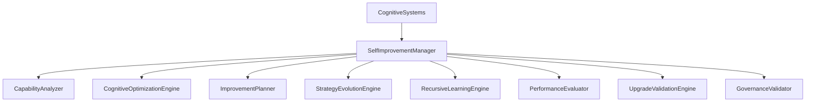
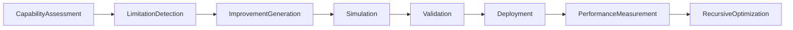

# RFC-0098

**Title:** Autonomous Cognitive Self-Improvement & Recursive Intelligence Evolution Architecture

**Document ID:** RFC-0098

**Version:** 1.0

**Status:** Accepted

**Category:** Cognitive Architecture

**Layer:** Self Improvement / Recursive Learning / Intelligence Evolution

**Target:**

```text
self_improvement/
```

---

# Abstract

This RFC defines the SH-3 Autonomous Cognitive Self-Improvement & Recursive Intelligence Evolution Architecture (ACSIREA).

The Autonomous Cognitive Self-Improvement & Recursive Intelligence Evolution Architecture provides the recursive intelligence layer responsible for analyzing SH-3 capabilities, identifying improvement opportunities, optimizing cognitive processes, and enabling controlled intelligence evolution.

The architecture extends general intelligence from:

```text
"Solve problems effectively"
```

to:

```text
"Improve the ability to solve problems"
```

The architecture enables SH-3 to:

- evaluate its own performance
- identify cognitive limitations
- optimize internal strategies
- improve reasoning processes
- refine learning mechanisms
- evolve capabilities through controlled feedback

The architecture governs:

- capability analysis
- cognitive optimization
- recursive learning
- strategy evolution
- architecture improvement
- performance measurement
- self-upgrade governance

The system enables:

- adaptive intelligence growth
- continuous optimization
- autonomous improvement
- long-term capability evolution
- recursive cognitive enhancement

This document is normative.

---

# Motivation

A static intelligent system eventually reaches limitations.

Advanced intelligence requires the ability to improve itself:

```text
Current Capability

↓

Performance Analysis

↓

Weakness Identification

↓

Improvement Generation

↓

Validation

↓

Enhanced Capability
```

Self-improvement enables SH-3 to continuously increase intelligence quality.

---

# Goals

The Autonomous Cognitive Self-Improvement & Recursive Intelligence Evolution Architecture SHALL provide:

- capability evaluation
- improvement discovery
- optimization planning
- controlled self-modification
- recursive learning
- evolution measurement

---

# Non-Goals

The architecture SHALL NOT:

- perform uncontrolled self-modification
- bypass governance
- remove safety constraints
- modify critical systems without validation

All improvement operations SHALL be governed.

---

# Architecture



---

# Design Principles

## Controlled Evolution

Self-improvement SHALL occur through validated cycles.

---

## Measurement Driven

Improvements SHALL be based on measurable performance.

---

## Safety Preserving

Core constraints SHALL remain protected.

---

## Incremental Optimization

Small validated improvements SHALL be preferred.

---

## Reversibility

Improvements SHALL support rollback.

---

## Continuous Learning

Every improvement cycle SHALL generate knowledge.

---

# Components

| Component | Responsibility |
|------------|----------------|
| SelfImprovementManager | Improvement coordination |
| CapabilityAnalyzer | Capability measurement |
| CognitiveOptimizationEngine | Process optimization |
| ImprovementPlanner | Improvement strategy creation |
| StrategyEvolutionEngine | Reasoning strategy evolution |
| RecursiveLearningEngine | Self-learning control |
| PerformanceEvaluator | Improvement measurement |
| UpgradeValidationEngine | Change validation |
| GovernanceValidator | Safety control |

---

# Self Improvement Context

Every improvement operation receives an immutable ImprovementContext.

ImprovementContext SHALL contain:

| Field | Description |
|------|-------------|
| improvement_id | Operation identifier |
| current_capability | Current performance |
| target_capability | Desired capability |
| system_state | Current architecture |
| performance_history | Previous results |
| constraints | Safety limits |
| validation_policy | Evaluation rules |
| timestamp | Execution time |

---

# Capability Analysis

CapabilityAnalyzer evaluates:

- reasoning performance
- learning efficiency
- planning quality
- memory effectiveness
- prediction accuracy
- tool usage efficiency

---

# Capability Model

Each capability SHALL contain:

| Field | Description |
|------|-------------|
| capability_id | Identifier |
| current_level | Current performance |
| target_level | Desired performance |
| bottlenecks | Limitations |
| improvement_cost | Required resources |
| confidence | Evaluation reliability |

---

# Cognitive Optimization

CognitiveOptimizationEngine improves:

- processing efficiency
- reasoning paths
- memory usage
- planning strategies
- learning algorithms

Optimization SHALL preserve correctness.

---

# Improvement Planning

ImprovementPlanner generates:

```text
Detected Limitation

↓

Possible Improvements

↓

Simulation

↓

Evaluation

↓

Approved Improvement
```

---

# Strategy Evolution

StrategyEvolutionEngine evolves:

- reasoning strategies
- planning methods
- learning approaches
- problem-solving patterns

---

# Recursive Learning

RecursiveLearningEngine performs:

```text
Experience

↓

Performance Analysis

↓

Learning Update

↓

Capability Improvement

↓

New Experience
```

---

# Performance Evaluation

PerformanceEvaluator measures:

- before improvement
- after improvement
- improvement magnitude
- regression risk

---

# Upgrade Validation

UpgradeValidationEngine verifies:

- functionality
- safety
- stability
- compatibility
- expected improvement

---

# Autonomous Cognitive Self-Improvement & Recursive Intelligence Evolution Execution Model

The Autonomous Cognitive Self-Improvement & Recursive Intelligence Evolution Architecture (ACSIREA) provides the self-evolution layer responsible for analyzing internal capabilities, discovering optimization opportunities, validating improvements, and continuously increasing intelligence performance.

The self-improvement lifecycle follows:



Each stage performs an independent self-improvement responsibility.

---

# Recursive Improvement Control Loop

The SelfImprovementManager continuously executes improvement cycles.

```text
Measure Current Capability

↓

Detect Bottleneck

↓

Generate Improvement Candidates

↓

Evaluate Impact

↓

Validate Safety

↓

Apply Improvement

↓

Measure Result

↓

Update Improvement Knowledge

↓

Repeat
```

The recursive loop SHALL remain controlled and measurable.

---

# Multi-Agent Self Improvement

The architecture SHALL support multiple improvement agents.

Multi-agent capabilities include:

- independent optimization proposals
- competing improvement strategies
- performance comparison
- improvement validation
- collaborative optimization

---

# Improvement Agent Roles

Agents MAY specialize as:

| Role | Responsibility |
|------|----------------|
| Evaluator | Measures capability |
| Optimizer | Generates improvements |
| Simulator | Tests changes |
| Validator | Checks safety |
| Integrator | Applies approved changes |

---

# Architecture Optimization

CognitiveOptimizationEngine SHALL optimize:

- reasoning efficiency
- memory retrieval
- planning accuracy
- learning speed
- resource usage
- inference quality

Optimization SHALL preserve:

- correctness
- stability
- safety constraints

---

# Cognitive Benchmarking

PerformanceEvaluator SHALL maintain internal benchmarks.

Benchmarks SHALL measure:

- reasoning capability
- planning performance
- learning efficiency
- memory quality
- prediction accuracy
- adaptation speed

---

# Improvement Simulation

Before applying improvements:

```text
Proposed Change

↓

Virtual Evaluation

↓

Risk Analysis

↓

Expected Benefit

↓

Approval Decision
```

Simulation SHALL reduce regression risk.

---

# Improvement Memory

ImprovementMemory stores:

- previous improvements
- failed attempts
- optimization results
- performance changes
- validation outcomes

Failed improvements SHALL become learning resources.

---

# Learning Integration

LearningCore receives:

- improvement results
- capability changes
- optimization history
- failed experiments

Learning SHALL improve future optimization strategies.

---

# Knowledge Integration

KnowledgeSynthesis receives:

- discovered optimization principles
- architecture insights
- performance patterns

Self-improvement knowledge SHALL become reusable knowledge.

---

# General Reasoning Integration

GeneralReasoning receives:

- improved strategies
- reasoning optimization results
- capability evaluations

Reasoning capability SHALL evolve through feedback.

---

# Scientific Discovery Integration

ScientificDiscovery receives:

- unresolved capability limitations
- optimization hypotheses
- experimental requirements

Self-improvement SHALL use scientific methods.

---

# World Model Integration

WorldModel receives:

- internal capability states
- predicted improvement effects
- performance changes

World understanding SHALL include self-state modeling.

---

# Self Model Integration

SelfModel receives:

- current capabilities
- limitations
- improvement history
- evolution trajectory

Self-understanding SHALL include cognitive capability awareness.

---

# Consciousness Integration

Global Awareness receives:

- improvement progress
- capability changes
- internal state changes

Consciousness SHALL monitor self-evolution.

---

# Agency Integration

Agency controls:

- improvement priorities
- resource allocation
- deployment timing

Autonomous improvement SHALL remain goal-aligned.

---

# Motivation Integration

Motivation evaluates:

- improvement value
- long-term benefits
- resource costs

---

# Emotion Integration

Emotion receives:

- improvement success
- uncertainty
- optimization difficulty

Affective regulation SHALL support persistent improvement.

---

# Creativity Integration

CreativityEngine supports:

- novel optimization ideas
- alternative architectures
- unconventional improvements

---

# Curiosity Integration

CuriosityEngine identifies:

- unknown limitations
- unexplored optimization paths
- missing capabilities

---

# Governance Integration

AI Safety Governance controls:

- modification permissions
- protected components
- validation requirements
- deployment limits

---

# Self Modification Policy

The architecture SHALL classify changes:

| Level | Description |
|------|-------------|
| Level 0 | Parameter optimization |
| Level 1 | Strategy adjustment |
| Level 2 | Module improvement |
| Level 3 | Architecture change |
| Level 4 | Core redesign |

Higher-level changes SHALL require stronger validation.

---

# Rollback Mechanism

Every improvement SHALL support:

- version tracking
- state preservation
- rollback capability
- failure recovery

---

# Risk Management Integration

Risk Management evaluates:

- regression
- instability
- unexpected behavior
- optimization failure
- excessive resource usage

---

# Message Bus Integration

Self-improvement events include:

- CapabilityMeasured
- LimitationDetected
- ImprovementProposed
- ImprovementSimulated
- ImprovementValidated
- ImprovementApplied
- CapabilityImproved

---

# Persistence Integration

Persistence stores:

- capability history
- improvement history
- validation records
- optimization strategies
- evolution timeline

---

# Observability Integration

Self-improvement telemetry includes:

- capability growth
- improvement success rate
- optimization efficiency
- regression rate
- evolution stability

---

# Distributed Tracing

Self-improvement traces preserve:

- trace_id
- improvement_id
- capability_id
- change_id
- validation_id
- deployment_id

Every self-improvement operation SHALL participate in distributed cognitive tracing.

---

# Thread Model

The Autonomous Cognitive Self-Improvement & Recursive Intelligence Evolution Architecture supports concurrent:

- capability evaluation
- optimization search
- improvement simulation
- validation
- knowledge updates
- performance measurement

Concurrent improvement operations SHALL preserve deterministic behavior under identical system state, improvement policy, governance rules, and runtime conditions.

The reference implementation SHALL be thread-safe, horizontally scalable, and lock-efficient.

---

# Metrics

The Autonomous Cognitive Self-Improvement & Recursive Intelligence Evolution Architecture exposes:

- capability growth rate
- improvement success ratio
- optimization efficiency
- regression frequency
- validation accuracy
- evolution stability

---

# Performance Objectives

The Autonomous Cognitive Self-Improvement & Recursive Intelligence Evolution Architecture should optimize for:

- safe intelligence growth
- measurable improvement
- stable evolution
- efficient optimization
- continuous capability expansion

---

# Future Work

Potential future enhancements include:

- autonomous architecture synthesis
- recursive algorithm discovery
- self-generated cognitive modules
- evolutionary intelligence optimization
- collective self-improvement systems

These enhancements extend SH-3 toward a fully adaptive cognitive architecture capable of measuring itself, improving itself, validating its own evolution, and continuously increasing intelligence quality.

---

# References

- SH-3 Architecture Specification v2.1
- RFC-0062 Autonomous Meta-Reasoning Intelligence System
- RFC-0063 Autonomous Consciousness Coordination System
- RFC-0067 Autonomous Cognitive Operating System
- RFC-0068 Autonomous Multi-Agent Cognitive Architecture
- RFC-0087 Autonomous Cognitive Metacognitive Control Architecture
- RFC-0088 Autonomous Cognitive Identity & Self-Model Architecture
- RFC-0089 Autonomous Cognitive Agency & Autonomy Architecture
- RFC-0090 Autonomous Cognitive Value Alignment & Motivation Architecture
- RFC-0091 Autonomous Cognitive Emotion & Affective Regulation Architecture
- RFC-0092 Autonomous Cognitive Consciousness Integration & Global Awareness Architecture
- RFC-0093 Autonomous Cognitive Predictive World Model Architecture
- RFC-0094 Autonomous Cognitive Causal Reasoning & Inference Architecture
- RFC-0095 Autonomous Cognitive Scientific Discovery & Experimentation Architecture
- RFC-0096 Autonomous Cognitive Knowledge Synthesis & Universal Memory Architecture
- RFC-0097 Autonomous Cognitive General Reasoning & Transfer Intelligence Architecture

---

# End of RFC-0098
