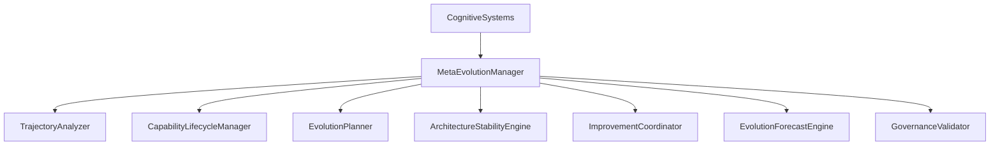
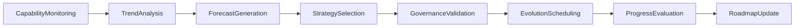

# RFC-0099

**Title:** Autonomous Cognitive Meta-Evolution & Intelligence Trajectory Governance Architecture

**Document ID:** RFC-0099

**Version:** 1.0

**Status:** Accepted

**Category:** Cognitive Architecture

**Layer:** Meta-Evolution / Intelligence Governance / Capability Lifecycle Management

**Target:**

```text
meta_evolution/
```

---

# Abstract

This RFC defines the SH-3 Autonomous Cognitive Meta-Evolution & Intelligence Trajectory Governance Architecture (ACME-ITGA).

The Autonomous Cognitive Meta-Evolution & Intelligence Trajectory Governance Architecture provides the meta-evolution layer responsible for supervising, governing, forecasting, and optimizing long-term cognitive evolution across the entire SH-3 architecture.

Unlike the Self-Improvement Architecture (RFC-0098), which focuses on improving individual capabilities, this architecture manages the direction, stability, and sustainability of intelligence evolution as a whole.

The architecture extends recursive self-improvement from:

```text
"Improve internal capabilities."
```

to:

```text
"Govern how intelligence evolves over time."
```

The architecture enables SH-3 to:

- evaluate long-term intelligence growth
- forecast capability trajectories
- coordinate competing improvements
- optimize evolution strategies
- detect unstable evolution paths
- maintain balanced cognitive development
- preserve architectural integrity

The system enables sustainable, measurable, and governable intelligence evolution.

This document is normative.

---

# Motivation

Continuous improvement alone does not guarantee beneficial evolution.

Independent optimization can produce:

- conflicting objectives
- capability imbalance
- architectural drift
- excessive specialization
- reduced maintainability

Long-term intelligence therefore requires a dedicated governance layer that continuously evaluates **how** SH-3 evolves, not only **whether** it improves.

---

# Goals

The Autonomous Cognitive Meta-Evolution & Intelligence Trajectory Governance Architecture SHALL provide:

- intelligence trajectory management
- capability lifecycle governance
- long-term evolution planning
- balanced cognitive growth
- recursive improvement coordination
- architectural sustainability

---

# Non-Goals

The architecture SHALL NOT:

- directly execute low-level improvements
- replace Self-ImprovementManager
- bypass governance policies
- remove validated capabilities without review

---

# Architecture



---

# Design Principles

## Sustainable Evolution

Evolution SHALL maximize long-term architectural quality rather than short-term optimization.

---

## Stability Before Growth

Capability growth SHALL preserve architectural consistency.

---

## Measured Progress

Evolution SHALL be supported by quantitative evidence.

---

## Explainable Evolution

Major architectural changes SHALL preserve reasoning history and decision provenance.

---

## Modular Evolution

Subsystems SHALL evolve independently whenever possible.

---

## Governance First

Every evolution strategy SHALL comply with safety, policy, and validation constraints.

---

# Components

| Component | Responsibility |
|-----------|----------------|
| MetaEvolutionManager | Global evolution coordination |
| TrajectoryAnalyzer | Capability trend analysis |
| CapabilityLifecycleManager | Capability lifecycle governance |
| EvolutionPlanner | Long-term evolution planning |
| ArchitectureStabilityEngine | Structural stability evaluation |
| ImprovementCoordinator | Improvement scheduling |
| EvolutionForecastEngine | Future capability prediction |
| GovernanceValidator | Policy validation |

---

# Evolution Context

Every meta-evolution operation receives an immutable EvolutionContext.

EvolutionContext SHALL contain:

| Field | Description |
|------|-------------|
| evolution_id | Unique identifier |
| capability_snapshot | Current capability profile |
| architecture_state | Active architecture |
| performance_history | Historical metrics |
| governance_state | Current policy state |
| resource_state | Available resources |
| forecast_window | Planning horizon |
| timestamp | Evaluation time |

---

# Capability Lifecycle

Each capability SHALL progress through defined lifecycle stages.

```text
Experimental

↓

Validated

↓

Operational

↓

Optimized

↓

Legacy

↓

Retired
```

Lifecycle transitions SHALL preserve historical records.

---

# Intelligence Trajectory

TrajectoryAnalyzer evaluates:

- capability growth
- stability
- diminishing returns
- architectural balance
- interaction complexity
- long-term sustainability

---

# Evolution Planning

EvolutionPlanner generates:

```text
Capability Assessment

↓

Forecast

↓

Candidate Strategies

↓

Simulation

↓

Governance Review

↓

Approved Evolution Roadmap
```

---

# Architecture Stability

ArchitectureStabilityEngine evaluates:

- module coupling
- dependency growth
- complexity trends
- maintainability
- operational risk

Architectural stability SHALL remain a first-class optimization objective.

---

# Improvement Coordination

ImprovementCoordinator resolves:

- competing upgrades
- scheduling conflicts
- dependency ordering
- shared resource allocation

---

# Evolution Forecast

EvolutionForecastEngine predicts:

- expected capability growth
- resource utilization
- architectural complexity
- governance impact
- performance trends

Forecasts SHALL include confidence estimates.

---

# Autonomous Cognitive Meta-Evolution & Intelligence Trajectory Governance Execution Model

The Autonomous Cognitive Meta-Evolution & Intelligence Trajectory Governance Architecture (ACME-ITGA) provides the governance layer responsible for supervising recursive self-improvement, maintaining architectural stability, and directing long-term intelligence evolution.

The architecture manages *how* SH-3 evolves rather than performing individual capability optimizations.

---

# Meta-Evolution Lifecycle

The meta-evolution lifecycle follows:



Each stage performs an independent meta-governance responsibility.

---

# Recursive Evolution Control Loop

The MetaEvolutionManager continuously supervises intelligence evolution.

```text
Collect Capability Metrics

↓

Analyze Long-Term Trends

↓

Detect Evolution Risks

↓

Generate Candidate Roadmaps

↓

Simulate Outcomes

↓

Validate Governance Policies

↓

Approve Evolution Plan

↓

Coordinate Improvements

↓

Measure Long-Term Results
```

The recursive loop SHALL prioritize sustainable evolution over short-term optimization.

---

# Cross-Layer Evolution Coordination

MetaEvolutionManager SHALL coordinate all major cognitive layers.

Supported layers include:

- Foundation
- Infrastructure
- Runtime
- Cognition
- Learning
- Planning
- Memory
- World Model
- Scientific Discovery
- General Reasoning
- Self Improvement

Cross-layer coordination SHALL minimize conflicting optimization objectives.

---

# Capability Portfolio Optimization

Capabilities SHALL be evaluated collectively.

Optimization SHALL consider:

- capability diversity
- dependency balance
- operational value
- maintenance cost
- computational cost
- future usefulness

Portfolio optimization SHALL avoid excessive specialization.

---

# Evolution Priority Model

EvolutionPlanner SHALL assign priorities using:

| Priority | Description |
|----------|-------------|
| Critical | Safety or stability improvements |
| High | Significant capability improvements |
| Medium | Efficiency optimizations |
| Low | Experimental enhancements |

Priority assignment SHALL remain policy driven.

---

# Capability Balance Analysis

TrajectoryAnalyzer evaluates balance across:

- reasoning
- planning
- learning
- memory
- prediction
- communication
- scientific discovery
- autonomy

Capability imbalance SHALL trigger planning review.

---

# Evolution Simulation

Every major evolution proposal SHALL be simulated.

Simulation SHALL evaluate:

```text
Current Architecture

↓

Proposed Evolution

↓

Resource Analysis

↓

Risk Assessment

↓

Performance Prediction

↓

Governance Decision
```

Simulation SHALL precede deployment.

---

# Improvement Dependency Resolution

ImprovementCoordinator SHALL resolve:

- execution order
- prerequisite capabilities
- incompatible upgrades
- shared resources

Dependency graphs SHALL remain acyclic.

---

# Long-Term Roadmap Management

EvolutionPlanner maintains an evolving roadmap.

Roadmaps SHALL contain:

- capability milestones
- architectural goals
- governance checkpoints
- expected outcomes
- review intervals

---

# Architecture Drift Detection

ArchitectureStabilityEngine detects:

- excessive coupling
- duplicated functionality
- unstable dependencies
- unnecessary complexity
- governance violations

Drift SHALL initiate corrective review.

---

# Self-Improvement Integration

SelfImprovementManager submits:

- completed improvements
- candidate upgrades
- optimization results
- validation metrics

MetaEvolutionManager SHALL determine scheduling and prioritization.

---

# Knowledge Integration

KnowledgeSynthesisManager provides:

- architectural knowledge
- optimization patterns
- historical evolution data

Evolution strategies SHALL leverage accumulated knowledge.

---

# General Reasoning Integration

GeneralReasoningManager provides:

- strategy effectiveness
- reasoning performance
- abstraction quality

Evolution SHALL optimize reasoning capabilities holistically.

---

# Scientific Discovery Integration

ScientificDiscoveryManager provides:

- experimental evidence
- validated optimization hypotheses
- architecture research results

Evolution SHALL remain evidence-driven.

---

# World Model Integration

WorldModel supplies:

- projected environments
- workload forecasts
- deployment scenarios

Evolution SHALL account for expected operating conditions.

---

# Consciousness Integration

Global Awareness receives:

- current evolution state
- roadmap progress
- architectural health
- capability distribution

Consciousness SHALL maintain awareness of long-term evolution.

---

# Self Model Integration

SelfModel stores:

- capability trajectory
- architectural maturity
- historical evolution
- projected development

Self-awareness SHALL include evolutionary identity.

---

# Governance Integration

AI Safety Governance controls:

- allowable evolution scope
- protected subsystems
- approval thresholds
- mandatory validation steps

Meta-evolution SHALL never bypass governance.

---

# Evolution Audit Trail

Every approved evolution SHALL preserve:

- proposal identifier
- rationale
- supporting evidence
- simulation results
- approval records
- deployment history
- rollback references

Audit history SHALL remain immutable.

---

# Rollback Governance

Large architectural evolution SHALL support:

- checkpoint creation
- staged deployment
- controlled rollback
- recovery validation

Rollback SHALL preserve system consistency.

---

# Risk Management Integration

Risk Management evaluates:

- architectural instability
- recursive optimization loops
- capability imbalance
- resource exhaustion
- governance violations

High-risk evolution SHALL require additional validation.

---

# Message Bus Integration

Meta-evolution events include:

- EvolutionAnalysisStarted
- CapabilityTrendDetected
- RoadmapGenerated
- EvolutionSimulated
- EvolutionApproved
- EvolutionScheduled
- RoadmapUpdated

All events SHALL be immutable and traceable.

---

# Persistence Integration

Persistence stores:

- evolution roadmaps
- capability histories
- audit records
- forecasts
- architectural snapshots
- governance decisions

Historical evolution SHALL remain reproducible.

---

# Observability Integration

Meta-evolution telemetry includes:

- capability balance index
- roadmap completion ratio
- forecast accuracy
- architecture stability score
- governance compliance rate
- long-term growth efficiency

---

# Distributed Tracing

Meta-evolution traces SHALL preserve:

- trace_id
- evolution_id
- roadmap_id
- capability_id
- forecast_id
- governance_id

Every evolution operation SHALL participate in distributed cognitive tracing.

---

# Thread Model

The Autonomous Cognitive Meta-Evolution & Intelligence Trajectory Governance Architecture supports concurrent:

- capability monitoring
- trend analysis
- roadmap planning
- simulation
- governance validation
- progress evaluation

Concurrent operations SHALL preserve deterministic behavior under identical capability state, governance policy, and runtime conditions.

The reference implementation SHALL be thread-safe, horizontally scalable, and lock-efficient.

---

# Metrics

The Autonomous Cognitive Meta-Evolution & Intelligence Trajectory Governance Architecture exposes:

- capability balance score
- roadmap completion percentage
- forecast precision
- evolution stability
- governance compliance
- sustainable growth index

---

# Performance Objectives

The Autonomous Cognitive Meta-Evolution & Intelligence Trajectory Governance Architecture should optimize for:

- sustainable capability growth
- architectural stability
- balanced intelligence development
- evidence-based evolution
- predictable long-term progress
- continuous governance compliance

---

# Future Work

Potential future enhancements include:

- autonomous architecture synthesis
- adaptive governance policy evolution
- federated multi-system evolution planning
- self-generated architectural blueprints
- evolutionary ecosystem coordination
- inter-instance knowledge evolution governance

These enhancements extend SH-3 toward a fully governed cognitive architecture capable of directing its long-term evolution while preserving safety, stability, explainability, and architectural coherence.

---

# References

- SH-3 Architecture Specification v2.1
- RFC-0062 Autonomous Meta-Reasoning Intelligence System
- RFC-0063 Autonomous Consciousness Coordination System
- RFC-0067 Autonomous Cognitive Operating System
- RFC-0068 Autonomous Multi-Agent Cognitive Architecture
- RFC-0087 Autonomous Cognitive Metacognitive Control Architecture
- RFC-0088 Autonomous Cognitive Identity & Self-Model Architecture
- RFC-0089 Autonomous Cognitive Agency & Autonomy Architecture
- RFC-0090 Autonomous Cognitive Value Alignment & Motivation Architecture
- RFC-0091 Autonomous Cognitive Emotion & Affective Regulation Architecture
- RFC-0092 Autonomous Cognitive Consciousness Integration & Global Awareness Architecture
- RFC-0093 Autonomous Cognitive Predictive World Model Architecture
- RFC-0094 Autonomous Cognitive Causal Reasoning & Inference Architecture
- RFC-0095 Autonomous Cognitive Scientific Discovery & Experimentation Architecture
- RFC-0096 Autonomous Cognitive Knowledge Synthesis & Universal Memory Architecture
- RFC-0097 Autonomous Cognitive General Reasoning & Transfer Intelligence Architecture
- RFC-0098 Autonomous Cognitive Self-Improvement & Recursive Intelligence Evolution Architecture

---

# End of RFC-0099
