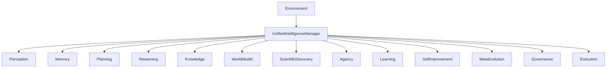

# RFC-0100

**Title:** Autonomous Cognitive Unified Intelligence Architecture

**Document ID:** RFC-0100

**Version:** 1.0

**Status:** Accepted

**Category:** Cognitive Architecture

**Layer:** Unified Intelligence / Global Cognitive Coordination

**Target:**

```text
unified_intelligence/
```

---

# Abstract

This RFC defines the SH-3 Autonomous Cognitive Unified Intelligence Architecture (ACUIA).

The Autonomous Cognitive Unified Intelligence Architecture provides the highest cognitive layer of SH-3. It unifies all intelligence subsystems into a single coordinated cognitive architecture that continuously perceives, reasons, plans, learns, improves, governs itself, and interacts with the external world.

Unlike previous RFCs that define individual cognitive capabilities, this RFC specifies how every cognitive subsystem cooperates as one coherent intelligence.

The architecture extends:

```text
Independent Cognitive Components
```

into

```text
Unified Autonomous Intelligence
```

This document is normative.

---

# Motivation

An AGI cannot simply consist of numerous independent modules.

It requires:

- unified cognition
- global coordination
- shared context
- common goals
- continuous synchronization
- deterministic execution

Without a unified architecture:

- reasoning becomes fragmented
- memory becomes inconsistent
- planning becomes inefficient
- learning becomes isolated
- self-improvement becomes unstable

A unified cognitive layer solves these problems.

---

# Goals

The Autonomous Cognitive Unified Intelligence Architecture SHALL provide:

- unified cognition
- shared global context
- cross-layer coordination
- deterministic execution
- distributed cognition
- scalable intelligence
- unified governance

---

# Non-Goals

This architecture SHALL NOT:

- replace existing cognitive subsystems
- remove modularity
- bypass governance
- reduce explainability

Existing subsystems remain independently replaceable.

---

# Architecture



---

# Unified Cognitive Principles

## Shared Context

All cognitive modules SHALL operate on a shared cognitive context.

---

## Single Cognitive State

Every module SHALL observe the same global cognitive state.

---

## Event Driven

All coordination SHALL occur through immutable events.

---

## Explainable Decisions

Every major decision SHALL preserve reasoning history.

---

## Replaceable Components

Each cognitive subsystem SHALL remain independently replaceable.

---

## Deterministic Coordination

Given identical inputs and policies, unified cognition SHALL produce identical results.

---

# Components

| Component | Responsibility |
|-----------|----------------|
| UnifiedIntelligenceManager | Global coordination |
| CognitiveStateManager | Shared state |
| CognitiveScheduler | Execution ordering |
| ContextFusionEngine | Shared context generation |
| CrossLayerCoordinator | Layer synchronization |
| GlobalDecisionEngine | Unified decision making |
| UnifiedPolicyManager | Global policy enforcement |
| GovernanceValidator | Safety validation |

---

# Unified Cognitive Context

Every cognitive cycle receives an immutable UnifiedContext.

UnifiedContext SHALL contain:

| Field | Description |
|------|-------------|
| context_id | Unique identifier |
| goals | Active objectives |
| environment_state | External world |
| world_model | Internal world representation |
| memory_state | Active memory |
| reasoning_state | Current reasoning |
| planning_state | Current plans |
| learning_state | Learning progress |
| capability_state | Capability profile |
| governance_state | Policy state |
| timestamp | Evaluation time |

---

# Cognitive Execution Cycle

Every execution cycle follows:

```text
Perceive

↓

Understand

↓

Predict

↓

Reason

↓

Plan

↓

Decide

↓

Execute

↓

Observe

↓

Learn

↓

Improve

↓

Synchronize
```

Every cycle SHALL update the shared cognitive state.

---

# Shared Cognitive State

The shared state SHALL include:

- active goals
- beliefs
- hypotheses
- knowledge
- memory
- world model
- capabilities
- emotional state
- confidence
- uncertainty

The state SHALL be versioned.

---

# Cross-Layer Coordination

CrossLayerCoordinator synchronizes:

- Memory
- Learning
- Planning
- Prediction
- Reasoning
- Agency
- Self Improvement
- Governance

Synchronization SHALL preserve consistency.

---

# Context Fusion

ContextFusionEngine combines:

```text
Perception

+

Memory

+

Knowledge

+

Goals

+

Predictions

↓

Unified Context
```

---

# Global Decision Engine

GlobalDecisionEngine evaluates:

- goals
- constraints
- predictions
- risks
- policies
- confidence

Decision selection SHALL remain explainable.

---

# Cognitive Scheduling

CognitiveScheduler SHALL prioritize:

1. Safety
2. Goal preservation
3. Planning
4. Learning
5. Optimization
6. Background evolution

Scheduling SHALL remain deterministic.

---

# Autonomous Cognitive Unified Intelligence Execution Model

The Autonomous Cognitive Unified Intelligence Architecture (ACUIA) provides the top-level orchestration layer responsible for coordinating every cognitive subsystem into a single deterministic intelligence.

Rather than replacing individual cognitive modules, this architecture synchronizes their operation through a unified execution model, shared cognitive context, immutable event propagation, and global governance.

---

# Unified Cognitive Lifecycle

The unified intelligence lifecycle follows:


Each stage SHALL operate independently while contributing to a shared cognitive state.

---

# Unified Cognitive Control Loop

The UnifiedIntelligenceManager continuously coordinates cognition.

```text
Observe Environment

↓

Update Shared Context

↓

Synchronize Memory

↓

Update World Model

↓

Perform Reasoning

↓

Generate Plans

↓

Select Actions

↓

Execute

↓

Collect Feedback

↓

Learn

↓

Improve

↓

Synchronize Entire Architecture
```

The unified control loop SHALL remain deterministic.

---

# Global Workspace Integration

The architecture SHALL implement a Global Workspace.

The Global Workspace SHALL contain:

- active goals
- working memory
- attention focus
- hypotheses
- predictions
- reasoning chains
- execution plans
- uncertainty estimates

All cognitive modules SHALL publish to and consume from the Global Workspace through immutable events.

---

# Multi-Agent Coordination

The unified architecture SHALL coordinate multiple cognitive agents.

Supported coordination models include:

| Model | Description |
|--------|-------------|
| Cooperative | Shared objective execution |
| Competitive | Independent solution generation |
| Specialized | Domain-specific reasoning |
| Hierarchical | Supervisor–worker organization |
| Consensus | Collective decision making |

Agent coordination SHALL preserve deterministic scheduling.

---

# Unified Event Model

Every subsystem SHALL communicate exclusively through immutable events.

Core event categories include:

- PerceptionEvent
- MemoryEvent
- KnowledgeEvent
- ReasoningEvent
- PlanningEvent
- PredictionEvent
- DecisionEvent
- ExecutionEvent
- LearningEvent
- ImprovementEvent
- GovernanceEvent
- SynchronizationEvent

Events SHALL be versioned and traceable.

---

# Cross-Subsystem Scheduling

The CognitiveScheduler SHALL coordinate execution across:

- Perception
- Memory
- Knowledge
- World Model
- Causal Reasoning
- General Reasoning
- Planning
- Agency
- Learning
- Self Improvement
- Meta Evolution
- Governance

Scheduling SHALL preserve dependency ordering while maximizing concurrency.

---

# Shared State Synchronization

CognitiveStateManager SHALL synchronize:

- beliefs
- goals
- capabilities
- knowledge
- memories
- predictions
- active tasks
- confidence
- uncertainty

State synchronization SHALL use immutable snapshots.

---

# Decision Integration

GlobalDecisionEngine SHALL evaluate:

```text
Goals

+

World Model

+

Knowledge

+

Reasoning

+

Risk

+

Governance

↓

Unified Decision
```

Decision generation SHALL preserve complete provenance.

---

# Learning Integration

LearningManager SHALL receive feedback from every subsystem.

Learning SHALL continuously optimize:

- reasoning
- planning
- prediction
- execution
- communication
- self-improvement

Learning SHALL become architecture-wide.

---

# Self-Improvement Integration

SelfImprovementManager SHALL optimize:

- subsystem performance
- execution efficiency
- resource usage
- strategy quality

Improvements SHALL be coordinated globally.

---

# Meta-Evolution Integration

MetaEvolutionManager SHALL supervise:

- long-term capability growth
- architecture evolution
- roadmap execution
- capability balance

Evolution SHALL remain policy-driven.

---

# Governance Integration

GovernanceManager SHALL validate:

- decisions
- plans
- improvements
- evolution
- external actions

Governance SHALL remain globally authoritative.

---

# Risk Management Integration

Risk Management SHALL continuously evaluate:

- execution failures
- unsafe actions
- architectural instability
- capability imbalance
- prediction uncertainty
- governance violations

Risk SHALL influence decision selection.

---

# Observability Integration

Unified telemetry SHALL expose:

- cognitive cycle latency
- subsystem utilization
- reasoning accuracy
- planning efficiency
- learning effectiveness
- improvement rate
- governance compliance
- global health score

Every subsystem SHALL emit standardized metrics.

---

# Distributed Cognitive Tracing

Every cognitive operation SHALL preserve:

- trace_id
- span_id
- parent_span_id
- context_id
- subsystem_id
- decision_id
- execution_id

Tracing SHALL support complete end-to-end cognitive replay.

---

# Persistence Integration

Persistence SHALL maintain:

- cognitive state snapshots
- event history
- decision provenance
- knowledge graphs
- evolution history
- governance audit logs
- execution traces

Historical cognition SHALL remain reproducible.

---

# Thread Model

The Autonomous Cognitive Unified Intelligence Architecture supports concurrent:

- perception
- memory retrieval
- reasoning
- planning
- prediction
- execution
- learning
- self-improvement
- governance validation

Concurrent execution SHALL preserve deterministic behavior under identical inputs, runtime conditions, and governance policies.

The reference implementation SHALL be thread-safe, horizontally scalable, and lock-efficient.

---

# Metrics

The Autonomous Cognitive Unified Intelligence Architecture exposes:

- cognitive throughput
- end-to-end decision latency
- unified context consistency
- reasoning accuracy
- planning success rate
- learning efficiency
- improvement velocity
- governance compliance
- architecture health index

---

# Performance Objectives

The Autonomous Cognitive Unified Intelligence Architecture should optimize for:

- unified cognition
- deterministic execution
- scalable coordination
- explainable intelligence
- resilient operation
- sustainable evolution
- efficient resource utilization

---

# SH-3 Unified Cognitive Stack

The complete SH-3 cognitive architecture SHALL be organized as follows:

```text
Unified Intelligence
        │
        ▼
Meta Evolution
        │
        ▼
Self Improvement
        │
        ▼
General Reasoning
        │
        ▼
Knowledge Synthesis
        │
        ▼
Scientific Discovery
        │
        ▼
Causal Reasoning
        │
        ▼
Predictive World Model
        │
        ▼
Planning
        │
        ▼
Learning
        │
        ▼
Memory
        │
        ▼
Perception
        │
        ▼
Runtime
        │
        ▼
Infrastructure
        │
        ▼
Foundation
```

Every layer SHALL expose well-defined interfaces, immutable state transitions, deterministic execution semantics, and governance-aware coordination.

---

# Future Work

Potential future enhancements include:

- distributed cognitive clusters
- federated multi-instance intelligence
- autonomous cognitive federation
- self-generated architecture synthesis
- cross-instance knowledge transfer
- collective reasoning ecosystems
- adaptive governance policy evolution
- autonomous cognitive operating systems at planetary scale

These enhancements position SH-3 as a unified cognitive architecture capable of integrating perception, reasoning, learning, self-improvement, governance, and long-term evolution into a coherent, explainable, and scalable intelligence platform.

---

# References

- SH-3 Architecture Specification v2.1
- RFC-0062 through RFC-0099
- RFC-0099 Autonomous Cognitive Meta-Evolution & Intelligence Trajectory Governance Architecture

---

# End of RFC-0100
