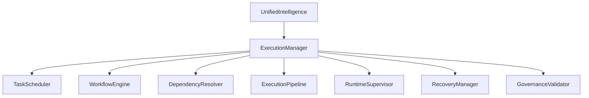

# RFC-0101

**Title:** Autonomous Cognitive Execution Orchestration Architecture

**Document ID:** RFC-0101

**Version:** 1.0

**Status:** Accepted

**Category:** Runtime Architecture

**Layer:** Execution / Orchestration / Runtime Coordination

**Target:**

```text
execution/
```

---

# Abstract

This RFC defines the SH-3 Autonomous Cognitive Execution Orchestration Architecture (ACEOA).

The Autonomous Cognitive Execution Orchestration Architecture is responsible for transforming cognitive decisions into deterministic execution.

While RFC-0100 unified cognition, this architecture unifies execution.

The architecture coordinates:

- task scheduling
- execution pipelines
- runtime orchestration
- resource allocation
- execution monitoring
- recovery
- deterministic concurrency

Every cognitive decision eventually becomes an executable action.

The Execution Architecture guarantees that execution remains:

- deterministic
- observable
- recoverable
- scalable
- governance-aware

This document is normative.

---

# Motivation

Intelligence alone is insufficient.

A production AI Operating System requires:

```text
Decision

↓

Execution

↓

Observation

↓

Feedback

↓

Learning
```

Without execution orchestration:

- plans cannot become actions
- runtime becomes inconsistent
- concurrency becomes unsafe
- recovery becomes difficult

Execution orchestration bridges cognition and runtime.

---

# Goals

The architecture SHALL provide:

- deterministic execution
- workflow orchestration
- execution scheduling
- runtime supervision
- task dependency management
- failure recovery
- execution observability

---

# Non-Goals

The architecture SHALL NOT:

- perform reasoning
- replace planning
- modify governance decisions
- execute unsafe actions

---

# Architecture



---

# Design Principles

## Deterministic Execution

Identical execution requests SHALL produce identical execution order.

---

## Immutable Execution Plans

Execution plans SHALL become immutable once approved.

---

## Event Driven Runtime

Every execution stage SHALL publish immutable events.

---

## Recoverable Execution

Failures SHALL support retry, rollback, or compensation.

---

## Observable Runtime

Every execution SHALL emit telemetry.

---

## Components

| Component | Responsibility |
|-----------|----------------|
| ExecutionManager | Global execution coordination |
| TaskScheduler | Task scheduling |
| WorkflowEngine | Workflow execution |
| DependencyResolver | Dependency ordering |
| ExecutionPipeline | Runtime execution |
| RuntimeSupervisor | Runtime monitoring |
| RecoveryManager | Failure recovery |
| GovernanceValidator | Policy validation |

---

# Execution Context

Every execution SHALL receive an immutable ExecutionContext.

ExecutionContext SHALL contain:

| Field | Description |
|------|-------------|
| execution_id | Unique identifier |
| plan_id | Approved plan |
| task_graph | Execution DAG |
| governance_state | Active policies |
| resource_state | Runtime resources |
| priority | Execution priority |
| deadline | Optional deadline |
| timestamp | Start time |

---

# Execution Pipeline

The execution lifecycle follows:

```text
Receive Plan

↓

Validate

↓

Resolve Dependencies

↓

Allocate Resources

↓

Schedule Tasks

↓

Execute

↓

Observe

↓

Recover (if necessary)

↓

Complete

↓

Emit Metrics
```

---

# Task Scheduling

TaskScheduler SHALL support:

- FIFO
- priority scheduling
- dependency-aware scheduling
- deadline scheduling
- adaptive scheduling

Scheduling SHALL remain deterministic.

---

# Dependency Resolution

DependencyResolver SHALL build a Directed Acyclic Graph (DAG).

Example:

```text
A

├── B

├── C

└── D
```

No cyclic dependencies SHALL be permitted.

---

# Workflow Engine

WorkflowEngine SHALL support:

- sequential workflows
- parallel workflows
- conditional branches
- retries
- compensation
- nested workflows

---

# Runtime Supervision

RuntimeSupervisor SHALL monitor:

- task state
- resource usage
- execution latency
- failures
- retries

---

# Recovery Manager

RecoveryManager SHALL support:

- retry
- rollback
- compensation
- alternate execution
- graceful degradation

---

# Resource Allocation

Execution resources include:

- CPU
- GPU
- Memory
- Storage
- Network
- External tools

Allocation SHALL remain policy driven.

---

# Governance Integration

Execution SHALL never bypass:

- policy engine
- safety validator
- permission manager
- risk evaluator

---

# Event Model

Execution events include:

- ExecutionStarted
- TaskScheduled
- TaskStarted
- TaskCompleted
- TaskFailed
- RecoveryStarted
- RecoveryCompleted
- ExecutionFinished

Events SHALL remain immutable.

---

# Thread Model

Execution SHALL support:

- parallel task execution
- deterministic synchronization
- thread safety
- lock minimization

---

# Metrics

Execution telemetry SHALL expose:

- throughput
- queue depth
- task latency
- success ratio
- retry count
- recovery rate

---

# Performance Objectives

The architecture should optimize for:

- high throughput
- low latency
- deterministic behavior
- rapid recovery
- efficient resource utilization

---

# Future Work

Future enhancements include:

- distributed execution clusters
- edge execution
- cloud-native orchestration
- autonomous runtime optimization
- predictive scheduling

---

# References

- RFC-0100 Unified Intelligence Architecture
- RFC-0099 Meta-Evolution Architecture
- RFC-0098 Self-Improvement Architecture

---

# Autonomous Cognitive Execution Orchestration Execution Model

The Autonomous Cognitive Execution Orchestration Architecture (ACEOA) provides the runtime execution layer responsible for converting approved cognitive decisions into deterministic, observable, recoverable execution.

The architecture coordinates every runtime activity while preserving governance, determinism, and system integrity.

---

# Execution Lifecycle

The execution lifecycle follows:


Every stage SHALL emit immutable runtime events.

---

# Global Execution Control Loop

ExecutionManager continuously supervises runtime execution.

```text
Receive Approved Plan

↓

Validate Governance

↓

Generate Execution Graph

↓

Allocate Resources

↓

Schedule Tasks

↓

Execute Tasks

↓

Monitor Progress

↓

Recover Failures

↓

Collect Results

↓

Publish Feedback
```

Execution SHALL remain deterministic under identical inputs and runtime conditions.

---

# Execution Graph

Every execution plan SHALL be represented as a Directed Acyclic Graph (DAG).

Example:

```text
Goal

├── Task A

│     ├── Task C

│     └── Task D

└── Task B

      └── Task E
```

Properties:

- immutable
- versioned
- traceable
- reproducible

Cycles SHALL NOT exist.

---

# Workflow Execution

WorkflowEngine SHALL support:

## Sequential

```text
A → B → C
```

---

## Parallel

```text
A

├── B

├── C

└── D
```

---

## Conditional

```text
A

↓

Condition

├── True → B

└── False → C
```

---

## Iterative

```text
Task

↓

Evaluation

↓

Continue

↓

Stop
```

---

## Nested

Workflows MAY contain child workflows.

---

# Resource Scheduling

TaskScheduler SHALL optimize:

- CPU utilization
- GPU utilization
- memory pressure
- storage bandwidth
- network bandwidth
- accelerator usage

Scheduling SHALL respect governance constraints.

---

# Resource Reservation

ExecutionManager SHALL reserve:

- compute resources
- execution slots
- external APIs
- tools
- storage
- temporary memory

Reservation SHALL occur before execution.

---

# Parallel Execution

Independent tasks MAY execute concurrently.

Parallel execution SHALL preserve:

- dependency ordering
- deterministic results
- consistent state

---

# Runtime Synchronization

Synchronization points SHALL exist at:

- workflow boundaries
- dependency completion
- governance checkpoints
- recovery boundaries

Synchronization SHALL avoid unnecessary blocking.

---

# Runtime Monitoring

RuntimeSupervisor continuously measures:

- active tasks
- queue depth
- resource usage
- latency
- throughput
- failures
- retries
- stalled tasks

Monitoring SHALL remain continuous.

---

# Failure Classification

Failures SHALL be categorized as:

| Type | Description |
|------|-------------|
| Transient | Retry likely succeeds |
| Persistent | Retry unlikely |
| Resource | Capacity shortage |
| Dependency | Upstream failure |
| Governance | Policy violation |
| External | Third-party failure |

Each category SHALL define an independent recovery strategy.

---

# Recovery Strategies

RecoveryManager SHALL support:

## Retry

```text
Failure

↓

Delay

↓

Retry
```

---

## Rollback

```text
Failure

↓

Restore Previous State
```

---

## Compensation

```text
Failure

↓

Execute Compensating Workflow
```

---

## Alternate Execution

```text
Primary Tool

↓

Unavailable

↓

Secondary Tool
```

---

## Graceful Degradation

Critical workflows MAY continue with reduced capability.

---

# Execution Checkpoints

Execution checkpoints SHALL preserve:

- runtime state
- completed tasks
- allocated resources
- workflow progress
- execution context

Checkpoints SHALL enable deterministic recovery.

---

# Feedback Integration

Execution feedback SHALL be forwarded to:

- Learning
- Memory
- Knowledge Synthesis
- General Reasoning
- Self Improvement
- Meta Evolution

Execution SHALL continuously improve future execution quality.

---

# Governance Integration

Execution SHALL require approval from:

- Policy Engine
- Risk Manager
- Safety Validator
- Permission Manager

Unsafe execution SHALL be rejected before scheduling.

---

# Message Bus Integration

Execution events include:

- ExecutionPlanned
- ResourcesAllocated
- WorkflowStarted
- TaskDispatched
- TaskCompleted
- TaskFailed
- RecoveryTriggered
- ExecutionSucceeded
- ExecutionFailed
- ExecutionObserved

Events SHALL remain immutable and versioned.

---

# Persistence Integration

Persistence SHALL store:

- execution plans
- workflow graphs
- runtime checkpoints
- execution history
- recovery history
- audit logs

Execution SHALL remain reproducible.

---

# Observability Integration

Execution telemetry SHALL expose:

- execution latency
- scheduler efficiency
- resource utilization
- recovery latency
- workflow duration
- task completion ratio
- failure distribution
- execution health index

Telemetry SHALL use standardized metrics.

---

# Distributed Tracing

Every execution SHALL preserve:

- trace_id
- execution_id
- workflow_id
- task_id
- scheduler_id
- recovery_id
- governance_id

Complete execution replay SHALL be supported.

---

# Thread Model

The Autonomous Cognitive Execution Orchestration Architecture supports concurrent:

- workflow scheduling
- task execution
- monitoring
- checkpoint creation
- recovery
- telemetry collection

Concurrent execution SHALL preserve deterministic behavior under identical execution plans, governance policies, and runtime conditions.

The reference implementation SHALL be:

- thread-safe
- horizontally scalable
- lock-efficient
- event-driven

---

# Metrics

The architecture exposes:

- execution throughput
- scheduling latency
- workflow completion rate
- task success ratio
- retry ratio
- recovery success ratio
- execution determinism index
- runtime health score

---

# Performance Objectives

The Autonomous Cognitive Execution Orchestration Architecture should optimize for:

- deterministic execution
- high throughput
- low latency
- efficient scheduling
- rapid recovery
- predictable runtime behavior
- scalable orchestration

---

# Future Work

Potential future enhancements include:

- distributed execution fabrics
- cross-cluster workflow orchestration
- predictive runtime scheduling
- autonomous resource optimization
- self-healing execution pipelines
- globally distributed execution coordination

These enhancements establish SH-3 as a deterministic execution platform capable of transforming cognitive decisions into scalable, observable, resilient runtime operations.

---

# References

- SH-3 Architecture Specification v2.1
- RFC-0100 Autonomous Cognitive Unified Intelligence Architecture
- RFC-0099 Autonomous Cognitive Meta-Evolution & Intelligence Trajectory Governance Architecture
- RFC-0098 Autonomous Cognitive Self-Improvement & Recursive Intelligence Evolution Architecture

---

# End of RFC-0101
